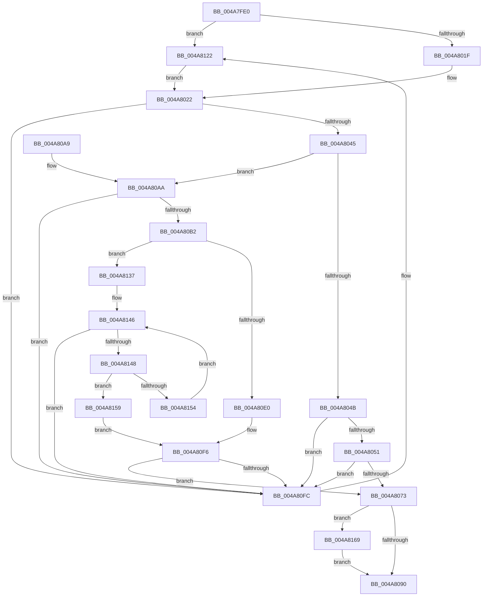

# RtlpHpFixedVsFree

- RVA: `0x004A7FE0`–`0x004A817E` (길이 `414` bytes)
- VA: `0x00000001404A7FE0`
- 실행 섹션: `.text`
- PDB 이름 있음: `예`; PDB Function 태그: `아니요`
- unwind 정보 RVA: `0x000B7434`
- 디코드: `114`개 명령, `414/414` bytes 표시
- 미해석 바이트: `0` (있으면 어셈블리에 `.byte`로 보존)

> 이 문서는 커널 이미지의 기계어와 PDB 기호를 분석해 생성했습니다. 4번과 5번은 함수 원형과 자료형을 바이너리 사용 방식에서 추정한 C 해석이며 원본 소스 복구 결과는 아닙니다.

## 1. Dependencies

- 직접 호출 지점: **4**; 고유 호출 대상: **4**
- 직접 호출자로 확인된 함수: **0**
- RIP 상대 이미지 참조: **0**

### Outgoing calls
- `0x004A807E` → [RtlClearBitsEx](../29/RtlClearBitsEx_function_00297740.md) (function, `0x00297740`)
- `0x004A8116` → [RtlpLogHeapFailure](../35/RtlpLogHeapFailure_function_0035B7BC.md) (function, `0x0035B7BC`)
- `0x004A812A` → [RtlpHpAcquireLockExclusive](../32/RtlpHpAcquireLockExclusive_function_003246B0.md) (function, `0x003246B0`)
- `0x004A8174` → [RtlpHpReleaseLockExclusive](../32/RtlpHpReleaseLockExclusive_function_00324230.md) (function, `0x00324230`)

### Direct callers
- 이 함수 시작 RVA로 연결되는 직접 call은 확인되지 않았습니다. 간접 호출은 완전히 역산할 수 없습니다.

### Static image references
- 디코드된 RIP-relative 메모리 참조가 없습니다.

## 2. Other-region calls and transfers

- 다른 실행 섹션으로 향하는 call: **0**
- 별도 외부 분기/꼬리 이동을 확인하지 못했습니다.

## 3. Assembly (complete function range)

```asm
004A7FE0  48 89 5C 24 08                  mov qword ptr [rsp + 8], rbx
004A7FE5  48 89 6C 24 10                  mov qword ptr [rsp + 0x10], rbp
004A7FEA  48 89 74 24 18                  mov qword ptr [rsp + 0x18], rsi
004A7FEF  57                              push rdi
004A7FF0  41 56                           push r14
004A7FF2  41 57                           push r15
004A7FF4  48 83 EC 40                     sub rsp, 0x40
004A7FF8  48 8B FA                        mov rdi, rdx
004A7FFB  41 8B F0                        mov esi, r8d
004A7FFE  48 2B F9                        sub rdi, rcx
004A8001  48 C1 EE 0C                     shr rsi, 0xc
004A8005  48 C1 EF 0C                     shr rdi, 0xc
004A8009  4C 8B F2                        mov r14, rdx
004A800C  F7 41 14 00 00 00 08            test dword ptr [rcx + 0x14], 0x8000000
004A8013  48 8B D9                        mov rbx, rcx
004A8016  45 8B F8                        mov r15d, r8d
004A8019  0F 84 03 01 00 00               je 0x1404a8122
004A801F  40 B5 FF                        mov bpl, 0xff
004A8022  0F 10 43 30                     movups xmm0, xmmword ptr [rbx + 0x30]
004A8026  48 8B 43 38                     mov rax, qword ptr [rbx + 0x38]
004A802A  48 33 C3                        xor rax, rbx
004A802D  0F 11 44 24 30                  movups xmmword ptr [rsp + 0x30], xmm0
004A8032  48 89 44 24 38                  mov qword ptr [rsp + 0x38], rax
004A8037  48 8B 44 24 30                  mov rax, qword ptr [rsp + 0x30]
004A803C  48 3B F8                        cmp rdi, rax
004A803F  0F 83 B7 00 00 00               jae 0x1404a80fc
004A8045  48 83 FE 01                     cmp rsi, 1
004A8049  77 5F                           ja 0x1404a80aa
004A804B  0F 85 AB 00 00 00               jne 0x1404a80fc
004A8051  48 8B 44 24 38                  mov rax, qword ptr [rsp + 0x38]
004A8056  48 8B D7                        mov rdx, rdi
004A8059  83 E2 3F                        and edx, 0x3f
004A805C  48 8B CF                        mov rcx, rdi
004A805F  48 C1 E9 06                     shr rcx, 6
004A8063  48 0F A3 14 C8                  bt qword ptr [rax + rcx*8], rdx
004A8068  0F 92 C0                        setb al
004A806B  84 C0                           test al, al
004A806D  0F 84 89 00 00 00               je 0x1404a80fc
004A8073  4C 8B C6                        mov r8, rsi
004A8076  48 8D 4C 24 30                  lea rcx, [rsp + 0x30]
004A807B  48 8B D7                        mov rdx, rdi
004A807E  E8 BD F6 DE FF                  call 0x140297740
004A8083  F7 43 14 00 00 00 08            test dword ptr [rbx + 0x14], 0x8000000
004A808A  0F 84 D9 00 00 00               je 0x1404a8169
004A8090  48 8B 5C 24 60                  mov rbx, qword ptr [rsp + 0x60]
004A8095  48 8B 6C 24 68                  mov rbp, qword ptr [rsp + 0x68]
004A809A  48 8B 74 24 70                  mov rsi, qword ptr [rsp + 0x70]
004A809F  48 83 C4 40                     add rsp, 0x40
004A80A3  41 5F                           pop r15
004A80A5  41 5E                           pop r14
004A80A7  5F                              pop rdi
004A80A8  C3                              ret
004A80A9  CC                              int3
004A80AA  48 2B C7                        sub rax, rdi
004A80AD  48 3B C6                        cmp rax, rsi
004A80B0  72 4A                           jb 0x1404a80fc
004A80B2  48 8B 4C 24 38                  mov rcx, qword ptr [rsp + 0x38]
004A80B7  4C 8D 5E FF                     lea r11, [rsi - 1]
004A80BB  4C 03 DF                        add r11, rdi
004A80BE  48 8B C7                        mov rax, rdi
004A80C1  48 C1 E8 06                     shr rax, 6
004A80C5  49 83 C8 FF                     or r8, 0xffffffffffffffff
004A80C9  48 8D 14 C1                     lea rdx, [rcx + rax*8]
004A80CD  49 8B C3                        mov rax, r11
004A80D0  4C 8B 0A                        mov r9, qword ptr [rdx]
004A80D3  48 C1 E8 06                     shr rax, 6
004A80D7  4C 8D 14 C1                     lea r10, [rcx + rax*8]
004A80DB  49 3B D2                        cmp rdx, r10
004A80DE  75 57                           jne 0x1404a8137
004A80E0  41 8D 48 41                     lea ecx, [r8 + 0x41]
004A80E4  40 2A CE                        sub cl, sil
004A80E7  49 D3 E8                        shr r8, cl
004A80EA  48 8B CF                        mov rcx, rdi
004A80ED  49 D3 E0                        shl r8, cl
004A80F0  4D 23 C8                        and r9, r8
004A80F3  4D 3B C8                        cmp r9, r8
004A80F6  0F 84 77 FF FF FF               je 0x1404a8073
004A80FC  48 83 64 24 28 00               and qword ptr [rsp + 0x28], 0
004A8102  4D 8B CF                        mov r9, r15
004A8105  48 83 64 24 20 00               and qword ptr [rsp + 0x20], 0
004A810B  4D 8B C6                        mov r8, r14
004A810E  48 8B D3                        mov rdx, rbx
004A8111  B9 08 00 00 00                  mov ecx, 8
004A8116  E8 A1 36 EB FF                  call 0x14035b7bc
004A811B  B9 32 00 00 00                  mov ecx, 0x32
004A8120  CD 29                           int 0x29
004A8122  0F B6 51 20                     movzx edx, byte ptr [rcx + 0x20]
004A8126  48 83 C1 18                     add rcx, 0x18
004A812A  E8 81 C5 E7 FF                  call 0x1403246b0
004A812F  40 8A E8                        mov bpl, al
004A8132  E9 EB FE FF FF                  jmp 0x1404a8022
004A8137  48 8B CF                        mov rcx, rdi
004A813A  49 8B C0                        mov rax, r8
004A813D  48 D3 E0                        shl rax, cl
004A8140  4C 23 C8                        and r9, rax
004A8143  4C 3B C8                        cmp r9, rax
004A8146  75 B4                           jne 0x1404a80fc
004A8148  48 83 C2 08                     add rdx, 8
004A814C  48 8B 02                        mov rax, qword ptr [rdx]
004A814F  49 3B D2                        cmp rdx, r10
004A8152  74 05                           je 0x1404a8159
004A8154  49 3B C0                        cmp rax, r8
004A8157  EB ED                           jmp 0x1404a8146
004A8159  41 8A CB                        mov cl, r11b
004A815C  F6 D1                           not cl
004A815E  49 D3 E8                        shr r8, cl
004A8161  49 23 C0                        and rax, r8
004A8164  49 3B C0                        cmp rax, r8
004A8167  EB 8D                           jmp 0x1404a80f6
004A8169  0F B6 53 20                     movzx edx, byte ptr [rbx + 0x20]
004A816D  48 8D 4B 18                     lea rcx, [rbx + 0x18]
004A8171  44 8A C5                        mov r8b, bpl
004A8174  E8 B7 C0 E7 FF                  call 0x140324230
004A8179  E9 12 FF FF FF                  jmp 0x1404a8090
```

## 4. C-style interpretation (structured pseudocode)

```c
__int64 __fastcall RtlpHpFixedVsFree(__int64 a1, __int64 a2, int a3)
{
    __int64 result;
    __int64 v_r11;
    __int64 v_rdi;
    __int64 v_rsi;
    __int64 v_rsp;
    unsigned __int64 v_stack_m20;
    unsigned __int64 v_stack_m28;
    unsigned __int64 v_stack_p10;
    unsigned __int64 v_stack_p18;
    unsigned __int64 v_stack_p20;
    unsigned __int64 v_stack_p28;
    unsigned __int64 v_stack_p38;
    unsigned __int64 v_stack_p8;

    v_stack_p8 = v_rbx;
    v_stack_p10 = v_rbp;
    v_stack_p18 = v_rsi;
    v_rsp = (v_rsp) - (64);
    v_rdi = (a2) - (a1);
    v_rsi = ((unsigned int)(a3)) >> (12);
    v_rdi = (v_rdi) >> (12);
    if (((*(unsigned int *)(a1 + 20)) & (0x8000000ULL)) == 0) goto loc_004A8122;
loc_004A8022:
    result = (*(unsigned __int64 *)(a1 + 56)) ^ (a1);
    v_stack_m28 = v_xmm0;
    v_stack_m20 = result;
    if (v_rdi >= v_stack_m28) goto loc_004A80FC;
    if (v_rsi > 1) goto loc_004A80AA;
    if (v_rsi != 1) goto loc_004A80FC;
    a2 = (unsigned int)((v_rdi) & (63));
    a1 = (v_rdi) >> (6);
    result = (condition_is_below) ? 1 : 0;
    if ((unsigned __int8)(result) == 0) goto loc_004A80FC;
loc_004A8073:
    result = RtlClearBitsEx(v_stack_m28, v_rdi, v_rsi, a4);
    if (((*(unsigned int *)(a1 + 20)) & (0x8000000ULL)) == 0) goto loc_004A8169;
loc_004A8090:
    v_rsp = (v_rsp) + (64);
    return result;
loc_004A80AA:
    result = (result) - (v_rdi);
    if (result < v_stack_p18) goto loc_004A80FC;
    v_r11 = (v_stack_p18 - 1) + (v_rdi);
    result = (v_rdi) >> (6);
    a3 = (v_rsi) | (-1);
    result = (v_r11) >> (6);
    if ((v_stack_p38 + result * 8) != (v_stack_p38 + result * 8)) goto loc_004A8137;
    a1 = (unsigned __int8)((a3 + 65) - ((unsigned __int8)(v_stack_p18)));
    a3 = (a3) >> ((unsigned __int8)(a1));
    a3 = (a3) << ((unsigned __int8)(v_rdi));
    a4 = (*(unsigned __int64 *)(v_stack_p38 + result * 8)) & (a3);
loc_004A80F6:
    if (a4 == a3) goto loc_004A8073;
loc_004A80FC:
    result = RtlpLogHeapFailure(8, v_stack_p8, a2, (unsigned int)(a3));
loc_004A8122:
    a1 = (50) + (24);
    result = RtlpHpAcquireLockExclusive(a1, *(unsigned __int8 *)(50 + 32), a2, (unsigned int)(a3));
    goto loc_004A8022;
loc_004A8137:
    result = (a2) << ((unsigned __int8)(v_rdi));
    a4 = ((unsigned int)(a3)) & (result);
loc_004A8146:
    if (a4 != result) goto loc_004A80FC;
    a2 = (*(unsigned __int8 *)(50 + 32)) + (8);
    if (a2 == (v_stack_p38 + result * 8)) goto loc_004A8159;
    goto loc_004A8146;
loc_004A8159:
    a1 = (unsigned __int8)(~((unsigned __int8)(v_r11)));
    a3 = (a2) >> ((unsigned __int8)(a1));
    result = (*(unsigned __int64 *)(a2)) & (a3);
    goto loc_004A80F6;
loc_004A8169:
    result = RtlpHpReleaseLockExclusive(v_stack_p8 + 24, *(unsigned __int8 *)(v_stack_p8 + 32), (unsigned __int8)((unsigned __int8)(result)), a4);
    goto loc_004A8090;
}
```

## 5. (Beta) C Style

```c
int64_t RtlpHpFixedVsFree(void *Arg1, int64_t Arg2, int32_t Arg3)
{
    uint8_t *arg1 = (uint8_t *)Arg1;

    int64_t result;
    int64_t local_r11;
    int64_t local_rdi;
    int64_t local_rsi;
    int64_t local_rsp;
    uint64_t v_stack_m20;
    uint64_t v_stack_m28;
    uint64_t v_stack_p10;
    uint64_t v_stack_p18;
    uint64_t v_stack_p20;
    uint64_t v_stack_p28;
    uint64_t v_stack_p38;
    uint64_t v_stack_p8;

    v_stack_p8 = local_rbx;
    v_stack_p10 = local_rbp;
    v_stack_p18 = local_rsi;
    local_rsp = (local_rsp) - (64);
    local_rdi = (Arg2) - (Arg1);
    local_rsi = ((uint32_t)(Arg3)) >> (12);
    local_rdi = (local_rdi) >> (12);
    if (((*(uint32_t *)(arg1 + 0x14)) & (0x8000000ULL)) == 0) goto loc_004A8122;
loc_004A8022:
    result = (*(uint64_t *)(arg1 + 0x38)) ^ (Arg1);
    v_stack_m28 = v_xmm0;
    v_stack_m20 = result;
    if (local_rdi >= v_stack_m28) goto loc_004A80FC;
    if (local_rsi > 1) goto loc_004A80AA;
    if (local_rsi != 1) goto loc_004A80FC;
    Arg2 = (uint32_t)((local_rdi) & (63));
    Arg1 = (local_rdi) >> (6);
    result = (condition_is_below) ? 1 : 0;
    if ((uint8_t)(result) == 0) goto loc_004A80FC;
loc_004A8073:
    result = RtlClearBitsEx(v_stack_m28, local_rdi, local_rsi, a4);
    if (((*(uint32_t *)(arg1 + 0x14)) & (0x8000000ULL)) == 0) goto loc_004A8169;
loc_004A8090:
    local_rsp = (local_rsp) + (64);
    return result;
loc_004A80AA:
    result = (result) - (local_rdi);
    if (result < v_stack_p18) goto loc_004A80FC;
    local_r11 = (v_stack_p18 - 1) + (local_rdi);
    result = (local_rdi) >> (6);
    Arg3 = (local_rsi) | (-1);
    result = (local_r11) >> (6);
    if ((v_stack_p38 + result * 8) != (v_stack_p38 + result * 8)) goto loc_004A8137;
    Arg1 = (uint8_t)((Arg3 + 65) - ((uint8_t)(v_stack_p18)));
    Arg3 = (Arg3) >> ((uint8_t)(Arg1));
    Arg3 = (Arg3) << ((uint8_t)(local_rdi));
    a4 = (*(uint64_t *)(v_stack_p38 + result * 8)) & (Arg3);
loc_004A80F6:
    if (a4 == Arg3) goto loc_004A8073;
loc_004A80FC:
    result = RtlpLogHeapFailure(8, v_stack_p8, Arg2, (uint32_t)(Arg3));
loc_004A8122:
    Arg1 = (50) + (24);
    result = RtlpHpAcquireLockExclusive(Arg1, *(uint8_t *)(50 + 0x20), Arg2, (uint32_t)(Arg3));
    goto loc_004A8022;
loc_004A8137:
    result = (Arg2) << ((uint8_t)(local_rdi));
    a4 = ((uint32_t)(Arg3)) & (result);
loc_004A8146:
    if (a4 != result) goto loc_004A80FC;
    Arg2 = (*(uint8_t *)(50 + 0x20)) + (8);
    if (Arg2 == (v_stack_p38 + result * 8)) goto loc_004A8159;
    goto loc_004A8146;
loc_004A8159:
    Arg1 = (uint8_t)(~((uint8_t)(local_r11)));
    Arg3 = (Arg2) >> ((uint8_t)(Arg1));
    result = (*(uint64_t *)(Arg2)) & (Arg3);
    goto loc_004A80F6;
loc_004A8169:
    result = RtlpHpReleaseLockExclusive(v_stack_p8 + 24, *(uint8_t *)(v_stack_p8 + 0x20), (uint8_t)((uint8_t)(result)), a4);
    goto loc_004A8090;
}
```

### 관측된 메모리 오프셋

구조체 형식이 확인되지 않은 접근은 인자 기준의 오프셋으로만 기록했습니다.

| 기준 인자 | 오프셋 표현 | 폭 (bit) | 접근 |
|---|---:|---:|---|
| `Arg1` | `+ 0x14` | `32` | `R` |
| `Arg1` | `+ 0x18` | `64` | `R` |
| `Arg1` | `+ 0x20` | `8` | `R` |
| `Arg1` | `+ 0x30` | `128` | `R` |
| `Arg1` | `+ 0x38` | `64` | `R` |

## 6. Execution-region graph

[열기: 2D/3D 그래프와 함수 탐색 컨트롤 패널](../../../control-panel.html?section=text&rva=0x004A7FE0&view=graph)

- 2D 그래프는 위에서 아래로 흐르고, 3D 그래프는 빈 공간을 드래그해 회전합니다. Shift+드래그는 이동, 휠은 확대·축소, 함수 노드 선택은 대상 보고서 이동입니다.

### Static fallback


