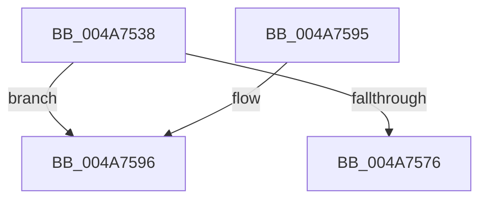

# RtlpHpLfhContextSlotStandbyProcess

- RVA: `0x004A7538`–`0x004A75A1` (길이 `105` bytes)
- VA: `0x00000001404A7538`
- 실행 섹션: `.text`
- PDB 이름 있음: `예`; PDB Function 태그: `예`
- unwind 정보 RVA: `0x000B7200`
- 디코드: `30`개 명령, `105/105` bytes 표시
- 미해석 바이트: `0` (있으면 어셈블리에 `.byte`로 보존)

> 이 문서는 커널 이미지의 기계어와 PDB 기호를 분석해 생성했습니다. 4번과 5번은 함수 원형과 자료형을 바이너리 사용 방식에서 추정한 C 해석이며 원본 소스 복구 결과는 아닙니다.

## 1. Dependencies

- 직접 호출 지점: **0**; 고유 호출 대상: **0**
- 직접 호출자로 확인된 함수: **1**
- RIP 상대 이미지 참조: **0**

### Outgoing calls
- 직접 디코드된 call 명령이 없습니다.

### Direct callers
- [RtlpHpHeapDestroy](../60/RtlpHpHeapDestroy_function_006033AC.md) at `0x0060347D`

### Static image references
- 디코드된 RIP-relative 메모리 참조가 없습니다.

## 2. Other-region calls and transfers

- 다른 실행 섹션으로 향하는 call: **0**
- call이 아닌 외부 분기/꼬리 이동: **1**
  - `0x004A759C` → [sub_006F9A96](../6F/Unknown_function_006F9A96.md) (`tail-transfer`)

## 3. Assembly (complete function range)

```asm
004A7538  4C 8B DC                        mov r11, rsp
004A753B  49 89 5B 08                     mov qword ptr [r11 + 8], rbx
004A753F  49 89 6B 10                     mov qword ptr [r11 + 0x10], rbp
004A7543  49 89 73 18                     mov qword ptr [r11 + 0x18], rsi
004A7547  49 89 7B 20                     mov qword ptr [r11 + 0x20], rdi
004A754B  41 54                           push r12
004A754D  41 56                           push r14
004A754F  41 57                           push r15
004A7551  48 83 EC 30                     sub rsp, 0x30
004A7555  49 8D 43 D8                     lea rax, [r11 - 0x28]
004A7559  33 DB                           xor ebx, ebx
004A755B  44 8B FA                        mov r15d, edx
004A755E  49 89 43 E0                     mov qword ptr [r11 - 0x20], rax
004A7562  49 8D 43 D8                     lea rax, [r11 - 0x28]
004A7566  48 8B F9                        mov rdi, rcx
004A7569  49 89 43 D8                     mov qword ptr [r11 - 0x28], rax
004A756D  48 39 99 A0 00 00 00            cmp qword ptr [rcx + 0xa0], rbx
004A7574  75 20                           jne 0x1404a7596
004A7576  48 8B 5C 24 50                  mov rbx, qword ptr [rsp + 0x50]
004A757B  48 8B 6C 24 58                  mov rbp, qword ptr [rsp + 0x58]
004A7580  48 8B 74 24 60                  mov rsi, qword ptr [rsp + 0x60]
004A7585  48 8B 7C 24 68                  mov rdi, qword ptr [rsp + 0x68]
004A758A  48 83 C4 30                     add rsp, 0x30
004A758E  41 5F                           pop r15
004A7590  41 5E                           pop r14
004A7592  41 5C                           pop r12
004A7594  C3                              ret
004A7595  CC                              int3
004A7596  41 BC 08 00 00 00               mov r12d, 8
004A759C  E9 F5 24 25 00                  jmp 0x1406f9a96
```

## 4. C-style interpretation (structured pseudocode)

```c
__int64 __fastcall RtlpHpLfhContextSlotStandbyProcess(__int64 a1, int a2)
{
    __int64 v_rbx;
    __int64 v_rsp;
    unsigned __int64 v_stack_p10;
    unsigned __int64 v_stack_p18;
    unsigned __int64 v_stack_p20;
    unsigned __int64 v_stack_p8;

    *(unsigned __int64 *)(v_rsp + 8) = v_rbx;
    *(unsigned __int64 *)(v_rsp + 16) = v_rbp;
    *(unsigned __int64 *)(v_rsp + 24) = v_rsi;
    *(unsigned __int64 *)(v_rsp + 32) = v_rdi;
    v_rsp = (v_rsp) - (48);
    v_rbx = 0;
    *(unsigned __int64 *)(v_rsp - 32) = v_rsp - 40;
    *(unsigned __int64 *)(v_rsp - 40) = v_rsp - 40;
    if ((*(unsigned __int64 *)(a1 + 160)) != 0) goto loc_004A7596;
    v_rsp = (v_rsp) + (48);
    return v_rsp - 40;
loc_004A7596:
}
```

## 5. (Beta) C Style

```c
int64_t RtlpHpLfhContextSlotStandbyProcess(void *Arg1, int32_t Arg2)
{
    uint8_t *arg1 = (uint8_t *)Arg1;

    int64_t local_rbx;
    int64_t local_rsp;
    uint64_t v_stack_p10;
    uint64_t v_stack_p18;
    uint64_t v_stack_p20;
    uint64_t v_stack_p8;

    *(uint64_t *)(local_rsp + 0x8) = local_rbx;
    *(uint64_t *)(local_rsp + 0x10) = local_rbp;
    *(uint64_t *)(local_rsp + 0x18) = local_rsi;
    *(uint64_t *)(local_rsp + 0x20) = local_rdi;
    local_rsp = (local_rsp) - (48);
    local_rbx = 0;
    *(uint64_t *)(local_rsp - 0x20) = local_rsp - 40;
    *(uint64_t *)(local_rsp - 0x28) = local_rsp - 40;
    if ((*(uint64_t *)(arg1 + 0xA0)) != 0) goto loc_004A7596;
    local_rsp = (local_rsp) + (48);
    return local_rsp - 40;
loc_004A7596:
}
```

### 관측된 메모리 오프셋

구조체 형식이 확인되지 않은 접근은 인자 기준의 오프셋으로만 기록했습니다.

| 기준 인자 | 오프셋 표현 | 폭 (bit) | 접근 |
|---|---:|---:|---|
| `Arg1` | `+ 0xA0` | `64` | `R` |

## 6. Execution-region graph

[열기: 2D/3D 그래프와 함수 탐색 컨트롤 패널](../../../control-panel.html?section=text&rva=0x004A7538&view=graph)

- 2D 그래프는 위에서 아래로 흐르고, 3D 그래프는 빈 공간을 드래그해 회전합니다. Shift+드래그는 이동, 휠은 확대·축소, 함수 노드 선택은 대상 보고서 이동입니다.

### Static fallback


