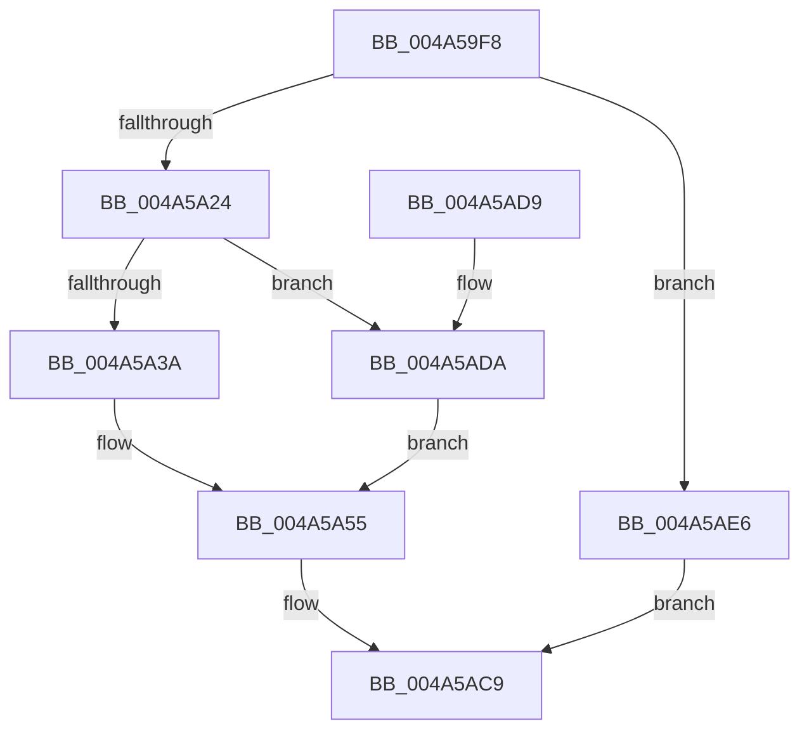

# SMKM_STORE_MGR&lt;SM_TRAITS&gt;::SmCompressCtxCompletePendingEntry

- RVA: `0x004A59F8`–`0x004A5AEA` (길이 `242` bytes)
- VA: `0x00000001404A59F8`
- 실행 섹션: `.text`
- PDB 이름 있음: `예`; PDB Function 태그: `아니요`
- unwind 정보 RVA: `0x000B6A08`
- 디코드: `67`개 명령, `242/242` bytes 표시
- 미해석 바이트: `0` (있으면 어셈블리에 `.byte`로 보존)

> 이 문서는 커널 이미지의 기계어와 PDB 기호를 분석해 생성했습니다. 4번과 5번은 함수 원형과 자료형을 바이너리 사용 방식에서 추정한 C 해석이며 원본 소스 복구 결과는 아닙니다.

## 1. Dependencies

- 직접 호출 지점: **2**; 고유 호출 대상: **2**
- 직접 호출자로 확인된 함수: **3**
- RIP 상대 이미지 참조: **0**

### Outgoing calls
- `0x004A5A79` → [SmStoreCompletePendingCompress](../61/SmStoreCompletePendingCompress_function_006113BC.md) (function, `0x006113BC`)
- `0x004A5A92` → [SMKM_STORE_MGR<SM_TRAITS>::SmCompressCtxCompleteEntry](../26/SMKM_STORE_MGR_SM_TRAITS_SmCompressCtxCompleteEntry_function_002685C0.md) (function, `0x002685C0`)

### Direct callers
- [SMKM_STORE_MGR&lt;SM_TRAITS&gt;::SmCompressCtxWorkerThread](../26/SMKM_STORE_MGR_SM_TRAITS_SmCompressCtxWorkerThread_function_00267D20.md) at `0x00268081`
- [SMKM_STORE_MGR&lt;SM_TRAITS&gt;::SmCompressCtxProcessEntry](../26/SMKM_STORE_MGR_SM_TRAITS_SmCompressCtxProcessEntry_function_002681DC.md) at `0x00268348`
- [sub_006D8FF8](../6D/Unknown_function_006D8FF8.md) at `0x006D900E`

### Static image references
- 디코드된 RIP-relative 메모리 참조가 없습니다.

## 2. Other-region calls and transfers

- 다른 실행 섹션으로 향하는 call: **0**
- 별도 외부 분기/꼬리 이동을 확인하지 못했습니다.

## 3. Assembly (complete function range)

```asm
004A59F8  48 8B C4                        mov rax, rsp
004A59FB  48 89 58 18                     mov qword ptr [rax + 0x18], rbx
004A59FF  48 89 70 20                     mov qword ptr [rax + 0x20], rsi
004A5A03  57                              push rdi
004A5A04  48 83 EC 30                     sub rsp, 0x30
004A5A08  48 8B F1                        mov rsi, rcx
004A5A0B  33 C9                           xor ecx, ecx
004A5A0D  89 48 10                        mov dword ptr [rax + 0x10], ecx
004A5A10  89 48 08                        mov dword ptr [rax + 8], ecx
004A5A13  48 8D 56 28                     lea rdx, [rsi + 0x28]
004A5A17  4C 8B 42 08                     mov r8, qword ptr [rdx + 8]
004A5A1B  4C 3B C2                        cmp r8, rdx
004A5A1E  0F 84 C2 00 00 00               je 0x1404a5ae6
004A5A24  48 8B 3A                        mov rdi, qword ptr [rdx]
004A5A27  48 8B 07                        mov rax, qword ptr [rdi]
004A5A2A  48 83 E0 F8                     and rax, 0xfffffffffffffff8
004A5A2E  48 89 02                        mov qword ptr [rdx], rax
004A5A31  49 3B F8                        cmp rdi, r8
004A5A34  0F 84 A0 00 00 00               je 0x1404a5ada
004A5A3A  49 8B 08                        mov rcx, qword ptr [r8]
004A5A3D  48 8B C1                        mov rax, rcx
004A5A40  83 E1 07                        and ecx, 7
004A5A43  48 C1 E8 03                     shr rax, 3
004A5A47  48 8D 04 C5 F8 FF FF FF         lea rax, [rax*8 - 8]
004A5A4F  48 0B C1                        or rax, rcx
004A5A52  49 89 00                        mov qword ptr [r8], rax
004A5A55  48 8B 5F 18                     mov rbx, qword ptr [rdi + 0x18]
004A5A59  48 8D 44 24 40                  lea rax, [rsp + 0x40]
004A5A5E  4C 8D 4C 24 48                  lea r9, [rsp + 0x48]
004A5A63  48 89 44 24 20                  mov qword ptr [rsp + 0x20], rax
004A5A68  4C 8B C7                        mov r8, rdi
004A5A6B  48 8B 53 68                     mov rdx, qword ptr [rbx + 0x68]
004A5A6F  48 8D 4B 70                     lea rcx, [rbx + 0x70]
004A5A73  8B 92 C0 12 00 00               mov edx, dword ptr [rdx + 0x12c0]
004A5A79  E8 3E B9 16 00                  call 0x1406113bc
004A5A7E  44 8B 4C 24 40                  mov r9d, dword ptr [rsp + 0x40]
004A5A83  48 8B D3                        mov rdx, rbx
004A5A86  44 8B 44 24 48                  mov r8d, dword ptr [rsp + 0x48]
004A5A8B  48 8B CE                        mov rcx, rsi
004A5A8E  89 44 24 20                     mov dword ptr [rsp + 0x20], eax
004A5A92  E8 29 2B DC FF                  call 0x1402685c0
004A5A97  48 8B 46 40                     mov rax, qword ptr [rsi + 0x40]
004A5A9B  48 8B 08                        mov rcx, qword ptr [rax]
004A5A9E  8B 07                           mov eax, dword ptr [rdi]
004A5AA0  48 83 E1 F8                     and rcx, 0xfffffffffffffff8
004A5AA4  83 E0 07                        and eax, 7
004A5AA7  48 83 C1 08                     add rcx, 8
004A5AAB  48 0B C8                        or rcx, rax
004A5AAE  48 89 0F                        mov qword ptr [rdi], rcx
004A5AB1  48 8B 4E 40                     mov rcx, qword ptr [rsi + 0x40]
004A5AB5  8B 01                           mov eax, dword ptr [rcx]
004A5AB7  83 E0 07                        and eax, 7
004A5ABA  48 0B C7                        or rax, rdi
004A5ABD  48 89 01                        mov qword ptr [rcx], rax
004A5AC0  B8 01 00 00 00                  mov eax, 1
004A5AC5  48 89 7E 40                     mov qword ptr [rsi + 0x40], rdi
004A5AC9  48 8B 5C 24 50                  mov rbx, qword ptr [rsp + 0x50]
004A5ACE  48 8B 74 24 58                  mov rsi, qword ptr [rsp + 0x58]
004A5AD3  48 83 C4 30                     add rsp, 0x30
004A5AD7  5F                              pop rdi
004A5AD8  C3                              ret
004A5AD9  CC                              int3
004A5ADA  48 89 52 08                     mov qword ptr [rdx + 8], rdx
004A5ADE  48 89 0A                        mov qword ptr [rdx], rcx
004A5AE1  E9 6F FF FF FF                  jmp 0x1404a5a55
004A5AE6  33 C0                           xor eax, eax
004A5AE8  EB DF                           jmp 0x1404a5ac9
```

## 4. C-style interpretation (structured pseudocode)

```c
__int64 __fastcall SMKM_STORE_MGR_SM_TRAITS___SmCompressCtxCompletePendingEntry(__int64 a1)
{
    __int64 result;
    __int64 v_rsp;
    unsigned __int64 v_stack_m18;
    unsigned __int64 v_stack_p10;
    unsigned __int64 v_stack_p18;
    unsigned __int64 v_stack_p20;
    unsigned __int64 v_stack_p8;

    *(unsigned __int64 *)(v_rsp + 24) = v_rbx;
    *(unsigned __int64 *)(v_rsp + 32) = v_rsi;
    v_rsp = (v_rsp) - (48);
    a1 = 0;
    *(unsigned int *)(v_rsp + 16) = 0;
    *(unsigned int *)(v_rsp + 8) = 0;
    if ((*(unsigned __int64 *)(a1 + 40 + 8)) == (a1 + 40)) goto loc_004A5AE6;
    result = (*(unsigned __int64 *)(*(unsigned __int64 *)(a1 + 40))) & (-8);
    *(unsigned __int64 *)(a1 + 40) = result;
    if ((*(unsigned __int64 *)(a1 + 40)) == (*(unsigned __int64 *)(a1 + 40 + 8))) goto loc_004A5ADA;
    a1 = (unsigned int)((*(unsigned __int64 *)(*(unsigned __int64 *)(a1 + 40 + 8))) & (7));
    result = (*(unsigned __int64 *)(*(unsigned __int64 *)(a1 + 40 + 8))) >> (3);
    result = (result * 8 - 8) | (a1);
    *(unsigned __int64 *)(*(unsigned __int64 *)(a1 + 40 + 8)) = result;
loc_004A5A55:
    v_stack_m18 = v_stack_p8;
    result = SmStoreCompletePendingCompress(*(unsigned __int64 *)(*(unsigned __int64 *)(a1 + 40) + 24) + 112, (unsigned int)(*(unsigned int *)(*(unsigned __int64 *)(*(unsigned __int64 *)(*(unsigned __int64 *)(a1 + 40) + 24) + 104) + 4800)), *(unsigned __int64 *)(a1 + 40), v_stack_p10);
    v_stack_m18 = (unsigned int)(result);
    result = SMKM_STORE_MGR_SM_TRAITS___SmCompressCtxCompleteEntry(a1, *(unsigned __int64 *)(*(unsigned __int64 *)(a1 + 40) + 24), (unsigned int)(v_stack_p10), (unsigned int)(v_stack_p8));
    a1 = (*(unsigned __int64 *)(*(unsigned __int64 *)(a1 + 64))) & (-8);
    result = (unsigned int)(((unsigned int)(*(unsigned int *)(*(unsigned __int64 *)(a1 + 40)))) & (7));
    a1 = (a1) + (8);
    a1 = (a1) | (result);
    *(unsigned __int64 *)(*(unsigned __int64 *)(a1 + 40)) = a1;
    result = (unsigned int)(((unsigned int)(*(unsigned int *)(*(unsigned __int64 *)(a1 + 64)))) & (7));
    result = (result) | (*(unsigned __int64 *)(a1 + 40));
    *(unsigned __int64 *)(*(unsigned __int64 *)(a1 + 64)) = result;
    *(unsigned __int64 *)(a1 + 64) = *(unsigned __int64 *)(a1 + 40);
loc_004A5AC9:
    v_rsp = (v_rsp) + (48);
    return 1;
loc_004A5ADA:
    *(unsigned __int64 *)(*(unsigned __int64 *)(*(unsigned __int64 *)(a1 + 40) + 24) + 8) = *(unsigned __int64 *)(*(unsigned __int64 *)(a1 + 40) + 24);
    *(unsigned __int64 *)(*(unsigned __int64 *)(*(unsigned __int64 *)(a1 + 40) + 24)) = *(unsigned __int64 *)(a1 + 64);
    goto loc_004A5A55;
loc_004A5AE6:
    result = 0;
    goto loc_004A5AC9;
}
```

## 5. (Beta) C Style

```c
int64_t SMKM_STORE_MGR_SM_TRAITS___SmCompressCtxCompletePendingEntry(void *Arg1)
{
    uint8_t *arg1 = (uint8_t *)Arg1;

    int64_t result;
    int64_t local_rsp;
    uint64_t v_stack_m18;
    uint64_t v_stack_p10;
    uint64_t v_stack_p18;
    uint64_t v_stack_p20;
    uint64_t v_stack_p8;

    *(uint64_t *)(local_rsp + 0x18) = local_rbx;
    *(uint64_t *)(local_rsp + 0x20) = local_rsi;
    local_rsp = (local_rsp) - (48);
    Arg1 = 0;
    *(uint32_t *)(local_rsp + 0x10) = 0;
    *(uint32_t *)(local_rsp + 0x8) = 0;
    if ((*(uint64_t *)(arg1 + 0x28 + 0x8)) == (Arg1 + 40)) goto loc_004A5AE6;
    result = (*(uint64_t *)(*(uint64_t *)(arg1 + 0x28))) & (-8);
    *(uint64_t *)(arg1 + 0x28) = result;
    if ((*(uint64_t *)(arg1 + 0x28)) == (*(uint64_t *)(arg1 + 0x28 + 0x8))) goto loc_004A5ADA;
    Arg1 = (uint32_t)((*(uint64_t *)(*(uint64_t *)(arg1 + 0x28 + 0x8))) & (7));
    result = (*(uint64_t *)(*(uint64_t *)(arg1 + 0x28 + 0x8))) >> (3);
    result = (result * 8 - 8) | (Arg1);
    *(uint64_t *)(*(uint64_t *)(arg1 + 0x28 + 0x8)) = result;
loc_004A5A55:
    v_stack_m18 = v_stack_p8;
    result = SmStoreCompletePendingCompress(*(uint64_t *)(*(uint64_t *)(arg1 + 0x28) + 0x18) + 112, (uint32_t)(*(uint32_t *)(*(uint64_t *)(*(uint64_t *)(*(uint64_t *)(arg1 + 0x28) + 0x18) + 0x68) + 0x12C0)), *(uint64_t *)(arg1 + 0x28), v_stack_p10);
    v_stack_m18 = (uint32_t)(result);
    result = SMKM_STORE_MGR_SM_TRAITS___SmCompressCtxCompleteEntry(Arg1, *(uint64_t *)(*(uint64_t *)(arg1 + 0x28) + 0x18), (uint32_t)(v_stack_p10), (uint32_t)(v_stack_p8));
    Arg1 = (*(uint64_t *)(*(uint64_t *)(arg1 + 0x40))) & (-8);
    result = (uint32_t)(((uint32_t)(*(uint32_t *)(*(uint64_t *)(arg1 + 0x28)))) & (7));
    Arg1 = (Arg1) + (8);
    Arg1 = (Arg1) | (result);
    *(void **)(*(uint64_t *)(arg1 + 0x28)) = Arg1;
    result = (uint32_t)(((uint32_t)(*(uint32_t *)(*(uint64_t *)(arg1 + 0x40)))) & (7));
    result = (result) | (*(uint64_t *)(arg1 + 0x28));
    *(uint64_t *)(*(uint64_t *)(arg1 + 0x40)) = result;
    *(uint64_t *)(arg1 + 0x40) = *(uint64_t *)(arg1 + 0x28);
loc_004A5AC9:
    local_rsp = (local_rsp) + (48);
    return 1;
loc_004A5ADA:
    *(uint64_t *)(*(uint64_t *)(*(uint64_t *)(arg1 + 0x28) + 0x18) + 0x8) = *(uint64_t *)(*(uint64_t *)(arg1 + 0x28) + 0x18);
    *(uint64_t *)(*(uint64_t *)(*(uint64_t *)(arg1 + 0x28) + 0x18)) = *(uint64_t *)(arg1 + 0x40);
    goto loc_004A5A55;
loc_004A5AE6:
    result = 0;
    goto loc_004A5AC9;
}
```

### 관측된 메모리 오프셋

구조체 형식이 확인되지 않은 접근은 인자 기준의 오프셋으로만 기록했습니다.

| 기준 인자 | 오프셋 표현 | 폭 (bit) | 접근 |
|---|---:|---:|---|
| `Arg1` | `+ 0x0` | `64` | `R` |
| `Arg1` | `+ 0x0` | `64` | `W` |
| `Arg1` | `+ 0x8` | `64` | `R` |
| `Arg1` | `+ 0x8` | `64` | `W` |
| `Arg1` | `+ 0x28` | `64` | `R` |
| `Arg1` | `+ 0x40` | `64` | `R` |
| `Arg1` | `+ 0x40` | `64` | `W` |

## 6. Execution-region graph

[열기: 2D/3D 그래프와 함수 탐색 컨트롤 패널](../../../control-panel.html?section=text&rva=0x004A59F8&view=graph)

- 2D 그래프는 위에서 아래로 흐르고, 3D 그래프는 빈 공간을 드래그해 회전합니다. Shift+드래그는 이동, 휠은 확대·축소, 함수 노드 선택은 대상 보고서 이동입니다.

### Static fallback


