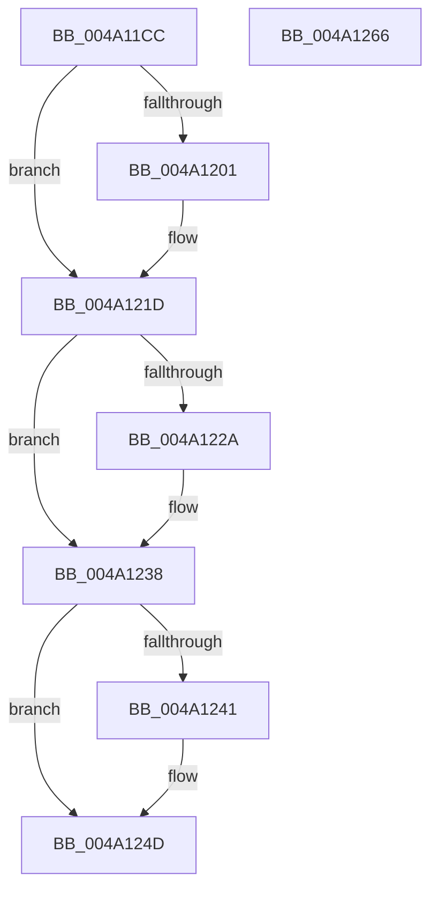

# SMKM_STORE_MGR&lt;SM_TRAITS&gt;::SmCompressCtxQueueEntries

- RVA: `0x004A11CC`–`0x004A1267` (길이 `155` bytes)
- VA: `0x00000001404A11CC`
- 실행 섹션: `.text`
- PDB 이름 있음: `예`; PDB Function 태그: `아니요`
- unwind 정보 RVA: `0x0005C954`
- 디코드: `44`개 명령, `155/155` bytes 표시
- 미해석 바이트: `0` (있으면 어셈블리에 `.byte`로 보존)

> 이 문서는 커널 이미지의 기계어와 PDB 기호를 분석해 생성했습니다. 4번과 5번은 함수 원형과 자료형을 바이너리 사용 방식에서 추정한 C 해석이며 원본 소스 복구 결과는 아닙니다.

## 1. Dependencies

- 직접 호출 지점: **4**; 고유 호출 대상: **4**
- 직접 호출자로 확인된 함수: **2**
- RIP 상대 이미지 참조: **1**

### Outgoing calls
- `0x004A11E6` → [ExAcquireSpinLockExclusive](../24/ExAcquireSpinLockExclusive_function_00248690.md) (function, `0x00248690`)
- `0x004A1220` → [ExReleaseSpinLockExclusiveFromDpcLevel](../24/ExReleaseSpinLockExclusiveFromDpcLevel_function_002497E0.md) (function, `0x002497E0`)
- `0x004A1233` → [KeSetEvent](../33/KeSetEvent_function_0033F310.md) (function, `0x0033F310`)
- `0x004A1248` → [KiLowerIrqlProcessIrqlFlags](../4F/KiLowerIrqlProcessIrqlFlags_function_004F5698.md) (function, `0x004F5698`)

### Direct callers
- [SmPageWrite](../34/SmPageWrite_function_0034B864.md) at `0x0034B9B0`
- [SMKM_STORE_MGR&lt;SM_TRAITS&gt;::SmPageWrite](../34/SMKM_STORE_MGR_SM_TRAITS_SmPageWrite_function_0034BA54.md) at `0x0034BCF9`

### Static image references
- `0x004A1238` → RVA `0x00FC6D20` (`ALMOSTRO`; read)

## 2. Other-region calls and transfers

- 다른 실행 섹션으로 향하는 call: **0**
- 별도 외부 분기/꼬리 이동을 확인하지 못했습니다.

## 3. Assembly (complete function range)

```asm
004A11CC  48 89 5C 24 08                  mov qword ptr [rsp + 8], rbx
004A11D1  48 89 6C 24 10                  mov qword ptr [rsp + 0x10], rbp
004A11D6  48 89 74 24 18                  mov qword ptr [rsp + 0x18], rsi
004A11DB  57                              push rdi
004A11DC  48 83 EC 20                     sub rsp, 0x20
004A11E0  48 8B DA                        mov rbx, rdx
004A11E3  48 8B F9                        mov rdi, rcx
004A11E6  E8 A5 74 DA FF                  call 0x140248690
004A11EB  48 8B 53 08                     mov rdx, qword ptr [rbx + 8]
004A11EF  4C 8B 47 18                     mov r8, qword ptr [rdi + 0x18]
004A11F3  0F B6 F0                        movzx esi, al
004A11F6  48 8B 0A                        mov rcx, qword ptr [rdx]
004A11F9  49 8B 28                        mov rbp, qword ptr [r8]
004A11FC  48 85 C9                        test rcx, rcx
004A11FF  74 1C                           je 0x1404a121d
004A1201  48 8B 03                        mov rax, qword ptr [rbx]
004A1204  48 03 CD                        add rcx, rbp
004A1207  49 89 00                        mov qword ptr [r8], rax
004A120A  48 8B 43 08                     mov rax, qword ptr [rbx + 8]
004A120E  48 89 47 18                     mov qword ptr [rdi + 0x18], rax
004A1212  48 89 08                        mov qword ptr [rax], rcx
004A1215  48 89 5B 08                     mov qword ptr [rbx + 8], rbx
004A1219  48 83 23 00                     and qword ptr [rbx], 0
004A121D  48 8B CF                        mov rcx, rdi
004A1220  E8 BB 85 DA FF                  call 0x1402497e0
004A1225  48 85 ED                        test rbp, rbp
004A1228  75 0E                           jne 0x1404a1238
004A122A  48 8D 4F 20                     lea rcx, [rdi + 0x20]
004A122E  45 33 C0                        xor r8d, r8d
004A1231  33 D2                           xor edx, edx
004A1233  E8 D8 E0 E9 FF                  call 0x14033f310
004A1238  83 3D E1 5A B2 00 00            cmp dword ptr [rip + 0xb25ae1], 0
004A123F  74 0C                           je 0x1404a124d
004A1241  44 0F 20 C1                     mov rcx, cr8
004A1245  40 8A D6                        mov dl, sil
004A1248  E8 4B 44 05 00                  call 0x1404f5698
004A124D  44 0F 22 C6                     mov cr8, rsi
004A1251  48 8B 5C 24 30                  mov rbx, qword ptr [rsp + 0x30]
004A1256  48 8B 6C 24 38                  mov rbp, qword ptr [rsp + 0x38]
004A125B  48 8B 74 24 40                  mov rsi, qword ptr [rsp + 0x40]
004A1260  48 83 C4 20                     add rsp, 0x20
004A1264  5F                              pop rdi
004A1265  C3                              ret
004A1266  CC                              int3
```

## 4. C-style interpretation (structured pseudocode)

```c
__int64 __fastcall SMKM_STORE_MGR_SM_TRAITS___SmCompressCtxQueueEntries(__int64 a1, __int64 a2)
{
    __int64 result;
    __int64 v_rsp;
    unsigned __int64 v_stack_p10;
    unsigned __int64 v_stack_p18;
    unsigned __int64 v_stack_p8;

    v_stack_p8 = v_rbx;
    v_stack_p10 = v_rbp;
    v_stack_p18 = v_rsi;
    v_rsp = (v_rsp) - (32);
    result = ExAcquireSpinLockExclusive(a1, a2, a3, a4);
    if (*(unsigned __int64 *)(*(unsigned __int64 *)(a2 + 8)) != 0) {
        result = *(unsigned __int64 *)(a2);
        a1 = (*(unsigned __int64 *)(*(unsigned __int64 *)(a2 + 8))) + (*(unsigned __int64 *)(*(unsigned __int64 *)(a1 + 24)));
        *(unsigned __int64 *)(*(unsigned __int64 *)(a1 + 24)) = result;
        result = *(unsigned __int64 *)(a2 + 8);
        *(unsigned __int64 *)(a1 + 24) = result;
        *(unsigned __int64 *)(result) = a1;
        *(unsigned __int64 *)(a2 + 8) = a2;
    }
    result = ExReleaseSpinLockExclusiveFromDpcLevel(a1, *(unsigned __int64 *)(a2 + 8), *(unsigned __int64 *)(a1 + 24), a4);
    if (*(unsigned __int64 *)(*(unsigned __int64 *)(a1 + 24)) == 0) {
        a1 = a1 + 32;
        a3 = 0;
        a2 = 0;
        result = KeSetEvent(a1, a2, a3, a4);
    }
    if ((*(unsigned int *)(v_rip + 11688673)) != 0) {
        a1 = v_cr8;
        a2 = (unsigned __int8)((unsigned __int8)(result));
        result = KiLowerIrqlProcessIrqlFlags(a1, a2, a3, a4);
    }
    v_rsp = (v_rsp) + (32);
    return result;
}
```

## 5. (Beta) C Style

```c
int64_t SMKM_STORE_MGR_SM_TRAITS___SmCompressCtxQueueEntries(void *Arg1, void *Arg2)
{
    uint8_t *arg1 = (uint8_t *)Arg1;
    uint8_t *arg2 = (uint8_t *)Arg2;

    int64_t result;
    int64_t local_rsp;
    uint64_t v_stack_p10;
    uint64_t v_stack_p18;
    uint64_t v_stack_p8;

    v_stack_p8 = local_rbx;
    v_stack_p10 = local_rbp;
    v_stack_p18 = local_rsi;
    local_rsp = (local_rsp) - (32);
    result = ExAcquireSpinLockExclusive(Arg1, Arg2, a3, a4);
    if (*(uint64_t *)(*(uint64_t *)(arg2 + 0x8)) != 0) {
        result = *(uint64_t *)(arg2);
        Arg1 = (*(uint64_t *)(*(uint64_t *)(arg2 + 0x8))) + (*(uint64_t *)(*(uint64_t *)(arg1 + 0x18)));
        *(uint64_t *)(*(uint64_t *)(arg1 + 0x18)) = result;
        result = *(uint64_t *)(arg2 + 0x8);
        *(uint64_t *)(arg1 + 0x18) = result;
        *(void **)(result) = Arg1;
        *(void **)(arg2 + 0x8) = Arg2;
    }
    result = ExReleaseSpinLockExclusiveFromDpcLevel(Arg1, *(uint64_t *)(arg2 + 0x8), *(uint64_t *)(arg1 + 0x18), a4);
    if (*(uint64_t *)(*(uint64_t *)(arg1 + 0x18)) == 0) {
        Arg1 = Arg1 + 32;
        a3 = 0;
        Arg2 = 0;
        result = KeSetEvent(Arg1, Arg2, a3, a4);
    }
    if ((*(uint32_t *)(v_rip + 0xB25AE1)) != 0) {
        Arg1 = v_cr8;
        Arg2 = (uint8_t)((uint8_t)(result));
        result = KiLowerIrqlProcessIrqlFlags(Arg1, Arg2, a3, a4);
    }
    local_rsp = (local_rsp) + (32);
    return result;
}
```

### 관측된 메모리 오프셋

구조체 형식이 확인되지 않은 접근은 인자 기준의 오프셋으로만 기록했습니다.

| 기준 인자 | 오프셋 표현 | 폭 (bit) | 접근 |
|---|---:|---:|---|
| `Arg1` | `+ 0x18` | `64` | `R` |
| `Arg1` | `+ 0x18` | `64` | `W` |
| `Arg1` | `+ 0x20` | `64` | `R` |
| `Arg2` | `+ 0x0` | `64` | `R` |
| `Arg2` | `+ 0x0` | `64` | `R/W` |
| `Arg2` | `+ 0x8` | `64` | `R` |
| `Arg2` | `+ 0x8` | `64` | `W` |

## 6. Execution-region graph

[열기: 2D/3D 그래프와 함수 탐색 컨트롤 패널](../../../control-panel.html?section=text&rva=0x004A11CC&view=graph)

- 2D 그래프는 위에서 아래로 흐르고, 3D 그래프는 빈 공간을 드래그해 회전합니다. Shift+드래그는 이동, 휠은 확대·축소, 함수 노드 선택은 대상 보고서 이동입니다.

### Static fallback


