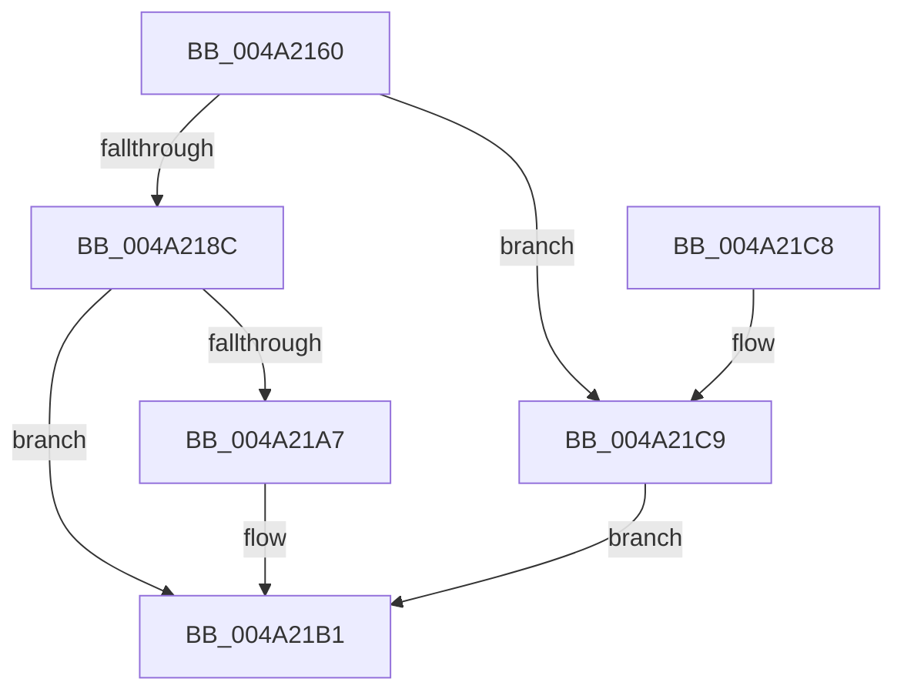

# SMKM_STORE_MGR&lt;SM_TRAITS&gt;::SmStoreRequest

- RVA: `0x004A2160`–`0x004A21D0` (길이 `112` bytes)
- VA: `0x00000001404A2160`
- 실행 섹션: `.text`
- PDB 이름 있음: `예`; PDB Function 태그: `아니요`
- unwind 정보 RVA: `0x00085980`
- 디코드: `34`개 명령, `112/112` bytes 표시
- 미해석 바이트: `0` (있으면 어셈블리에 `.byte`로 보존)

> 이 문서는 커널 이미지의 기계어와 PDB 기호를 분석해 생성했습니다. 4번과 5번은 함수 원형과 자료형을 바이너리 사용 방식에서 추정한 C 해석이며 원본 소스 복구 결과는 아닙니다.

## 1. Dependencies

- 직접 호출 지점: **3**; 고유 호출 대상: **3**
- 직접 호출자로 확인된 함수: **2**
- RIP 상대 이미지 참조: **0**

### Outgoing calls
- `0x004A217F` → [SmKmStoreReference](../34/SmKmStoreReference_function_0034BFB0.md) (function, `0x0034BFB0`)
- `0x004A219C` → [SMKM_STORE_MGR<SM_TRAITS>::SmStoreRequestEx](SMKM_STORE_MGR_SM_TRAITS_SmStoreRequestEx_function_004A21D8.md) (function, `0x004A21D8`)
- `0x004A21AC` → [SmKmStoreDereference](../20/SmKmStoreDereference_function_00206574.md) (function, `0x00206574`)

### Direct callers
- [SmProcessResizeRequest](../../page/7A/SmProcessResizeRequest_function_007A6D50.md) at `0x007A6E27`
- [SmProcessStatsRequest](../../page/7A/SmProcessStatsRequest_function_007A6E68.md) at `0x007A70E9`

### Static image references
- 디코드된 RIP-relative 메모리 참조가 없습니다.

## 2. Other-region calls and transfers

- 다른 실행 섹션으로 향하는 call: **0**
- 별도 외부 분기/꼬리 이동을 확인하지 못했습니다.

## 3. Assembly (complete function range)

```asm
004A2160  48 89 5C 24 08                  mov qword ptr [rsp + 8], rbx
004A2165  48 89 6C 24 10                  mov qword ptr [rsp + 0x10], rbp
004A216A  48 89 74 24 18                  mov qword ptr [rsp + 0x18], rsi
004A216F  57                              push rdi
004A2170  48 83 EC 30                     sub rsp, 0x30
004A2174  49 8B D9                        mov rbx, r9
004A2177  49 8B E8                        mov rbp, r8
004A217A  8B FA                           mov edi, edx
004A217C  48 8B F1                        mov rsi, rcx
004A217F  E8 2C 9E EA FF                  call 0x14034bfb0
004A2184  48 8B D0                        mov rdx, rax
004A2187  48 85 C0                        test rax, rax
004A218A  74 3D                           je 0x1404a21c9
004A218C  48 8B 44 24 60                  mov rax, qword ptr [rsp + 0x60]
004A2191  4C 8B CB                        mov r9, rbx
004A2194  4C 8B C5                        mov r8, rbp
004A2197  48 89 44 24 20                  mov qword ptr [rsp + 0x20], rax
004A219C  E8 37 00 00 00                  call 0x1404a21d8
004A21A1  8B D8                           mov ebx, eax
004A21A3  85 C0                           test eax, eax
004A21A5  79 0A                           jns 0x1404a21b1
004A21A7  8B D7                           mov edx, edi
004A21A9  48 8B CE                        mov rcx, rsi
004A21AC  E8 C3 43 D6 FF                  call 0x140206574
004A21B1  48 8B 6C 24 48                  mov rbp, qword ptr [rsp + 0x48]
004A21B6  8B C3                           mov eax, ebx
004A21B8  48 8B 5C 24 40                  mov rbx, qword ptr [rsp + 0x40]
004A21BD  48 8B 74 24 50                  mov rsi, qword ptr [rsp + 0x50]
004A21C2  48 83 C4 30                     add rsp, 0x30
004A21C6  5F                              pop rdi
004A21C7  C3                              ret
004A21C8  CC                              int3
004A21C9  BB 0D 00 00 C0                  mov ebx, 0xc000000d
004A21CE  EB E1                           jmp 0x1404a21b1
```

## 4. C-style interpretation (structured pseudocode)

```c
__int64 __fastcall SMKM_STORE_MGR_SM_TRAITS___SmStoreRequest(__int64 a1, int a2, __int64 a3, __int64 a4, __int64 a5)
{
    __int64 result;
    __int64 v_rsp;
    unsigned __int64 v_stack_m18;
    unsigned __int64 v_stack_p10;
    unsigned __int64 v_stack_p18;
    unsigned __int64 v_stack_p8;

    v_stack_p8 = v_rbx;
    v_stack_p10 = v_rbp;
    v_stack_p18 = v_rsi;
    v_rsp = (v_rsp) - (48);
    result = SmKmStoreReference(a1, a2, a3, a4);
    if (result == 0) goto loc_004A21C9;
    v_stack_m18 = a5;
    result = SMKM_STORE_MGR_SM_TRAITS___SmStoreRequestEx(a1, result, a3, a4);
    if (sign_flag) {
        a2 = (unsigned int)((unsigned int)(a2));
        a1 = a1;
        result = SmKmStoreDereference(a1, a2, a3, a4);
    }
    v_rsp = (v_rsp) + (48);
    return (unsigned int)((unsigned int)((unsigned int)((unsigned int)(result))));
loc_004A21C9:
    goto loc_004A21B1;
}
```

## 5. (Beta) C Style

```c
int64_t SMKM_STORE_MGR_SM_TRAITS___SmStoreRequest(int64_t Arg1, int32_t Arg2, int64_t Arg3, int64_t Arg4, int64_t Arg5)
{
    int64_t result;
    int64_t local_rsp;
    uint64_t v_stack_m18;
    uint64_t v_stack_p10;
    uint64_t v_stack_p18;
    uint64_t v_stack_p8;

    v_stack_p8 = local_rbx;
    v_stack_p10 = local_rbp;
    v_stack_p18 = local_rsi;
    local_rsp = (local_rsp) - (48);
    result = SmKmStoreReference(Arg1, Arg2, Arg3, Arg4);
    if (result == 0) goto loc_004A21C9;
    v_stack_m18 = Arg5;
    result = SMKM_STORE_MGR_SM_TRAITS___SmStoreRequestEx(Arg1, result, Arg3, Arg4);
    if (sign_flag) {
        Arg2 = (uint32_t)((uint32_t)(Arg2));
        Arg1 = Arg1;
        result = SmKmStoreDereference(Arg1, Arg2, Arg3, Arg4);
    }
    local_rsp = (local_rsp) + (48);
    return (uint32_t)((uint32_t)((uint32_t)((uint32_t)(result))));
loc_004A21C9:
    goto loc_004A21B1;
}
```

## 6. Execution-region graph

[열기: 2D/3D 그래프와 함수 탐색 컨트롤 패널](../../../control-panel.html?section=text&rva=0x004A2160&view=graph)

- 2D 그래프는 위에서 아래로 흐르고, 3D 그래프는 빈 공간을 드래그해 회전합니다. Shift+드래그는 이동, 휠은 확대·축소, 함수 노드 선택은 대상 보고서 이동입니다.

### Static fallback


