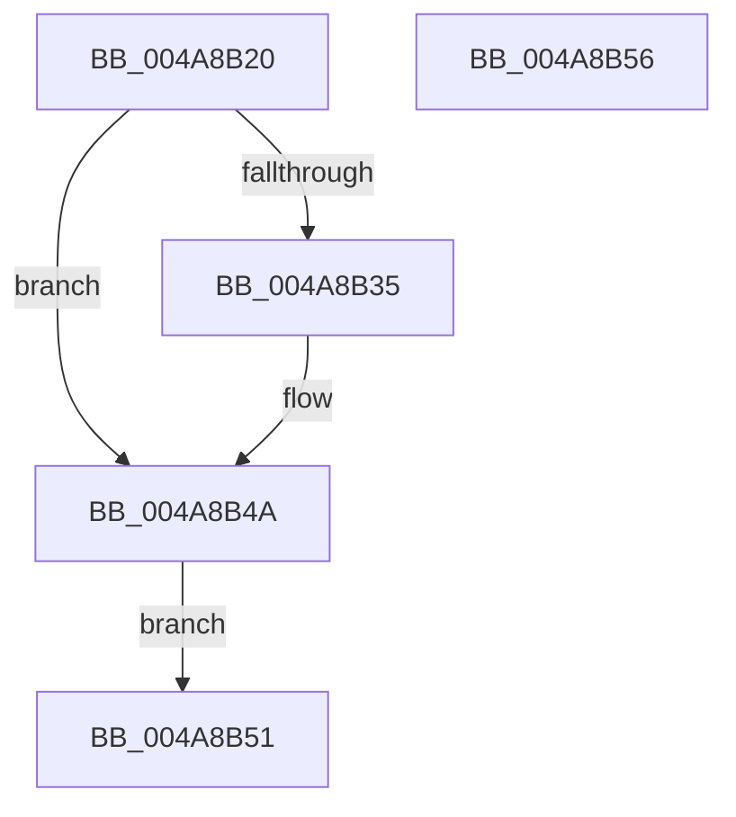

# SMKM_STORE&lt;SM_TRAITS&gt;::SmStWorkerThread

- RVA: `0x004A8B20`–`0x004A8B57` (길이 `55` bytes)
- VA: `0x00000001404A8B20`
- 실행 섹션: `.text`
- PDB 이름 있음: `예`; PDB Function 태그: `아니요`
- unwind 정보 RVA: `0x000B78A0`
- 디코드: `13`개 명령, `55/55` bytes 표시
- 미해석 바이트: `0` (있으면 어셈블리에 `.byte`로 보존)

> 이 문서는 커널 이미지의 기계어와 PDB 기호를 분석해 생성했습니다. 4번과 5번은 함수 원형과 자료형을 바이너리 사용 방식에서 추정한 C 해석이며 원본 소스 복구 결과는 아닙니다.

## 1. Dependencies

- 직접 호출 지점: **1**; 고유 호출 대상: **1**
- 직접 호출자로 확인된 함수: **0**
- RIP 상대 이미지 참조: **0**

### Outgoing calls
- `0x004A8B4A` → [SMKM_STORE<SM_TRAITS>::SmStWorker](../20/SMKM_STORE_SM_TRAITS_SmStWorker_function_002066B0.md) (function, `0x002066B0`)

### Direct callers
- 이 함수 시작 RVA로 연결되는 직접 call은 확인되지 않았습니다. 간접 호출은 완전히 역산할 수 없습니다.

### Static image references
- 디코드된 RIP-relative 메모리 참조가 없습니다.

## 2. Other-region calls and transfers

- 다른 실행 섹션으로 향하는 call: **0**
- 별도 외부 분기/꼬리 이동을 확인하지 못했습니다.

## 3. Assembly (complete function range)

```asm
004A8B20  48 83 EC 28                     sub rsp, 0x28
004A8B24  48 8B 11                        mov rdx, qword ptr [rcx]
004A8B27  48 89 54 24 30                  mov qword ptr [rsp + 0x30], rdx
004A8B2C  80 BA 95 1A 00 00 00            cmp byte ptr [rdx + 0x1a95], 0
004A8B33  7D 15                           jge 0x1404a8b4a
004A8B35  8A 92 A4 1D 00 00               mov dl, byte ptr [rdx + 0x1da4]
004A8B3B  65 48 8B 04 25 88 01 00 00      mov rax, qword ptr gs:[0x188]
004A8B44  88 90 27 07 00 00               mov byte ptr [rax + 0x727], dl
004A8B4A  E8 61 DB D5 FF                  call 0x1402066b0
004A8B4F  EB 00                           jmp 0x1404a8b51
004A8B51  48 83 C4 28                     add rsp, 0x28
004A8B55  C3                              ret
004A8B56  CC                              int3
```

## 4. C-style interpretation (structured pseudocode)

```c
__int64 __fastcall SMKM_STORE_SM_TRAITS___SmStWorkerThread(__int64 a1)
{
    __int64 result;
    __int64 v_rsp;
    unsigned __int64 v_stack_p8;

    v_rsp = (v_rsp) - (40);
    v_stack_p8 = *(unsigned __int64 *)(a1);
    if ((*(unsigned __int8 *)(*(unsigned __int64 *)(a1) + 6805)) < 0) {
        a2 = *(unsigned __int8 *)(*(unsigned __int64 *)(a1) + 7588);
        result = *(unsigned __int64 *)(gs_base + (0 + 392));
        *(unsigned __int8 *)(result + 1831) = (unsigned __int8)(a2);
    }
    result = SMKM_STORE_SM_TRAITS___SmStWorker(a1, a2, a3, a4);
    goto loc_004A8B51;
loc_004A8B51:
    v_rsp = (v_rsp) + (40);
    return result;
}
```

## 5. (Beta) C Style

```c
int64_t SMKM_STORE_SM_TRAITS___SmStWorkerThread(void *Arg1)
{
    uint8_t *arg1 = (uint8_t *)Arg1;

    int64_t result;
    int64_t local_rsp;
    uint64_t v_stack_p8;

    local_rsp = (local_rsp) - (40);
    v_stack_p8 = *(uint64_t *)(arg1);
    if ((*(uint8_t *)(*(uint64_t *)(arg1) + 0x1A95)) < 0) {
        a2 = *(uint8_t *)(*(uint64_t *)(arg1) + 0x1DA4);
        result = *(uint64_t *)(gs_base + (0 + 0x188));
        *(uint8_t *)(result + 0x727) = (uint8_t)(a2);
    }
    result = SMKM_STORE_SM_TRAITS___SmStWorker(Arg1, a2, a3, a4);
    goto loc_004A8B51;
loc_004A8B51:
    local_rsp = (local_rsp) + (40);
    return result;
}
```

### 관측된 메모리 오프셋

구조체 형식이 확인되지 않은 접근은 인자 기준의 오프셋으로만 기록했습니다.

| 기준 인자 | 오프셋 표현 | 폭 (bit) | 접근 |
|---|---:|---:|---|
| `Arg1` | `+ 0x0` | `64` | `R` |

## 6. Execution-region graph

[열기: 2D/3D 그래프와 함수 탐색 컨트롤 패널](../../../control-panel.html?section=text&rva=0x004A8B20&view=graph)

- 2D 그래프는 위에서 아래로 흐르고, 3D 그래프는 빈 공간을 드래그해 회전합니다. Shift+드래그는 이동, 휠은 확대·축소, 함수 노드 선택은 대상 보고서 이동입니다.

### Static fallback


