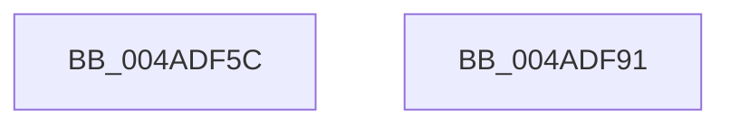

# SSHSupportEtwWrite

- RVA: `0x004ADF5C`–`0x004ADF92` (길이 `54` bytes)
- VA: `0x00000001404ADF5C`
- 실행 섹션: `.text`
- PDB 이름 있음: `예`; PDB Function 태그: `아니요`
- unwind 정보 RVA: `0x00082420`
- 디코드: `14`개 명령, `54/54` bytes 표시
- 미해석 바이트: `0` (있으면 어셈블리에 `.byte`로 보존)

> 이 문서는 커널 이미지의 기계어와 PDB 기호를 분석해 생성했습니다. 4번과 5번은 함수 원형과 자료형을 바이너리 사용 방식에서 추정한 C 해석이며 원본 소스 복구 결과는 아닙니다.

## 1. Dependencies

- 직접 호출 지점: **1**; 고유 호출 대상: **1**
- 직접 호출자로 확인된 함수: **4**
- RIP 상대 이미지 참조: **1**

### Outgoing calls
- `0x004ADF87` → [EtwWriteEx](../25/EtwWriteEx_function_0025F0D0.md) (function, `0x0025F0D0`)

### Direct callers
- [SshpSessionManagerFlushControlEventBuffer](../../page/77/SshpSessionManagerFlushControlEventBuffer_function_007743C4.md) at `0x00774423`
- [SshpFlushBlockerDataCache](../../page/A6/SshpFlushBlockerDataCache_function_00A606F4.md) at `0x00A608F3`
- [SshpTracingRundownCollectionState](../../page/A8/SshpTracingRundownCollectionState_function_00A8E534.md) at `0x00A8E64F`
- [sub_00B4A7C6](../../page/B4/Unknown_function_00B4A7C6.md) at `0x00B4A824`

### Static image references
- `0x004ADF6B` → RVA `0x00F07010` (`.data`; read)

## 2. Other-region calls and transfers

- 다른 실행 섹션으로 향하는 call: **0**
- 별도 외부 분기/꼬리 이동을 확인하지 못했습니다.

## 3. Assembly (complete function range)

```asm
004ADF5C  4C 8B DC                        mov r11, rsp
004ADF5F  48 83 EC 48                     sub rsp, 0x48
004ADF63  48 8B 44 24 70                  mov rax, qword ptr [rsp + 0x70]
004ADF68  45 33 C0                        xor r8d, r8d
004ADF6B  48 8B 0D 9E 90 A5 00            mov rcx, qword ptr [rip + 0xa5909e]
004ADF72  49 89 43 F0                     mov qword ptr [r11 - 0x10], rax
004ADF76  45 89 4B E8                     mov dword ptr [r11 - 0x18], r9d
004ADF7A  45 33 C9                        xor r9d, r9d
004ADF7D  49 83 63 E0 00                  and qword ptr [r11 - 0x20], 0
004ADF82  49 83 63 D8 00                  and qword ptr [r11 - 0x28], 0
004ADF87  E8 44 11 DB FF                  call 0x14025f0d0
004ADF8C  48 83 C4 48                     add rsp, 0x48
004ADF90  C3                              ret
004ADF91  CC                              int3
```

## 4. C-style interpretation (structured pseudocode)

```c
__int64 __fastcall SSHSupportEtwWrite(__int64 a1, __int64 a2, int a3, int a4, __int64 a5)
{
    __int64 result;
    __int64 v_rsp;

    v_rsp = (v_rsp) - (72);
    a3 = 0;
    *(unsigned __int64 *)(v_rsp - 16) = a5;
    *(unsigned int *)(v_rsp - 24) = a4;
    a4 = 0;
    result = EtwWriteEx(*(unsigned __int64 *)(v_rip + 10850462), a2, a3, a4);
    v_rsp = (v_rsp) + (72);
    return result;
}
```

## 5. (Beta) C Style

```c
int64_t SSHSupportEtwWrite(int64_t Arg1, int64_t Arg2, int32_t Arg3, int32_t Arg4, int64_t Arg5)
{
    int64_t result;
    int64_t local_rsp;

    local_rsp = (local_rsp) - (72);
    Arg3 = 0;
    *(uint64_t *)(local_rsp - 0x10) = Arg5;
    *(uint32_t *)(local_rsp - 0x18) = Arg4;
    Arg4 = 0;
    result = EtwWriteEx(*(uint64_t *)(v_rip + 0xA5909E), Arg2, Arg3, Arg4);
    local_rsp = (local_rsp) + (72);
    return result;
}
```

## 6. Execution-region graph

[열기: 2D/3D 그래프와 함수 탐색 컨트롤 패널](../../../control-panel.html?section=text&rva=0x004ADF5C&view=graph)

- 2D 그래프는 위에서 아래로 흐르고, 3D 그래프는 빈 공간을 드래그해 회전합니다. Shift+드래그는 이동, 휠은 확대·축소, 함수 노드 선택은 대상 보고서 이동입니다.

### Static fallback


