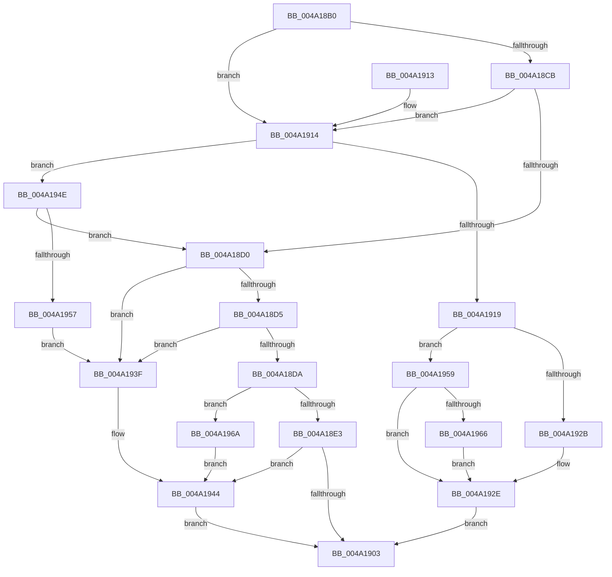

# SeConvertSecurityDescriptorToStringSecurityDescriptor

- RVA: `0x004A18B0`–`0x004A1971` (길이 `193` bytes)
- VA: `0x00000001404A18B0`
- 실행 섹션: `.text`
- PDB 이름 있음: `예`; PDB Function 태그: `아니요`
- unwind 정보 RVA: `0x000B5C48`
- 디코드: `60`개 명령, `193/193` bytes 표시
- 미해석 바이트: `0` (있으면 어셈블리에 `.byte`로 보존)

> 이 문서는 커널 이미지의 기계어와 PDB 기호를 분석해 생성했습니다. 4번과 5번은 함수 원형과 자료형을 바이너리 사용 방식에서 추정한 C 해석이며 원본 소스 복구 결과는 아닙니다.

## 1. Dependencies

- 직접 호출 지점: **2**; 고유 호출 대상: **2**
- 직접 호출자로 확인된 함수: **3**
- RIP 상대 이미지 참조: **0**

### Outgoing calls
- `0x004A18FA` → [LocalConvertSDToStringSD_Rev1](../../page/92/LocalConvertSDToStringSD_Rev1_function_00924428.md) (function, `0x00924428`)
- `0x004A191E` → [SddlpAlloc](../../page/92/SddlpAlloc_function_00925F88.md) (function, `0x00925F88`)

### Direct callers
- [CmpLogHiveFileInaccessible](../../page/87/CmpLogHiveFileInaccessible_function_0087AEAC.md) at `0x0087B10C`
- [AstLogDeviceSDDLUpdated](../../page/9A/AstLogDeviceSDDLUpdated_function_009A36A8.md) at `0x009A377E`
- [AdtpBuildSecurityDescriptorUnicodeString](../../page/A6/AdtpBuildSecurityDescriptorUnicodeString_function_00A663C0.md) at `0x00A66438`

### Static image references
- 디코드된 RIP-relative 메모리 참조가 없습니다.

## 2. Other-region calls and transfers

- 다른 실행 섹션으로 향하는 call: **2**
  - `0x004A18FA` → [LocalConvertSDToStringSD_Rev1](../../page/92/LocalConvertSDToStringSD_Rev1_function_00924428.md) (`.text` → `PAGE`)
  - `0x004A191E` → [SddlpAlloc](../../page/92/SddlpAlloc_function_00925F88.md) (`.text` → `PAGE`)
- 별도 외부 분기/꼬리 이동을 확인하지 못했습니다.

## 3. Assembly (complete function range)

```asm
004A18B0  48 89 5C 24 08                  mov qword ptr [rsp + 8], rbx
004A18B5  48 89 74 24 10                  mov qword ptr [rsp + 0x10], rsi
004A18BA  57                              push rdi
004A18BB  48 83 EC 40                     sub rsp, 0x40
004A18BF  33 F6                           xor esi, esi
004A18C1  49 8B F9                        mov rdi, r9
004A18C4  8B DE                           mov ebx, esi
004A18C6  48 85 C9                        test rcx, rcx
004A18C9  74 49                           je 0x1404a1914
004A18CB  45 85 C0                        test r8d, r8d
004A18CE  74 44                           je 0x1404a1914
004A18D0  48 85 FF                        test rdi, rdi
004A18D3  74 6A                           je 0x1404a193f
004A18D5  45 85 C0                        test r8d, r8d
004A18D8  74 65                           je 0x1404a193f
004A18DA  83 FA 01                        cmp edx, 1
004A18DD  0F 85 87 00 00 00               jne 0x1404a196a
004A18E3  48 8B 44 24 70                  mov rax, qword ptr [rsp + 0x70]
004A18E8  4C 8B C9                        mov r9, rcx
004A18EB  48 89 44 24 30                  mov qword ptr [rsp + 0x30], rax
004A18F0  48 89 7C 24 28                  mov qword ptr [rsp + 0x28], rdi
004A18F5  44 89 44 24 20                  mov dword ptr [rsp + 0x20], r8d
004A18FA  E8 29 2B 48 00                  call 0x140924428
004A18FF  85 C0                           test eax, eax
004A1901  7F 41                           jg 0x1404a1944
004A1903  48 8B 5C 24 50                  mov rbx, qword ptr [rsp + 0x50]
004A1908  48 8B 74 24 58                  mov rsi, qword ptr [rsp + 0x58]
004A190D  48 83 C4 40                     add rsp, 0x40
004A1911  5F                              pop rdi
004A1912  C3                              ret
004A1913  CC                              int3
004A1914  48 85 FF                        test rdi, rdi
004A1917  74 35                           je 0x1404a194e
004A1919  B9 02 00 00 00                  mov ecx, 2
004A191E  E8 65 46 48 00                  call 0x140925f88
004A1923  48 89 07                        mov qword ptr [rdi], rax
004A1926  48 85 C0                        test rax, rax
004A1929  75 2E                           jne 0x1404a1959
004A192B  8D 58 08                        lea ebx, [rax + 8]
004A192E  8B CB                           mov ecx, ebx
004A1930  81 C9 00 00 07 C0               or ecx, 0xc0070000
004A1936  85 DB                           test ebx, ebx
004A1938  0F 45 D9                        cmovne ebx, ecx
004A193B  8B C3                           mov eax, ebx
004A193D  EB C4                           jmp 0x1404a1903
004A193F  B8 57 00 00 00                  mov eax, 0x57
004A1944  0F B7 C0                        movzx eax, ax
004A1947  0D 00 00 07 C0                  or eax, 0xc0070000
004A194C  EB B5                           jmp 0x1404a1903
004A194E  48 85 C9                        test rcx, rcx
004A1951  0F 85 79 FF FF FF               jne 0x1404a18d0
004A1957  EB E6                           jmp 0x1404a193f
004A1959  66 89 30                        mov word ptr [rax], si
004A195C  48 8B 44 24 70                  mov rax, qword ptr [rsp + 0x70]
004A1961  48 85 C0                        test rax, rax
004A1964  74 C8                           je 0x1404a192e
004A1966  89 30                           mov dword ptr [rax], esi
004A1968  EB C4                           jmp 0x1404a192e
004A196A  B8 19 05 00 00                  mov eax, 0x519
004A196F  EB D3                           jmp 0x1404a1944
```

## 4. C-style interpretation (structured pseudocode)

```c
__int64 __fastcall SeConvertSecurityDescriptorToStringSecurityDescriptor(__int64 a1, int a2, int a3, __int64 a4, __int64 a5)
{
    __int64 result;
    __int64 v_rbx;
    __int64 v_rsi;
    __int64 v_rsp;
    unsigned __int64 v_stack_m18;
    unsigned __int64 v_stack_m20;
    unsigned int v_stack_m28;
    unsigned __int64 v_stack_p10;
    unsigned __int64 v_stack_p8;

    v_stack_p8 = v_rbx;
    v_stack_p10 = v_rsi;
    v_rsp = (v_rsp) - (64);
    v_rsi = 0;
    if (a1 == 0) goto loc_004A1914;
    if (a3 == 0) goto loc_004A1914;
loc_004A18D0:
    if (a4 == 0) goto loc_004A193F;
    if (a3 == 0) goto loc_004A193F;
    if (a2 != 1) goto loc_004A196A;
    v_stack_m18 = a5;
    v_stack_m20 = a4;
    v_stack_m28 = a3;
    result = LocalConvertSDToStringSD_Rev1(a1, a2, a3, a1);
    if (condition_is_greater) goto loc_004A1944;
loc_004A1903:
    v_rsp = (v_rsp) + (64);
    return result;
loc_004A1914:
    if (a4 == 0) goto loc_004A194E;
    result = SddlpAlloc(2, a2, a3, a1);
    *(unsigned __int64 *)(a4) = result;
    if (result != 0) goto loc_004A1959;
loc_004A192E:
    a1 = (unsigned int)(((unsigned int)((unsigned int)(result + 8))) | (0xC0070000ULL));
    v_rbx = result + 8;
    if ((unsigned int)(result + 8) != 0) { v_rbx = (unsigned int)(a1); }
    goto loc_004A1903;
loc_004A193F:
loc_004A1944:
    result = (unsigned int)((87) | (0xC0070000ULL));
    goto loc_004A1903;
loc_004A194E:
    if (a1 != 0) goto loc_004A18D0;
    goto loc_004A193F;
loc_004A1959:
    *(unsigned __int16 *)(result) = (unsigned __int16)(v_stack_p10);
    if (a5 == 0) goto loc_004A192E;
    *(unsigned int *)(a5) = (unsigned int)(v_stack_p10);
    goto loc_004A192E;
loc_004A196A:
    goto loc_004A1944;
}
```

## 5. (Beta) C Style

```c
int64_t SeConvertSecurityDescriptorToStringSecurityDescriptor(int64_t Arg1, int32_t Arg2, int32_t Arg3, int64_t Arg4, int64_t Arg5)
{
    int64_t result;
    int64_t local_rbx;
    int64_t local_rsi;
    int64_t local_rsp;
    uint64_t v_stack_m18;
    uint64_t v_stack_m20;
    uint32_t v_stack_m28;
    uint64_t v_stack_p10;
    uint64_t v_stack_p8;

    v_stack_p8 = local_rbx;
    v_stack_p10 = local_rsi;
    local_rsp = (local_rsp) - (64);
    local_rsi = 0;
    if (Arg1 == 0) goto loc_004A1914;
    if (Arg3 == 0) goto loc_004A1914;
loc_004A18D0:
    if (Arg4 == 0) goto loc_004A193F;
    if (Arg3 == 0) goto loc_004A193F;
    if (Arg2 != 1) goto loc_004A196A;
    v_stack_m18 = Arg5;
    v_stack_m20 = Arg4;
    v_stack_m28 = Arg3;
    result = LocalConvertSDToStringSD_Rev1(Arg1, Arg2, Arg3, Arg1);
    if (condition_is_greater) goto loc_004A1944;
loc_004A1903:
    local_rsp = (local_rsp) + (64);
    return result;
loc_004A1914:
    if (Arg4 == 0) goto loc_004A194E;
    result = SddlpAlloc(2, Arg2, Arg3, Arg1);
    *(uint64_t *)(Arg4) = result;
    if (result != 0) goto loc_004A1959;
loc_004A192E:
    Arg1 = (uint32_t)(((uint32_t)((uint32_t)(result + 8))) | (0xC0070000ULL));
    local_rbx = result + 8;
    if ((uint32_t)(result + 8) != 0) { local_rbx = (uint32_t)(Arg1); }
    goto loc_004A1903;
loc_004A193F:
loc_004A1944:
    result = (uint32_t)((87) | (0xC0070000ULL));
    goto loc_004A1903;
loc_004A194E:
    if (Arg1 != 0) goto loc_004A18D0;
    goto loc_004A193F;
loc_004A1959:
    *(uint16_t *)(result) = (uint16_t)(v_stack_p10);
    if (Arg5 == 0) goto loc_004A192E;
    *(uint32_t *)(Arg5) = (uint32_t)(v_stack_p10);
    goto loc_004A192E;
loc_004A196A:
    goto loc_004A1944;
}
```

## 6. Execution-region graph

[열기: 2D/3D 그래프와 함수 탐색 컨트롤 패널](../../../control-panel.html?section=text&rva=0x004A18B0&view=graph)

- 2D 그래프는 위에서 아래로 흐르고, 3D 그래프는 빈 공간을 드래그해 회전합니다. Shift+드래그는 이동, 휠은 확대·축소, 함수 노드 선택은 대상 보고서 이동입니다.

### Static fallback


