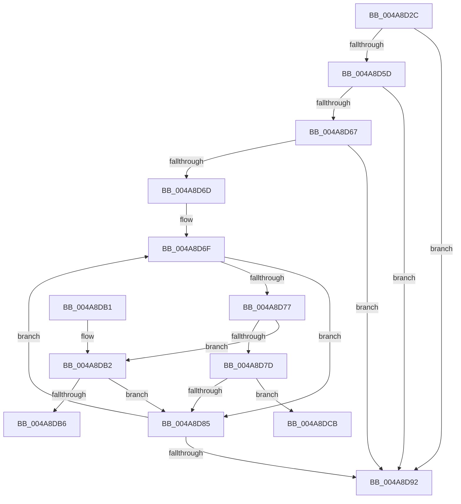

# SeMaximumAuditMask

- RVA: `0x004A8D2C`–`0x004A8DD3` (길이 `167` bytes)
- VA: `0x00000001404A8D2C`
- 실행 섹션: `.text`
- PDB 이름 있음: `예`; PDB Function 태그: `예`
- unwind 정보 RVA: `0x000B790C`
- 디코드: `56`개 명령, `167/167` bytes 표시
- 미해석 바이트: `0` (있으면 어셈블리에 `.byte`로 보존)

> 이 문서는 커널 이미지의 기계어와 PDB 기호를 분석해 생성했습니다. 4번과 5번은 함수 원형과 자료형을 바이너리 사용 방식에서 추정한 C 해석이며 원본 소스 복구 결과는 아닙니다.

## 1. Dependencies

- 직접 호출 지점: **0**; 고유 호출 대상: **0**
- 직접 호출자로 확인된 함수: **3**
- RIP 상대 이미지 참조: **0**

### Outgoing calls
- 직접 디코드된 call 명령이 없습니다.

### Direct callers
- [sub_0086E95E](../../page/86/Unknown_function_0086E95E.md) at `0x0086EA24`
- [SeMaximumAuditMaskFromGlobalSacl](../../page/A8/SeMaximumAuditMaskFromGlobalSacl_function_00A832DC.md) at `0x00A8337E`
- [sub_00B222A0](../../page/B2/Unknown_function_00B222A0.md) at `0x00B222B5`

### Static image references
- 디코드된 RIP-relative 메모리 참조가 없습니다.

## 2. Other-region calls and transfers

- 다른 실행 섹션으로 향하는 call: **0**
- call이 아닌 외부 분기/꼬리 이동: **2**
  - `0x004A8DC6` → [sub_006F9FB6](../6F/Unknown_function_006F9FB6.md) (`tail-transfer`)
  - `0x004A8DCE` → [sub_006F9FB6](../6F/Unknown_function_006F9FB6.md) (`tail-transfer`)

## 3. Assembly (complete function range)

```asm
004A8D2C  48 8B C4                        mov rax, rsp
004A8D2F  48 89 58 08                     mov qword ptr [rax + 8], rbx
004A8D33  48 89 68 10                     mov qword ptr [rax + 0x10], rbp
004A8D37  48 89 70 18                     mov qword ptr [rax + 0x18], rsi
004A8D3B  48 89 78 20                     mov qword ptr [rax + 0x20], rdi
004A8D3F  41 54                           push r12
004A8D41  41 56                           push r14
004A8D43  41 57                           push r15
004A8D45  48 83 EC 30                     sub rsp, 0x30
004A8D49  45 33 E4                        xor r12d, r12d
004A8D4C  49 8B F9                        mov rdi, r9
004A8D4F  45 89 21                        mov dword ptr [r9], r12d
004A8D52  4D 8B F8                        mov r15, r8
004A8D55  44 8B F2                        mov r14d, edx
004A8D58  48 85 C9                        test rcx, rcx
004A8D5B  74 35                           je 0x1404a8d92
004A8D5D  0F B7 41 04                     movzx eax, word ptr [rcx + 4]
004A8D61  66 44 3B E0                     cmp r12w, ax
004A8D65  74 2B                           je 0x1404a8d92
004A8D67  48 8D 59 08                     lea rbx, [rcx + 8]
004A8D6B  73 25                           jae 0x1404a8d92
004A8D6D  8B E8                           mov ebp, eax
004A8D6F  8A 4B 01                        mov cl, byte ptr [rbx + 1]
004A8D72  F6 C1 08                        test cl, 8
004A8D75  75 0E                           jne 0x1404a8d85
004A8D77  8A 03                           mov al, byte ptr [rbx]
004A8D79  3C 02                           cmp al, 2
004A8D7B  75 35                           jne 0x1404a8db2
004A8D7D  41 8B F6                        mov esi, r14d
004A8D80  23 73 04                        and esi, dword ptr [rbx + 4]
004A8D83  75 46                           jne 0x1404a8dcb
004A8D85  0F B7 43 02                     movzx eax, word ptr [rbx + 2]
004A8D89  48 03 D8                        add rbx, rax
004A8D8C  48 83 ED 01                     sub rbp, 1
004A8D90  75 DD                           jne 0x1404a8d6f
004A8D92  48 8B 5C 24 50                  mov rbx, qword ptr [rsp + 0x50]
004A8D97  48 8B 6C 24 58                  mov rbp, qword ptr [rsp + 0x58]
004A8D9C  48 8B 74 24 60                  mov rsi, qword ptr [rsp + 0x60]
004A8DA1  48 8B 7C 24 68                  mov rdi, qword ptr [rsp + 0x68]
004A8DA6  48 83 C4 30                     add rsp, 0x30
004A8DAA  41 5F                           pop r15
004A8DAC  41 5E                           pop r14
004A8DAE  41 5C                           pop r12
004A8DB0  C3                              ret
004A8DB1  CC                              int3
004A8DB2  3C 0D                           cmp al, 0xd
004A8DB4  75 CF                           jne 0x1404a8d85
004A8DB6  41 8B F6                        mov esi, r14d
004A8DB9  23 73 04                        and esi, dword ptr [rbx + 4]
004A8DBC  0F 95 C0                        setne al
004A8DBF  C0 E9 06                        shr cl, 6
004A8DC2  22 C1                           and al, cl
004A8DC4  A8 01                           test al, 1
004A8DC6  E9 EB 11 25 00                  jmp 0x1406f9fb6
004A8DCB  F6 C1 40                        test cl, 0x40
004A8DCE  E9 E3 11 25 00                  jmp 0x1406f9fb6
```

## 4. C-style interpretation (structured pseudocode)

```c
__int64 __fastcall SeMaximumAuditMask(__int64 a1, int a2, __int64 a3, __int64 a4)
{
    __int64 result;
    __int64 v_r12;
    __int64 v_rbp;
    __int64 v_rbx;
    __int64 v_rsi;
    __int64 v_rsp;
    unsigned __int64 v_stack_p10;
    unsigned __int64 v_stack_p18;
    unsigned __int64 v_stack_p20;
    unsigned __int64 v_stack_p8;

    *(unsigned __int64 *)(v_rsp + 8) = v_rbx;
    *(unsigned __int64 *)(v_rsp + 16) = v_rbp;
    *(unsigned __int64 *)(v_rsp + 24) = v_rsi;
    *(unsigned __int64 *)(v_rsp + 32) = v_rdi;
    v_rsp = (v_rsp) - (48);
    v_r12 = 0;
    *(unsigned int *)(a4) = 0;
    if (a1 == 0) goto loc_004A8D92;
    if (0 == ((unsigned __int16)(*(unsigned __int16 *)(a1 + 4)))) goto loc_004A8D92;
    if (0 >= ((unsigned __int16)(*(unsigned __int16 *)(a1 + 4)))) goto loc_004A8D92;
loc_004A8D6F:
    if ((((unsigned __int8)(*(unsigned __int8 *)(a1 + 8 + 1))) & (8)) != 0) goto loc_004A8D85;
    if (((unsigned __int8)(*(unsigned __int8 *)(a1 + 8))) != 2) goto loc_004A8DB2;
    v_rsi = (unsigned int)(((unsigned int)((unsigned int)((unsigned int)(a2)))) & (*(unsigned int *)(a1 + 8 + 4)));
    if (condition_is_not_equal) goto loc_004A8DCB;
loc_004A8D85:
    v_rbx = (a1 + 8) + (*(unsigned __int16 *)(a1 + 8 + 2));
    v_rbp = ((unsigned int)((unsigned int)(*(unsigned __int16 *)(a1 + 4)))) - (1);
    if (condition_is_not_equal) goto loc_004A8D6F;
loc_004A8D92:
    v_rsp = (v_rsp) + (48);
    return *(unsigned __int16 *)(a1 + 8 + 2);
loc_004A8DB2:
    if (((unsigned __int8)(*(unsigned __int16 *)(a1 + 8 + 2))) != 13) goto loc_004A8D85;
    v_rsi = (unsigned int)(((unsigned int)((unsigned int)((unsigned int)(a2)))) & (*(unsigned int *)(v_stack_p8 + 4)));
    result = (condition_is_not_equal) ? 1 : 0;
    a1 = (unsigned __int8)((*(unsigned __int8 *)(a1 + 8 + 1)) >> (6));
    result = (unsigned __int8)((result) & ((unsigned __int8)(a1)));
loc_004A8DCB:
}
```

## 5. (Beta) C Style

```c
int64_t SeMaximumAuditMask(int64_t Arg1, int32_t Arg2, int64_t Arg3, void *Arg4)
{
    uint8_t *arg4 = (uint8_t *)Arg4;

    int64_t result;
    int64_t local_r12;
    int64_t local_rbp;
    int64_t local_rbx;
    int64_t local_rsi;
    int64_t local_rsp;
    uint64_t v_stack_p10;
    uint64_t v_stack_p18;
    uint64_t v_stack_p20;
    uint64_t v_stack_p8;

    *(uint64_t *)(local_rsp + 0x8) = local_rbx;
    *(uint64_t *)(local_rsp + 0x10) = local_rbp;
    *(uint64_t *)(local_rsp + 0x18) = local_rsi;
    *(uint64_t *)(local_rsp + 0x20) = local_rdi;
    local_rsp = (local_rsp) - (48);
    local_r12 = 0;
    *(uint32_t *)(arg4) = 0;
    if (Arg1 == 0) goto loc_004A8D92;
    if (0 == ((uint16_t)(*(uint16_t *)(Arg1 + 0x4)))) goto loc_004A8D92;
    if (0 >= ((uint16_t)(*(uint16_t *)(Arg1 + 0x4)))) goto loc_004A8D92;
loc_004A8D6F:
    if ((((uint8_t)(*(uint8_t *)(Arg1 + 0x8 + 0x1))) & (8)) != 0) goto loc_004A8D85;
    if (((uint8_t)(*(uint8_t *)(Arg1 + 0x8))) != 2) goto loc_004A8DB2;
    local_rsi = (uint32_t)(((uint32_t)((uint32_t)((uint32_t)(Arg2)))) & (*(uint32_t *)(Arg1 + 0x8 + 0x4)));
    if (condition_is_not_equal) goto loc_004A8DCB;
loc_004A8D85:
    local_rbx = (Arg1 + 8) + (*(uint16_t *)(Arg1 + 0x8 + 0x2));
    local_rbp = ((uint32_t)((uint32_t)(*(uint16_t *)(Arg1 + 0x4)))) - (1);
    if (condition_is_not_equal) goto loc_004A8D6F;
loc_004A8D92:
    local_rsp = (local_rsp) + (48);
    return *(uint16_t *)(Arg1 + 0x8 + 0x2);
loc_004A8DB2:
    if (((uint8_t)(*(uint16_t *)(Arg1 + 0x8 + 0x2))) != 13) goto loc_004A8D85;
    local_rsi = (uint32_t)(((uint32_t)((uint32_t)((uint32_t)(Arg2)))) & (*(uint32_t *)(v_stack_p8 + 0x4)));
    result = (condition_is_not_equal) ? 1 : 0;
    Arg1 = (uint8_t)((*(uint8_t *)(Arg1 + 0x8 + 0x1)) >> (6));
    result = (uint8_t)((result) & ((uint8_t)(Arg1)));
loc_004A8DCB:
}
```

### 관측된 메모리 오프셋

구조체 형식이 확인되지 않은 접근은 인자 기준의 오프셋으로만 기록했습니다.

| 기준 인자 | 오프셋 표현 | 폭 (bit) | 접근 |
|---|---:|---:|---|
| `Arg4` | `+ 0x0` | `32` | `W` |

## 6. Execution-region graph

[열기: 2D/3D 그래프와 함수 탐색 컨트롤 패널](../../../control-panel.html?section=text&rva=0x004A8D2C&view=graph)

- 2D 그래프는 위에서 아래로 흐르고, 3D 그래프는 빈 공간을 드래그해 회전합니다. Shift+드래그는 이동, 휠은 확대·축소, 함수 노드 선택은 대상 보고서 이동입니다.

### Static fallback


