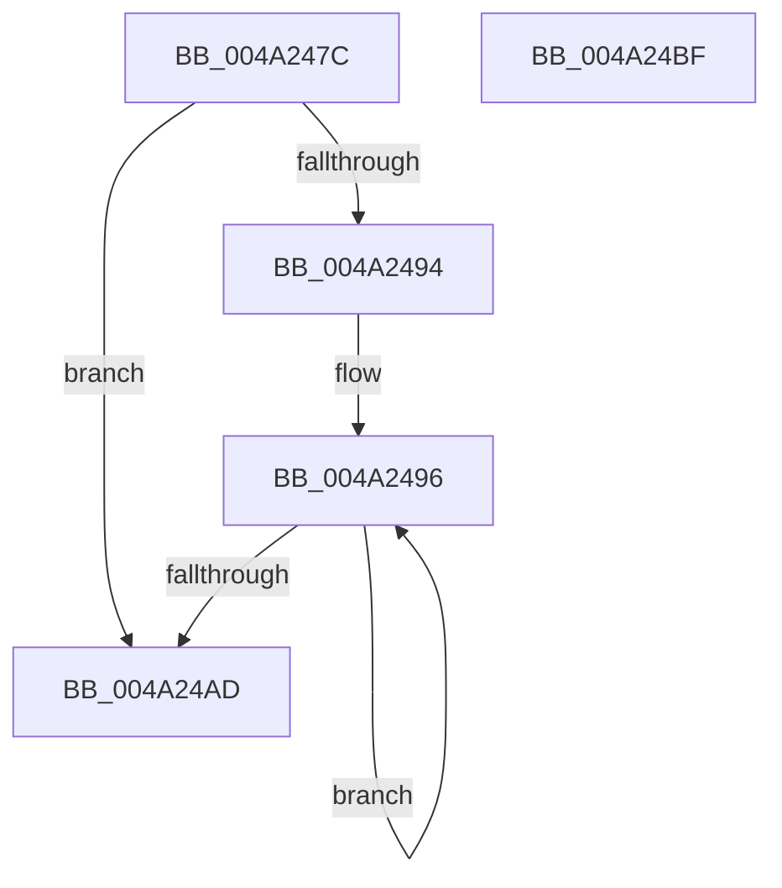

# SepCloseCachedTokenHandles

- RVA: `0x004A247C`–`0x004A24C0` (길이 `68` bytes)
- VA: `0x00000001404A247C`
- 실행 섹션: `.text`
- PDB 이름 있음: `예`; PDB Function 태그: `아니요`
- unwind 정보 RVA: `0x00060BC4`
- 디코드: `23`개 명령, `68/68` bytes 표시
- 미해석 바이트: `0` (있으면 어셈블리에 `.byte`로 보존)

> 이 문서는 커널 이미지의 기계어와 PDB 기호를 분석해 생성했습니다. 4번과 5번은 함수 원형과 자료형을 바이너리 사용 방식에서 추정한 C 해석이며 원본 소스 복구 결과는 아닙니다.

## 1. Dependencies

- 직접 호출 지점: **1**; 고유 호출 대상: **1**
- 직접 호출자로 확인된 함수: **2**
- RIP 상대 이미지 참조: **0**

### Outgoing calls
- `0x004A2499` → [ZwClose](../6A/ZwClose_function_006AD2B0.md) (function, `0x006AD2B0`)

### Direct callers
- [SepSetTokenCachedHandles](../../page/9A/SepSetTokenCachedHandles_function_009A939C.md) at `0x009A9552`
- [SepDereferenceCachedHandlesEntryInternal](../../page/A1/SepDereferenceCachedHandlesEntryInternal_function_00A19424.md) at `0x00A19550`

### Static image references
- 디코드된 RIP-relative 메모리 참조가 없습니다.

## 2. Other-region calls and transfers

- 다른 실행 섹션으로 향하는 call: **0**
- 별도 외부 분기/꼬리 이동을 확인하지 못했습니다.

## 3. Assembly (complete function range)

```asm
004A247C  48 89 5C 24 08                  mov qword ptr [rsp + 8], rbx
004A2481  48 89 74 24 10                  mov qword ptr [rsp + 0x10], rsi
004A2486  57                              push rdi
004A2487  48 83 EC 20                     sub rsp, 0x20
004A248B  33 DB                           xor ebx, ebx
004A248D  48 8B FA                        mov rdi, rdx
004A2490  85 C9                           test ecx, ecx
004A2492  74 19                           je 0x1404a24ad
004A2494  8B F1                           mov esi, ecx
004A2496  48 8B 0F                        mov rcx, qword ptr [rdi]
004A2499  E8 12 AE 20 00                  call 0x1406ad2b0
004A249E  85 C0                           test eax, eax
004A24A0  48 8D 7F 08                     lea rdi, [rdi + 8]
004A24A4  0F 48 D8                        cmovs ebx, eax
004A24A7  48 83 EE 01                     sub rsi, 1
004A24AB  75 E9                           jne 0x1404a2496
004A24AD  48 8B 74 24 38                  mov rsi, qword ptr [rsp + 0x38]
004A24B2  8B C3                           mov eax, ebx
004A24B4  48 8B 5C 24 30                  mov rbx, qword ptr [rsp + 0x30]
004A24B9  48 83 C4 20                     add rsp, 0x20
004A24BD  5F                              pop rdi
004A24BE  C3                              ret
004A24BF  CC                              int3
```

## 4. C-style interpretation (structured pseudocode)

```c
__int64 __fastcall SepCloseCachedTokenHandles(int a1, __int64 a2)
{
    __int64 result;
    __int64 v_rbx;
    __int64 v_rsi;
    __int64 v_rsp;
    unsigned __int64 v_stack_p10;
    unsigned __int64 v_stack_p8;

    v_stack_p8 = v_rbx;
    v_stack_p10 = v_rsi;
    v_rsp = (v_rsp) - (32);
    v_rbx = 0;
    if (a1 == 0) goto loc_004A24AD;
loc_004A2496:
    result = ZwClose(*(unsigned __int64 *)(a2), a2, a3, a4);
    if (sign_flag) { v_rbx = (unsigned int)(result); }
    v_rsi = ((unsigned int)(a1)) - (1);
    if (condition_is_not_equal) goto loc_004A2496;
loc_004A24AD:
    v_rsp = (v_rsp) + (32);
    return (unsigned int)((unsigned int)(v_rbx));
}
```

## 5. (Beta) C Style

```c
int64_t SepCloseCachedTokenHandles(int32_t Arg1, void *Arg2)
{
    uint8_t *arg2 = (uint8_t *)Arg2;

    int64_t result;
    int64_t local_rbx;
    int64_t local_rsi;
    int64_t local_rsp;
    uint64_t v_stack_p10;
    uint64_t v_stack_p8;

    v_stack_p8 = local_rbx;
    v_stack_p10 = local_rsi;
    local_rsp = (local_rsp) - (32);
    local_rbx = 0;
    if (Arg1 == 0) goto loc_004A24AD;
loc_004A2496:
    result = ZwClose(*(uint64_t *)(arg2), Arg2, a3, a4);
    if (sign_flag) { local_rbx = (uint32_t)(result); }
    local_rsi = ((uint32_t)(Arg1)) - (1);
    if (condition_is_not_equal) goto loc_004A2496;
loc_004A24AD:
    local_rsp = (local_rsp) + (32);
    return (uint32_t)((uint32_t)(local_rbx));
}
```

### 관측된 메모리 오프셋

구조체 형식이 확인되지 않은 접근은 인자 기준의 오프셋으로만 기록했습니다.

| 기준 인자 | 오프셋 표현 | 폭 (bit) | 접근 |
|---|---:|---:|---|
| `Arg2` | `+ 0x0` | `64` | `R` |
| `Arg2` | `+ 0x8` | `64` | `R` |

## 6. Execution-region graph

[열기: 2D/3D 그래프와 함수 탐색 컨트롤 패널](../../../control-panel.html?section=text&rva=0x004A247C&view=graph)

- 2D 그래프는 위에서 아래로 흐르고, 3D 그래프는 빈 공간을 드래그해 회전합니다. Shift+드래그는 이동, 휠은 확대·축소, 함수 노드 선택은 대상 보고서 이동입니다.

### Static fallback


