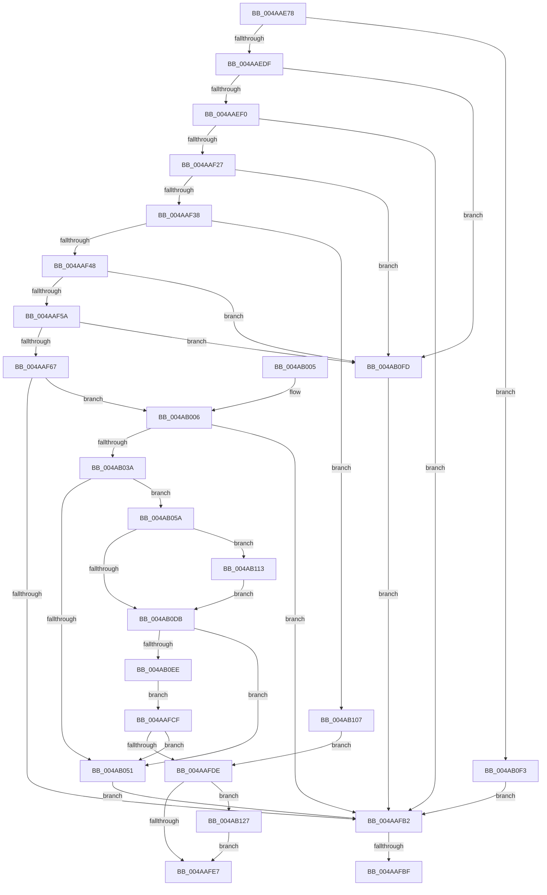

# SepLinkLogonSessions

- RVA: `0x004AAE78`–`0x004AB139` (길이 `705` bytes)
- VA: `0x00000001404AAE78`
- 실행 섹션: `.text`
- PDB 이름 있음: `예`; PDB Function 태그: `예`
- unwind 정보 RVA: `0x000B7EA8`
- 디코드: `171`개 명령, `705/705` bytes 표시
- 미해석 바이트: `0` (있으면 어셈블리에 `.byte`로 보존)

> 이 문서는 커널 이미지의 기계어와 PDB 기호를 분석해 생성했습니다. 4번과 5번은 함수 원형과 자료형을 바이너리 사용 방식에서 추정한 C 해석이며 원본 소스 복구 결과는 아닙니다.

## 1. Dependencies

- 직접 호출 지점: **11**; 고유 호출 대상: **7**
- 직접 호출자로 확인된 함수: **1**
- RIP 상대 이미지 참조: **3**

### Outgoing calls
- `0x004AAED2` → [SeSinglePrivilegeCheck](../../page/87/SeSinglePrivilegeCheck_function_00871E20.md) (function, `0x00871E20`)
- `0x004AAF14` → [ObReferenceObjectByHandle](../../page/86/ObReferenceObjectByHandle_function_00868DB0.md) (function, `0x00868DB0`)
- `0x004AAFA7` → [SepDuplicateToken](../../page/8B/SepDuplicateToken_function_008B87EC.md) (function, `0x008B87EC`)
- `0x004AAFC4` → [ObfDereferenceObjectWithTag](../2F/ObfDereferenceObjectWithTag_function_002F78E0.md) (function, `0x002F78E0`)
- `0x004AAFD3` → [SepStopReferencingLogonSession](../../page/A8/SepStopReferencingLogonSession_function_00A8E35C.md) (function, `0x00A8E35C`)
- `0x004AB02B` → [SepDuplicateToken](../../page/8B/SepDuplicateToken_function_008B87EC.md) (function, `0x008B87EC`)
- `0x004AB046` → [SepReferenceLogonSession](../../page/A3/SepReferenceLogonSession_function_00A3B74C.md) (function, `0x00A3B74C`)
- `0x004AB0DF` → [SepStopReferencingLogonSession](../../page/A8/SepStopReferencingLogonSession_function_00A8E35C.md) (function, `0x00A8E35C`)
- `0x004AB117` → [SepRemoveTokenLogonSession](../../page/7A/SepRemoveTokenLogonSession_function_007A19C8.md) (function, `0x007A19C8`)
- `0x004AB120` → [SepRemoveTokenLogonSession](../../page/7A/SepRemoveTokenLogonSession_function_007A19C8.md) (function, `0x007A19C8`)
- `0x004AB12F` → [ObfDereferenceObjectWithTag](../2F/ObfDereferenceObjectWithTag_function_002F78E0.md) (function, `0x002F78E0`)

### Direct callers
- [NtSetInformationToken](../../page/AF/NtSetInformationToken_function_00AF0530.md) at `0x00AF0EC3`

### Static image references
- `0x004AAEB0` → RVA `0x00FD9B80` (`PAGEDATA`; read)
- `0x004AAEF0` → RVA `0x00FD8020` (`PAGEDATA`; read)
- `0x004AB0D2` → RVA `0x00FD8010` (`PAGEDATA`; read)

## 2. Other-region calls and transfers

- 다른 실행 섹션으로 향하는 call: **9**
  - `0x004AAED2` → [SeSinglePrivilegeCheck](../../page/87/SeSinglePrivilegeCheck_function_00871E20.md) (`.text` → `PAGE`)
  - `0x004AAF14` → [ObReferenceObjectByHandle](../../page/86/ObReferenceObjectByHandle_function_00868DB0.md) (`.text` → `PAGE`)
  - `0x004AAFA7` → [SepDuplicateToken](../../page/8B/SepDuplicateToken_function_008B87EC.md) (`.text` → `PAGE`)
  - `0x004AAFD3` → [SepStopReferencingLogonSession](../../page/A8/SepStopReferencingLogonSession_function_00A8E35C.md) (`.text` → `PAGE`)
  - `0x004AB02B` → [SepDuplicateToken](../../page/8B/SepDuplicateToken_function_008B87EC.md) (`.text` → `PAGE`)
  - `0x004AB046` → [SepReferenceLogonSession](../../page/A3/SepReferenceLogonSession_function_00A3B74C.md) (`.text` → `PAGE`)
  - `0x004AB0DF` → [SepStopReferencingLogonSession](../../page/A8/SepStopReferencingLogonSession_function_00A8E35C.md) (`.text` → `PAGE`)
  - `0x004AB117` → [SepRemoveTokenLogonSession](../../page/7A/SepRemoveTokenLogonSession_function_007A19C8.md) (`.text` → `PAGE`)
  - `0x004AB120` → [SepRemoveTokenLogonSession](../../page/7A/SepRemoveTokenLogonSession_function_007A19C8.md) (`.text` → `PAGE`)
- call이 아닌 외부 분기/꼬리 이동: **2**
  - `0x004AAFB9` → [sub_006FA500](../6F/Unknown_function_006FA500.md) (`tail-transfer`)
  - `0x004AAFCA` → [sub_006FA500](../6F/Unknown_function_006FA500.md) (`tail-transfer`)

## 3. Assembly (complete function range)

```asm
004AAE78  48 89 5C 24 08                  mov qword ptr [rsp + 8], rbx
004AAE7D  48 89 74 24 10                  mov qword ptr [rsp + 0x10], rsi
004AAE82  55                              push rbp
004AAE83  57                              push rdi
004AAE84  41 54                           push r12
004AAE86  41 56                           push r14
004AAE88  41 57                           push r15
004AAE8A  48 8D 6C 24 C9                  lea rbp, [rsp - 0x37]
004AAE8F  48 81 EC 90 00 00 00            sub rsp, 0x90
004AAE96  45 33 E4                        xor r12d, r12d
004AAE99  33 C0                           xor eax, eax
004AAE9B  0F 57 C0                        xorps xmm0, xmm0
004AAE9E  4C 89 65 E7                     mov qword ptr [rbp - 0x19], r12
004AAEA2  4C 8B FA                        mov r15, rdx
004AAEA5  4C 89 65 7F                     mov qword ptr [rbp + 0x7f], r12
004AAEA9  48 8B F1                        mov rsi, rcx
004AAEAC  4C 89 65 F7                     mov qword ptr [rbp - 9], r12
004AAEB0  48 8B 0D C9 EC B2 00            mov rcx, qword ptr [rip + 0xb2ecc9]
004AAEB7  41 8A D0                        mov dl, r8b
004AAEBA  41 8B FC                        mov edi, r12d
004AAEBD  48 89 45 1F                     mov qword ptr [rbp + 0x1f], rax
004AAEC1  45 8B F4                        mov r14d, r12d
004AAEC4  89 45 27                        mov dword ptr [rbp + 0x27], eax
004AAEC7  0F 11 45 FF                     movups xmmword ptr [rbp - 1], xmm0
004AAECB  41 8A D8                        mov bl, r8b
004AAECE  0F 11 45 0F                     movups xmmword ptr [rbp + 0xf], xmm0
004AAED2  E8 49 6F 3C 00                  call 0x140871e20
004AAED7  84 C0                           test al, al
004AAED9  0F 84 14 02 00 00               je 0x1404ab0f3
004AAEDF  48 8B 86 D8 00 00 00            mov rax, qword ptr [rsi + 0xd8]
004AAEE6  4C 39 60 38                     cmp qword ptr [rax + 0x38], r12
004AAEEA  0F 85 0D 02 00 00               jne 0x1404ab0fd
004AAEF0  4C 8B 05 29 D1 B2 00            mov r8, qword ptr [rip + 0xb2d129]
004AAEF7  48 8D 45 EF                     lea rax, [rbp - 0x11]
004AAEFB  4C 89 64 24 28                  mov qword ptr [rsp + 0x28], r12
004AAF00  44 8A CB                        mov r9b, bl
004AAF03  BA 88 00 00 00                  mov edx, 0x88
004AAF08  48 89 44 24 20                  mov qword ptr [rsp + 0x20], rax
004AAF0D  49 8B CF                        mov rcx, r15
004AAF10  4C 89 65 EF                     mov qword ptr [rbp - 0x11], r12
004AAF14  E8 97 DE 3B 00                  call 0x140868db0
004AAF19  48 8B 7D EF                     mov rdi, qword ptr [rbp - 0x11]
004AAF1D  8B D8                           mov ebx, eax
004AAF1F  85 C0                           test eax, eax
004AAF21  0F 88 8B 00 00 00               js 0x1404aafb2
004AAF27  48 8B 8F D8 00 00 00            mov rcx, qword ptr [rdi + 0xd8]
004AAF2E  4C 39 61 38                     cmp qword ptr [rcx + 0x38], r12
004AAF32  0F 85 C5 01 00 00               jne 0x1404ab0fd
004AAF38  48 8B 86 D8 00 00 00            mov rax, qword ptr [rsi + 0xd8]
004AAF3F  48 3B C1                        cmp rax, rcx
004AAF42  0F 84 BF 01 00 00               je 0x1404ab107
004AAF48  45 8D 7C 24 01                  lea r15d, [r12 + 1]
004AAF4D  44 39 BE C0 00 00 00            cmp dword ptr [rsi + 0xc0], r15d
004AAF54  0F 85 A3 01 00 00               jne 0x1404ab0fd
004AAF5A  44 39 BF C0 00 00 00            cmp dword ptr [rdi + 0xc0], r15d
004AAF61  0F 85 96 01 00 00               jne 0x1404ab0fd
004AAF67  48 8D 45 7F                     lea rax, [rbp + 0x7f]
004AAF6B  C7 45 FF 30 00 00 00            mov dword ptr [rbp - 1], 0x30
004AAF72  48 89 44 24 38                  mov qword ptr [rsp + 0x38], rax
004AAF77  48 8D 55 FF                     lea rdx, [rbp - 1]
004AAF7B  44 88 64 24 30                  mov byte ptr [rsp + 0x30], r12b
004AAF80  0F 57 C0                        xorps xmm0, xmm0
004AAF83  44 88 64 24 28                  mov byte ptr [rsp + 0x28], r12b
004AAF88  45 8B CF                        mov r9d, r15d
004AAF8B  45 33 C0                        xor r8d, r8d
004AAF8E  44 89 64 24 20                  mov dword ptr [rsp + 0x20], r12d
004AAF93  48 8B CE                        mov rcx, rsi
004AAF96  4C 89 65 07                     mov qword ptr [rbp + 7], r12
004AAF9A  44 89 65 17                     mov dword ptr [rbp + 0x17], r12d
004AAF9E  4C 89 65 0F                     mov qword ptr [rbp + 0xf], r12
004AAFA2  F3 0F 7F 45 1F                  movdqu xmmword ptr [rbp + 0x1f], xmm0
004AAFA7  E8 40 D8 40 00                  call 0x1408b87ec
004AAFAC  8B D8                           mov ebx, eax
004AAFAE  85 C0                           test eax, eax
004AAFB0  79 54                           jns 0x1404ab006
004AAFB2  48 8B 4D E7                     mov rcx, qword ptr [rbp - 0x19]
004AAFB6  48 85 C9                        test rcx, rcx
004AAFB9  0F 84 41 F5 24 00               je 0x1406fa500
004AAFBF  BA 44 66 6C 74                  mov edx, 0x746c6644
004AAFC4  E8 17 C9 E4 FF                  call 0x1402f78e0
004AAFC9  90                              nop
004AAFCA  E9 31 F5 24 00                  jmp 0x1406fa500
004AAFCF  48 8B 4D 7F                     mov rcx, qword ptr [rbp + 0x7f]
004AAFD3  E8 84 33 5E 00                  call 0x140a8e35c
004AAFD8  8B D8                           mov ebx, eax
004AAFDA  85 C0                           test eax, eax
004AAFDC  78 73                           js 0x1404ab051
004AAFDE  48 85 FF                        test rdi, rdi
004AAFE1  0F 85 40 01 00 00               jne 0x1404ab127
004AAFE7  4C 8D 9C 24 90 00 00 00         lea r11, [rsp + 0x90]
004AAFEF  8B C3                           mov eax, ebx
004AAFF1  49 8B 5B 30                     mov rbx, qword ptr [r11 + 0x30]
004AAFF5  49 8B 73 38                     mov rsi, qword ptr [r11 + 0x38]
004AAFF9  49 8B E3                        mov rsp, r11
004AAFFC  41 5F                           pop r15
004AAFFE  41 5E                           pop r14
004AB000  41 5C                           pop r12
004AB002  5F                              pop rdi
004AB003  5D                              pop rbp
004AB004  C3                              ret
004AB005  CC                              int3
004AB006  48 8D 45 E7                     lea rax, [rbp - 0x19]
004AB00A  45 8B CF                        mov r9d, r15d
004AB00D  48 89 44 24 38                  mov qword ptr [rsp + 0x38], rax
004AB012  48 8D 55 FF                     lea rdx, [rbp - 1]
004AB016  44 88 64 24 30                  mov byte ptr [rsp + 0x30], r12b
004AB01B  45 33 C0                        xor r8d, r8d
004AB01E  44 88 64 24 28                  mov byte ptr [rsp + 0x28], r12b
004AB023  48 8B CF                        mov rcx, rdi
004AB026  44 89 64 24 20                  mov dword ptr [rsp + 0x20], r12d
004AB02B  E8 BC D7 40 00                  call 0x1408b87ec
004AB030  8B D8                           mov ebx, eax
004AB032  85 C0                           test eax, eax
004AB034  0F 88 78 FF FF FF               js 0x1404aafb2
004AB03A  48 8B 4D 7F                     mov rcx, qword ptr [rbp + 0x7f]
004AB03E  48 8D 55 F7                     lea rdx, [rbp - 9]
004AB042  48 83 C1 18                     add rcx, 0x18
004AB046  E8 01 07 59 00                  call 0x140a3b74c
004AB04B  8B D8                           mov ebx, eax
004AB04D  85 C0                           test eax, eax
004AB04F  79 09                           jns 0x1404ab05a
004AB051  4C 8B 75 F7                     mov r14, qword ptr [rbp - 9]
004AB055  E9 58 FF FF FF                  jmp 0x1404aafb2
004AB05A  48 8B 4D 7F                     mov rcx, qword ptr [rbp + 0x7f]
004AB05E  48 8B 81 D8 00 00 00            mov rax, qword ptr [rcx + 0xd8]
004AB065  48 89 48 38                     mov qword ptr [rax + 0x38], rcx
004AB069  48 8B 45 E7                     mov rax, qword ptr [rbp - 0x19]
004AB06D  48 8B 90 D8 00 00 00            mov rdx, qword ptr [rax + 0xd8]
004AB074  48 8B 45 7F                     mov rax, qword ptr [rbp + 0x7f]
004AB078  48 8B 88 D8 00 00 00            mov rcx, qword ptr [rax + 0xd8]
004AB07F  48 8B 42 08                     mov rax, qword ptr [rdx + 8]
004AB083  48 89 41 10                     mov qword ptr [rcx + 0x10], rax
004AB087  48 8B 45 7F                     mov rax, qword ptr [rbp + 0x7f]
004AB08B  48 8B 88 D8 00 00 00            mov rcx, qword ptr [rax + 0xd8]
004AB092  83 49 28 02                     or dword ptr [rcx + 0x28], 2
004AB096  48 8B 4D E7                     mov rcx, qword ptr [rbp - 0x19]
004AB09A  48 8B 81 D8 00 00 00            mov rax, qword ptr [rcx + 0xd8]
004AB0A1  48 89 48 38                     mov qword ptr [rax + 0x38], rcx
004AB0A5  48 8B 45 7F                     mov rax, qword ptr [rbp + 0x7f]
004AB0A9  48 8B 90 D8 00 00 00            mov rdx, qword ptr [rax + 0xd8]
004AB0B0  48 8B 45 E7                     mov rax, qword ptr [rbp - 0x19]
004AB0B4  48 8B 88 D8 00 00 00            mov rcx, qword ptr [rax + 0xd8]
004AB0BB  48 8B 42 08                     mov rax, qword ptr [rdx + 8]
004AB0BF  48 89 41 10                     mov qword ptr [rcx + 0x10], rax
004AB0C3  48 8B 45 E7                     mov rax, qword ptr [rbp - 0x19]
004AB0C7  48 8B 88 D8 00 00 00            mov rcx, qword ptr [rax + 0xd8]
004AB0CE  83 49 28 04                     or dword ptr [rcx + 0x28], 4
004AB0D2  44 39 25 37 CF B2 00            cmp dword ptr [rip + 0xb2cf37], r12d
004AB0D9  75 38                           jne 0x1404ab113
004AB0DB  48 8B 4D E7                     mov rcx, qword ptr [rbp - 0x19]
004AB0DF  E8 78 32 5E 00                  call 0x140a8e35c
004AB0E4  8B D8                           mov ebx, eax
004AB0E6  85 C0                           test eax, eax
004AB0E8  0F 88 63 FF FF FF               js 0x1404ab051
004AB0EE  E9 DC FE FF FF                  jmp 0x1404aafcf
004AB0F3  BB 61 00 00 C0                  mov ebx, 0xc0000061
004AB0F8  E9 B5 FE FF FF                  jmp 0x1404aafb2
004AB0FD  BB 0D 00 00 C0                  mov ebx, 0xc000000d
004AB102  E9 AB FE FF FF                  jmp 0x1404aafb2
004AB107  83 48 28 04                     or dword ptr [rax + 0x28], 4
004AB10B  41 8B DC                        mov ebx, r12d
004AB10E  E9 CB FE FF FF                  jmp 0x1404aafde
004AB113  48 8B 4D E7                     mov rcx, qword ptr [rbp - 0x19]
004AB117  E8 AC 68 2F 00                  call 0x1407a19c8
004AB11C  48 8B 4D 7F                     mov rcx, qword ptr [rbp + 0x7f]
004AB120  E8 A3 68 2F 00                  call 0x1407a19c8
004AB125  EB B4                           jmp 0x1404ab0db
004AB127  BA 44 66 6C 74                  mov edx, 0x746c6644
004AB12C  48 8B CF                        mov rcx, rdi
004AB12F  E8 AC C7 E4 FF                  call 0x1402f78e0
004AB134  E9 AE FE FF FF                  jmp 0x1404aafe7
```

## 4. C-style interpretation (structured pseudocode)

```c
__int64 __fastcall SepLinkLogonSessions(__int64 a1, __int64 a2, unsigned __int8 a3)
{
    __int64 result;
    __int64 v_r12;
    __int64 v_rsp;
    unsigned __int64 v_stack_m28;
    unsigned int v_stack_m38;
    unsigned __int64 v_stack_m40;
    unsigned int v_stack_m48;
    unsigned __int64 v_stack_m50;
    unsigned __int64 v_stack_m58;
    unsigned __int64 v_stack_m5F;
    unsigned __int64 v_stack_m60;
    unsigned __int64 v_stack_m68;
    unsigned __int64 v_stack_m70;
    unsigned __int64 v_stack_m78;
    unsigned __int64 v_stack_m80;
    unsigned __int8 v_stack_m88;
    unsigned __int64 v_stack_m90;
    unsigned __int64 v_stack_m98;
    unsigned __int64 v_stack_p10;
    unsigned __int64 v_stack_p20;
    unsigned __int64 v_stack_p8;

    v_stack_p8 = v_rbx;
    v_stack_p10 = v_rsi;
    v_rsp = (v_rsp) - (144);
    v_r12 = 0;
    result = 0;
    v_stack_m78 = 0;
    v_stack_p20 = 0;
    v_stack_m68 = 0;
    v_stack_m40 = 0;
    v_stack_m38 = 0;
    v_stack_m60 = v_xmm0;
    v_stack_m50 = v_xmm0;
    result = SeSinglePrivilegeCheck(*(unsigned __int64 *)(v_rip + 11726025), a3, a3, a4);
    if ((unsigned __int8)(result) == 0) goto loc_004AB0F3;
    if ((*(unsigned __int64 *)(*(unsigned __int64 *)(a1 + 216) + 56)) != 0) goto loc_004AB0FD;
    v_stack_m90 = 0;
    v_stack_m98 = v_stack_m70;
    v_stack_m70 = 0;
    result = ObReferenceObjectByHandle(a2, 136, *(unsigned __int64 *)(v_rip + 11718953), a3);
    if (sign_flag) goto loc_004AAFB2;
    if ((*(unsigned __int64 *)(*(unsigned __int64 *)(v_stack_m70 + 216) + 56)) != 0) goto loc_004AB0FD;
    if ((*(unsigned __int64 *)(a1 + 216)) == (*(unsigned __int64 *)(v_stack_m70 + 216))) goto loc_004AB107;
    if ((*(unsigned int *)(a1 + 192)) != ((unsigned int)(v_r12 + 1))) goto loc_004AB0FD;
    if ((*(unsigned int *)(v_stack_m70 + 192)) != ((unsigned int)(v_r12 + 1))) goto loc_004AB0FD;
    v_stack_m60 = 48;
    v_stack_m80 = v_stack_p20;
    v_stack_m88 = 0;
    v_stack_m90 = 0;
    a3 = 0;
    v_stack_m98 = 0;
    v_stack_m58 = 0;
    v_stack_m48 = 0;
    v_stack_m50 = 0;
    v_stack_m40 = v_xmm0;
    result = SepDuplicateToken(a1, v_stack_m60, a3, (unsigned int)((unsigned int)(v_r12 + 1)));
    if (!sign_flag) goto loc_004AB006;
loc_004AAFB2:
    result = ObfDereferenceObjectWithTag(v_stack_m78, (unsigned int)(0x746C6644ULL), a3, (unsigned int)((unsigned int)(v_r12 + 1)));
loc_004AAFCF:
    result = SepStopReferencingLogonSession(v_stack_p20, (unsigned int)(0x746C6644ULL), a3, (unsigned int)((unsigned int)(v_r12 + 1)));
    if (sign_flag) goto loc_004AB051;
loc_004AAFDE:
    if (v_stack_m70 != 0) goto loc_004AB127;
loc_004AAFE7:
    return (unsigned int)((unsigned int)((unsigned int)((unsigned int)(result))));
loc_004AB006:
    v_stack_m58 = v_stack_m78;
    v_stack_m60 = 0;
    a3 = 0;
    v_stack_m68 = 0;
    v_stack_m70 = 0;
    result = SepDuplicateToken(v_stack_m70, v_stack_m60, a3, (unsigned int)((unsigned int)(v_r12 + 1)));
    if (sign_flag) goto loc_004AAFB2;
    a1 = (v_stack_p20) + (24);
    result = SepReferenceLogonSession(a1, v_stack_m68, a3, (unsigned int)((unsigned int)(v_r12 + 1)));
    if (!sign_flag) goto loc_004AB05A;
loc_004AB051:
    goto loc_004AAFB2;
loc_004AB05A:
    *(unsigned __int64 *)(*(unsigned __int64 *)(v_stack_p20 + 216) + 56) = v_stack_p20;
    *(unsigned __int64 *)(*(unsigned __int64 *)(v_stack_p20 + 216) + 16) = *(unsigned __int64 *)(*(unsigned __int64 *)(v_stack_m78 + 216) + 8);
    *(unsigned __int64 *)(*(unsigned __int64 *)(v_stack_m78 + 216) + 56) = v_stack_m78;
    *(unsigned __int64 *)(*(unsigned __int64 *)(v_stack_m78 + 216) + 16) = *(unsigned __int64 *)(*(unsigned __int64 *)(v_stack_p20 + 216) + 8);
    if ((*(unsigned int *)(v_rip + 11718455)) != 0) goto loc_004AB113;
loc_004AB0DB:
    result = SepStopReferencingLogonSession(v_stack_m78, *(unsigned __int64 *)(v_stack_p20 + 216), a3, (unsigned int)((unsigned int)(v_r12 + 1)));
    if (sign_flag) goto loc_004AB051;
    goto loc_004AAFCF;
loc_004AB0F3:
    goto loc_004AAFB2;
loc_004AB0FD:
    goto loc_004AAFB2;
loc_004AB107:
    goto loc_004AAFDE;
loc_004AB113:
    result = SepRemoveTokenLogonSession(v_stack_m78, *(unsigned __int64 *)(v_stack_p20 + 216), a3, (unsigned int)((unsigned int)(v_r12 + 1)));
    result = SepRemoveTokenLogonSession(v_stack_p20, *(unsigned __int64 *)(v_stack_p20 + 216), a3, (unsigned int)((unsigned int)(v_r12 + 1)));
    goto loc_004AB0DB;
loc_004AB127:
    result = ObfDereferenceObjectWithTag(v_stack_m70, (unsigned int)(0x746C6644ULL), a3, (unsigned int)((unsigned int)(v_r12 + 1)));
    goto loc_004AAFE7;
}
```

## 5. (Beta) C Style

```c
int64_t SepLinkLogonSessions(void *Arg1, int64_t Arg2, uint8_t Arg3)
{
    uint8_t *arg1 = (uint8_t *)Arg1;

    int64_t result;
    int64_t local_r12;
    int64_t local_rsp;
    uint64_t v_stack_m28;
    uint32_t v_stack_m38;
    uint64_t v_stack_m40;
    uint32_t v_stack_m48;
    uint64_t v_stack_m50;
    uint64_t v_stack_m58;
    uint64_t v_stack_m5F;
    uint64_t v_stack_m60;
    uint64_t v_stack_m68;
    uint64_t v_stack_m70;
    uint64_t v_stack_m78;
    uint64_t v_stack_m80;
    uint8_t v_stack_m88;
    uint64_t v_stack_m90;
    uint64_t v_stack_m98;
    uint64_t v_stack_p10;
    uint64_t v_stack_p20;
    uint64_t v_stack_p8;

    v_stack_p8 = local_rbx;
    v_stack_p10 = local_rsi;
    local_rsp = (local_rsp) - (144);
    local_r12 = 0;
    result = 0;
    v_stack_m78 = 0;
    v_stack_p20 = 0;
    v_stack_m68 = 0;
    v_stack_m40 = 0;
    v_stack_m38 = 0;
    v_stack_m60 = v_xmm0;
    v_stack_m50 = v_xmm0;
    result = SeSinglePrivilegeCheck(*(uint64_t *)(v_rip + 0xB2ECC9), Arg3, Arg3, a4);
    if ((uint8_t)(result) == 0) goto loc_004AB0F3;
    if ((*(uint64_t *)(*(uint64_t *)(arg1 + 0xD8) + 0x38)) != 0) goto loc_004AB0FD;
    v_stack_m90 = 0;
    v_stack_m98 = v_stack_m70;
    v_stack_m70 = 0;
    result = ObReferenceObjectByHandle(Arg2, 136, *(uint64_t *)(v_rip + 0xB2D129), Arg3);
    if (sign_flag) goto loc_004AAFB2;
    if ((*(uint64_t *)(*(uint64_t *)(v_stack_m70 + 0xD8) + 0x38)) != 0) goto loc_004AB0FD;
    if ((*(uint64_t *)(arg1 + 0xD8)) == (*(uint64_t *)(v_stack_m70 + 0xD8))) goto loc_004AB107;
    if ((*(uint32_t *)(arg1 + 0xC0)) != ((uint32_t)(local_r12 + 1))) goto loc_004AB0FD;
    if ((*(uint32_t *)(v_stack_m70 + 0xC0)) != ((uint32_t)(local_r12 + 1))) goto loc_004AB0FD;
    v_stack_m60 = 48;
    v_stack_m80 = v_stack_p20;
    v_stack_m88 = 0;
    v_stack_m90 = 0;
    Arg3 = 0;
    v_stack_m98 = 0;
    v_stack_m58 = 0;
    v_stack_m48 = 0;
    v_stack_m50 = 0;
    v_stack_m40 = v_xmm0;
    result = SepDuplicateToken(Arg1, v_stack_m60, Arg3, (uint32_t)((uint32_t)(local_r12 + 1)));
    if (!sign_flag) goto loc_004AB006;
loc_004AAFB2:
    result = ObfDereferenceObjectWithTag(v_stack_m78, (uint32_t)(0x746C6644ULL), Arg3, (uint32_t)((uint32_t)(local_r12 + 1)));
loc_004AAFCF:
    result = SepStopReferencingLogonSession(v_stack_p20, (uint32_t)(0x746C6644ULL), Arg3, (uint32_t)((uint32_t)(local_r12 + 1)));
    if (sign_flag) goto loc_004AB051;
loc_004AAFDE:
    if (v_stack_m70 != 0) goto loc_004AB127;
loc_004AAFE7:
    return (uint32_t)((uint32_t)((uint32_t)((uint32_t)(result))));
loc_004AB006:
    v_stack_m58 = v_stack_m78;
    v_stack_m60 = 0;
    Arg3 = 0;
    v_stack_m68 = 0;
    v_stack_m70 = 0;
    result = SepDuplicateToken(v_stack_m70, v_stack_m60, Arg3, (uint32_t)((uint32_t)(local_r12 + 1)));
    if (sign_flag) goto loc_004AAFB2;
    Arg1 = (v_stack_p20) + (24);
    result = SepReferenceLogonSession(Arg1, v_stack_m68, Arg3, (uint32_t)((uint32_t)(local_r12 + 1)));
    if (!sign_flag) goto loc_004AB05A;
loc_004AB051:
    goto loc_004AAFB2;
loc_004AB05A:
    *(uint64_t *)(*(uint64_t *)(v_stack_p20 + 0xD8) + 0x38) = v_stack_p20;
    *(uint64_t *)(*(uint64_t *)(v_stack_p20 + 0xD8) + 0x10) = *(uint64_t *)(*(uint64_t *)(v_stack_m78 + 0xD8) + 0x8);
    *(uint64_t *)(*(uint64_t *)(v_stack_m78 + 0xD8) + 0x38) = v_stack_m78;
    *(uint64_t *)(*(uint64_t *)(v_stack_m78 + 0xD8) + 0x10) = *(uint64_t *)(*(uint64_t *)(v_stack_p20 + 0xD8) + 0x8);
    if ((*(uint32_t *)(v_rip + 0xB2CF37)) != 0) goto loc_004AB113;
loc_004AB0DB:
    result = SepStopReferencingLogonSession(v_stack_m78, *(uint64_t *)(v_stack_p20 + 0xD8), Arg3, (uint32_t)((uint32_t)(local_r12 + 1)));
    if (sign_flag) goto loc_004AB051;
    goto loc_004AAFCF;
loc_004AB0F3:
    goto loc_004AAFB2;
loc_004AB0FD:
    goto loc_004AAFB2;
loc_004AB107:
    goto loc_004AAFDE;
loc_004AB113:
    result = SepRemoveTokenLogonSession(v_stack_m78, *(uint64_t *)(v_stack_p20 + 0xD8), Arg3, (uint32_t)((uint32_t)(local_r12 + 1)));
    result = SepRemoveTokenLogonSession(v_stack_p20, *(uint64_t *)(v_stack_p20 + 0xD8), Arg3, (uint32_t)((uint32_t)(local_r12 + 1)));
    goto loc_004AB0DB;
loc_004AB127:
    result = ObfDereferenceObjectWithTag(v_stack_m70, (uint32_t)(0x746C6644ULL), Arg3, (uint32_t)((uint32_t)(local_r12 + 1)));
    goto loc_004AAFE7;
}
```

### 관측된 메모리 오프셋

구조체 형식이 확인되지 않은 접근은 인자 기준의 오프셋으로만 기록했습니다.

| 기준 인자 | 오프셋 표현 | 폭 (bit) | 접근 |
|---|---:|---:|---|
| `Arg1` | `+ 0xC0` | `32` | `R` |
| `Arg1` | `+ 0xD8` | `64` | `R` |

## 6. Execution-region graph

[열기: 2D/3D 그래프와 함수 탐색 컨트롤 패널](../../../control-panel.html?section=text&rva=0x004AAE78&view=graph)

- 2D 그래프는 위에서 아래로 흐르고, 3D 그래프는 빈 공간을 드래그해 회전합니다. Shift+드래그는 이동, 휠은 확대·축소, 함수 노드 선택은 대상 보고서 이동입니다.

### Static fallback


