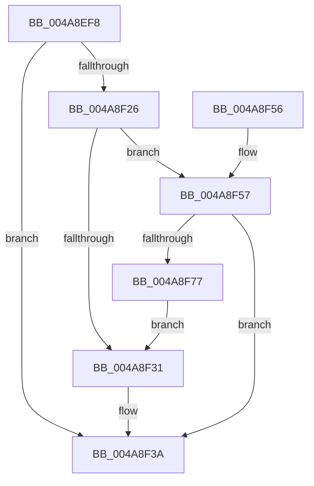

# SmBinaryArrayGrow

- RVA: `0x004A8EF8`–`0x004A8F8A` (길이 `146` bytes)
- VA: `0x00000001404A8EF8`
- 실행 섹션: `.text`
- PDB 이름 있음: `예`; PDB Function 태그: `아니요`
- unwind 정보 RVA: `0x000B7980`
- 디코드: `48`개 명령, `146/146` bytes 표시
- 미해석 바이트: `0` (있으면 어셈블리에 `.byte`로 보존)

> 이 문서는 커널 이미지의 기계어와 PDB 기호를 분석해 생성했습니다. 4번과 5번은 함수 원형과 자료형을 바이너리 사용 방식에서 추정한 C 해석이며 원본 소스 복구 결과는 아닙니다.

## 1. Dependencies

- 직접 호출 지점: **2**; 고유 호출 대상: **2**
- 직접 호출자로 확인된 함수: **1**
- RIP 상대 이미지 참조: **0**

### Outgoing calls
- `0x004A8F6A` → [ExAllocatePool2](../../poolcode/B8/ExAllocatePool2_function_00B820F0.md) (function, `0x00B820F0`)
- `0x004A8F7F` → [memset](../6C/memset_function_006C6C40.md) (function, `0x006C6C40`)

### Direct callers
- [SmHpBufferAlloc](../26/SmHpBufferAlloc_function_00268F7C.md) at `0x00269075`

### Static image references
- 디코드된 RIP-relative 메모리 참조가 없습니다.

## 2. Other-region calls and transfers

- 다른 실행 섹션으로 향하는 call: **1**
  - `0x004A8F6A` → [ExAllocatePool2](../../poolcode/B8/ExAllocatePool2_function_00B820F0.md) (`.text` → `POOLCODE`)
- 별도 외부 분기/꼬리 이동을 확인하지 못했습니다.

## 3. Assembly (complete function range)

```asm
004A8EF8  48 89 5C 24 08                  mov qword ptr [rsp + 8], rbx
004A8EFD  48 89 6C 24 10                  mov qword ptr [rsp + 0x10], rbp
004A8F02  48 89 74 24 20                  mov qword ptr [rsp + 0x20], rsi
004A8F07  57                              push rdi
004A8F08  41 56                           push r14
004A8F0A  41 57                           push r15
004A8F0C  48 83 EC 20                     sub rsp, 0x20
004A8F10  33 DB                           xor ebx, ebx
004A8F12  4C 8B F1                        mov r14, rcx
004A8F15  0F BD CA                        bsr ecx, edx
004A8F18  8D 43 01                        lea eax, [rbx + 1]
004A8F1B  D3 E0                           shl eax, cl
004A8F1D  8B E8                           mov ebp, eax
004A8F1F  33 EA                           xor ebp, edx
004A8F21  83 F9 20                        cmp ecx, 0x20
004A8F24  73 14                           jae 0x1404a8f3a
004A8F26  49 8B 3C CE                     mov rdi, qword ptr [r14 + rcx*8]
004A8F2A  8B F1                           mov esi, ecx
004A8F2C  48 85 FF                        test rdi, rdi
004A8F2F  74 26                           je 0x1404a8f57
004A8F31  8B DD                           mov ebx, ebp
004A8F33  48 C1 E3 04                     shl rbx, 4
004A8F37  48 03 DF                        add rbx, rdi
004A8F3A  48 8B 6C 24 48                  mov rbp, qword ptr [rsp + 0x48]
004A8F3F  48 8B C3                        mov rax, rbx
004A8F42  48 8B 5C 24 40                  mov rbx, qword ptr [rsp + 0x40]
004A8F47  48 8B 74 24 58                  mov rsi, qword ptr [rsp + 0x58]
004A8F4C  48 83 C4 20                     add rsp, 0x20
004A8F50  41 5F                           pop r15
004A8F52  41 5E                           pop r14
004A8F54  5F                              pop rdi
004A8F55  C3                              ret
004A8F56  CC                              int3
004A8F57  C1 E0 04                        shl eax, 4
004A8F5A  41 B8 73 6D 42 41               mov r8d, 0x41426d73
004A8F60  8B D0                           mov edx, eax
004A8F62  B9 40 00 00 00                  mov ecx, 0x40
004A8F67  44 8B F8                        mov r15d, eax
004A8F6A  E8 81 91 6D 00                  call 0x140b820f0
004A8F6F  48 8B F8                        mov rdi, rax
004A8F72  48 85 C0                        test rax, rax
004A8F75  74 C3                           je 0x1404a8f3a
004A8F77  45 8B C7                        mov r8d, r15d
004A8F7A  33 D2                           xor edx, edx
004A8F7C  48 8B C8                        mov rcx, rax
004A8F7F  E8 BC DC 21 00                  call 0x1406c6c40
004A8F84  49 89 3C F6                     mov qword ptr [r14 + rsi*8], rdi
004A8F88  EB A7                           jmp 0x1404a8f31
```

## 4. C-style interpretation (structured pseudocode)

```c
__int64 __fastcall SmBinaryArrayGrow(__int64 a1, int a2)
{
    __int64 result;
    __int64 v_rbp;
    __int64 v_rbx;
    __int64 v_rsp;
    unsigned __int64 v_stack_p10;
    unsigned __int64 v_stack_p20;
    unsigned __int64 v_stack_p8;

    v_stack_p8 = v_rbx;
    v_stack_p10 = v_rbp;
    v_stack_p20 = v_rsi;
    v_rsp = (v_rsp) - (32);
    v_rbx = 0;
    result = (unsigned int)((v_rbx + 1) << ((unsigned __int8)(a1)));
    v_rbp = (unsigned int)(((unsigned int)((unsigned int)(result))) ^ (a2));
    if (((unsigned int)(a1)) >= 32) goto loc_004A8F3A;
    if (*(unsigned __int64 *)(a1 + a1 * 8) == 0) goto loc_004A8F57;
loc_004A8F31:
    v_rbx = ((unsigned int)((unsigned int)(v_rbp))) << (4);
    v_rbx = (v_rbx) + (*(unsigned __int64 *)(a1 + a1 * 8));
loc_004A8F3A:
    v_rsp = (v_rsp) + (32);
    return v_rbx;
loc_004A8F57:
    result = (unsigned int)((v_rbx) << (4));
    result = ExAllocatePool2(64, (unsigned int)((unsigned int)(result)), (unsigned int)(0x41426D73ULL), a4);
    if (result == 0) goto loc_004A8F3A;
    a2 = 0;
    result = memset(result, a2, (unsigned int)((unsigned int)((unsigned int)((unsigned int)(result)))), a4);
    *(unsigned __int64 *)(a1 + v_stack_p20 * 8) = result;
    goto loc_004A8F31;
}
```

## 5. (Beta) C Style

```c
int64_t SmBinaryArrayGrow(void *Arg1, int32_t Arg2)
{
    uint8_t *arg1 = (uint8_t *)Arg1;

    int64_t result;
    int64_t local_rbp;
    int64_t local_rbx;
    int64_t local_rsp;
    uint64_t v_stack_p10;
    uint64_t v_stack_p20;
    uint64_t v_stack_p8;

    v_stack_p8 = local_rbx;
    v_stack_p10 = local_rbp;
    v_stack_p20 = local_rsi;
    local_rsp = (local_rsp) - (32);
    local_rbx = 0;
    result = (uint32_t)((local_rbx + 1) << ((uint8_t)(Arg1)));
    local_rbp = (uint32_t)(((uint32_t)((uint32_t)(result))) ^ (Arg2));
    if (((uint32_t)(Arg1)) >= 32) goto loc_004A8F3A;
    if (*(uint64_t *)(arg1 + arg1 * 8) == 0) goto loc_004A8F57;
loc_004A8F31:
    local_rbx = ((uint32_t)((uint32_t)(local_rbp))) << (4);
    local_rbx = (local_rbx) + (*(uint64_t *)(arg1 + arg1 * 8));
loc_004A8F3A:
    local_rsp = (local_rsp) + (32);
    return local_rbx;
loc_004A8F57:
    result = (uint32_t)((local_rbx) << (4));
    result = ExAllocatePool2(64, (uint32_t)((uint32_t)(result)), (uint32_t)(0x41426D73ULL), a4);
    if (result == 0) goto loc_004A8F3A;
    Arg2 = 0;
    result = memset(result, Arg2, (uint32_t)((uint32_t)((uint32_t)((uint32_t)(result)))), a4);
    *(uint64_t *)(arg1 + v_stack_p20 * 8) = result;
    goto loc_004A8F31;
}
```

### 관측된 메모리 오프셋

구조체 형식이 확인되지 않은 접근은 인자 기준의 오프셋으로만 기록했습니다.

| 기준 인자 | 오프셋 표현 | 폭 (bit) | 접근 |
|---|---:|---:|---|
| `Arg1` | `+ 0x0 + rcx*8` | `64` | `R` |
| `Arg1` | `+ 0x0 + rsi*8` | `64` | `W` |

## 6. Execution-region graph

[열기: 2D/3D 그래프와 함수 탐색 컨트롤 패널](../../../control-panel.html?section=text&rva=0x004A8EF8&view=graph)

- 2D 그래프는 위에서 아래로 흐르고, 3D 그래프는 빈 공간을 드래그해 회전합니다. Shift+드래그는 이동, 휠은 확대·축소, 함수 노드 선택은 대상 보고서 이동입니다.

### Static fallback


