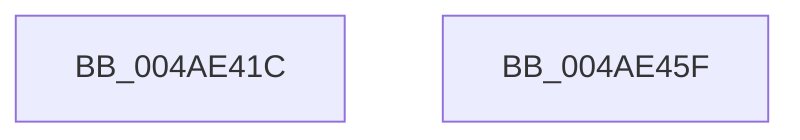

# SmFpInitialize

- RVA: `0x004AE41C`–`0x004AE460` (길이 `68` bytes)
- VA: `0x00000001404AE41C`
- 실행 섹션: `.text`
- PDB 이름 있음: `예`; PDB Function 태그: `아니요`
- unwind 정보 RVA: `0x0005CAAC`
- 디코드: `20`개 명령, `68/68` bytes 표시
- 미해석 바이트: `0` (있으면 어셈블리에 `.byte`로 보존)

> 이 문서는 커널 이미지의 기계어와 PDB 기호를 분석해 생성했습니다. 4번과 5번은 함수 원형과 자료형을 바이너리 사용 방식에서 추정한 C 해석이며 원본 소스 복구 결과는 아닙니다.

## 1. Dependencies

- 직접 호출 지점: **1**; 고유 호출 대상: **1**
- 직접 호출자로 확인된 함수: **1**
- RIP 상대 이미지 참조: **0**

### Outgoing calls
- `0x004AE432` → [memset](../6C/memset_function_006C6C40.md) (function, `0x006C6C40`)

### Direct callers
- [SmPartitionInitialize](../../page/7A/SmPartitionInitialize_function_007A5D04.md) at `0x007A5DEE`
- [SmPartitionInitialize](../../page/7A/SmPartitionInitialize_function_007A5D04.md) at `0x007A5DFD`

### Static image references
- 디코드된 RIP-relative 메모리 참조가 없습니다.

## 2. Other-region calls and transfers

- 다른 실행 섹션으로 향하는 call: **0**
- 별도 외부 분기/꼬리 이동을 확인하지 못했습니다.

## 3. Assembly (complete function range)

```asm
004AE41C  48 89 5C 24 08                  mov qword ptr [rsp + 8], rbx
004AE421  57                              push rdi
004AE422  48 83 EC 20                     sub rsp, 0x20
004AE426  48 8B FA                        mov rdi, rdx
004AE429  48 8B D9                        mov rbx, rcx
004AE42C  33 D2                           xor edx, edx
004AE42E  44 8D 42 78                     lea r8d, [rdx + 0x78]
004AE432  E8 09 88 21 00                  call 0x1406c6c40
004AE437  83 63 0C 00                     and dword ptr [rbx + 0xc], 0
004AE43B  48 8D 43 10                     lea rax, [rbx + 0x10]
004AE43F  66 C7 43 08 01 00               mov word ptr [rbx + 8], 1
004AE445  C6 43 0A 06                     mov byte ptr [rbx + 0xa], 6
004AE449  48 89 40 08                     mov qword ptr [rax + 8], rax
004AE44D  48 89 00                        mov qword ptr [rax], rax
004AE450  48 89 7B 20                     mov qword ptr [rbx + 0x20], rdi
004AE454  48 8B 5C 24 30                  mov rbx, qword ptr [rsp + 0x30]
004AE459  48 83 C4 20                     add rsp, 0x20
004AE45D  5F                              pop rdi
004AE45E  C3                              ret
004AE45F  CC                              int3
```

## 4. C-style interpretation (structured pseudocode)

```c
__int64 __fastcall SmFpInitialize(__int64 a1, __int64 a2)
{
    __int64 result;
    __int64 v_rsp;
    unsigned __int64 v_stack_p8;

    v_stack_p8 = v_rbx;
    v_rsp = (v_rsp) - (32);
    a2 = 0;
    result = memset(a1, a2, a2 + 120, a4);
    *(unsigned __int16 *)(a1 + 8) = 1;
    *(unsigned __int8 *)(a1 + 10) = 6;
    *(unsigned __int64 *)(a1 + 16 + 8) = a1 + 16;
    *(unsigned __int64 *)(a1 + 16) = a1 + 16;
    *(unsigned __int64 *)(a1 + 32) = 0;
    v_rsp = (v_rsp) + (32);
    return a1 + 16;
}
```

## 5. (Beta) C Style

```c
void *SmFpInitialize(void *Arg1, int64_t Arg2)
{
    uint8_t *arg1 = (uint8_t *)Arg1;

    int64_t result;
    int64_t local_rsp;
    uint64_t v_stack_p8;

    v_stack_p8 = local_rbx;
    local_rsp = (local_rsp) - (32);
    Arg2 = 0;
    result = memset(Arg1, Arg2, Arg2 + 120, a4);
    *(uint16_t *)(arg1 + 0x8) = 1;
    *(uint8_t *)(arg1 + 0xA) = 6;
    *(void **)(arg1 + 0x10 + 0x8) = Arg1 + 16;
    *(void **)(arg1 + 0x10) = Arg1 + 16;
    *(uint64_t *)(arg1 + 0x20) = 0;
    local_rsp = (local_rsp) + (32);
    return Arg1 + 16;
}
```

### 관측된 메모리 오프셋

구조체 형식이 확인되지 않은 접근은 인자 기준의 오프셋으로만 기록했습니다.

| 기준 인자 | 오프셋 표현 | 폭 (bit) | 접근 |
|---|---:|---:|---|
| `Arg1` | `+ 0x0` | `64` | `W` |
| `Arg1` | `+ 0x8` | `16` | `W` |
| `Arg1` | `+ 0x8` | `64` | `W` |
| `Arg1` | `+ 0xA` | `8` | `W` |
| `Arg1` | `+ 0xC` | `32` | `R/W` |
| `Arg1` | `+ 0x10` | `64` | `R` |
| `Arg1` | `+ 0x20` | `64` | `W` |

## 6. Execution-region graph

[열기: 2D/3D 그래프와 함수 탐색 컨트롤 패널](../../../control-panel.html?section=text&rva=0x004AE41C&view=graph)

- 2D 그래프는 위에서 아래로 흐르고, 3D 그래프는 빈 공간을 드래그해 회전합니다. Shift+드래그는 이동, 휠은 확대·축소, 함수 노드 선택은 대상 보고서 이동입니다.

### Static fallback


