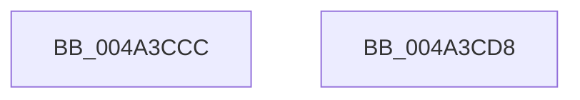

# SmpGetProcessPartition

- RVA: `0x004A3CCC`–`0x004A3CD9` (길이 `13` bytes)
- VA: `0x00000001404A3CCC`
- 실행 섹션: `.text`
- PDB 이름 있음: `예`; PDB Function 태그: `아니요`
- unwind 정보 RVA: `0x000DB714`
- 디코드: `4`개 명령, `13/13` bytes 표시
- 미해석 바이트: `0` (있으면 어셈블리에 `.byte`로 보존)

> 이 문서는 커널 이미지의 기계어와 PDB 기호를 분석해 생성했습니다. 4번과 5번은 함수 원형과 자료형을 바이너리 사용 방식에서 추정한 C 해석이며 원본 소스 복구 결과는 아닙니다.

## 1. Dependencies

- 직접 호출 지점: **0**; 고유 호출 대상: **0**
- 직접 호출자로 확인된 함수: **24**
- RIP 상대 이미지 참조: **0**

### Outgoing calls
- 직접 디코드된 call 명령이 없습니다.

### Direct callers
- [SmProcessCompressionAcceleratorRequest](../../page/7A/SmProcessCompressionAcceleratorRequest_function_007A5EEC.md) at `0x007A5FF8`
- [SmProcessCompressionReadStatsRequest](../../page/7A/SmProcessCompressionReadStatsRequest_function_007A6090.md) at `0x007A6205`
- [SmProcessConfigRequest](../../page/7A/SmProcessConfigRequest_function_007A62E4.md) at `0x007A6434`
- [SmProcessConfigRequest](../../page/7A/SmProcessConfigRequest_function_007A62E4.md) at `0x007A6637`
- [SmProcessDeleteRequest](../../page/7A/SmProcessDeleteRequest_function_007A6728.md) at `0x007A677F`
- [SmProcessListRequest](../../page/7A/SmProcessListRequest_function_007A67A8.md) at `0x007A691B`
- [SmProcessRegistrationRequest](../../page/7A/SmProcessRegistrationRequest_function_007A6C8C.md) at `0x007A6D08`
- [SmProcessResizeRequest](../../page/7A/SmProcessResizeRequest_function_007A6D50.md) at `0x007A6DB7`
- [SmProcessStatsRequest](../../page/7A/SmProcessStatsRequest_function_007A6E68.md) at `0x007A6F42`
- [SmcProcessCreateRequest](../../page/7A/SmcProcessCreateRequest_function_007A764C.md) at `0x007A7788`
- [SmcProcessDeleteRequest](../../page/7A/SmcProcessDeleteRequest_function_007A7900.md) at `0x007A7957`
- [SmcProcessListRequest](../../page/7A/SmcProcessListRequest_function_007A7988.md) at `0x007A7A5B`
- [SmcProcessResizeRequest](../../page/7A/SmcProcessResizeRequest_function_007A7B1C.md) at `0x007A7BB6`
- [SmcProcessStatsRequest](../../page/7A/SmcProcessStatsRequest_function_007A7BFC.md) at `0x007A7D32`
- [SmcProcessStoreCreateRequest](../../page/7A/SmcProcessStoreCreateRequest_function_007A7E14.md) at `0x007A7ED1`
- [SmcProcessStoreDeleteRequest](../../page/7A/SmcProcessStoreDeleteRequest_function_007A7F80.md) at `0x007A7FEF`
- [SmProcessCompressionInfoRequest](../../page/A0/SmProcessCompressionInfoRequest_function_00A0E980.md) at `0x00A0EACD`
- [SmProcessCreateNotification](../../page/A5/SmProcessCreateNotification_function_00A50B04.md) at `0x00A50B23`
- [SmpKeyedStoreCreate](../../page/A5/SmpKeyedStoreCreate_function_00A50B64.md) at `0x00A50BA3`
- [SmStoreCompressionStop](../../page/A6/SmStoreCompressionStop_function_00A6197C.md) at `0x00A619BA`
- [SmStoreCompressionStart](../../page/A6/SmStoreCompressionStart_function_00A61AD0.md) at `0x00A61AF7`
- [SmProcessDeleteNotification](../../page/A6/SmProcessDeleteNotification_function_00A686F4.md) at `0x00A686FE`
- [SmProcessSystemStoreTrimRequest](../../page/A7/SmProcessSystemStoreTrimRequest_function_00A784E0.md) at `0x00A78615`
- [sub_00B419D6](../../page/B4/Unknown_function_00B419D6.md) at `0x00B41A2B`
- [sub_00B41A62](../../page/B4/Unknown_function_00B41A62.md) at `0x00B41A67`

### Static image references
- 디코드된 RIP-relative 메모리 참조가 없습니다.

## 2. Other-region calls and transfers

- 다른 실행 섹션으로 향하는 call: **0**
- 별도 외부 분기/꼬리 이동을 확인하지 못했습니다.

## 3. Assembly (complete function range)

```asm
004A3CCC  48 8B 81 58 07 00 00            mov rax, qword ptr [rcx + 0x758]
004A3CD3  48 8B 40 18                     mov rax, qword ptr [rax + 0x18]
004A3CD7  C3                              ret
004A3CD8  CC                              int3
```

## 4. C-style interpretation (structured pseudocode)

```c
__int64 __fastcall SmpGetProcessPartition(__int64 a1)
{
    return *(unsigned __int64 *)(*(unsigned __int64 *)(a1 + 1880) + 24);
}
```

## 5. (Beta) C Style

```c
int64_t SmpGetProcessPartition(void *Arg1)
{
    uint8_t *arg1 = (uint8_t *)Arg1;

    return *(uint64_t *)(*(uint64_t *)(arg1 + 0x758) + 0x18);
}
```

### 관측된 메모리 오프셋

구조체 형식이 확인되지 않은 접근은 인자 기준의 오프셋으로만 기록했습니다.

| 기준 인자 | 오프셋 표현 | 폭 (bit) | 접근 |
|---|---:|---:|---|
| `Arg1` | `+ 0x758` | `64` | `R` |

## 6. Execution-region graph

[열기: 2D/3D 그래프와 함수 탐색 컨트롤 패널](../../../control-panel.html?section=text&rva=0x004A3CCC&view=graph)

- 2D 그래프는 위에서 아래로 흐르고, 3D 그래프는 빈 공간을 드래그해 회전합니다. Shift+드래그는 이동, 휠은 확대·축소, 함수 노드 선택은 대상 보고서 이동입니다.

### Static fallback


