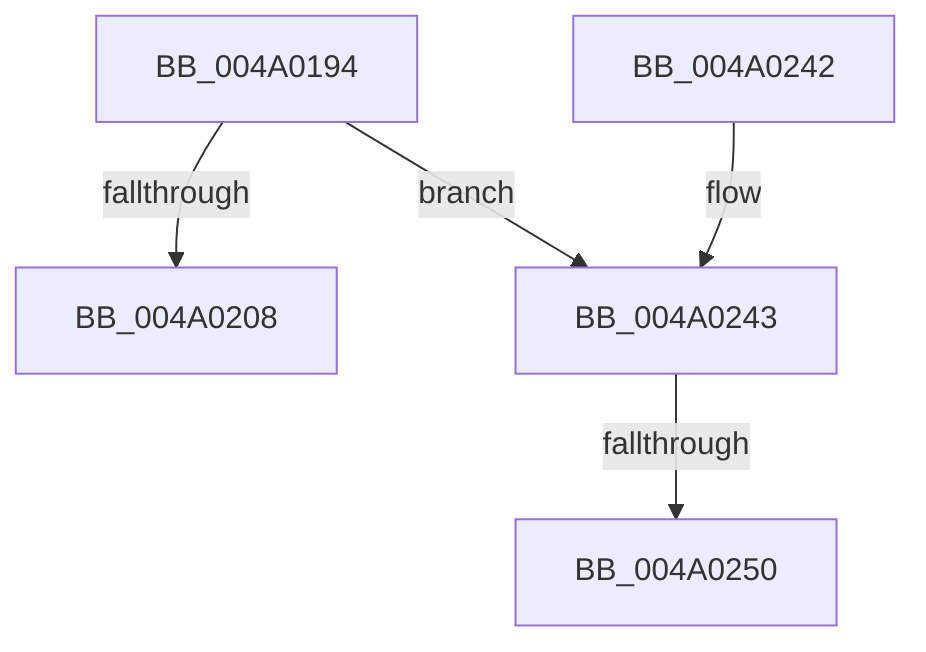

# StEtaHelper::StartHelper

- RVA: `0x004A0194`–`0x004A0255` (길이 `193` bytes)
- VA: `0x00000001404A0194`
- 실행 섹션: `.text`
- PDB 이름 있음: `예`; PDB Function 태그: `예`
- unwind 정보 RVA: `0x000B5764`
- 디코드: `43`개 명령, `193/193` bytes 표시
- 미해석 바이트: `0` (있으면 어셈블리에 `.byte`로 보존)

> 이 문서는 커널 이미지의 기계어와 PDB 기호를 분석해 생성했습니다. 4번과 5번은 함수 원형과 자료형을 바이너리 사용 방식에서 추정한 C 해석이며 원본 소스 복구 결과는 아닙니다.

## 1. Dependencies

- 직접 호출 지점: **2**; 고유 호출 대상: **2**
- 직접 호출자로 확인된 함수: **2**
- RIP 상대 이미지 참조: **1**

### Outgoing calls
- `0x004A0228` → [StEtaStart](StEtaStart_function_004A025C.md) (function, `0x004A025C`)
- `0x004A0234` → [_security_check_cookie](../6A/_security_check_cookie_function_006AC640.md) (function, `0x006AC640`)

### Direct callers
- [ST_STORE&lt;SM_TRAITS&gt;::StStart](../3B/ST_STORE_SM_TRAITS_StStart_function_003B1BBC.md) at `0x003B1F2E`
- [SmcCacheStart](../../page/7A/SmcCacheStart_function_007ABC48.md) at `0x007ABDC3`

### Static image references
- `0x004A01A2` → RVA `0x00E0A740` (`.data`; read)

## 2. Other-region calls and transfers

- 다른 실행 섹션으로 향하는 call: **0**
- call이 아닌 외부 분기/꼬리 이동: **2**
  - `0x004A024A` → [sub_006F867E](../6F/Unknown_function_006F867E.md) (`tail-transfer`)
  - `0x004A0250` → [sub_006F867E + 0x8](../6F/Unknown_function_006F867E.md) (`tail-transfer`)

## 3. Assembly (complete function range)

```asm
004A0194  40 55                           push rbp
004A0196  48 8D 6C 24 A9                  lea rbp, [rsp - 0x57]
004A019B  48 81 EC 90 00 00 00            sub rsp, 0x90
004A01A2  48 8B 05 97 A5 96 00            mov rax, qword ptr [rip + 0x96a597]
004A01A9  48 33 C4                        xor rax, rsp
004A01AC  48 89 45 47                     mov qword ptr [rbp + 0x47], rax
004A01B0  41 83 C9 FF                     or r9d, 0xffffffff
004A01B4  48 C7 45 1F 00 10 00 00         mov qword ptr [rbp + 0x1f], 0x1000
004A01BC  45 33 C0                        xor r8d, r8d
004A01BF  48 C7 45 27 00 20 00 00         mov qword ptr [rbp + 0x27], 0x2000
004A01C7  48 C7 45 2F 00 40 00 00         mov qword ptr [rbp + 0x2f], 0x4000
004A01CF  41 BA 00 08 00 00               mov r10d, 0x800
004A01D5  4C 89 55 17                     mov qword ptr [rbp + 0x17], r10
004A01D9  48 C7 45 37 00 80 00 00         mov qword ptr [rbp + 0x37], 0x8000
004A01E1  44 89 4D 3F                     mov dword ptr [rbp + 0x3f], r9d
004A01E5  44 89 45 43                     mov dword ptr [rbp + 0x43], r8d
004A01E9  44 89 4D EF                     mov dword ptr [rbp - 0x11], r9d
004A01ED  C7 45 F3 00 E1 F5 05            mov dword ptr [rbp - 0xd], 0x5f5e100
004A01F4  44 89 4D F7                     mov dword ptr [rbp - 9], r9d
004A01F8  44 89 45 FB                     mov dword ptr [rbp - 5], r8d
004A01FC  44 89 4D FF                     mov dword ptr [rbp - 1], r9d
004A0200  44 89 45 03                     mov dword ptr [rbp + 3], r8d
004A0204  85 D2                           test edx, edx
004A0206  75 3B                           jne 0x1404a0243
004A0208  48 8D 45 F7                     lea rax, [rbp - 9]
004A020C  48 89 45 07                     mov qword ptr [rbp + 7], rax
004A0210  48 8D 45 FF                     lea rax, [rbp - 1]
004A0214  4C 8D 45 E7                     lea r8, [rbp - 0x19]
004A0218  48 89 45 0F                     mov qword ptr [rbp + 0xf], rax
004A021C  48 8D 55 07                     lea rdx, [rbp + 7]
004A0220  48 C7 45 E7 40 00 0F 00         mov qword ptr [rbp - 0x19], 0xf0040
004A0228  E8 2F 00 00 00                  call 0x1404a025c
004A022D  48 8B 4D 47                     mov rcx, qword ptr [rbp + 0x47]
004A0231  48 33 CC                        xor rcx, rsp
004A0234  E8 07 C4 20 00                  call 0x1406ac640
004A0239  48 81 C4 90 00 00 00            add rsp, 0x90
004A0240  5D                              pop rbp
004A0241  C3                              ret
004A0242  CC                              int3
004A0243  48 8D 45 17                     lea rax, [rbp + 0x17]
004A0247  41 3B D2                        cmp edx, r10d
004A024A  0F 87 2E 84 25 00               ja 0x1406f867e
004A0250  E9 31 84 25 00                  jmp 0x1406f8686
```

## 4. C-style interpretation (structured pseudocode)

```c
__int64 __fastcall StEtaHelper__StartHelper(__int64 a1, int a2, int a3, int a4)
{
    __int64 result;
    __int64 v_rsp;
    unsigned __int64 v_stack_m18;
    unsigned int v_stack_m1C;
    unsigned int v_stack_m20;
    unsigned __int64 v_stack_m28;
    unsigned __int64 v_stack_m30;
    unsigned __int64 v_stack_m38;
    unsigned __int64 v_stack_m40;
    unsigned __int64 v_stack_m48;
    unsigned __int64 v_stack_m50;
    unsigned __int64 v_stack_m58;
    unsigned int v_stack_m5C;
    unsigned __int64 v_stack_m5F;
    unsigned int v_stack_m60;
    unsigned int v_stack_m64;
    unsigned int v_stack_m68;
    unsigned int v_stack_m6C;
    unsigned int v_stack_m70;
    unsigned __int64 v_stack_m78;

    v_rsp = (v_rsp) - (144);
    result = (*(unsigned __int64 *)(v_rip + 9872791)) ^ (v_rsp);
    v_stack_m18 = result;
    a4 = (unsigned int)((a4) | (0xFFFFFFFFULL));
    v_stack_m40 = 0x1000ULL;
    a3 = 0;
    v_stack_m38 = 0x2000ULL;
    v_stack_m30 = 0x4000ULL;
    v_stack_m48 = (unsigned int)(0x800ULL);
    v_stack_m28 = 0x8000ULL;
    v_stack_m20 = a4;
    v_stack_m1C = 0;
    v_stack_m70 = a4;
    v_stack_m6C = 0x5F5E100ULL;
    v_stack_m68 = a4;
    v_stack_m64 = 0;
    v_stack_m60 = a4;
    v_stack_m5C = 0;
    if (a2 != 0) goto loc_004A0243;
    v_stack_m58 = v_stack_m68;
    v_stack_m50 = v_stack_m60;
    v_stack_m78 = 0xF0040ULL;
    result = StEtaStart(a1, v_stack_m58, v_stack_m78, a4);
    a1 = (v_stack_m18) ^ (v_rsp);
    result = _security_check_cookie(a1, v_stack_m58, v_stack_m78, a4);
    v_rsp = (v_rsp) + (144);
    return result;
loc_004A0243:
}
```

## 5. (Beta) C Style

```c
int64_t StEtaHelper__StartHelper(int64_t Arg1, int32_t Arg2, int32_t Arg3, int32_t Arg4)
{
    int64_t result;
    int64_t local_rsp;
    uint64_t v_stack_m18;
    uint32_t v_stack_m1C;
    uint32_t v_stack_m20;
    uint64_t v_stack_m28;
    uint64_t v_stack_m30;
    uint64_t v_stack_m38;
    uint64_t v_stack_m40;
    uint64_t v_stack_m48;
    uint64_t v_stack_m50;
    uint64_t v_stack_m58;
    uint32_t v_stack_m5C;
    uint64_t v_stack_m5F;
    uint32_t v_stack_m60;
    uint32_t v_stack_m64;
    uint32_t v_stack_m68;
    uint32_t v_stack_m6C;
    uint32_t v_stack_m70;
    uint64_t v_stack_m78;

    local_rsp = (local_rsp) - (144);
    result = (*(uint64_t *)(v_rip + 0x96A597)) ^ (local_rsp);
    v_stack_m18 = result;
    Arg4 = (uint32_t)((Arg4) | (0xFFFFFFFFULL));
    v_stack_m40 = 0x1000ULL;
    Arg3 = 0;
    v_stack_m38 = 0x2000ULL;
    v_stack_m30 = 0x4000ULL;
    v_stack_m48 = (uint32_t)(0x800ULL);
    v_stack_m28 = 0x8000ULL;
    v_stack_m20 = Arg4;
    v_stack_m1C = 0;
    v_stack_m70 = Arg4;
    v_stack_m6C = 0x5F5E100ULL;
    v_stack_m68 = Arg4;
    v_stack_m64 = 0;
    v_stack_m60 = Arg4;
    v_stack_m5C = 0;
    if (Arg2 != 0) goto loc_004A0243;
    v_stack_m58 = v_stack_m68;
    v_stack_m50 = v_stack_m60;
    v_stack_m78 = 0xF0040ULL;
    result = StEtaStart(Arg1, v_stack_m58, v_stack_m78, Arg4);
    Arg1 = (v_stack_m18) ^ (local_rsp);
    result = _security_check_cookie(Arg1, v_stack_m58, v_stack_m78, Arg4);
    local_rsp = (local_rsp) + (144);
    return result;
loc_004A0243:
}
```

## 6. Execution-region graph

[열기: 2D/3D 그래프와 함수 탐색 컨트롤 패널](../../../control-panel.html?section=text&rva=0x004A0194&view=graph)

- 2D 그래프는 위에서 아래로 흐르고, 3D 그래프는 빈 공간을 드래그해 회전합니다. Shift+드래그는 이동, 휠은 확대·축소, 함수 노드 선택은 대상 보고서 이동입니다.

### Static fallback


