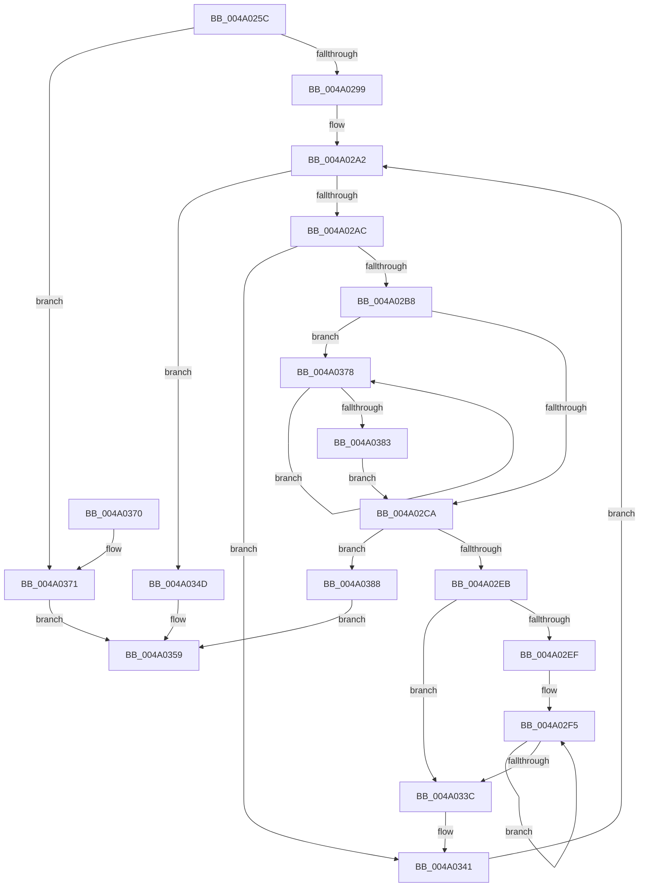

# StEtaStart

- RVA: `0x004A025C`–`0x004A038F` (길이 `307` bytes)
- VA: `0x00000001404A025C`
- 실행 섹션: `.text`
- PDB 이름 있음: `예`; PDB Function 태그: `아니요`
- unwind 정보 RVA: `0x000B578C`
- 디코드: `90`개 명령, `307/307` bytes 표시
- 미해석 바이트: `0` (있으면 어셈블리에 `.byte`로 보존)

> 이 문서는 커널 이미지의 기계어와 PDB 기호를 분석해 생성했습니다. 4번과 5번은 함수 원형과 자료형을 바이너리 사용 방식에서 추정한 C 해석이며 원본 소스 복구 결과는 아닙니다.

## 1. Dependencies

- 직접 호출 지점: **2**; 고유 호출 대상: **2**
- 직접 호출자로 확인된 함수: **1**
- RIP 상대 이미지 참조: **0**

### Outgoing calls
- `0x004A0286` → [KeQueryPerformanceCounter](../37/KeQueryPerformanceCounter_function_0037E7E0.md) (function, `0x0037E7E0`)
- `0x004A02DA` → [ExAllocatePool2](../../poolcode/B8/ExAllocatePool2_function_00B820F0.md) (function, `0x00B820F0`)

### Direct callers
- [StEtaHelper::StartHelper](StEtaHelper_StartHelper_function_004A0194.md) at `0x004A0228`

### Static image references
- 디코드된 RIP-relative 메모리 참조가 없습니다.

## 2. Other-region calls and transfers

- 다른 실행 섹션으로 향하는 call: **1**
  - `0x004A02DA` → [ExAllocatePool2](../../poolcode/B8/ExAllocatePool2_function_00B820F0.md) (`.text` → `POOLCODE`)
- 별도 외부 분기/꼬리 이동을 확인하지 못했습니다.

## 3. Assembly (complete function range)

```asm
004A025C  48 8B C4                        mov rax, rsp
004A025F  48 89 58 08                     mov qword ptr [rax + 8], rbx
004A0263  4C 89 40 18                     mov qword ptr [rax + 0x18], r8
004A0267  55                              push rbp
004A0268  56                              push rsi
004A0269  57                              push rdi
004A026A  41 54                           push r12
004A026C  41 55                           push r13
004A026E  41 56                           push r14
004A0270  41 57                           push r15
004A0272  48 83 EC 20                     sub rsp, 0x20
004A0276  4C 8B E9                        mov r13, rcx
004A0279  33 FF                           xor edi, edi
004A027B  48 8D 48 20                     lea rcx, [rax + 0x20]
004A027F  48 89 78 20                     mov qword ptr [rax + 0x20], rdi
004A0283  48 8B F2                        mov rsi, rdx
004A0286  E8 55 E5 ED FF                  call 0x14037e7e0
004A028B  48 8B 5C 24 78                  mov rbx, qword ptr [rsp + 0x78]
004A0290  48 85 DB                        test rbx, rbx
004A0293  0F 84 D8 00 00 00               je 0x1404a0371
004A0299  4D 8B E5                        mov r12, r13
004A029C  44 8B FF                        mov r15d, edi
004A029F  4C 2B E6                        sub r12, rsi
004A02A2  49 83 FF 02                     cmp r15, 2
004A02A6  0F 8D A1 00 00 00               jge 0x1404a034d
004A02AC  4C 8B 36                        mov r14, qword ptr [rsi]
004A02AF  4D 85 F6                        test r14, r14
004A02B2  0F 84 89 00 00 00               je 0x1404a0341
004A02B8  41 83 3E FF                     cmp dword ptr [r14], -1
004A02BC  49 8B C6                        mov rax, r14
004A02BF  BD 01 00 00 00                  mov ebp, 1
004A02C4  0F 82 AE 00 00 00               jb 0x1404a0378
004A02CA  8B D5                           mov edx, ebp
004A02CC  B9 40 00 00 00                  mov ecx, 0x40
004A02D1  C1 E2 05                        shl edx, 5
004A02D4  41 B8 73 6D 49 74               mov r8d, 0x74496d73
004A02DA  E8 11 1E 6E 00                  call 0x140b820f0
004A02DF  4C 8B C0                        mov r8, rax
004A02E2  48 85 C0                        test rax, rax
004A02E5  0F 84 9D 00 00 00               je 0x1404a0388
004A02EB  85 ED                           test ebp, ebp
004A02ED  74 4D                           je 0x1404a033c
004A02EF  4C 8B C8                        mov r9, rax
004A02F2  44 8B D5                        mov r10d, ebp
004A02F5  41 8B 4E 04                     mov ecx, dword ptr [r14 + 4]
004A02F9  41 8B 06                        mov eax, dword ptr [r14]
004A02FC  4D 8D 76 08                     lea r14, [r14 + 8]
004A0300  41 89 79 04                     mov dword ptr [r9 + 4], edi
004A0304  49 89 79 10                     mov qword ptr [r9 + 0x10], rdi
004A0308  49 89 79 18                     mov qword ptr [r9 + 0x18], rdi
004A030C  41 89 01                        mov dword ptr [r9], eax
004A030F  48 B8 DB 34 B6 D7 82 DE 1B 43   movabs rax, 0x431bde82d7b634db
004A0319  48 0F AF CB                     imul rcx, rbx
004A031D  4D 8D 49 20                     lea r9, [r9 + 0x20]
004A0321  48 F7 E9                        imul rcx
004A0324  48 C1 FA 12                     sar rdx, 0x12
004A0328  48 8B C2                        mov rax, rdx
004A032B  48 C1 E8 3F                     shr rax, 0x3f
004A032F  48 03 D0                        add rdx, rax
004A0332  49 89 51 E8                     mov qword ptr [r9 - 0x18], rdx
004A0336  49 83 EA 01                     sub r10, 1
004A033A  75 B9                           jne 0x1404a02f5
004A033C  4D 89 44 34 10                  mov qword ptr [r12 + rsi + 0x10], r8
004A0341  49 FF C7                        inc r15
004A0344  48 83 C6 08                     add rsi, 8
004A0348  E9 55 FF FF FF                  jmp 0x1404a02a2
004A034D  48 8B 4C 24 70                  mov rcx, qword ptr [rsp + 0x70]
004A0352  48 8B 09                        mov rcx, qword ptr [rcx]
004A0355  49 89 4D 20                     mov qword ptr [r13 + 0x20], rcx
004A0359  48 8B 5C 24 60                  mov rbx, qword ptr [rsp + 0x60]
004A035E  8B C7                           mov eax, edi
004A0360  48 83 C4 20                     add rsp, 0x20
004A0364  41 5F                           pop r15
004A0366  41 5E                           pop r14
004A0368  41 5D                           pop r13
004A036A  41 5C                           pop r12
004A036C  5F                              pop rdi
004A036D  5E                              pop rsi
004A036E  5D                              pop rbp
004A036F  C3                              ret
004A0370  CC                              int3
004A0371  BF BB 00 00 C0                  mov edi, 0xc00000bb
004A0376  EB E1                           jmp 0x1404a0359
004A0378  48 8D 40 08                     lea rax, [rax + 8]
004A037C  FF C5                           inc ebp
004A037E  83 38 FF                        cmp dword ptr [rax], -1
004A0381  72 F5                           jb 0x1404a0378
004A0383  E9 42 FF FF FF                  jmp 0x1404a02ca
004A0388  BF 9A 00 00 C0                  mov edi, 0xc000009a
004A038D  EB CA                           jmp 0x1404a0359
```

## 4. C-style interpretation (structured pseudocode)

```c
__int64 __fastcall StEtaStart(__int64 a1, __int64 a2, __int64 a3)
{
    __int64 result;
    __int64 v_r10;
    __int64 v_r12;
    __int64 v_r15;
    __int64 v_rbp;
    __int64 v_rdi;
    __int64 v_rsi;
    __int64 v_rsp;
    unsigned __int64 v_stack_p18;
    unsigned __int64 v_stack_p20;
    unsigned __int64 v_stack_p8;

    *(unsigned __int64 *)(v_rsp + 8) = v_rbx;
    *(unsigned __int64 *)(v_rsp + 24) = a3;
    v_rsp = (v_rsp) - (32);
    v_rdi = 0;
    *(unsigned __int64 *)(v_rsp + 32) = 0;
    result = KeQueryPerformanceCounter(v_rsp + 32, a2, a3, a4);
    if (v_stack_p20 == 0) goto loc_004A0371;
    v_r12 = (a1) - (a2);
loc_004A02A2:
    if (0 >= 2) goto loc_004A034D;
    if (*(unsigned __int64 *)(a2) == 0) goto loc_004A0341;
    if ((*(unsigned int *)(*(unsigned __int64 *)(a2))) < -1) goto loc_004A0378;
loc_004A02CA:
    a2 = (unsigned int)((1) << (5));
    result = ExAllocatePool2(64, a2, (unsigned int)(0x74496D73ULL), a4);
    if (result == 0) goto loc_004A0388;
    if (1 == 0) goto loc_004A033C;
loc_004A02F5:
    *(unsigned int *)(result + 4) = 0;
    *(unsigned __int64 *)(result + 16) = 0;
    *(unsigned __int64 *)(result + 24) = 0;
    *(unsigned int *)(result) = (unsigned int)((unsigned int)(*(unsigned int *)(*(unsigned __int64 *)(a2))));
    a1 = ((unsigned int)(*(unsigned int *)(*(unsigned __int64 *)(a2) + 4))) * (v_stack_p20);
    a2 = (a2) >> (18);
    result = (a2) >> (63);
    a2 = (a2) + (result);
    *(unsigned __int64 *)(result + 32 - 24) = a2;
    v_r10 = (1) - (1);
    if (condition_is_not_equal) goto loc_004A02F5;
loc_004A033C:
    *(unsigned __int64 *)(v_r12 + a2 * 1 + 16) = result;
loc_004A0341:
    v_r15 = (0) + 1;
    v_rsi = (a2) + (8);
    goto loc_004A02A2;
loc_004A034D:
    *(unsigned __int64 *)(a1 + 32) = *(unsigned __int64 *)(v_stack_p18);
loc_004A0359:
    v_rsp = (v_rsp) + (32);
    return 0;
loc_004A0371:
    goto loc_004A0359;
loc_004A0378:
    v_rbp = (unsigned int)((1) + 1);
    if ((*(unsigned int *)(0 + 8)) < -1) goto loc_004A0378;
    goto loc_004A02CA;
loc_004A0388:
    goto loc_004A0359;
}
```

## 5. (Beta) C Style

```c
int64_t StEtaStart(void *Arg1, void *Arg2, int64_t Arg3)
{
    uint8_t *arg1 = (uint8_t *)Arg1;
    uint8_t *arg2 = (uint8_t *)Arg2;

    int64_t result;
    int64_t local_r10;
    int64_t local_r12;
    int64_t local_r15;
    int64_t local_rbp;
    int64_t local_rdi;
    int64_t local_rsi;
    int64_t local_rsp;
    uint64_t v_stack_p18;
    uint64_t v_stack_p20;
    uint64_t v_stack_p8;

    *(uint64_t *)(local_rsp + 0x8) = local_rbx;
    *(uint64_t *)(local_rsp + 0x18) = Arg3;
    local_rsp = (local_rsp) - (32);
    local_rdi = 0;
    *(uint64_t *)(local_rsp + 0x20) = 0;
    result = KeQueryPerformanceCounter(local_rsp + 32, Arg2, Arg3, a4);
    if (v_stack_p20 == 0) goto loc_004A0371;
    local_r12 = (Arg1) - (Arg2);
loc_004A02A2:
    if (0 >= 2) goto loc_004A034D;
    if (*(uint64_t *)(arg2) == 0) goto loc_004A0341;
    if ((*(uint32_t *)(*(uint64_t *)(arg2))) < -1) goto loc_004A0378;
loc_004A02CA:
    Arg2 = (uint32_t)((1) << (5));
    result = ExAllocatePool2(64, Arg2, (uint32_t)(0x74496D73ULL), a4);
    if (result == 0) goto loc_004A0388;
    if (1 == 0) goto loc_004A033C;
loc_004A02F5:
    *(uint32_t *)(result + 0x4) = 0;
    *(uint64_t *)(result + 0x10) = 0;
    *(uint64_t *)(result + 0x18) = 0;
    *(uint32_t *)(result) = (uint32_t)((uint32_t)(*(uint32_t *)(*(uint64_t *)(arg2))));
    Arg1 = ((uint32_t)(*(uint32_t *)(*(uint64_t *)(arg2) + 0x4))) * (v_stack_p20);
    Arg2 = (Arg2) >> (18);
    result = (Arg2) >> (63);
    Arg2 = (Arg2) + (result);
    *(void **)(result + 0x20 - 0x18) = Arg2;
    local_r10 = (1) - (1);
    if (condition_is_not_equal) goto loc_004A02F5;
loc_004A033C:
    *(uint64_t *)(local_r12 + arg2 * 1 + 0x10) = result;
loc_004A0341:
    local_r15 = (0) + 1;
    local_rsi = (Arg2) + (8);
    goto loc_004A02A2;
loc_004A034D:
    *(uint64_t *)(arg1 + 0x20) = *(uint64_t *)(v_stack_p18);
loc_004A0359:
    local_rsp = (local_rsp) + (32);
    return 0;
loc_004A0371:
    goto loc_004A0359;
loc_004A0378:
    local_rbp = (uint32_t)((1) + 1);
    if ((*(uint32_t *)(0 + 0x8)) < -1) goto loc_004A0378;
    goto loc_004A02CA;
loc_004A0388:
    goto loc_004A0359;
}
```

### 관측된 메모리 오프셋

구조체 형식이 확인되지 않은 접근은 인자 기준의 오프셋으로만 기록했습니다.

| 기준 인자 | 오프셋 표현 | 폭 (bit) | 접근 |
|---|---:|---:|---|
| `Arg1` | `+ 0x10 + rsi*1` | `64` | `W` |
| `Arg1` | `+ 0x20` | `64` | `W` |
| `Arg2` | `+ 0x0` | `64` | `R` |

## 6. Execution-region graph

[열기: 2D/3D 그래프와 함수 탐색 컨트롤 패널](../../../control-panel.html?section=text&rva=0x004A025C&view=graph)

- 2D 그래프는 위에서 아래로 흐르고, 3D 그래프는 빈 공간을 드래그해 회전합니다. Shift+드래그는 이동, 휠은 확대·축소, 함수 노드 선택은 대상 보고서 이동입니다.

### Static fallback


