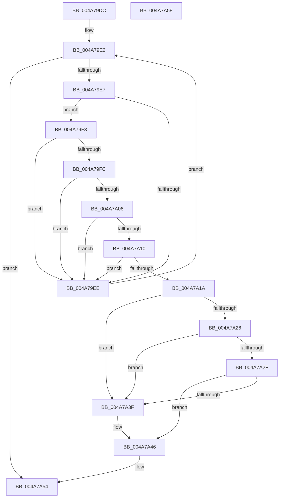

# TxtpGetCacheEntry

- RVA: `0x004A79DC`–`0x004A7A59` (길이 `125` bytes)
- VA: `0x00000001404A79DC`
- 실행 섹션: `.text`
- PDB 이름 있음: `예`; PDB Function 태그: `아니요`
- unwind 정보 RVA: `0x000DB714`
- 디코드: `41`개 명령, `125/125` bytes 표시
- 미해석 바이트: `0` (있으면 어셈블리에 `.byte`로 보존)

> 이 문서는 커널 이미지의 기계어와 PDB 기호를 분석해 생성했습니다. 4번과 5번은 함수 원형과 자료형을 바이너리 사용 방식에서 추정한 C 해석이며 원본 소스 복구 결과는 아닙니다.

## 1. Dependencies

- 직접 호출 지점: **0**; 고유 호출 대상: **0**
- 직접 호출자로 확인된 함수: **1**
- RIP 상대 이미지 참조: **0**

### Outgoing calls
- 직접 디코드된 call 명령이 없습니다.

### Direct callers
- [BgpTxtDisplayCharacter](../47/BgpTxtDisplayCharacter_function_0047F120.md) at `0x0047F1B6`

### Static image references
- 디코드된 RIP-relative 메모리 참조가 없습니다.

## 2. Other-region calls and transfers

- 다른 실행 섹션으로 향하는 call: **0**
- 별도 외부 분기/꼬리 이동을 확인하지 못했습니다.

## 3. Assembly (complete function range)

```asm
004A79DC  4C 8B 09                        mov r9, qword ptr [rcx]
004A79DF  45 33 D2                        xor r10d, r10d
004A79E2  4C 3B C9                        cmp r9, rcx
004A79E5  74 6D                           je 0x1404a7a54
004A79E7  66 41 39 51 10                  cmp word ptr [r9 + 0x10], dx
004A79EC  74 05                           je 0x1404a79f3
004A79EE  4D 8B 09                        mov r9, qword ptr [r9]
004A79F1  EB EF                           jmp 0x1404a79e2
004A79F3  41 8B 00                        mov eax, dword ptr [r8]
004A79F6  41 39 41 18                     cmp dword ptr [r9 + 0x18], eax
004A79FA  75 F2                           jne 0x1404a79ee
004A79FC  41 8B 40 04                     mov eax, dword ptr [r8 + 4]
004A7A00  41 39 41 1C                     cmp dword ptr [r9 + 0x1c], eax
004A7A04  75 E8                           jne 0x1404a79ee
004A7A06  49 8B 40 08                     mov rax, qword ptr [r8 + 8]
004A7A0A  49 39 41 20                     cmp qword ptr [r9 + 0x20], rax
004A7A0E  75 DE                           jne 0x1404a79ee
004A7A10  41 8B 40 10                     mov eax, dword ptr [r8 + 0x10]
004A7A14  41 39 41 28                     cmp dword ptr [r9 + 0x28], eax
004A7A18  75 D4                           jne 0x1404a79ee
004A7A1A  49 8B 01                        mov rax, qword ptr [r9]
004A7A1D  4D 8B D1                        mov r10, r9
004A7A20  4C 39 48 08                     cmp qword ptr [rax + 8], r9
004A7A24  75 19                           jne 0x1404a7a3f
004A7A26  49 8B 51 08                     mov rdx, qword ptr [r9 + 8]
004A7A2A  4C 39 0A                        cmp qword ptr [rdx], r9
004A7A2D  75 10                           jne 0x1404a7a3f
004A7A2F  48 89 02                        mov qword ptr [rdx], rax
004A7A32  48 89 50 08                     mov qword ptr [rax + 8], rdx
004A7A36  48 8B 01                        mov rax, qword ptr [rcx]
004A7A39  48 39 48 08                     cmp qword ptr [rax + 8], rcx
004A7A3D  74 07                           je 0x1404a7a46
004A7A3F  B9 03 00 00 00                  mov ecx, 3
004A7A44  CD 29                           int 0x29
004A7A46  49 89 01                        mov qword ptr [r9], rax
004A7A49  49 89 49 08                     mov qword ptr [r9 + 8], rcx
004A7A4D  4C 89 48 08                     mov qword ptr [rax + 8], r9
004A7A51  4C 89 09                        mov qword ptr [rcx], r9
004A7A54  49 8B C2                        mov rax, r10
004A7A57  C3                              ret
004A7A58  CC                              int3
```

## 4. C-style interpretation (structured pseudocode)

```c
__int64 __fastcall TxtpGetCacheEntry(__int64 a1, unsigned __int16 a2, __int64 a3)
{
    __int64 v_r10;

    v_r10 = 0;
loc_004A79E2:
    if ((*(unsigned __int64 *)(a1)) == a1) goto loc_004A7A54;
    if ((*(unsigned __int16 *)(*(unsigned __int64 *)(a1) + 16)) == a2) goto loc_004A79F3;
loc_004A79EE:
    goto loc_004A79E2;
loc_004A79F3:
    if ((*(unsigned int *)(*(unsigned __int64 *)(*(unsigned __int64 *)(a1)) + 24)) != ((unsigned int)((unsigned int)(*(unsigned int *)(a3))))) goto loc_004A79EE;
    if ((*(unsigned int *)(*(unsigned __int64 *)(*(unsigned __int64 *)(a1)) + 28)) != ((unsigned int)((unsigned int)(*(unsigned int *)(a3 + 4))))) goto loc_004A79EE;
    if ((*(unsigned __int64 *)(*(unsigned __int64 *)(*(unsigned __int64 *)(a1)) + 32)) != (*(unsigned __int64 *)(a3 + 8))) goto loc_004A79EE;
    if ((*(unsigned int *)(*(unsigned __int64 *)(*(unsigned __int64 *)(a1)) + 40)) != ((unsigned int)((unsigned int)(*(unsigned int *)(a3 + 16))))) goto loc_004A79EE;
    if ((*(unsigned __int64 *)(*(unsigned __int64 *)(*(unsigned __int64 *)(*(unsigned __int64 *)(a1))) + 8)) != (*(unsigned __int64 *)(*(unsigned __int64 *)(a1)))) goto loc_004A7A3F;
    if ((*(unsigned __int64 *)(*(unsigned __int64 *)(*(unsigned __int64 *)(*(unsigned __int64 *)(a1)) + 8))) != (*(unsigned __int64 *)(*(unsigned __int64 *)(a1)))) goto loc_004A7A3F;
    *(unsigned __int64 *)(*(unsigned __int64 *)(*(unsigned __int64 *)(*(unsigned __int64 *)(a1)) + 8)) = *(unsigned __int64 *)(*(unsigned __int64 *)(*(unsigned __int64 *)(a1)));
    *(unsigned __int64 *)(*(unsigned __int64 *)(*(unsigned __int64 *)(*(unsigned __int64 *)(a1))) + 8) = *(unsigned __int64 *)(*(unsigned __int64 *)(*(unsigned __int64 *)(a1)) + 8);
    if ((*(unsigned __int64 *)(*(unsigned __int64 *)(a1) + 8)) != a1) {
        a1 = 3;
    }
    *(unsigned __int64 *)(*(unsigned __int64 *)(*(unsigned __int64 *)(a1))) = *(unsigned __int64 *)(a1);
    *(unsigned __int64 *)(*(unsigned __int64 *)(*(unsigned __int64 *)(a1)) + 8) = a1;
    *(unsigned __int64 *)(*(unsigned __int64 *)(a1) + 8) = *(unsigned __int64 *)(*(unsigned __int64 *)(a1));
    *(unsigned __int64 *)(a1) = *(unsigned __int64 *)(*(unsigned __int64 *)(a1));
loc_004A7A54:
    return *(unsigned __int64 *)(*(unsigned __int64 *)(a1));
}
```

## 5. (Beta) C Style

```c
int64_t TxtpGetCacheEntry(void *Arg1, uint16_t Arg2, void *Arg3)
{
    uint8_t *arg1 = (uint8_t *)Arg1;
    uint8_t *arg3 = (uint8_t *)Arg3;

    int64_t local_r10;

    local_r10 = 0;
loc_004A79E2:
    if ((*(uint64_t *)(arg1)) == Arg1) goto loc_004A7A54;
    if ((*(uint16_t *)(*(uint64_t *)(arg1) + 0x10)) == Arg2) goto loc_004A79F3;
loc_004A79EE:
    goto loc_004A79E2;
loc_004A79F3:
    if ((*(uint32_t *)(*(uint64_t *)(*(uint64_t *)(arg1)) + 0x18)) != ((uint32_t)((uint32_t)(*(uint32_t *)(arg3))))) goto loc_004A79EE;
    if ((*(uint32_t *)(*(uint64_t *)(*(uint64_t *)(arg1)) + 0x1C)) != ((uint32_t)((uint32_t)(*(uint32_t *)(arg3 + 0x4))))) goto loc_004A79EE;
    if ((*(uint64_t *)(*(uint64_t *)(*(uint64_t *)(arg1)) + 0x20)) != (*(uint64_t *)(arg3 + 0x8))) goto loc_004A79EE;
    if ((*(uint32_t *)(*(uint64_t *)(*(uint64_t *)(arg1)) + 0x28)) != ((uint32_t)((uint32_t)(*(uint32_t *)(arg3 + 0x10))))) goto loc_004A79EE;
    if ((*(uint64_t *)(*(uint64_t *)(*(uint64_t *)(*(uint64_t *)(arg1))) + 0x8)) != (*(uint64_t *)(*(uint64_t *)(arg1)))) goto loc_004A7A3F;
    if ((*(uint64_t *)(*(uint64_t *)(*(uint64_t *)(*(uint64_t *)(arg1)) + 0x8))) != (*(uint64_t *)(*(uint64_t *)(arg1)))) goto loc_004A7A3F;
    *(uint64_t *)(*(uint64_t *)(*(uint64_t *)(*(uint64_t *)(arg1)) + 0x8)) = *(uint64_t *)(*(uint64_t *)(*(uint64_t *)(arg1)));
    *(uint64_t *)(*(uint64_t *)(*(uint64_t *)(*(uint64_t *)(arg1))) + 0x8) = *(uint64_t *)(*(uint64_t *)(*(uint64_t *)(arg1)) + 0x8);
    if ((*(uint64_t *)(*(uint64_t *)(arg1) + 0x8)) != Arg1) {
        Arg1 = 3;
    }
    *(uint64_t *)(*(uint64_t *)(*(uint64_t *)(arg1))) = *(uint64_t *)(arg1);
    *(void **)(*(uint64_t *)(*(uint64_t *)(arg1)) + 0x8) = Arg1;
    *(uint64_t *)(*(uint64_t *)(arg1) + 0x8) = *(uint64_t *)(*(uint64_t *)(arg1));
    *(uint64_t *)(arg1) = *(uint64_t *)(*(uint64_t *)(arg1));
loc_004A7A54:
    return *(uint64_t *)(*(uint64_t *)(arg1));
}
```

### 관측된 메모리 오프셋

구조체 형식이 확인되지 않은 접근은 인자 기준의 오프셋으로만 기록했습니다.

| 기준 인자 | 오프셋 표현 | 폭 (bit) | 접근 |
|---|---:|---:|---|
| `Arg1` | `+ 0x0` | `64` | `R` |
| `Arg3` | `+ 0x0` | `32` | `R` |
| `Arg3` | `+ 0x4` | `32` | `R` |
| `Arg3` | `+ 0x8` | `64` | `R` |
| `Arg3` | `+ 0x10` | `32` | `R` |

## 6. Execution-region graph

[열기: 2D/3D 그래프와 함수 탐색 컨트롤 패널](../../../control-panel.html?section=text&rva=0x004A79DC&view=graph)

- 2D 그래프는 위에서 아래로 흐르고, 3D 그래프는 빈 공간을 드래그해 회전합니다. Shift+드래그는 이동, 휠은 확대·축소, 함수 노드 선택은 대상 보고서 이동입니다.

### Static fallback


