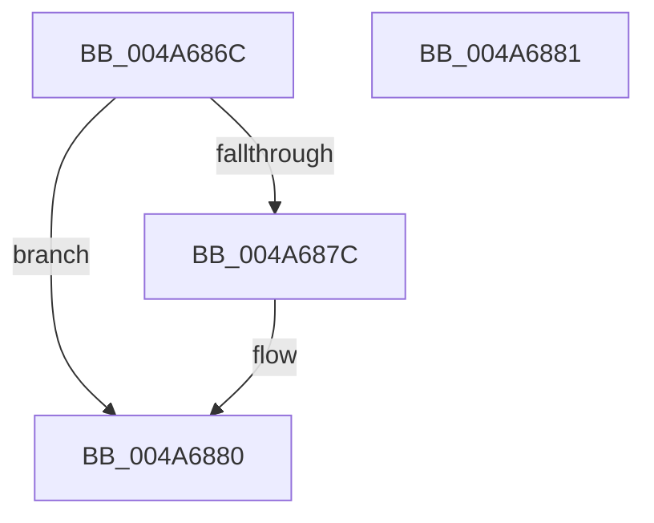

# VfAvlInitializeLockContext

- RVA: `0x004A686C`–`0x004A6882` (길이 `22` bytes)
- VA: `0x00000001404A686C`
- 실행 섹션: `.text`
- PDB 이름 있음: `예`; PDB Function 태그: `아니요`
- unwind 정보 RVA: `0x000DB714`
- 디코드: `9`개 명령, `22/22` bytes 표시
- 미해석 바이트: `0` (있으면 어셈블리에 `.byte`로 보존)

> 이 문서는 커널 이미지의 기계어와 PDB 기호를 분석해 생성했습니다. 4번과 5번은 함수 원형과 자료형을 바이너리 사용 방식에서 추정한 C 해석이며 원본 소스 복구 결과는 아닙니다.

## 1. Dependencies

- 직접 호출 지점: **0**; 고유 호출 대상: **0**
- 직접 호출자로 확인된 함수: **43**
- RIP 상대 이미지 참조: **0**

### Outgoing calls
- 직접 디코드된 call 명령이 없습니다.

### Direct callers
- [DifEnumeratePluginData](../61/DifEnumeratePluginData_function_00612590.md) at `0x006125CC`
- [VfTargetRecoverIoCallbacks](../61/VfTargetRecoverIoCallbacks_function_006131F0.md) at `0x0061321C`
- [VfTargetReplaceIoCallbacks](../61/VfTargetReplaceIoCallbacks_function_00613260.md) at `0x006132A0`
- [VfAvlDeleteAllTreeNodes](../../pagevrfy/B9/VfAvlDeleteAllTreeNodes_function_00B93B9C.md) at `0x00B93BBB`
- [VfTargetDriversDisableVerifier](../../pagevrfy/B9/VfTargetDriversDisableVerifier_function_00B9B2CC.md) at `0x00B9B2F3`
- [VfTargetDriversEnableVerifier](../../pagevrfy/B9/VfTargetDriversEnableVerifier_function_00B9B354.md) at `0x00B9B3A0`
- [VfTargetEtwRegister](../../pagevrfy/B9/VfTargetEtwRegister_function_00B9B49C.md) at `0x00B9B4ED`
- [VfTargetEtwUnregister](../../pagevrfy/B9/VfTargetEtwUnregister_function_00B9B590.md) at `0x00B9B5CE`
- [VfTargetFreeContiguousMemory](../../pagevrfy/B9/VfTargetFreeContiguousMemory_function_00B9B6BC.md) at `0x00B9B6F1`
- [VfTargetWMIRegistrationControl](../../pagevrfy/B9/VfTargetWMIRegistrationControl_function_00B9B74C.md) at `0x00B9B79F`
- [ViTargetAddToCounter](../../pagevrfy/B9/ViTargetAddToCounter_function_00B9B8E0.md) at `0x00B9B920`
- [ViTargetWMIDeregister](../../pagevrfy/B9/ViTargetWMIDeregister_function_00B9BC28.md) at `0x00B9BC4A`
- [IovpCallDriver1](../../pagevrfy/B9/IovpCallDriver1_function_00B9CCA4.md) at `0x00B9D111`
- [VerifierKeAcquireQueuedSpinLock](../../pagevrfy/B9/VerifierKeAcquireQueuedSpinLock_function_00B9FBD0.md) at `0x00B9FC38`
- [ViDevObjAdd](../../pagevrfy/BA/ViDevObjAdd_function_00BA23F4.md) at `0x00BA244A`
- [ViDevObjRemove](../../pagevrfy/BA/ViDevObjRemove_function_00BA248C.md) at `0x00BA24DA`
- [VerifierIoInitializeRemoveLockEx](../../pagevrfy/BA/VerifierIoInitializeRemoveLockEx_function_00BA2610.md) at `0x00BA272D`
- [ViRemLockDeleteFirstTreeNode](../../pagevrfy/BA/ViRemLockDeleteFirstTreeNode_function_00BA28F4.md) at `0x00BA291C`
- [ViRemLockFindSurrogate](../../pagevrfy/BA/ViRemLockFindSurrogate_function_00BA2994.md) at `0x00BA29B4`
- [VerifierKeAcquireInStackQueuedSpinLockAtDpcLevel](../../pagevrfy/BA/VerifierKeAcquireInStackQueuedSpinLockAtDpcLevel_function_00BA4F20.md) at `0x00BA4F7B`
- [VerifierKeAcquireInStackQueuedSpinLockCommon](../../pagevrfy/BA/VerifierKeAcquireInStackQueuedSpinLockCommon_function_00BA4FD8.md) at `0x00BA504A`
- [VerifierKeAcquireInStackQueuedSpinLockForDpcCommon](../../pagevrfy/BA/VerifierKeAcquireInStackQueuedSpinLockForDpcCommon_function_00BA5100.md) at `0x00BA5159`
- [VerifierKeAcquireInStackQueuedSpinLockRaiseToSynch](../../pagevrfy/BA/VerifierKeAcquireInStackQueuedSpinLockRaiseToSynch_function_00BA51C0.md) at `0x00BA5234`
- [VerifierKeAcquireQueuedSpinLockRaiseToSynch](../../pagevrfy/BA/VerifierKeAcquireQueuedSpinLockRaiseToSynch_function_00BA52C0.md) at `0x00BA532C`
- [VerifierKeAcquireSpinLockAtDpcLevel](../../pagevrfy/BA/VerifierKeAcquireSpinLockAtDpcLevel_function_00BA53B0.md) at `0x00BA5404`
- [VerifierKeSynchronizeExecution](../../pagevrfy/BA/VerifierKeSynchronizeExecution_function_00BA59A0.md) at `0x00BA5A11`
- [VerifierKeTryToAcquireQueuedSpinLock](../../pagevrfy/BA/VerifierKeTryToAcquireQueuedSpinLock_function_00BA5A80.md) at `0x00BA5AF4`
- [VerifierKeTryToAcquireQueuedSpinLockRaiseToSynch](../../pagevrfy/BA/VerifierKeTryToAcquireQueuedSpinLockRaiseToSynch_function_00BA5B80.md) at `0x00BA5BF4`
- [VerifierKeTryToAcquireSpinLockAtDpcLevel](../../pagevrfy/BA/VerifierKeTryToAcquireSpinLockAtDpcLevel_function_00BA5C80.md) at `0x00BA5CD4`
- [VerifierPortKeAcquireSpinLockNoXdv](../../pagevrfy/BA/VerifierPortKeAcquireSpinLockNoXdv_function_00BA5E80.md) at `0x00BA5F0C`
- [ViKeAcquireSpinLockCommon](../../pagevrfy/BA/ViKeAcquireSpinLockCommon_function_00BA60B0.md) at `0x00BA613F`
- [ViFaultsInjectionNotification](../../pagevrfy/BA/ViFaultsInjectionNotification_function_00BA6BDC.md) at `0x00BA6C37`
- [VfSuspectDriversGetVerifierInformation](../../pagevrfy/BA/VfSuspectDriversGetVerifierInformation_function_00BAA884.md) at `0x00BAAA36`
- [VfLookasideAdd](../../pagevrfy/BA/VfLookasideAdd_function_00BAFE34.md) at `0x00BAFEA1`
- [VfLookasideDelete](../../pagevrfy/BA/VfLookasideDelete_function_00BAFF58.md) at `0x00BAFF90`
- [VerifierIoWMIRegistrationControl](../../pagevrfy/BB/VerifierIoWMIRegistrationControl_function_00BB1590.md) at `0x00BB15D0`
- [VfDeleteResource](../../pagevrfy/BB/VfDeleteResource_function_00BB187C.md) at `0x00BB18C6`
- [VfTrackResource](../../pagevrfy/BB/VfTrackResource_function_00BB19A0.md) at `0x00BB1A0E`
- [VfWmiVerifyIrpStackUpward](../../pagevrfy/BB/VfWmiVerifyIrpStackUpward_function_00BB6200.md) at `0x00BB626C`
- [VfCheckForResource](../../pagevrfy/BB/VfCheckForResource_function_00BB71C8.md) at `0x00BB723F`
- [VfCheckForResource](../../pagevrfy/BB/VfCheckForResource_function_00BB71C8.md) at `0x00BB727F`
- [VfRemLockDeleteMemoryRange](../../pagevrfy/BB/VfRemLockDeleteMemoryRange_function_00BB7AEC.md) at `0x00BB7B48`
- [VfCheckForLookaside](../../pagevrfy/BB/VfCheckForLookaside_function_00BB7C80.md) at `0x00BB7CC4`
- [VfHandlePoolAlloc](../../pagevrfy/BB/VfHandlePoolAlloc_function_00BB8A90.md) at `0x00BB8D65`

### Static image references
- 디코드된 RIP-relative 메모리 참조가 없습니다.

## 2. Other-region calls and transfers

- 다른 실행 섹션으로 향하는 call: **0**
- 별도 외부 분기/꼬리 이동을 확인하지 못했습니다.

## 3. Assembly (complete function range)

```asm
004A686C  33 C0                           xor eax, eax
004A686E  0F 57 C0                        xorps xmm0, xmm0
004A6871  0F 11 01                        movups xmmword ptr [rcx], xmm0
004A6874  48 89 41 10                     mov qword ptr [rcx + 0x10], rax
004A6878  85 D2                           test edx, edx
004A687A  75 04                           jne 0x1404a6880
004A687C  C6 41 0C 04                     mov byte ptr [rcx + 0xc], 4
004A6880  C3                              ret
004A6881  CC                              int3
```

## 4. C-style interpretation (structured pseudocode)

```c
__int64 __fastcall VfAvlInitializeLockContext(__int64 a1, int a2)
{
    __int64 result;

    result = 0;
    *(unsigned __int64 *)(a1) = v_xmm0;
    *(unsigned __int64 *)(a1 + 16) = 0;
    if (a2 == 0) {
        *(unsigned __int8 *)(a1 + 12) = 4;
    }
    return result;
}
```

## 5. (Beta) C Style

```c
int64_t VfAvlInitializeLockContext(void *Arg1, int32_t Arg2)
{
    uint8_t *arg1 = (uint8_t *)Arg1;

    int64_t result;

    result = 0;
    *(uint64_t *)(arg1) = v_xmm0;
    *(uint64_t *)(arg1 + 0x10) = 0;
    if (Arg2 == 0) {
        *(uint8_t *)(arg1 + 0xC) = 4;
    }
    return result;
}
```

### 관측된 메모리 오프셋

구조체 형식이 확인되지 않은 접근은 인자 기준의 오프셋으로만 기록했습니다.

| 기준 인자 | 오프셋 표현 | 폭 (bit) | 접근 |
|---|---:|---:|---|
| `Arg1` | `+ 0x0` | `128` | `R` |
| `Arg1` | `+ 0xC` | `8` | `W` |
| `Arg1` | `+ 0x10` | `64` | `W` |

## 6. Execution-region graph

[열기: 2D/3D 그래프와 함수 탐색 컨트롤 패널](../../../control-panel.html?section=text&rva=0x004A686C&view=graph)

- 2D 그래프는 위에서 아래로 흐르고, 3D 그래프는 빈 공간을 드래그해 회전합니다. Shift+드래그는 이동, 휠은 확대·축소, 함수 노드 선택은 대상 보고서 이동입니다.

### Static fallback


