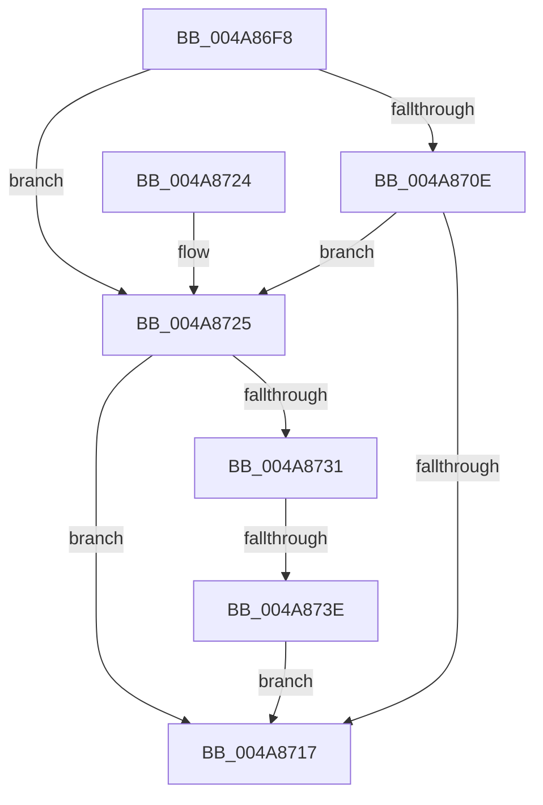

# VfDifCaptureDriverEntry

- RVA: `0x004A86F8`–`0x004A875B` (길이 `99` bytes)
- VA: `0x00000001404A86F8`
- 실행 섹션: `.text`
- PDB 이름 있음: `예`; PDB Function 태그: `예`
- unwind 정보 RVA: `0x000B7578`
- 디코드: `28`개 명령, `99/99` bytes 표시
- 미해석 바이트: `0` (있으면 어셈블리에 `.byte`로 보존)

> 이 문서는 커널 이미지의 기계어와 PDB 기호를 분석해 생성했습니다. 4번과 5번은 함수 원형과 자료형을 바이너리 사용 방식에서 추정한 C 해석이며 원본 소스 복구 결과는 아닙니다.

## 1. Dependencies

- 직접 호출 지점: **3**; 고유 호출 대상: **3**
- 직접 호출자로 확인된 함수: **2**
- RIP 상대 이미지 참조: **2**

### Outgoing calls
- `0x004A870E` → [MmIsDriverVerifying](MmIsDriverVerifying_function_004A8770.md) (function, `0x004A8770`)
- `0x004A8728` → [ViDifCheckCallbackInterception](../../pagevrfy/B9/ViDifCheckCallbackInterception_function_00B9A848.md) (function, `0x00B9A848`)
- `0x004A8754` → [VfUtilDbgPrint](../61/VfUtilDbgPrint_function_006122AC.md) (function, `0x006122AC`)

### Direct callers
- [IopLoadDriver](../../page/99/IopLoadDriver_function_00997B54.md) at `0x00998236`
- [IopInitializeBuiltinDriver](../../init/C7/IopInitializeBuiltinDriver_function_00C7625C.md) at `0x00C7660C`

### Static image references
- `0x004A8702` → RVA `0x00F048B8` (`.data`; read)
- `0x004A8747` → RVA `0x006CE240` (` ?? ::FNODOBFM::`string'`; read)

## 2. Other-region calls and transfers

- 다른 실행 섹션으로 향하는 call: **1**
  - `0x004A8728` → [ViDifCheckCallbackInterception](../../pagevrfy/B9/ViDifCheckCallbackInterception_function_00B9A848.md) (`.text` → `PAGEVRFY`)
- call이 아닌 외부 분기/꼬리 이동: **1**
  - `0x004A8738` → [sub_006F9C9A](../6F/Unknown_function_006F9C9A.md) (`tail-transfer`)

## 3. Assembly (complete function range)

```asm
004A86F8  48 89 5C 24 08                  mov qword ptr [rsp + 8], rbx
004A86FD  57                              push rdi
004A86FE  48 83 EC 30                     sub rsp, 0x30
004A8702  80 3D AF C1 A5 00 00            cmp byte ptr [rip + 0xa5c1af], 0
004A8709  48 8B D9                        mov rbx, rcx
004A870C  75 17                           jne 0x1404a8725
004A870E  E8 5D 00 00 00                  call 0x1404a8770
004A8713  85 C0                           test eax, eax
004A8715  75 0E                           jne 0x1404a8725
004A8717  32 C0                           xor al, al
004A8719  48 8B 5C 24 40                  mov rbx, qword ptr [rsp + 0x40]
004A871E  48 83 C4 30                     add rsp, 0x30
004A8722  5F                              pop rdi
004A8723  C3                              ret
004A8724  CC                              int3
004A8725  48 8B CB                        mov rcx, rbx
004A8728  E8 1B 21 6F 00                  call 0x140b9a848
004A872D  84 C0                           test al, al
004A872F  74 E6                           je 0x1404a8717
004A8731  48 8B 4B 18                     mov rcx, qword ptr [rbx + 0x18]
004A8735  48 85 C9                        test rcx, rcx
004A8738  0F 85 5C 15 25 00               jne 0x1406f9c9a
004A873E  0F 10 43 38                     movups xmm0, xmmword ptr [rbx + 0x38]
004A8742  48 8D 54 24 20                  lea rdx, [rsp + 0x20]
004A8747  48 8D 0D F2 5A 22 00            lea rcx, [rip + 0x225af2]
004A874E  F3 0F 7F 44 24 20               movdqu xmmword ptr [rsp + 0x20], xmm0
004A8754  E8 53 9B 16 00                  call 0x1406122ac
004A8759  EB BC                           jmp 0x1404a8717
```

## 4. C-style interpretation (structured pseudocode)

```c
__int64 __fastcall VfDifCaptureDriverEntry(__int64 a1)
{
    __int64 result;
    __int64 v_rsp;
    unsigned __int64 v_stack_p20;
    unsigned __int64 v_stack_p8;

    v_stack_p8 = v_rbx;
    v_rsp = (v_rsp) - (48);
    if ((*(unsigned __int8 *)(v_rip + 10863023)) != 0) goto loc_004A8725;
    result = MmIsDriverVerifying(a1, a2, a3, a4);
    if ((unsigned int)(result) != 0) goto loc_004A8725;
loc_004A8717:
    result = 0;
    v_rsp = (v_rsp) + (48);
    return result;
loc_004A8725:
    result = ViDifCheckCallbackInterception(v_stack_p8, a2, a3, a4);
    if ((unsigned __int8)(result) == 0) goto loc_004A8717;
    v_stack_p20 = v_xmm0;
    result = VfUtilDbgPrint(v_rip + 2251506, v_stack_p20, a3, a4);
    goto loc_004A8717;
}
```

## 5. (Beta) C Style

```c
int64_t VfDifCaptureDriverEntry(void *Arg1)
{
    uint8_t *arg1 = (uint8_t *)Arg1;

    int64_t result;
    int64_t local_rsp;
    uint64_t v_stack_p20;
    uint64_t v_stack_p8;

    v_stack_p8 = local_rbx;
    local_rsp = (local_rsp) - (48);
    if ((*(uint8_t *)(v_rip + 0xA5C1AF)) != 0) goto loc_004A8725;
    result = MmIsDriverVerifying(Arg1, a2, a3, a4);
    if ((uint32_t)(result) != 0) goto loc_004A8725;
loc_004A8717:
    result = 0;
    local_rsp = (local_rsp) + (48);
    return result;
loc_004A8725:
    result = ViDifCheckCallbackInterception(v_stack_p8, a2, a3, a4);
    if ((uint8_t)(result) == 0) goto loc_004A8717;
    v_stack_p20 = v_xmm0;
    result = VfUtilDbgPrint(v_rip + 2251506, v_stack_p20, a3, a4);
    goto loc_004A8717;
}
```

### 관측된 메모리 오프셋

구조체 형식이 확인되지 않은 접근은 인자 기준의 오프셋으로만 기록했습니다.

| 기준 인자 | 오프셋 표현 | 폭 (bit) | 접근 |
|---|---:|---:|---|
| `Arg1` | `+ 0x18` | `64` | `R` |
| `Arg1` | `+ 0x38` | `128` | `R` |

## 6. Execution-region graph

[열기: 2D/3D 그래프와 함수 탐색 컨트롤 패널](../../../control-panel.html?section=text&rva=0x004A86F8&view=graph)

- 2D 그래프는 위에서 아래로 흐르고, 3D 그래프는 빈 공간을 드래그해 회전합니다. Shift+드래그는 이동, 휠은 확대·축소, 함수 노드 선택은 대상 보고서 이동입니다.

### Static fallback


