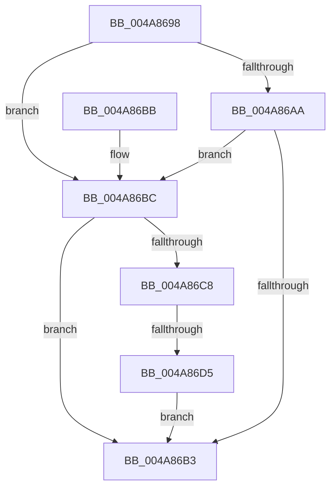

# VfDifCaptureIoCallbacks

- RVA: `0x004A8698`–`0x004A86F2` (길이 `90` bytes)
- VA: `0x00000001404A8698`
- 실행 섹션: `.text`
- PDB 이름 있음: `예`; PDB Function 태그: `예`
- unwind 정보 RVA: `0x000B755C`
- 디코드: `26`개 명령, `90/90` bytes 표시
- 미해석 바이트: `0` (있으면 어셈블리에 `.byte`로 보존)

> 이 문서는 커널 이미지의 기계어와 PDB 기호를 분석해 생성했습니다. 4번과 5번은 함수 원형과 자료형을 바이너리 사용 방식에서 추정한 C 해석이며 원본 소스 복구 결과는 아닙니다.

## 1. Dependencies

- 직접 호출 지점: **3**; 고유 호출 대상: **3**
- 직접 호출자로 확인된 함수: **3**
- RIP 상대 이미지 참조: **2**

### Outgoing calls
- `0x004A86AA` → [MmIsDriverVerifying](MmIsDriverVerifying_function_004A8770.md) (function, `0x004A8770`)
- `0x004A86BF` → [ViDifCheckCallbackInterception](../../pagevrfy/B9/ViDifCheckCallbackInterception_function_00B9A848.md) (function, `0x00B9A848`)
- `0x004A86EB` → [VfUtilDbgPrint](../61/VfUtilDbgPrint_function_006122AC.md) (function, `0x006122AC`)

### Direct callers
- [VfTargetReplaceIoCallbacks](../61/VfTargetReplaceIoCallbacks_function_00613260.md) at `0x00613309`
- [IopLoadDriver](../../page/99/IopLoadDriver_function_00997B54.md) at `0x009983DD`
- [IopInitializeBuiltinDriver](../../init/C7/IopInitializeBuiltinDriver_function_00C7625C.md) at `0x00C76662`

### Static image references
- `0x004A869E` → RVA `0x00F048B8` (`.data`; read)
- `0x004A86DE` → RVA `0x006CE240` (` ?? ::FNODOBFM::`string'`; read)

## 2. Other-region calls and transfers

- 다른 실행 섹션으로 향하는 call: **1**
  - `0x004A86BF` → [ViDifCheckCallbackInterception](../../pagevrfy/B9/ViDifCheckCallbackInterception_function_00B9A848.md) (`.text` → `PAGEVRFY`)
- call이 아닌 외부 분기/꼬리 이동: **1**
  - `0x004A86CF` → [sub_006F9C7C](../6F/Unknown_function_006F9C7C.md) (`tail-transfer`)

## 3. Assembly (complete function range)

```asm
004A8698  40 53                           push rbx
004A869A  48 83 EC 30                     sub rsp, 0x30
004A869E  80 3D 13 C2 A5 00 00            cmp byte ptr [rip + 0xa5c213], 0
004A86A5  48 8B D9                        mov rbx, rcx
004A86A8  75 12                           jne 0x1404a86bc
004A86AA  E8 C1 00 00 00                  call 0x1404a8770
004A86AF  85 C0                           test eax, eax
004A86B1  75 09                           jne 0x1404a86bc
004A86B3  32 C0                           xor al, al
004A86B5  48 83 C4 30                     add rsp, 0x30
004A86B9  5B                              pop rbx
004A86BA  C3                              ret
004A86BB  CC                              int3
004A86BC  48 8B CB                        mov rcx, rbx
004A86BF  E8 84 21 6F 00                  call 0x140b9a848
004A86C4  84 C0                           test al, al
004A86C6  74 EB                           je 0x1404a86b3
004A86C8  48 8B 4B 18                     mov rcx, qword ptr [rbx + 0x18]
004A86CC  48 85 C9                        test rcx, rcx
004A86CF  0F 85 A7 15 25 00               jne 0x1406f9c7c
004A86D5  0F 10 43 38                     movups xmm0, xmmword ptr [rbx + 0x38]
004A86D9  48 8D 54 24 20                  lea rdx, [rsp + 0x20]
004A86DE  48 8D 0D 5B 5B 22 00            lea rcx, [rip + 0x225b5b]
004A86E5  F3 0F 7F 44 24 20               movdqu xmmword ptr [rsp + 0x20], xmm0
004A86EB  E8 BC 9B 16 00                  call 0x1406122ac
004A86F0  EB C1                           jmp 0x1404a86b3
```

## 4. C-style interpretation (structured pseudocode)

```c
__int64 __fastcall VfDifCaptureIoCallbacks(__int64 a1)
{
    __int64 result;
    __int64 v_rsp;
    unsigned __int64 v_stack_p20;

    v_rsp = (v_rsp) - (48);
    if ((*(unsigned __int8 *)(v_rip + 10863123)) != 0) goto loc_004A86BC;
    result = MmIsDriverVerifying(a1, a2, a3, a4);
    if ((unsigned int)(result) != 0) goto loc_004A86BC;
loc_004A86B3:
    result = 0;
    v_rsp = (v_rsp) + (48);
    return result;
loc_004A86BC:
    result = ViDifCheckCallbackInterception(a1, a2, a3, a4);
    if ((unsigned __int8)(result) == 0) goto loc_004A86B3;
    v_stack_p20 = v_xmm0;
    result = VfUtilDbgPrint(v_rip + 2251611, v_stack_p20, a3, a4);
    goto loc_004A86B3;
}
```

## 5. (Beta) C Style

```c
int64_t VfDifCaptureIoCallbacks(void *Arg1)
{
    uint8_t *arg1 = (uint8_t *)Arg1;

    int64_t result;
    int64_t local_rsp;
    uint64_t v_stack_p20;

    local_rsp = (local_rsp) - (48);
    if ((*(uint8_t *)(v_rip + 0xA5C213)) != 0) goto loc_004A86BC;
    result = MmIsDriverVerifying(Arg1, a2, a3, a4);
    if ((uint32_t)(result) != 0) goto loc_004A86BC;
loc_004A86B3:
    result = 0;
    local_rsp = (local_rsp) + (48);
    return result;
loc_004A86BC:
    result = ViDifCheckCallbackInterception(Arg1, a2, a3, a4);
    if ((uint8_t)(result) == 0) goto loc_004A86B3;
    v_stack_p20 = v_xmm0;
    result = VfUtilDbgPrint(v_rip + 2251611, v_stack_p20, a3, a4);
    goto loc_004A86B3;
}
```

### 관측된 메모리 오프셋

구조체 형식이 확인되지 않은 접근은 인자 기준의 오프셋으로만 기록했습니다.

| 기준 인자 | 오프셋 표현 | 폭 (bit) | 접근 |
|---|---:|---:|---|
| `Arg1` | `+ 0x18` | `64` | `R` |
| `Arg1` | `+ 0x38` | `128` | `R` |

## 6. Execution-region graph

[열기: 2D/3D 그래프와 함수 탐색 컨트롤 패널](../../../control-panel.html?section=text&rva=0x004A8698&view=graph)

- 2D 그래프는 위에서 아래로 흐르고, 3D 그래프는 빈 공간을 드래그해 회전합니다. Shift+드래그는 이동, 휠은 확대·축소, 함수 노드 선택은 대상 보고서 이동입니다.

### Static fallback


