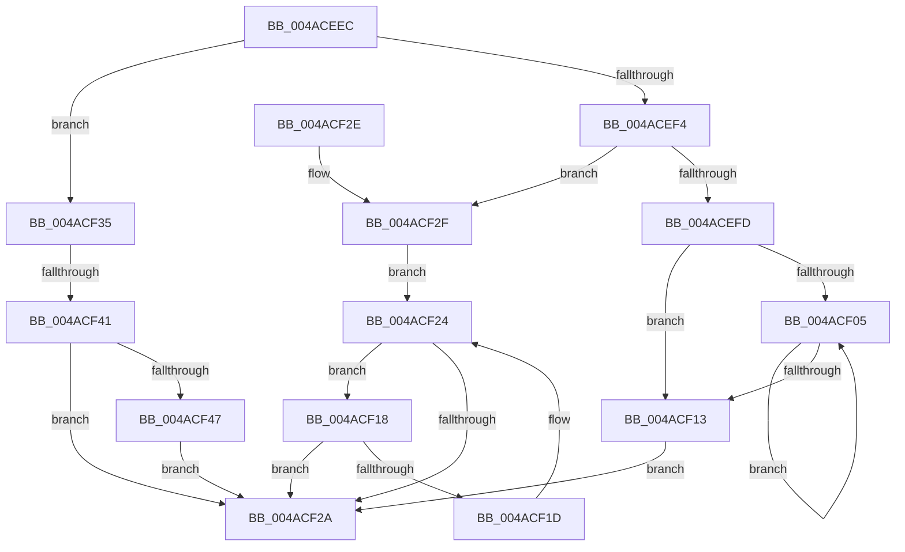

# VmpVaMemoryRangeGetNext

- RVA: `0x004ACEEC`–`0x004ACF54` (길이 `104` bytes)
- VA: `0x00000001404ACEEC`
- 실행 섹션: `.text`
- PDB 이름 있음: `예`; PDB Function 태그: `예`
- unwind 정보 RVA: `0x000DB714`
- 디코드: `36`개 명령, `104/104` bytes 표시
- 미해석 바이트: `0` (있으면 어셈블리에 `.byte`로 보존)

> 이 문서는 커널 이미지의 기계어와 PDB 기호를 분석해 생성했습니다. 4번과 5번은 함수 원형과 자료형을 바이너리 사용 방식에서 추정한 C 해석이며 원본 소스 복구 결과는 아닙니다.

## 1. Dependencies

- 직접 호출 지점: **0**; 고유 호출 대상: **0**
- 직접 호출자로 확인된 함수: **3**
- RIP 상대 이미지 참조: **0**

### Outgoing calls
- 직접 디코드된 call 명령이 없습니다.

### Direct callers
- [VmpConvertPortionVpnRangeToGpnRange](../31/VmpConvertPortionVpnRangeToGpnRange_function_003147F0.md) at `0x00314AC9`
- [VmpMergeMemoryRanges](../4D/VmpMergeMemoryRanges_function_004D9EDC.md) at `0x004D9F8E`
- [sub_006E128A](../6E/Unknown_function_006E128A.md) at `0x006E12F5`

### Static image references
- 디코드된 RIP-relative 메모리 참조가 없습니다.

## 2. Other-region calls and transfers

- 다른 실행 섹션으로 향하는 call: **0**
- call이 아닌 외부 분기/꼬리 이동: **1**
  - `0x004ACF3B` → `0x006FA770` (`tail-transfer`)

## 3. Assembly (complete function range)

```asm
004ACEEC  45 33 C0                        xor r8d, r8d
004ACEEF  48 85 D2                        test rdx, rdx
004ACEF2  74 41                           je 0x1404acf35
004ACEF4  48 8B 4A 08                     mov rcx, qword ptr [rdx + 8]
004ACEF8  48 85 C9                        test rcx, rcx
004ACEFB  74 32                           je 0x1404acf2f
004ACEFD  48 8B 11                        mov rdx, qword ptr [rcx]
004ACF00  48 85 D2                        test rdx, rdx
004ACF03  74 0E                           je 0x1404acf13
004ACF05  48 8B 02                        mov rax, qword ptr [rdx]
004ACF08  48 8B CA                        mov rcx, rdx
004ACF0B  48 8B D0                        mov rdx, rax
004ACF0E  48 85 C0                        test rax, rax
004ACF11  75 F2                           jne 0x1404acf05
004ACF13  4C 8B C1                        mov r8, rcx
004ACF16  EB 12                           jmp 0x1404acf2a
004ACF18  49 39 10                        cmp qword ptr [r8], rdx
004ACF1B  74 0D                           je 0x1404acf2a
004ACF1D  49 8B D0                        mov rdx, r8
004ACF20  4D 8B 40 10                     mov r8, qword ptr [r8 + 0x10]
004ACF24  49 83 E0 FC                     and r8, 0xfffffffffffffffc
004ACF28  75 EE                           jne 0x1404acf18
004ACF2A  49 8B C0                        mov rax, r8
004ACF2D  C3                              ret
004ACF2E  CC                              int3
004ACF2F  4C 8B 42 10                     mov r8, qword ptr [rdx + 0x10]
004ACF33  EB EF                           jmp 0x1404acf24
004ACF35  48 8B 41 20                     mov rax, qword ptr [rcx + 0x20]
004ACF39  A8 01                           test al, 1
004ACF3B  0F 84 2F D8 24 00               je 0x1406fa770
004ACF41  48 83 F8 01                     cmp rax, 1
004ACF45  74 E3                           je 0x1404acf2a
004ACF47  4C 8D 41 18                     lea r8, [rcx + 0x18]
004ACF4B  49 83 C8 01                     or r8, 1
004ACF4F  4C 33 C0                        xor r8, rax
004ACF52  EB D6                           jmp 0x1404acf2a
```

## 4. C-style interpretation (structured pseudocode)

```c
__int64 __fastcall VmpVaMemoryRangeGetNext(__int64 a1, __int64 a2, int a3)
{
    a3 = 0;
    if (a2 == 0) goto loc_004ACF35;
    if (*(unsigned __int64 *)(a2 + 8) == 0) goto loc_004ACF2F;
    if (*(unsigned __int64 *)(*(unsigned __int64 *)(a2 + 8)) == 0) goto loc_004ACF13;
loc_004ACF05:
    if (*(unsigned __int64 *)(*(unsigned __int64 *)(*(unsigned __int64 *)(a2 + 8))) != 0) goto loc_004ACF05;
loc_004ACF13:
    goto loc_004ACF2A;
loc_004ACF18:
    if ((*(unsigned __int64 *)(*(unsigned __int64 *)(*(unsigned __int64 *)(a2 + 8)))) == (*(unsigned __int64 *)(*(unsigned __int64 *)(*(unsigned __int64 *)(a2 + 8))))) goto loc_004ACF2A;
loc_004ACF24:
    a3 = (*(unsigned __int64 *)(*(unsigned __int64 *)(*(unsigned __int64 *)(a2 + 8)) + 16)) & (-4);
    if (condition_is_not_equal) goto loc_004ACF18;
loc_004ACF2A:
    return a3;
loc_004ACF2F:
    goto loc_004ACF24;
loc_004ACF35:
    if ((*(unsigned __int64 *)(*(unsigned __int64 *)(*(unsigned __int64 *)(a2 + 8)) + 32)) == 1) goto loc_004ACF2A;
    a3 = (*(unsigned __int64 *)(*(unsigned __int64 *)(a2 + 8)) + 24) | (1);
    a3 = (a3) ^ (*(unsigned __int64 *)(*(unsigned __int64 *)(*(unsigned __int64 *)(a2 + 8)) + 32));
    goto loc_004ACF2A;
}
```

## 5. (Beta) C Style

```c
int64_t VmpVaMemoryRangeGetNext(void *Arg1, int64_t Arg2, int32_t Arg3)
{
    uint8_t *arg1 = (uint8_t *)Arg1;

    Arg3 = 0;
    if (Arg2 == 0) goto loc_004ACF35;
    if (*(uint64_t *)(Arg2 + 0x8) == 0) goto loc_004ACF2F;
    if (*(uint64_t *)(*(uint64_t *)(Arg2 + 0x8)) == 0) goto loc_004ACF13;
loc_004ACF05:
    if (*(uint64_t *)(*(uint64_t *)(*(uint64_t *)(Arg2 + 0x8))) != 0) goto loc_004ACF05;
loc_004ACF13:
    goto loc_004ACF2A;
loc_004ACF18:
    if ((*(uint64_t *)(*(uint64_t *)(*(uint64_t *)(Arg2 + 0x8)))) == (*(uint64_t *)(*(uint64_t *)(*(uint64_t *)(Arg2 + 0x8))))) goto loc_004ACF2A;
loc_004ACF24:
    Arg3 = (*(uint64_t *)(*(uint64_t *)(*(uint64_t *)(Arg2 + 0x8)) + 0x10)) & (-4);
    if (condition_is_not_equal) goto loc_004ACF18;
loc_004ACF2A:
    return Arg3;
loc_004ACF2F:
    goto loc_004ACF24;
loc_004ACF35:
    if ((*(uint64_t *)(*(uint64_t *)(*(uint64_t *)(Arg2 + 0x8)) + 0x20)) == 1) goto loc_004ACF2A;
    Arg3 = (*(uint64_t *)(*(uint64_t *)(Arg2 + 0x8)) + 24) | (1);
    Arg3 = (Arg3) ^ (*(uint64_t *)(*(uint64_t *)(*(uint64_t *)(Arg2 + 0x8)) + 0x20));
    goto loc_004ACF2A;
}
```

### 관측된 메모리 오프셋

구조체 형식이 확인되지 않은 접근은 인자 기준의 오프셋으로만 기록했습니다.

| 기준 인자 | 오프셋 표현 | 폭 (bit) | 접근 |
|---|---:|---:|---|
| `Arg1` | `+ 0x18` | `64` | `R` |
| `Arg1` | `+ 0x20` | `64` | `R` |

## 6. Execution-region graph

[열기: 2D/3D 그래프와 함수 탐색 컨트롤 패널](../../../control-panel.html?section=text&rva=0x004ACEEC&view=graph)

- 2D 그래프는 위에서 아래로 흐르고, 3D 그래프는 빈 공간을 드래그해 회전합니다. Shift+드래그는 이동, 휠은 확대·축소, 함수 노드 선택은 대상 보고서 이동입니다.

### Static fallback


