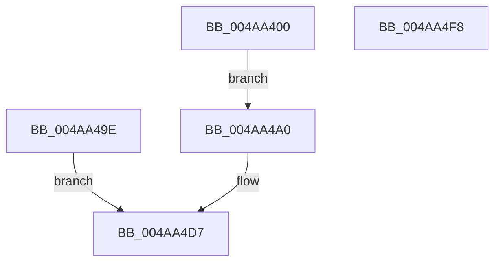

# VslFinalizeSecureImageHash

- RVA: `0x004AA400`–`0x004AA4F9` (길이 `249` bytes)
- VA: `0x00000001404AA400`
- 실행 섹션: `.text`
- PDB 이름 있음: `예`; PDB Function 태그: `아니요`
- unwind 정보 RVA: `0x000B7C54`
- 디코드: `61`개 명령, `249/249` bytes 표시
- 미해석 바이트: `0` (있으면 어셈블리에 `.byte`로 보존)

> 이 문서는 커널 이미지의 기계어와 PDB 기호를 분석해 생성했습니다. 4번과 5번은 함수 원형과 자료형을 바이너리 사용 방식에서 추정한 C 해석이며 원본 소스 복구 결과는 아닙니다.

## 1. Dependencies

- 직접 호출 지점: **6**; 고유 호출 대상: **5**
- 직접 호출자로 확인된 함수: **0**
- RIP 상대 이미지 참조: **1**

### Outgoing calls
- `0x004AA430` → [memset](../6C/memset_function_006C6C40.md) (function, `0x006C6C40`)
- `0x004AA440` → [memset](../6C/memset_function_006C6C40.md) (function, `0x006C6C40`)
- `0x004AA497` → [MmProbeAndLockPages](../23/MmProbeAndLockPages_function_0023B990.md) (function, `0x0023B990`)
- `0x004AA4C4` → [VslpEnterIumSecureMode](../23/VslpEnterIumSecureMode_function_00235E50.md) (function, `0x00235E50`)
- `0x004AA4D0` → [MmUnlockPages](../29/MmUnlockPages_function_0029EEE0.md) (function, `0x0029EEE0`)
- `0x004AA4E2` → [_security_check_cookie](../6A/_security_check_cookie_function_006AC640.md) (function, `0x006AC640`)

### Direct callers
- 이 함수 시작 RVA로 연결되는 직접 call은 확인되지 않았습니다. 간접 호출은 완전히 역산할 수 없습니다.

### Static image references
- `0x004AA40D` → RVA `0x00E0A740` (`.data`; read)

## 2. Other-region calls and transfers

- 다른 실행 섹션으로 향하는 call: **0**
- 별도 외부 분기/꼬리 이동을 확인하지 못했습니다.

## 3. Assembly (complete function range)

```asm
004AA400  48 89 5C 24 08                  mov qword ptr [rsp + 8], rbx
004AA405  57                              push rdi
004AA406  48 81 EC E0 00 00 00            sub rsp, 0xe0
004AA40D  48 8B 05 2C 03 96 00            mov rax, qword ptr [rip + 0x96032c]
004AA414  48 33 C4                        xor rax, rsp
004AA417  48 89 84 24 D0 00 00 00         mov qword ptr [rsp + 0xd0], rax
004AA41F  48 8B DA                        mov rbx, rdx
004AA422  48 8B F9                        mov rdi, rcx
004AA425  33 D2                           xor edx, edx
004AA427  44 8D 42 68                     lea r8d, [rdx + 0x68]
004AA42B  48 8D 4C 24 60                  lea rcx, [rsp + 0x60]
004AA430  E8 0B C8 21 00                  call 0x1406c6c40
004AA435  33 D2                           xor edx, edx
004AA437  44 8D 42 40                     lea r8d, [rdx + 0x40]
004AA43B  48 8D 4C 24 20                  lea rcx, [rsp + 0x20]
004AA440  E8 FB C7 21 00                  call 0x1406c6c40
004AA445  0F B7 C3                        movzx eax, bx
004AA448  BA FF 0F 00 00                  mov edx, 0xfff
004AA44D  66 23 C2                        and ax, dx
004AA450  8D 4A 48                        lea ecx, [rdx + 0x48]
004AA453  66 03 C1                        add ax, cx
004AA456  66 C1 E8 0C                     shr ax, 0xc
004AA45A  66 83 C0 06                     add ax, 6
004AA45E  66 C1 E0 03                     shl ax, 3
004AA462  66 89 44 24 28                  mov word ptr [rsp + 0x28], ax
004AA467  33 C0                           xor eax, eax
004AA469  66 89 44 24 2A                  mov word ptr [rsp + 0x2a], ax
004AA46E  48 8B C3                        mov rax, rbx
004AA471  48 25 00 F0 FF FF               and rax, 0xfffffffffffff000
004AA477  48 89 44 24 40                  mov qword ptr [rsp + 0x40], rax
004AA47C  8B C3                           mov eax, ebx
004AA47E  23 C2                           and eax, edx
004AA480  89 44 24 4C                     mov dword ptr [rsp + 0x4c], eax
004AA484  C7 44 24 48 48 00 00 00         mov dword ptr [rsp + 0x48], 0x48
004AA48C  33 D2                           xor edx, edx
004AA48E  44 8D 42 01                     lea r8d, [rdx + 1]
004AA492  48 8D 4C 24 20                  lea rcx, [rsp + 0x20]
004AA497  E8 F4 14 D9 FF                  call 0x14023b990
004AA49C  EB 02                           jmp 0x1404aa4a0
004AA49E  EB 37                           jmp 0x1404aa4d7
004AA4A0  48 89 7C 24 68                  mov qword ptr [rsp + 0x68], rdi
004AA4A5  48 89 5C 24 70                  mov qword ptr [rsp + 0x70], rbx
004AA4AA  0F 28 44 24 50                  movaps xmm0, xmmword ptr [rsp + 0x50]
004AA4AF  F3 0F 7F 44 24 78               movdqu xmmword ptr [rsp + 0x78], xmm0
004AA4B5  BA 1A 00 00 00                  mov edx, 0x1a
004AA4BA  4C 8D 4C 24 60                  lea r9, [rsp + 0x60]
004AA4BF  45 33 C0                        xor r8d, r8d
004AA4C2  B1 02                           mov cl, 2
004AA4C4  E8 87 B9 D8 FF                  call 0x140235e50
004AA4C9  8B D8                           mov ebx, eax
004AA4CB  48 8D 4C 24 20                  lea rcx, [rsp + 0x20]
004AA4D0  E8 0B 4A DF FF                  call 0x14029eee0
004AA4D5  8B C3                           mov eax, ebx
004AA4D7  48 8B 8C 24 D0 00 00 00         mov rcx, qword ptr [rsp + 0xd0]
004AA4DF  48 33 CC                        xor rcx, rsp
004AA4E2  E8 59 21 20 00                  call 0x1406ac640
004AA4E7  48 8B 9C 24 F0 00 00 00         mov rbx, qword ptr [rsp + 0xf0]
004AA4EF  48 81 C4 E0 00 00 00            add rsp, 0xe0
004AA4F6  5F                              pop rdi
004AA4F7  C3                              ret
004AA4F8  CC                              int3
```

## 4. C-style interpretation (structured pseudocode)

```c
__int64 __fastcall VslFinalizeSecureImageHash(__int64 a1, __int64 a2)
{
    __int64 result;
    __int64 v_rsp;
    unsigned __int64 v_stack_m18;
    unsigned __int64 v_stack_m70;
    unsigned __int64 v_stack_m78;
    unsigned __int64 v_stack_m80;
    unsigned __int64 v_stack_m88;
    unsigned __int64 v_stack_m98;
    unsigned int v_stack_m9C;
    unsigned int v_stack_mA0;
    unsigned __int64 v_stack_mA8;
    unsigned __int16 v_stack_mBE;
    unsigned __int16 v_stack_mC0;
    unsigned __int64 v_stack_mC8;
    unsigned __int64 v_stack_p8;

    v_stack_p8 = v_rbx;
    v_rsp = (v_rsp) - (224);
    result = (*(unsigned __int64 *)(v_rip + 9831212)) ^ (v_rsp);
    v_stack_m18 = result;
    a2 = 0;
    result = memset(v_stack_m88, a2, a2 + 104, a4);
    a2 = 0;
    result = memset(v_stack_mC8, a2, a2 + 64, a4);
    result = (unsigned __int16)((0) & ((unsigned __int16)((unsigned int)(0xFFFULL))));
    result = (unsigned __int16)((result) + ((unsigned __int16)((unsigned int)(0xFFFULL) + 72)));
    result = (unsigned __int16)((result) >> (12));
    result = (unsigned __int16)((result) + (6));
    result = (unsigned __int16)((result) << (3));
    v_stack_mC0 = (unsigned __int16)(result);
    result = 0;
    v_stack_mBE = 0;
    result = (0) & (0xFFFFFFFFFFFFF000ULL);
    v_stack_mA8 = result;
    result = (unsigned int)((0) & ((unsigned int)((unsigned int)(0xFFFULL))));
    v_stack_m9C = (unsigned int)(result);
    v_stack_mA0 = 72;
    a2 = 0;
    result = MmProbeAndLockPages(v_stack_mC8, a2, a2 + 1, a4);
    goto loc_004AA4A0;
loc_004AA4A0:
    v_stack_m80 = a1;
    v_stack_m78 = 0;
    v_stack_m70 = v_xmm0;
    a3 = 0;
    result = VslpEnterIumSecureMode(2, 26, a3, v_stack_m88);
    result = MmUnlockPages(v_stack_mC8, 26, a3, v_stack_m88);
loc_004AA4D7:
    a1 = (v_stack_m18) ^ (v_rsp);
    result = _security_check_cookie(a1, 26, a3, v_stack_m88);
    v_rsp = (v_rsp) + (224);
    return result;
}
```

## 5. (Beta) C Style

```c
int64_t VslFinalizeSecureImageHash(int64_t Arg1, int64_t Arg2)
{
    int64_t result;
    int64_t local_rsp;
    uint64_t v_stack_m18;
    uint64_t v_stack_m70;
    uint64_t v_stack_m78;
    uint64_t v_stack_m80;
    uint64_t v_stack_m88;
    uint64_t v_stack_m98;
    uint32_t v_stack_m9C;
    uint32_t v_stack_mA0;
    uint64_t v_stack_mA8;
    uint16_t v_stack_mBE;
    uint16_t v_stack_mC0;
    uint64_t v_stack_mC8;
    uint64_t v_stack_p8;

    v_stack_p8 = local_rbx;
    local_rsp = (local_rsp) - (224);
    result = (*(uint64_t *)(v_rip + 0x96032C)) ^ (local_rsp);
    v_stack_m18 = result;
    Arg2 = 0;
    result = memset(v_stack_m88, Arg2, Arg2 + 104, a4);
    Arg2 = 0;
    result = memset(v_stack_mC8, Arg2, Arg2 + 64, a4);
    result = (uint16_t)((0) & ((uint16_t)((uint32_t)(0xFFFULL))));
    result = (uint16_t)((result) + ((uint16_t)((uint32_t)(0xFFFULL) + 72)));
    result = (uint16_t)((result) >> (12));
    result = (uint16_t)((result) + (6));
    result = (uint16_t)((result) << (3));
    v_stack_mC0 = (uint16_t)(result);
    result = 0;
    v_stack_mBE = 0;
    result = (0) & (0xFFFFFFFFFFFFF000ULL);
    v_stack_mA8 = result;
    result = (uint32_t)((0) & ((uint32_t)((uint32_t)(0xFFFULL))));
    v_stack_m9C = (uint32_t)(result);
    v_stack_mA0 = 72;
    Arg2 = 0;
    result = MmProbeAndLockPages(v_stack_mC8, Arg2, Arg2 + 1, a4);
    goto loc_004AA4A0;
loc_004AA4A0:
    v_stack_m80 = Arg1;
    v_stack_m78 = 0;
    v_stack_m70 = v_xmm0;
    a3 = 0;
    result = VslpEnterIumSecureMode(2, 26, a3, v_stack_m88);
    result = MmUnlockPages(v_stack_mC8, 26, a3, v_stack_m88);
loc_004AA4D7:
    Arg1 = (v_stack_m18) ^ (local_rsp);
    result = _security_check_cookie(Arg1, 26, a3, v_stack_m88);
    local_rsp = (local_rsp) + (224);
    return result;
}
```

## 6. Execution-region graph

[열기: 2D/3D 그래프와 함수 탐색 컨트롤 패널](../../../control-panel.html?section=text&rva=0x004AA400&view=graph)

- 2D 그래프는 위에서 아래로 흐르고, 3D 그래프는 빈 공간을 드래그해 회전합니다. Shift+드래그는 이동, 휠은 확대·축소, 함수 노드 선택은 대상 보고서 이동입니다.

### Static fallback


