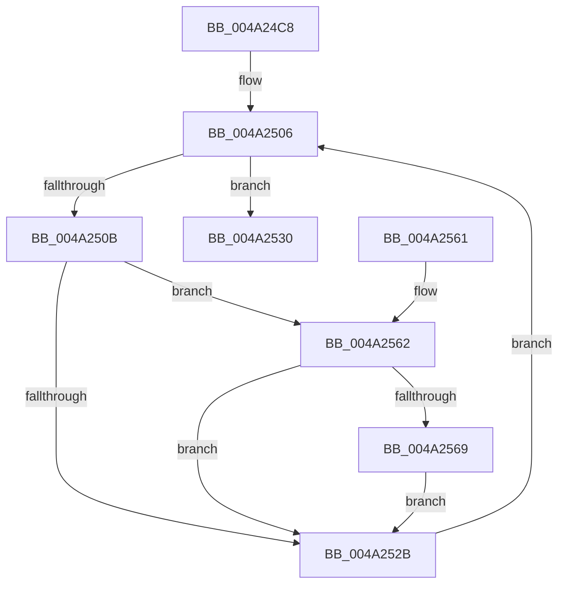

# WmiQueryTraceProviderCount

- RVA: `0x004A24C8`–`0x004A256D` (길이 `165` bytes)
- VA: `0x00000001404A24C8`
- 실행 섹션: `.text`
- PDB 이름 있음: `예`; PDB Function 태그: `아니요`
- unwind 정보 RVA: `0x00086DE4`
- 디코드: `45`개 명령, `165/165` bytes 표시
- 미해석 바이트: `0` (있으면 어셈블리에 `.byte`로 보존)

> 이 문서는 커널 이미지의 기계어와 PDB 기호를 분석해 생성했습니다. 4번과 5번은 함수 원형과 자료형을 바이너리 사용 방식에서 추정한 C 해석이며 원본 소스 복구 결과는 아닙니다.

## 1. Dependencies

- 직접 호출 지점: **4**; 고유 호출 대상: **4**
- 직접 호출자로 확인된 함수: **1**
- RIP 상대 이미지 참조: **3**

### Outgoing calls
- `0x004A24E4` → [KeWaitForSingleObject](../20/KeWaitForSingleObject_function_0020E6B0.md) (function, `0x0020E6B0`)
- `0x004A24F0` → [KeAcquireSpinLockRaiseToDpc](../20/KeAcquireSpinLockRaiseToDpc_function_00208470.md) (function, `0x00208470`)
- `0x004A253A` → [KeReleaseSpinLock](../39/KeReleaseSpinLock_function_00392BA0.md) (function, `0x00392BA0`)
- `0x004A2554` → [KeReleaseMutantEx](../39/KeReleaseMutantEx_function_00396850.md) (function, `0x00396850`)

### Direct callers
- [EtwpUpdateFileInfoDriverState](../../page/A5/EtwpUpdateFileInfoDriverState_function_00A501BC.md) at `0x00A50243`

### Static image references
- `0x004A24D0` → RVA `0x00EFFA60` (`.data`; read)
- `0x004A24E9` → RVA `0x00EFFC28` (`.data`; read)
- `0x004A24F5` → RVA `0x00E09148` (`.data`; read)

## 2. Other-region calls and transfers

- 다른 실행 섹션으로 향하는 call: **0**
- 별도 외부 분기/꼬리 이동을 확인하지 못했습니다.

## 3. Assembly (complete function range)

```asm
004A24C8  40 53                           push rbx
004A24CA  48 83 EC 30                     sub rsp, 0x30
004A24CE  33 DB                           xor ebx, ebx
004A24D0  48 8D 0D 89 D5 A5 00            lea rcx, [rip + 0xa5d589]
004A24D7  48 21 5C 24 20                  and qword ptr [rsp + 0x20], rbx
004A24DC  45 33 C9                        xor r9d, r9d
004A24DF  45 33 C0                        xor r8d, r8d
004A24E2  33 D2                           xor edx, edx
004A24E4  E8 C7 C1 D6 FF                  call 0x14020e6b0
004A24E9  48 8D 0D 38 D7 A5 00            lea rcx, [rip + 0xa5d738]
004A24F0  E8 7B 5F D6 FF                  call 0x140208470
004A24F5  4C 8B 05 4C 6C 96 00            mov r8, qword ptr [rip + 0x966c4c]
004A24FC  4C 8D 15 45 6C 96 00            lea r10, [rip + 0x966c45]
004A2503  44 8A C8                        mov r9b, al
004A2506  4D 3B C2                        cmp r8, r10
004A2509  74 25                           je 0x1404a2530
004A250B  41 8B 50 30                     mov edx, dword ptr [r8 + 0x30]
004A250F  8B C2                           mov eax, edx
004A2511  C1 F8 04                        sar eax, 4
004A2514  25 00 00 F0 00                  and eax, 0xf00000
004A2519  0F BA E0 16                     bt eax, 0x16
004A251D  0F 92 C1                        setb cl
004A2520  0F BA E2 1E                     bt edx, 0x1e
004A2524  0F 92 C0                        setb al
004A2527  84 C8                           test al, cl
004A2529  75 37                           jne 0x1404a2562
004A252B  4D 8B 00                        mov r8, qword ptr [r8]
004A252E  EB D6                           jmp 0x1404a2506
004A2530  41 8A D1                        mov dl, r9b
004A2533  48 8D 0D EE D6 A5 00            lea rcx, [rip + 0xa5d6ee]
004A253A  E8 61 06 EF FF                  call 0x140392ba0
004A253F  BA 01 00 00 00                  mov edx, 1
004A2544  4C 8D 4C 24 40                  lea r9, [rsp + 0x40]
004A2549  48 8D 0D 10 D5 A5 00            lea rcx, [rip + 0xa5d510]
004A2550  44 8D 42 03                     lea r8d, [rdx + 3]
004A2554  E8 F7 42 EF FF                  call 0x140396850
004A2559  8B C3                           mov eax, ebx
004A255B  48 83 C4 30                     add rsp, 0x30
004A255F  5B                              pop rbx
004A2560  C3                              ret
004A2561  CC                              int3
004A2562  49 83 78 10 00                  cmp qword ptr [r8 + 0x10], 0
004A2567  74 C2                           je 0x1404a252b
004A2569  FF C3                           inc ebx
004A256B  EB BE                           jmp 0x1404a252b
```

## 4. C-style interpretation (structured pseudocode)

```c
__int64 __fastcall WmiQueryTraceProviderCount(__int64 a1, int a2, int a3, int a4)
{
    __int64 result;
    __int64 v_rbx;
    __int64 v_rsp;
    unsigned __int64 v_stack_m18;
    unsigned __int64 v_stack_p8;

    v_rsp = (v_rsp) - (48);
    v_rbx = 0;
    a4 = 0;
    a3 = 0;
    a2 = 0;
    result = KeWaitForSingleObject(v_rip + 10868105, a2, a3, a4);
    result = KeAcquireSpinLockRaiseToDpc(v_rip + 10868536, a2, a3, a4);
loc_004A2506:
    if ((*(unsigned __int64 *)(v_rip + 9858124)) == (v_rip + 9858117)) goto loc_004A2530;
    result = (unsigned int)(((unsigned int)((unsigned int)((unsigned int)(*(unsigned int *)(*(unsigned __int64 *)(v_rip + 9858124) + 48))))) >> (4));
    result = (unsigned int)((result) & (0xF00000ULL));
    a1 = (condition_is_below) ? 1 : 0;
    result = (condition_is_below) ? 1 : 0;
    if ((((unsigned __int8)(result)) & ((unsigned __int8)(a1))) != 0) goto loc_004A2562;
loc_004A252B:
    goto loc_004A2506;
loc_004A2530:
    result = KeReleaseSpinLock(v_rip + 10868462, (unsigned __int8)((unsigned __int8)(result)), *(unsigned __int64 *)(*(unsigned __int64 *)(v_rip + 9858124)), (unsigned __int8)(result));
    result = KeReleaseMutantEx(v_rip + 10867984, 1, 1 + 3, v_stack_p8);
    v_rsp = (v_rsp) + (48);
    return 0;
loc_004A2562:
    if ((*(unsigned __int64 *)(1 + 3 + 16)) == 0) goto loc_004A252B;
    v_rbx = (unsigned int)((v_rbx) + 1);
    goto loc_004A252B;
}
```

## 5. (Beta) C Style

```c
int64_t WmiQueryTraceProviderCount(int64_t Arg1, int32_t Arg2, int32_t Arg3, int32_t Arg4)
{
    int64_t result;
    int64_t local_rbx;
    int64_t local_rsp;
    uint64_t v_stack_m18;
    uint64_t v_stack_p8;

    local_rsp = (local_rsp) - (48);
    local_rbx = 0;
    Arg4 = 0;
    Arg3 = 0;
    Arg2 = 0;
    result = KeWaitForSingleObject(v_rip + 10868105, Arg2, Arg3, Arg4);
    result = KeAcquireSpinLockRaiseToDpc(v_rip + 10868536, Arg2, Arg3, Arg4);
loc_004A2506:
    if ((*(uint64_t *)(v_rip + 0x966C4C)) == (v_rip + 9858117)) goto loc_004A2530;
    result = (uint32_t)(((uint32_t)((uint32_t)((uint32_t)(*(uint32_t *)(*(uint64_t *)(v_rip + 0x966C4C) + 0x30))))) >> (4));
    result = (uint32_t)((result) & (0xF00000ULL));
    Arg1 = (condition_is_below) ? 1 : 0;
    result = (condition_is_below) ? 1 : 0;
    if ((((uint8_t)(result)) & ((uint8_t)(Arg1))) != 0) goto loc_004A2562;
loc_004A252B:
    goto loc_004A2506;
loc_004A2530:
    result = KeReleaseSpinLock(v_rip + 10868462, (uint8_t)((uint8_t)(result)), *(uint64_t *)(*(uint64_t *)(v_rip + 0x966C4C)), (uint8_t)(result));
    result = KeReleaseMutantEx(v_rip + 10867984, 1, 1 + 3, v_stack_p8);
    local_rsp = (local_rsp) + (48);
    return 0;
loc_004A2562:
    if ((*(uint64_t *)(1 + 0x3 + 0x10)) == 0) goto loc_004A252B;
    local_rbx = (uint32_t)((local_rbx) + 1);
    goto loc_004A252B;
}
```

## 6. Execution-region graph

[열기: 2D/3D 그래프와 함수 탐색 컨트롤 패널](../../../control-panel.html?section=text&rva=0x004A24C8&view=graph)

- 2D 그래프는 위에서 아래로 흐르고, 3D 그래프는 빈 공간을 드래그해 회전합니다. Shift+드래그는 이동, 휠은 확대·축소, 함수 노드 선택은 대상 보고서 이동입니다.

### Static fallback


