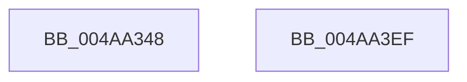

# tlgWriteEx_EtwWriteEx

- RVA: `0x004AA348`–`0x004AA3F0` (길이 `168` bytes)
- VA: `0x00000001404AA348`
- 실행 섹션: `.text`
- PDB 이름 있음: `예`; PDB Function 태그: `아니요`
- unwind 정보 RVA: `0x000B42C0`
- 디코드: `40`개 명령, `168/168` bytes 표시
- 미해석 바이트: `0` (있으면 어셈블리에 `.byte`로 보존)

> 이 문서는 커널 이미지의 기계어와 PDB 기호를 분석해 생성했습니다. 4번과 5번은 함수 원형과 자료형을 바이너리 사용 방식에서 추정한 C 해석이며 원본 소스 복구 결과는 아닙니다.

## 1. Dependencies

- 직접 호출 지점: **1**; 고유 호출 대상: **1**
- 직접 호출자로 확인된 함수: **66**
- RIP 상대 이미지 참조: **2**

### Outgoing calls
- `0x004AA3E5` → [EtwWriteEx](../25/EtwWriteEx_function_0025F0D0.md) (function, `0x0025F0D0`)

### Direct callers
- [MiLogPeriodicTelemetry](../2D/MiLogPeriodicTelemetry_function_002DB750.md) at `0x002DBCFF`
- [MiLogSlabEntryDemote](../44/MiLogSlabEntryDemote_function_0044CDF0.md) at `0x0044CEE7`
- [MiStoreLogWriteCompleteFailure](MiStoreLogWriteCompleteFailure_function_004A4414.md) at `0x004A44B1`
- [PopPlRegisterComponent](PopPlRegisterComponent_function_004AA1FC.md) at `0x004AA2EE`
- [MiStoreLogWriteDisabled](../4B/MiStoreLogWriteDisabled_function_004B2D9C.md) at `0x004B2E5C`
- [MmStoreLogConsumedPoison](../4C/MmStoreLogConsumedPoison_function_004C6B00.md) at `0x004C6C3E`
- [HalpTimerQueryAndResetRtcErrors](../4D/HalpTimerQueryAndResetRtcErrors_function_004D9B30.md) at `0x004D9BF4`
- [HalpTimerQueryAndResetRtcErrors](../4D/HalpTimerQueryAndResetRtcErrors_function_004D9B30.md) at `0x004D9C5B`
- [PopPlRegisterPowerPlane](../4D/PopPlRegisterPowerPlane_function_004DB504.md) at `0x004DB67D`
- [MiStoreLogFullPagefile](../4F/MiStoreLogFullPagefile_function_004FC7C8.md) at `0x004FC81A`
- [PopPlPublishInitialPowerDraw](../5D/PopPlPublishInitialPowerDraw_function_005DDB90.md) at `0x005DDCB6`
- [PopPlPublishSystemPowerChange](../5D/PopPlPublishSystemPowerChange_function_005DDD0C.md) at `0x005DDDD1`
- [PopPlRegisterDeviceIterator](../5D/PopPlRegisterDeviceIterator_function_005DDE20.md) at `0x005DDF7A`
- [PopPlTraceLogPowerPlane](../5D/PopPlTraceLogPowerPlane_function_005DDFB4.md) at `0x005DE091`
- [PopPlTraceLogPowerPlane](../5D/PopPlTraceLogPowerPlane_function_005DDFB4.md) at `0x005DE189`
- [PopPlTraceLogPowerPlane](../5D/PopPlTraceLogPowerPlane_function_005DDFB4.md) at `0x005DE292`
- [VmpLogColdHint](../64/VmpLogColdHint_function_0064D8E0.md) at `0x0064D9A4`
- [VmpLogLargeSlatFill](../64/VmpLogLargeSlatFill_function_0064D9C8.md) at `0x0064DABC`
- [VmpLogQueryAccessedState](../64/VmpLogQueryAccessedState_function_0064DAE0.md) at `0x0064DC15`
- [VmpLogSparseSlatFill](../64/VmpLogSparseSlatFill_function_0064DC38.md) at `0x0064DD42`
- [VmpLogTbFlushSlatFlushEntire](../64/VmpLogTbFlushSlatFlushEntire_function_0064DD64.md) at `0x0064DE14`
- [VmpLogTbFlushSlatInvalidate](../64/VmpLogTbFlushSlatInvalidate_function_0064DE38.md) at `0x0064DF2C`
- [VmpLogTbFlushSlatInvalidateInsert](../64/VmpLogTbFlushSlatInvalidateInsert_function_0064DF50.md) at `0x0064E042`
- [MiLogOutswappedProcessCommitReacquire](../66/MiLogOutswappedProcessCommitReacquire_function_0066F228.md) at `0x0066F35D`
- [MiLogOutswappedProcessCommitRelease](../66/MiLogOutswappedProcessCommitRelease_function_0066F388.md) at `0x0066F44C`
- [MiLogResetPagesCommitRelease](../66/MiLogResetPagesCommitRelease_function_0066F470.md) at `0x0066F537`
- [MiLogAddPhysicalMemory](../67/MiLogAddPhysicalMemory_function_006731A8.md) at `0x00673326`
- [MiLogUpdateOldPagesInWs](../67/MiLogUpdateOldPagesInWs_function_0067EB40.md) at `0x0067ECE0`
- [MiLogDelayFaultingThread](../68/MiLogDelayFaultingThread_function_006869A4.md) at `0x00686AB3`
- [MiLogUnlockVmTrim](../68/MiLogUnlockVmTrim_function_00689C7C.md) at `0x00689DC1`
- [MiLogNotifyPageHeat](../68/MiLogNotifyPageHeat_function_0068C050.md) at `0x0068C27A`
- [MiStoreLogDiscardPoisonedPage](../69/MiStoreLogDiscardPoisonedPage_function_00692D90.md) at `0x00692EA2`
- [MiStoreLogReadFailure](../69/MiStoreLogReadFailure_function_00692ED0.md) at `0x00693033`
- [MmStoreLogDecompressionFailure](../69/MmStoreLogDecompressionFailure_function_00693208.md) at `0x00693419`
- [MmStoreLogRegionInPageError](../69/MmStoreLogRegionInPageError_function_00693450.md) at `0x00693523`
- [sub_006DB344](../6D/Unknown_function_006DB344.md) at `0x006DB4CC`
- [sub_006DBF86](../6D/Unknown_function_006DBF86.md) at `0x006DC0F6`
- [sub_006DC222](../6D/Unknown_function_006DC222.md) at `0x006DC38B`
- [sub_006DEEFE](../6D/Unknown_function_006DEEFE.md) at `0x006DEF4E`
- [sub_006E22D2](../6E/Unknown_function_006E22D2.md) at `0x006E2428`
- [sub_006E2434](../6E/Unknown_function_006E2434.md) at `0x006E2556`
- [sub_006E2562](../6E/Unknown_function_006E2562.md) at `0x006E25DC`
- [sub_006E27CE](../6E/Unknown_function_006E27CE.md) at `0x006E2865`
- [sub_006EFD18](../6E/Unknown_function_006EFD18.md) at `0x006EFDED`
- [sub_006F2B30](../6F/Unknown_function_006F2B30.md) at `0x006F2BAE`
- [sub_006F3B98](../6F/Unknown_function_006F3B98.md) at `0x006F3BFF`
- [sub_006F5DD8](../6F/Unknown_function_006F5DD8.md) at `0x006F5F64`
- [sub_006F6CE0](../6F/Unknown_function_006F6CE0.md) at `0x006F6D72`
- [sub_006FBECE](../6F/Unknown_function_006FBECE.md) at `0x006FBF6D`
- [sub_006FC388](../6F/Unknown_function_006FC388.md) at `0x006FC3FA`
- [VmpLogAccessFault](../../page/7A/VmpLogAccessFault_function_007AE0C4.md) at `0x007AE254`
- [VmpLogAccessFaultRange](../../page/7A/VmpLogAccessFaultRange_function_007AE28C.md) at `0x007AE3F3`
- [VmpLogCreateDeleteMemoryRange](../../page/7A/VmpLogCreateDeleteMemoryRange_function_007AE428.md) at `0x007AE632`
- [VmpLogCreateMemoryProcess](../../page/7A/VmpLogCreateMemoryProcess_function_007AE668.md) at `0x007AE86F`
- [VmpLogPin](../../page/7A/VmpLogPin_function_007AE8A0.md) at `0x007AEAA8`
- [VmpLogSplitMergeMemoryRange](../../page/7A/VmpLogSplitMergeMemoryRange_function_007AEAE0.md) at `0x007AEC36`
- [MiLogCreateImageFileMapFailure](../../page/7F/MiLogCreateImageFileMapFailure_function_007FCCDC.md) at `0x007FCDC8`
- [MiLogHotPatchManagement](../../page/80/MiLogHotPatchManagement_function_008046B8.md) at `0x008049C8`
- [MiLogHotPatchOperation](../../page/80/MiLogHotPatchOperation_function_00804A04.md) at `0x00804E45`
- [MiLogHotPatchOperationStatus](../../page/80/MiLogHotPatchOperationStatus_function_00804E84.md) at `0x008055C2`
- [MiLogHotPatchPagesLocked](../../page/80/MiLogHotPatchPagesLocked_function_008055FC.md) at `0x00805768`
- [MiLogHotPatchRundown](../../page/80/MiLogHotPatchRundown_function_008057A4.md) at `0x00805939`
- [MiLogHotPatchRundown](../../page/80/MiLogHotPatchRundown_function_008057A4.md) at `0x00805A90`
- [MiLogHotPatchRundown](../../page/80/MiLogHotPatchRundown_function_008057A4.md) at `0x00805C67`
- [MiLogHotPatchRundown](../../page/80/MiLogHotPatchRundown_function_008057A4.md) at `0x00805DF8`
- [MiLogHotPatchRundown](../../page/80/MiLogHotPatchRundown_function_008057A4.md) at `0x00806025`
- [MiLogHotPatchRundown](../../page/80/MiLogHotPatchRundown_function_008057A4.md) at `0x00806246`
- [MiLogInsertSecureImageActivePatch](../../page/80/MiLogInsertSecureImageActivePatch_function_00806300.md) at `0x0080640E`
- [VmpLogFaultResolveFailure](../../page/9F/VmpLogFaultResolveFailure_function_009FFBCC.md) at `0x009FFD01`
- [MiLogStrongCodeDriverLoadFailure](../../page/AC/MiLogStrongCodeDriverLoadFailure_function_00AC2E6C.md) at `0x00AC2F6A`
- [MiLogCommitRequestFailed](../../page/AC/MiLogCommitRequestFailed_function_00AC4240.md) at `0x00AC44CE`
- [sub_00B484E6](../../page/B4/Unknown_function_00B484E6.md) at `0x00B485B3`
- [sub_00B484E6](../../page/B4/Unknown_function_00B484E6.md) at `0x00B486E2`
- [sub_00B484E6](../../page/B4/Unknown_function_00B484E6.md) at `0x00B48812`
- [sub_00B4A0F6](../../page/B4/Unknown_function_00B4A0F6.md) at `0x00B4A232`
- [MiFlushStrongCodeDriverLoadFailures](../../init/C6/MiFlushStrongCodeDriverLoadFailures_function_00C61680.md) at `0x00C617C9`

### Static image references
- `0x004AA392` → RVA `0x00043590` (`.rdata`; read)
- `0x004AA3B0` → RVA `0x0005BCFD` (`.rdata`; read)

## 2. Other-region calls and transfers

- 다른 실행 섹션으로 향하는 call: **0**
- 별도 외부 분기/꼬리 이동을 확인하지 못했습니다.

## 3. Assembly (complete function range)

```asm
004AA348  4C 8B DC                        mov r11, rsp
004AA34B  4D 89 43 18                     mov qword ptr [r11 + 0x18], r8
004AA34F  48 83 EC 58                     sub rsp, 0x58
004AA353  0F B6 02                        movzx eax, byte ptr [rdx]
004AA356  4C 8B D1                        mov r10, rcx
004AA359  4C 8B 84 24 98 00 00 00         mov r8, qword ptr [rsp + 0x98]
004AA361  C1 E0 18                        shl eax, 0x18
004AA364  89 44 24 40                     mov dword ptr [rsp + 0x40], eax
004AA368  0F B7 42 01                     movzx eax, word ptr [rdx + 1]
004AA36C  89 44 24 44                     mov dword ptr [rsp + 0x44], eax
004AA370  48 8B 42 03                     mov rax, qword ptr [rdx + 3]
004AA374  48 83 C2 0B                     add rdx, 0xb
004AA378  49 89 43 F0                     mov qword ptr [r11 - 0x10], rax
004AA37C  48 8B 41 08                     mov rax, qword ptr [rcx + 8]
004AA380  49 89 00                        mov qword ptr [r8], rax
004AA383  48 8B 41 08                     mov rax, qword ptr [rcx + 8]
004AA387  4D 89 43 E0                     mov qword ptr [r11 - 0x20], r8
004AA38B  0F B7 08                        movzx ecx, word ptr [rax]
004AA38E  41 89 48 08                     mov dword ptr [r8 + 8], ecx
004AA392  48 8D 0D F7 91 B9 FF            lea rcx, [rip - 0x466e09]
004AA399  49 89 50 10                     mov qword ptr [r8 + 0x10], rdx
004AA39D  41 C7 40 0C 02 00 00 00         mov dword ptr [r8 + 0xc], 2
004AA3A5  0F B7 02                        movzx eax, word ptr [rdx]
004AA3A8  49 8D 53 E8                     lea rdx, [r11 - 0x18]
004AA3AC  41 89 40 18                     mov dword ptr [r8 + 0x18], eax
004AA3B0  48 8D 05 46 19 BB FF            lea rax, [rip - 0x44e6ba]
004AA3B7  2B C1                           sub eax, ecx
004AA3B9  41 C7 40 1C 01 00 00 00         mov dword ptr [r8 + 0x1c], 1
004AA3C1  89 44 24 70                     mov dword ptr [rsp + 0x70], eax
004AA3C5  45 33 C0                        xor r8d, r8d
004AA3C8  8B 44 24 70                     mov eax, dword ptr [rsp + 0x70]
004AA3CC  8B 84 24 90 00 00 00            mov eax, dword ptr [rsp + 0x90]
004AA3D3  49 8B 4A 20                     mov rcx, qword ptr [r10 + 0x20]
004AA3D7  89 44 24 30                     mov dword ptr [rsp + 0x30], eax
004AA3DB  49 83 63 D0 00                  and qword ptr [r11 - 0x30], 0
004AA3E0  49 83 63 C8 00                  and qword ptr [r11 - 0x38], 0
004AA3E5  E8 E6 4C DB FF                  call 0x14025f0d0
004AA3EA  48 83 C4 58                     add rsp, 0x58
004AA3EE  C3                              ret
004AA3EF  CC                              int3
```

## 4. C-style interpretation (structured pseudocode)

```c
__int64 __fastcall tlgWriteEx_EtwWriteEx(__int64 a1, __int64 a2, __int64 a3, __int64 a4, __int64 a5, __int64 a6, unsigned int a7, __int64 a8)
{
    __int64 result;
    __int64 v_rsp;
    unsigned int v_stack_m14;
    unsigned int v_stack_m18;
    unsigned int v_stack_m28;
    unsigned int v_stack_p18;

    *(unsigned __int64 *)(v_rsp + 24) = a3;
    v_rsp = (v_rsp) - (88);
    result = (unsigned int)((*(unsigned __int8 *)(a2)) << (24));
    v_stack_m18 = (unsigned int)(result);
    v_stack_m14 = (unsigned int)(*(unsigned __int16 *)(a2 + 1));
    a2 = (a2) + (11);
    *(unsigned __int64 *)(v_rsp - 16) = *(unsigned __int64 *)(a2 + 3);
    *(unsigned __int64 *)(a8) = *(unsigned __int64 *)(a1 + 8);
    *(unsigned __int64 *)(v_rsp - 32) = a8;
    *(unsigned int *)(a8 + 8) = (unsigned int)(*(unsigned __int16 *)(*(unsigned __int64 *)(a1 + 8)));
    *(unsigned __int64 *)(a8 + 16) = a2;
    *(unsigned int *)(a8 + 12) = 2;
    *(unsigned int *)(a8 + 24) = (unsigned int)(*(unsigned __int16 *)(a2));
    result = (unsigned int)((v_rip - 4515514) - ((unsigned int)(v_rip - 4615689)));
    *(unsigned int *)(a8 + 28) = 1;
    v_stack_p18 = (unsigned int)(result);
    a3 = 0;
    v_stack_m28 = (unsigned int)((unsigned int)(a7));
    result = EtwWriteEx(*(unsigned __int64 *)(a1 + 32), v_rsp - 24, a3, a4);
    v_rsp = (v_rsp) + (88);
    return result;
}
```

## 5. (Beta) C Style

```c
int64_t tlgWriteEx_EtwWriteEx(void *Arg1, void *Arg2, int64_t Arg3, int64_t Arg4, uint64_t Arg5, uint64_t Arg6, uint32_t Arg7, void *Arg8)
{
    uint8_t *arg1 = (uint8_t *)Arg1;
    uint8_t *arg2 = (uint8_t *)Arg2;
    uint8_t *arg8 = (uint8_t *)Arg8;

    int64_t result;
    int64_t local_rsp;
    uint32_t v_stack_m14;
    uint32_t v_stack_m18;
    uint32_t v_stack_m28;
    uint32_t v_stack_p18;

    *(uint64_t *)(local_rsp + 0x18) = Arg3;
    local_rsp = (local_rsp) - (88);
    result = (uint32_t)((*(uint8_t *)(arg2)) << (24));
    v_stack_m18 = (uint32_t)(result);
    v_stack_m14 = (uint32_t)(*(uint16_t *)(arg2 + 0x1));
    Arg2 = (Arg2) + (11);
    *(uint64_t *)(local_rsp - 0x10) = *(uint64_t *)(arg2 + 0x3);
    *(uint64_t *)(arg8) = *(uint64_t *)(arg1 + 0x8);
    *(void **)(local_rsp - 0x20) = Arg8;
    *(uint32_t *)(arg8 + 0x8) = (uint32_t)(*(uint16_t *)(*(uint64_t *)(arg1 + 0x8)));
    *(void **)(arg8 + 0x10) = Arg2;
    *(uint32_t *)(arg8 + 0xC) = 2;
    *(uint32_t *)(arg8 + 0x18) = (uint32_t)(*(uint16_t *)(arg2));
    result = (uint32_t)((v_rip - 4515514) - ((uint32_t)(v_rip - 4615689)));
    *(uint32_t *)(arg8 + 0x1C) = 1;
    v_stack_p18 = (uint32_t)(result);
    Arg3 = 0;
    v_stack_m28 = (uint32_t)((uint32_t)(Arg7));
    result = EtwWriteEx(*(uint64_t *)(arg1 + 0x20), local_rsp - 24, Arg3, Arg4);
    local_rsp = (local_rsp) + (88);
    return result;
}
```

### 관측된 메모리 오프셋

구조체 형식이 확인되지 않은 접근은 인자 기준의 오프셋으로만 기록했습니다.

| 기준 인자 | 오프셋 표현 | 폭 (bit) | 접근 |
|---|---:|---:|---|
| `Arg1` | `+ 0x8` | `64` | `R` |
| `Arg1` | `+ 0x20` | `64` | `R` |
| `Arg2` | `+ 0x0` | `8` | `R` |
| `Arg2` | `+ 0x0` | `16` | `R` |
| `Arg2` | `+ 0x1` | `16` | `R` |
| `Arg2` | `+ 0x3` | `64` | `R` |
| `Arg8` | `+ 0x0` | `64` | `W` |
| `Arg8` | `+ 0x8` | `32` | `W` |
| `Arg8` | `+ 0xC` | `32` | `W` |
| `Arg8` | `+ 0x10` | `64` | `W` |
| `Arg8` | `+ 0x18` | `32` | `W` |
| `Arg8` | `+ 0x1C` | `32` | `W` |

## 6. Execution-region graph

[열기: 2D/3D 그래프와 함수 탐색 컨트롤 패널](../../../control-panel.html?section=text&rva=0x004AA348&view=graph)

- 2D 그래프는 위에서 아래로 흐르고, 3D 그래프는 빈 공간을 드래그해 회전합니다. Shift+드래그는 이동, 휠은 확대·축소, 함수 노드 선택은 대상 보고서 이동입니다.

### Static fallback


