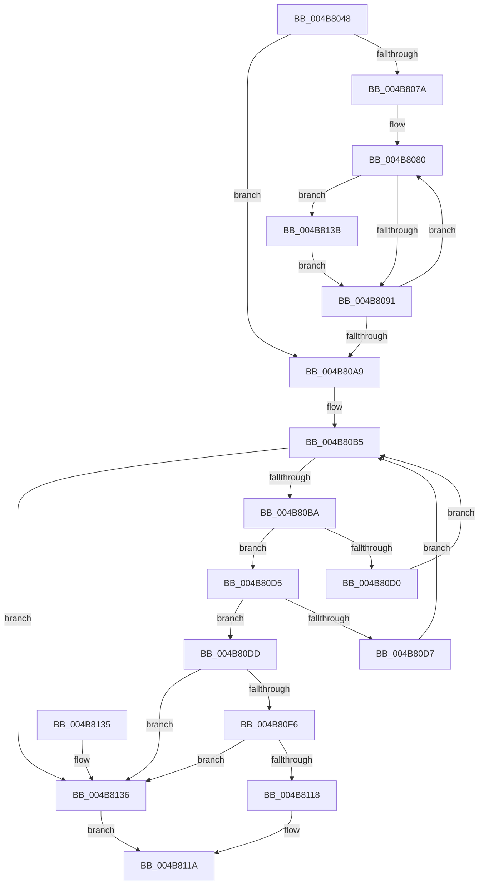

# ApiSetpSearchForApiSet

- RVA: `0x004B8048`–`0x004B8144` (길이 `252` bytes)
- VA: `0x00000001404B8048`
- 실행 섹션: `.text`
- PDB 이름 있음: `예`; PDB Function 태그: `아니요`
- unwind 정보 RVA: `0x000BAD0C`
- 디코드: `76`개 명령, `252/252` bytes 표시
- 미해석 바이트: `0` (있으면 어셈블리에 `.byte`로 보존)

> 이 문서는 커널 이미지의 기계어와 PDB 기호를 분석해 생성했습니다. 4번과 5번은 함수 원형과 자료형을 바이너리 사용 방식에서 추정한 C 해석이며 원본 소스 복구 결과는 아닙니다.

## 1. Dependencies

- 직접 호출 지점: **1**; 고유 호출 대상: **1**
- 직접 호출자로 확인된 함수: **4**
- RIP 상대 이미지 참조: **0**

### Outgoing calls
- `0x004B810F` → [RtlCompareUnicodeStrings](../../page/97/RtlCompareUnicodeStrings_function_009727E0.md) (function, `0x009727E0`)

### Direct callers
- [ApiSetResolveToHost](../4C/ApiSetResolveToHost_function_004C8AA8.md) at `0x004C8B8A`
- [ApiSetValidateSchemaFormat](../66/ApiSetValidateSchemaFormat_function_0066228C.md) at `0x0066239C`
- [ApiSetComposeSchema](../66/ApiSetComposeSchema_function_00662684.md) at `0x006627DA`
- [ApiSetComposeSchema](../66/ApiSetComposeSchema_function_00662684.md) at `0x00662AEF`
- [ApiSetCompose_V7_ProcessV6Extension_Phase1](../66/ApiSetCompose_V7_ProcessV6Extension_Phase1_function_00665C64.md) at `0x006660A9`

### Static image references
- 디코드된 RIP-relative 메모리 참조가 없습니다.

## 2. Other-region calls and transfers

- 다른 실행 섹션으로 향하는 call: **1**
  - `0x004B810F` → [RtlCompareUnicodeStrings](../../page/97/RtlCompareUnicodeStrings_function_009727E0.md) (`.text` → `PAGE`)
- 별도 외부 분기/꼬리 이동을 확인하지 못했습니다.

## 3. Assembly (complete function range)

```asm
004B8048  48 8B C4                        mov rax, rsp
004B804B  48 89 58 08                     mov qword ptr [rax + 8], rbx
004B804F  48 89 68 10                     mov qword ptr [rax + 0x10], rbp
004B8053  48 89 70 18                     mov qword ptr [rax + 0x18], rsi
004B8057  48 89 78 20                     mov qword ptr [rax + 0x20], rdi
004B805B  41 56                           push r14
004B805D  48 83 EC 30                     sub rsp, 0x30
004B8061  45 33 F6                        xor r14d, r14d
004B8064  41 0F B7 F0                     movzx esi, r8w
004B8068  48 8B EA                        mov rbp, rdx
004B806B  4C 8B C9                        mov r9, rcx
004B806E  45 8B D6                        mov r10d, r14d
004B8071  4C 8B DA                        mov r11, rdx
004B8074  66 44 3B F6                     cmp r14w, si
004B8078  73 2F                           jae 0x1404b80a9
004B807A  44 8B 41 18                     mov r8d, dword ptr [rcx + 0x18]
004B807E  8B DE                           mov ebx, esi
004B8080  41 0F B7 13                     movzx edx, word ptr [r11]
004B8084  8D 42 BF                        lea eax, [rdx - 0x41]
004B8087  66 83 F8 19                     cmp ax, 0x19
004B808B  0F 86 AA 00 00 00               jbe 0x1404b813b
004B8091  41 8B C8                        mov ecx, r8d
004B8094  49 83 C3 02                     add r11, 2
004B8098  41 0F AF CA                     imul ecx, r10d
004B809C  44 0F B7 D2                     movzx r10d, dx
004B80A0  44 03 D1                        add r10d, ecx
004B80A3  48 83 EB 01                     sub rbx, 1
004B80A7  75 D7                           jne 0x1404b8080
004B80A9  41 8B 49 0C                     mov ecx, dword ptr [r9 + 0xc]
004B80AD  49 8B DE                        mov rbx, r14
004B80B0  FF C9                           dec ecx
004B80B2  45 8B C6                        mov r8d, r14d
004B80B5  44 3B C1                        cmp r8d, ecx
004B80B8  7F 7C                           jg 0x1404b8136
004B80BA  41 8B 79 14                     mov edi, dword ptr [r9 + 0x14]
004B80BE  41 8D 14 08                     lea edx, [r8 + rcx]
004B80C2  D1 FA                           sar edx, 1
004B80C4  49 03 F9                        add rdi, r9
004B80C7  4C 63 DA                        movsxd r11, edx
004B80CA  46 3B 14 DF                     cmp r10d, dword ptr [rdi + r11*8]
004B80CE  73 05                           jae 0x1404b80d5
004B80D0  8D 4A FF                        lea ecx, [rdx - 1]
004B80D3  EB E0                           jmp 0x1404b80b5
004B80D5  76 06                           jbe 0x1404b80dd
004B80D7  44 8D 42 01                     lea r8d, [rdx + 1]
004B80DB  EB D8                           jmp 0x1404b80b5
004B80DD  42 8B 44 DF 04                  mov eax, dword ptr [rdi + r11*8 + 4]
004B80E2  41 8B 49 10                     mov ecx, dword ptr [r9 + 0x10]
004B80E6  49 03 C9                        add rcx, r9
004B80E9  48 8D 14 40                     lea rdx, [rax + rax*2]
004B80ED  48 8D 1C D1                     lea rbx, [rcx + rdx*8]
004B80F1  48 85 DB                        test rbx, rbx
004B80F4  74 40                           je 0x1404b8136
004B80F6  44 8B 43 04                     mov r8d, dword ptr [rbx + 4]
004B80FA  48 8B D6                        mov rdx, rsi
004B80FD  4D 03 C1                        add r8, r9
004B8100  C6 44 24 20 01                  mov byte ptr [rsp + 0x20], 1
004B8105  44 8B 4B 0C                     mov r9d, dword ptr [rbx + 0xc]
004B8109  48 8B CD                        mov rcx, rbp
004B810C  41 D1 E9                        shr r9d, 1
004B810F  E8 CC A6 4B 00                  call 0x1409727e0
004B8114  85 C0                           test eax, eax
004B8116  74 1E                           je 0x1404b8136
004B8118  33 C0                           xor eax, eax
004B811A  48 8B 5C 24 40                  mov rbx, qword ptr [rsp + 0x40]
004B811F  48 8B 6C 24 48                  mov rbp, qword ptr [rsp + 0x48]
004B8124  48 8B 74 24 50                  mov rsi, qword ptr [rsp + 0x50]
004B8129  48 8B 7C 24 58                  mov rdi, qword ptr [rsp + 0x58]
004B812E  48 83 C4 30                     add rsp, 0x30
004B8132  41 5E                           pop r14
004B8134  C3                              ret
004B8135  CC                              int3
004B8136  48 8B C3                        mov rax, rbx
004B8139  EB DF                           jmp 0x1404b811a
004B813B  66 83 C2 20                     add dx, 0x20
004B813F  E9 4D FF FF FF                  jmp 0x1404b8091
```

## 4. C-style interpretation (structured pseudocode)

```c
__int64 __fastcall ApiSetpSearchForApiSet(__int64 a1, __int64 a2, unsigned __int16 a3)
{
    __int64 result;
    __int64 v_r10;
    __int64 v_r11;
    __int64 v_r14;
    __int64 v_rbx;
    __int64 v_rdi;
    __int64 v_rsp;
    unsigned __int8 v_stack_m18;
    unsigned __int64 v_stack_p10;
    unsigned __int64 v_stack_p18;
    unsigned __int64 v_stack_p20;
    unsigned __int64 v_stack_p8;

    *(unsigned __int64 *)(v_rsp + 8) = v_rbx;
    *(unsigned __int64 *)(v_rsp + 16) = v_rbp;
    *(unsigned __int64 *)(v_rsp + 24) = v_rsi;
    *(unsigned __int64 *)(v_rsp + 32) = v_rdi;
    v_rsp = (v_rsp) - (48);
    v_r14 = 0;
    if (0 >= a3) goto loc_004B80A9;
loc_004B8080:
    if (((unsigned __int16)(*(unsigned __int16 *)(a2) - 65)) <= 25) goto loc_004B813B;
loc_004B8091:
    v_r11 = (a2) + (2);
    a1 = (unsigned int)(((unsigned int)((unsigned int)((unsigned int)(*(unsigned int *)(a1 + 24))))) * (0));
    v_r10 = (unsigned int)(((unsigned __int16)(*(unsigned __int16 *)(a2))) + ((unsigned int)(a1)));
    v_rbx = ((unsigned int)(a3)) - (1);
    if (condition_is_not_equal) goto loc_004B8080;
loc_004B80A9:
    a1 = (unsigned int)(((unsigned int)(*(unsigned int *)(a1 + 12))) - 1);
loc_004B80B5:
    if (0 > ((unsigned int)(a1))) goto loc_004B8136;
    a2 = (unsigned int)((0 + a1 * 1) >> (1));
    v_rdi = ((unsigned int)(*(unsigned int *)(a1 + 20))) + (a1);
    if (((unsigned int)(v_r10)) >= (*(unsigned int *)(v_rdi + (int)((unsigned int)(a2)) * 8))) goto loc_004B80D5;
    goto loc_004B80B5;
loc_004B80D5:
    if (((unsigned int)(v_r10)) <= (*(unsigned int *)(v_rdi + (int)((unsigned int)(a2)) * 8))) goto loc_004B80DD;
    goto loc_004B80B5;
loc_004B80DD:
    a1 = ((unsigned int)(*(unsigned int *)(a1 + 16))) + (a1);
    if (a1 + (unsigned int)(*(unsigned int *)(v_rdi + (int)((unsigned int)(a2)) * 8 + 4)) + (unsigned int)(*(unsigned int *)(v_rdi + (int)((unsigned int)(a2)) * 8 + 4)) * 2 * 8 == 0) goto loc_004B8136;
    a3 = ((unsigned int)(*(unsigned int *)(a1 + (unsigned int)(*(unsigned int *)(v_rdi + (int)((unsigned int)(a2)) * 8 + 4)) + (unsigned int)(*(unsigned int *)(v_rdi + (int)((unsigned int)(a2)) * 8 + 4)) * 2 * 8 + 4))) + (a1);
    v_stack_m18 = 1;
    a4 = (unsigned int)(((unsigned int)(*(unsigned int *)(a1 + (unsigned int)(*(unsigned int *)(v_rdi + (int)((unsigned int)(a2)) * 8 + 4)) + (unsigned int)(*(unsigned int *)(v_rdi + (int)((unsigned int)(a2)) * 8 + 4)) * 2 * 8 + 12))) >> (1));
    result = RtlCompareUnicodeStrings(a2, a3, a3, a4);
    if ((unsigned int)(result) == 0) goto loc_004B8136;
    result = 0;
loc_004B811A:
    v_rsp = (v_rsp) + (48);
    return result;
loc_004B8136:
    goto loc_004B811A;
loc_004B813B:
    a2 = (unsigned __int16)((a3) + (32));
    goto loc_004B8091;
}
```

## 5. (Beta) C Style

```c
int64_t ApiSetpSearchForApiSet(void *Arg1, void *Arg2, uint16_t Arg3)
{
    uint8_t *arg1 = (uint8_t *)Arg1;
    uint8_t *arg2 = (uint8_t *)Arg2;

    int64_t result;
    int64_t local_r10;
    int64_t local_r11;
    int64_t local_r14;
    int64_t local_rbx;
    int64_t local_rdi;
    int64_t local_rsp;
    uint8_t v_stack_m18;
    uint64_t v_stack_p10;
    uint64_t v_stack_p18;
    uint64_t v_stack_p20;
    uint64_t v_stack_p8;

    *(uint64_t *)(local_rsp + 0x8) = local_rbx;
    *(uint64_t *)(local_rsp + 0x10) = local_rbp;
    *(uint64_t *)(local_rsp + 0x18) = local_rsi;
    *(uint64_t *)(local_rsp + 0x20) = local_rdi;
    local_rsp = (local_rsp) - (48);
    local_r14 = 0;
    if (0 >= Arg3) goto loc_004B80A9;
loc_004B8080:
    if (((uint16_t)(*(uint16_t *)(arg2) - 65)) <= 25) goto loc_004B813B;
loc_004B8091:
    local_r11 = (Arg2) + (2);
    Arg1 = (uint32_t)(((uint32_t)((uint32_t)((uint32_t)(*(uint32_t *)(arg1 + 0x18))))) * (0));
    local_r10 = (uint32_t)(((uint16_t)(*(uint16_t *)(arg2))) + ((uint32_t)(Arg1)));
    local_rbx = ((uint32_t)(Arg3)) - (1);
    if (condition_is_not_equal) goto loc_004B8080;
loc_004B80A9:
    Arg1 = (uint32_t)(((uint32_t)(*(uint32_t *)(arg1 + 0xC))) - 1);
loc_004B80B5:
    if (0 > ((uint32_t)(Arg1))) goto loc_004B8136;
    Arg2 = (uint32_t)((0 + Arg1 * 1) >> (1));
    local_rdi = ((uint32_t)(*(uint32_t *)(arg1 + 0x14))) + (Arg1);
    if (((uint32_t)(local_r10)) >= (*(uint32_t *)(local_rdi + (int32_t)((uint32_t)(arg2)) * 8))) goto loc_004B80D5;
    goto loc_004B80B5;
loc_004B80D5:
    if (((uint32_t)(local_r10)) <= (*(uint32_t *)(local_rdi + (int32_t)((uint32_t)(arg2)) * 8))) goto loc_004B80DD;
    goto loc_004B80B5;
loc_004B80DD:
    Arg1 = ((uint32_t)(*(uint32_t *)(arg1 + 0x10))) + (Arg1);
    if (Arg1 + (uint32_t)(*(uint32_t *)(local_rdi + (int32_t)((uint32_t)(arg2)) * 8 + 0x4)) + (uint32_t)(*(uint32_t *)(local_rdi + (int32_t)((uint32_t)(arg2)) * 8 + 0x4)) * 2 * 8 == 0) goto loc_004B8136;
    Arg3 = ((uint32_t)(*(uint32_t *)(arg1 + (uint32_t)(*(uint32_t *)(local_rdi + (int32_t)((uint32_t)(arg2)) * 8 + 0x4)) + (uint32_t)(*(uint32_t *)(local_rdi + (int32_t)((uint32_t)(arg2)) * 8 + 0x4)) * 2 * 8 + 0x4))) + (Arg1);
    v_stack_m18 = 1;
    a4 = (uint32_t)(((uint32_t)(*(uint32_t *)(arg1 + (uint32_t)(*(uint32_t *)(local_rdi + (int32_t)((uint32_t)(arg2)) * 8 + 0x4)) + (uint32_t)(*(uint32_t *)(local_rdi + (int32_t)((uint32_t)(arg2)) * 8 + 0x4)) * 2 * 8 + 0xC))) >> (1));
    result = RtlCompareUnicodeStrings(Arg2, Arg3, Arg3, a4);
    if ((uint32_t)(result) == 0) goto loc_004B8136;
    result = 0;
loc_004B811A:
    local_rsp = (local_rsp) + (48);
    return result;
loc_004B8136:
    goto loc_004B811A;
loc_004B813B:
    Arg2 = (uint16_t)((Arg3) + (32));
    goto loc_004B8091;
}
```

### 관측된 메모리 오프셋

구조체 형식이 확인되지 않은 접근은 인자 기준의 오프셋으로만 기록했습니다.

| 기준 인자 | 오프셋 표현 | 폭 (bit) | 접근 |
|---|---:|---:|---|
| `Arg1` | `+ 0xC` | `32` | `R` |
| `Arg1` | `+ 0x10` | `32` | `R` |
| `Arg1` | `+ 0x14` | `32` | `R` |
| `Arg1` | `+ 0x18` | `32` | `R` |
| `Arg2` | `+ 0x0` | `16` | `R` |

## 6. Execution-region graph

[열기: 2D/3D 그래프와 함수 탐색 컨트롤 패널](../../../control-panel.html?section=text&rva=0x004B8048&view=graph)

- 2D 그래프는 위에서 아래로 흐르고, 3D 그래프는 빈 공간을 드래그해 회전합니다. Shift+드래그는 이동, 휠은 확대·축소, 함수 노드 선택은 대상 보고서 이동입니다.

### Static fallback


