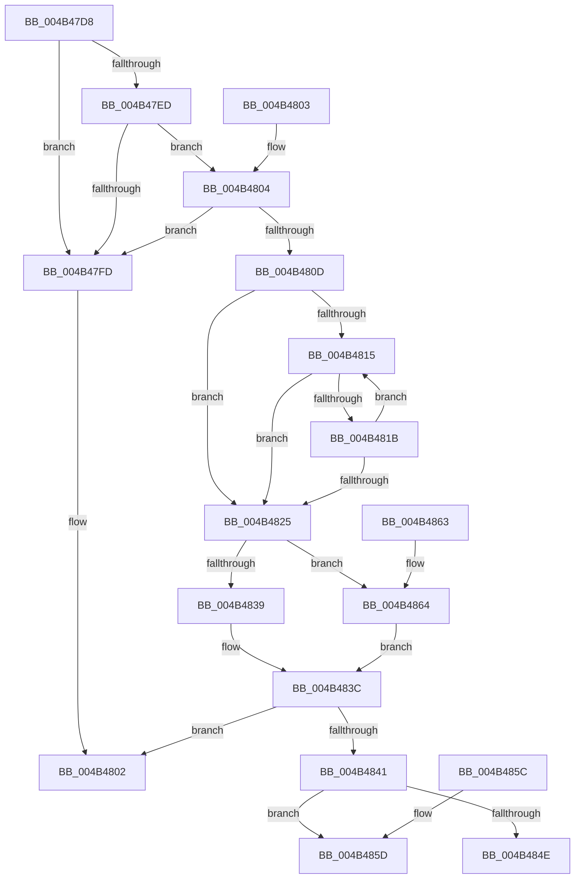

# AslpFileVerBlockGetValueOffset

- RVA: `0x004B47D8`–`0x004B4869` (길이 `145` bytes)
- VA: `0x00000001404B47D8`
- 실행 섹션: `.text`
- PDB 이름 있음: `예`; PDB Function 태그: `아니요`
- unwind 정보 RVA: `0x000DB714`
- 디코드: `49`개 명령, `145/145` bytes 표시
- 미해석 바이트: `0` (있으면 어셈블리에 `.byte`로 보존)

> 이 문서는 커널 이미지의 기계어와 PDB 기호를 분석해 생성했습니다. 4번과 5번은 함수 원형과 자료형을 바이너리 사용 방식에서 추정한 C 해석이며 원본 소스 복구 결과는 아닙니다.

## 1. Dependencies

- 직접 호출 지점: **0**; 고유 호출 대상: **0**
- 직접 호출자로 확인된 함수: **3**
- RIP 상대 이미지 참조: **0**

### Outgoing calls
- 직접 디코드된 call 명령이 없습니다.

### Direct callers
- [AslpFileMakeStringVersionAttributes](../../page/82/AslpFileMakeStringVersionAttributes_function_00820964.md) at `0x00820A3E`
- [AslpFileVerStringBlockGetValue](../../page/82/AslpFileVerStringBlockGetValue_function_00821370.md) at `0x008213AA`
- [AslpFileVerQueryBlock](../../page/AF/AslpFileVerQueryBlock_function_00AF9694.md) at `0x00AF97C3`

### Static image references
- 디코드된 RIP-relative 메모리 참조가 없습니다.

## 2. Other-region calls and transfers

- 다른 실행 섹션으로 향하는 call: **0**
- 별도 외부 분기/꼬리 이동을 확인하지 못했습니다.

## 3. Assembly (complete function range)

```asm
004B47D8  45 33 D2                        xor r10d, r10d
004B47DB  49 8D 40 F8                     lea rax, [r8 - 8]
004B47DF  4C 89 11                        mov qword ptr [rcx], r10
004B47E2  4C 8B C9                        mov r9, rcx
004B47E5  48 3D F7 7F 00 00               cmp rax, 0x7ff7
004B47EB  77 10                           ja 0x1404b47fd
004B47ED  48 8D 42 06                     lea rax, [rdx + 6]
004B47F1  49 8D 50 FA                     lea rdx, [r8 - 6]
004B47F5  48 D1 EA                        shr rdx, 1
004B47F8  48 85 C0                        test rax, rax
004B47FB  75 07                           jne 0x1404b4804
004B47FD  B8 0D 00 00 C0                  mov eax, 0xc000000d
004B4802  C3                              ret
004B4803  CC                              int3
004B4804  48 81 FA FF FF FF 7F            cmp rdx, 0x7fffffff
004B480B  77 F0                           ja 0x1404b47fd
004B480D  48 8B CA                        mov rcx, rdx
004B4810  48 85 D2                        test rdx, rdx
004B4813  74 10                           je 0x1404b4825
004B4815  66 44 39 10                     cmp word ptr [rax], r10w
004B4819  74 0A                           je 0x1404b4825
004B481B  48 83 C0 02                     add rax, 2
004B481F  48 83 E9 01                     sub rcx, 1
004B4823  75 F0                           jne 0x1404b4815
004B4825  48 8B C1                        mov rax, rcx
004B4828  48 F7 D8                        neg rax
004B482B  1B C0                           sbb eax, eax
004B482D  F7 D0                           not eax
004B482F  25 0D 00 00 C0                  and eax, 0xc000000d
004B4834  48 85 C9                        test rcx, rcx
004B4837  74 2B                           je 0x1404b4864
004B4839  48 2B D1                        sub rdx, rcx
004B483C  48 85 C9                        test rcx, rcx
004B483F  74 C1                           je 0x1404b4802
004B4841  48 8D 04 12                     lea rax, [rdx + rdx]
004B4845  48 8D 48 08                     lea rcx, [rax + 8]
004B4849  48 3B C8                        cmp rcx, rax
004B484C  72 0F                           jb 0x1404b485d
004B484E  48 8D 41 03                     lea rax, [rcx + 3]
004B4852  48 83 E0 FC                     and rax, 0xfffffffffffffffc
004B4856  49 89 01                        mov qword ptr [r9], rax
004B4859  33 C0                           xor eax, eax
004B485B  C3                              ret
004B485C  CC                              int3
004B485D  B8 95 00 00 C0                  mov eax, 0xc0000095
004B4862  C3                              ret
004B4863  CC                              int3
004B4864  49 8B D2                        mov rdx, r10
004B4867  EB D3                           jmp 0x1404b483c
```

## 4. C-style interpretation (structured pseudocode)

```c
__int64 __fastcall AslpFileVerBlockGetValueOffset(__int64 a1, __int64 a2, __int64 a3)
{
    __int64 result;
    __int64 v_r10;

    v_r10 = 0;
    *(unsigned __int64 *)(a1) = 0;
    if ((a3 - 8) > 0x7FF7ULL) goto loc_004B47FD;
    a2 = (a3 - 6) >> (1);
    if (a2 + 6 != 0) goto loc_004B4804;
loc_004B47FD:
loc_004B4802:
    return (unsigned int)(0xC000000DULL);
loc_004B4804:
    if (a2 > 0x7FFFFFFFULL) goto loc_004B47FD;
    if (a2 == 0) goto loc_004B4825;
loc_004B4815:
    if ((*(unsigned __int16 *)((unsigned int)(0xC000000DULL))) == 0) goto loc_004B4825;
    result = ((unsigned int)(0xC000000DULL)) + (2);
    a1 = (a2) - (1);
    if (condition_is_not_equal) goto loc_004B4815;
loc_004B4825:
    result = -(a1);
    result = (unsigned int)(~(result));
    result = (unsigned int)((result) & (0xC000000DULL));
    if (a1 == 0) goto loc_004B4864;
    a2 = (a2) - (a1);
loc_004B483C:
    if (a1 == 0) goto loc_004B4802;
    if ((a2 + a2 * 1 + 8) < (a2 + a2 * 1)) goto loc_004B485D;
    result = (a2 + a2 * 1 + 8 + 3) & (-4);
    *(unsigned __int64 *)(a1) = result;
    result = 0;
    return result;
loc_004B485D:
    return (unsigned int)(0xC0000095ULL);
loc_004B4864:
    goto loc_004B483C;
}
```

## 5. (Beta) C Style

```c
int64_t AslpFileVerBlockGetValueOffset(void *Arg1, void *Arg2, void *Arg3)
{
    uint8_t *arg1 = (uint8_t *)Arg1;
    uint8_t *arg2 = (uint8_t *)Arg2;
    uint8_t *arg3 = (uint8_t *)Arg3;

    int64_t result;
    int64_t local_r10;

    local_r10 = 0;
    *(uint64_t *)(arg1) = 0;
    if ((Arg3 - 8) > 0x7FF7ULL) goto loc_004B47FD;
    Arg2 = (Arg3 - 6) >> (1);
    if (Arg2 + 6 != 0) goto loc_004B4804;
loc_004B47FD:
loc_004B4802:
    return (uint32_t)(0xC000000DULL);
loc_004B4804:
    if (Arg2 > 0x7FFFFFFFULL) goto loc_004B47FD;
    if (Arg2 == NULL) goto loc_004B4825;
loc_004B4815:
    if ((*(uint16_t *)((uint32_t)(0xC000000DULL))) == 0) goto loc_004B4825;
    result = ((uint32_t)(0xC000000DULL)) + (2);
    Arg1 = (Arg2) - (1);
    if (condition_is_not_equal) goto loc_004B4815;
loc_004B4825:
    result = -(Arg1);
    result = (uint32_t)(~(result));
    result = (uint32_t)((result) & (0xC000000DULL));
    if (Arg1 == NULL) goto loc_004B4864;
    Arg2 = (Arg2) - (Arg1);
loc_004B483C:
    if (Arg1 == NULL) goto loc_004B4802;
    if ((Arg2 + Arg2 * 1 + 8) < (Arg2 + Arg2 * 1)) goto loc_004B485D;
    result = (Arg2 + Arg2 * 1 + 8 + 3) & (-4);
    *(uint64_t *)(arg1) = result;
    result = 0;
    return result;
loc_004B485D:
    return (uint32_t)(0xC0000095ULL);
loc_004B4864:
    goto loc_004B483C;
}
```

### 관측된 메모리 오프셋

구조체 형식이 확인되지 않은 접근은 인자 기준의 오프셋으로만 기록했습니다.

| 기준 인자 | 오프셋 표현 | 폭 (bit) | 접근 |
|---|---:|---:|---|
| `Arg1` | `+ 0x0` | `64` | `W` |
| `Arg2` | `+ 0x6` | `64` | `R` |
| `Arg3` | `- 0x8` | `64` | `R` |
| `Arg3` | `- 0x6` | `64` | `R` |

## 6. Execution-region graph

[열기: 2D/3D 그래프와 함수 탐색 컨트롤 패널](../../../control-panel.html?section=text&rva=0x004B47D8&view=graph)

- 2D 그래프는 위에서 아래로 흐르고, 3D 그래프는 빈 공간을 드래그해 회전합니다. Shift+드래그는 이동, 휠은 확대·축소, 함수 노드 선택은 대상 보고서 이동입니다.

### Static fallback


