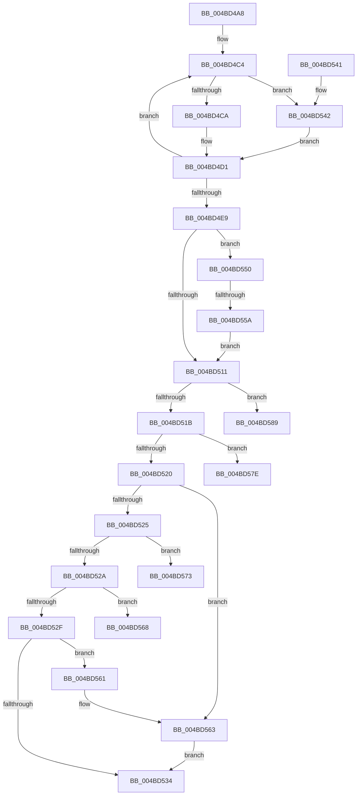

# AuthzBasepCompareOctetStringOperands

- RVA: `0x004BD4A8`–`0x004BD594` (길이 `236` bytes)
- VA: `0x00000001404BD4A8`
- 실행 섹션: `.text`
- PDB 이름 있음: `예`; PDB Function 태그: `예`
- unwind 정보 RVA: `0x000BBFD0`
- 디코드: `71`개 명령, `236/236` bytes 표시
- 미해석 바이트: `0` (있으면 어셈블리에 `.byte`로 보존)

> 이 문서는 커널 이미지의 기계어와 PDB 기호를 분석해 생성했습니다. 4번과 5번은 함수 원형과 자료형을 바이너리 사용 방식에서 추정한 C 해석이며 원본 소스 복구 결과는 아닙니다.

## 1. Dependencies

- 직접 호출 지점: **1**; 고유 호출 대상: **1**
- 직접 호출자로 확인된 함수: **2**
- RIP 상대 이미지 참조: **0**

### Outgoing calls
- `0x004BD503` → [memcmp](../6C/memcmp_function_006C6B10.md) (function, `0x006C6B10`)

### Direct callers
- [AuthzBasepValueInSet](../2F/AuthzBasepValueInSet_function_002FE9B0.md) at `0x002FEB54`
- [AuthzBasepEvaluateExpression](../30/AuthzBasepEvaluateExpression_function_00300578.md) at `0x00300672`

### Static image references
- 디코드된 RIP-relative 메모리 참조가 없습니다.

## 2. Other-region calls and transfers

- 다른 실행 섹션으로 향하는 call: **0**
- call이 아닌 외부 분기/꼬리 이동: **5**
  - `0x004BD554` → [sub_006FC8DC](../6F/Unknown_function_006FC8DC.md) (`tail-transfer`)
  - `0x004BD56E` → [sub_006FC8DC + 0xF](../6F/Unknown_function_006FC8DC.md) (`tail-transfer`)
  - `0x004BD579` → [sub_006FC8DC + 0xF](../6F/Unknown_function_006FC8DC.md) (`tail-transfer`)
  - `0x004BD584` → [sub_006FC8DC + 0xF](../6F/Unknown_function_006FC8DC.md) (`tail-transfer`)
  - `0x004BD58F` → [sub_006FC8DC + 0xF](../6F/Unknown_function_006FC8DC.md) (`tail-transfer`)

## 3. Assembly (complete function range)

```asm
004BD4A8  48 89 74 24 08                  mov qword ptr [rsp + 8], rsi
004BD4AD  57                              push rdi
004BD4AE  48 83 EC 40                     sub rsp, 0x40
004BD4B2  0F B6 F1                        movzx esi, cl
004BD4B5  4C 8D 44 24 20                  lea r8, [rsp + 0x20]
004BD4BA  48 83 C2 20                     add rdx, 0x20
004BD4BE  41 BA 02 00 00 00               mov r10d, 2
004BD4C4  83 7A EC 01                     cmp dword ptr [rdx - 0x14], 1
004BD4C8  75 78                           jne 0x1404bd542
004BD4CA  44 8B 4A F8                     mov r9d, dword ptr [rdx - 8]
004BD4CE  48 8B C2                        mov rax, rdx
004BD4D1  48 8B 00                        mov rax, qword ptr [rax]
004BD4D4  48 83 C2 28                     add rdx, 0x28
004BD4D8  49 89 00                        mov qword ptr [r8], rax
004BD4DB  45 89 48 08                     mov dword ptr [r8 + 8], r9d
004BD4DF  49 83 C0 10                     add r8, 0x10
004BD4E3  49 83 EA 01                     sub r10, 1
004BD4E7  75 DB                           jne 0x1404bd4c4
004BD4E9  44 8B 44 24 38                  mov r8d, dword ptr [rsp + 0x38]
004BD4EE  8B 7C 24 28                     mov edi, dword ptr [rsp + 0x28]
004BD4F2  41 3B F8                        cmp edi, r8d
004BD4F5  48 8B 54 24 30                  mov rdx, qword ptr [rsp + 0x30]
004BD4FA  48 8B 4C 24 20                  mov rcx, qword ptr [rsp + 0x20]
004BD4FF  44 0F 42 C7                     cmovb r8d, edi
004BD503  E8 08 96 20 00                  call 0x1406c6b10
004BD508  45 33 C0                        xor r8d, r8d
004BD50B  8B C8                           mov ecx, eax
004BD50D  85 C0                           test eax, eax
004BD50F  74 3F                           je 0x1404bd550
004BD511  8B D6                           mov edx, esi
004BD513  81 EA 80 00 00 00               sub edx, 0x80
004BD519  74 6E                           je 0x1404bd589
004BD51B  83 EA 01                        sub edx, 1
004BD51E  74 5E                           je 0x1404bd57e
004BD520  83 EA 01                        sub edx, 1
004BD523  74 3E                           je 0x1404bd563
004BD525  83 EA 01                        sub edx, 1
004BD528  74 49                           je 0x1404bd573
004BD52A  83 EA 01                        sub edx, 1
004BD52D  74 39                           je 0x1404bd568
004BD52F  83 FA 01                        cmp edx, 1
004BD532  74 2D                           je 0x1404bd561
004BD534  48 8B 74 24 50                  mov rsi, qword ptr [rsp + 0x50]
004BD539  8B C1                           mov eax, ecx
004BD53B  48 83 C4 40                     add rsp, 0x40
004BD53F  5F                              pop rdi
004BD540  C3                              ret
004BD541  CC                              int3
004BD542  48 8B 42 F0                     mov rax, qword ptr [rdx - 0x10]
004BD546  48 8B 40 30                     mov rax, qword ptr [rax + 0x30]
004BD54A  44 8B 48 08                     mov r9d, dword ptr [rax + 8]
004BD54E  EB 81                           jmp 0x1404bd4d1
004BD550  3B 7C 24 38                     cmp edi, dword ptr [rsp + 0x38]
004BD554  0F 86 82 F3 23 00               jbe 0x1406fc8dc
004BD55A  B9 01 00 00 00                  mov ecx, 1
004BD55F  EB B0                           jmp 0x1404bd511
004BD561  F7 D1                           not ecx
004BD563  C1 E9 1F                        shr ecx, 0x1f
004BD566  EB CC                           jmp 0x1404bd534
004BD568  85 C9                           test ecx, ecx
004BD56A  41 0F 9F C0                     setg r8b
004BD56E  E9 78 F3 23 00                  jmp 0x1406fc8eb
004BD573  85 C9                           test ecx, ecx
004BD575  41 0F 9E C0                     setle r8b
004BD579  E9 6D F3 23 00                  jmp 0x1406fc8eb
004BD57E  85 C9                           test ecx, ecx
004BD580  41 0F 95 C0                     setne r8b
004BD584  E9 62 F3 23 00                  jmp 0x1406fc8eb
004BD589  85 C9                           test ecx, ecx
004BD58B  41 0F 94 C0                     sete r8b
004BD58F  E9 57 F3 23 00                  jmp 0x1406fc8eb
```

## 4. C-style interpretation (structured pseudocode)

```c
__int64 __fastcall AuthzBasepCompareOctetStringOperands(unsigned __int8 a1, __int64 a2)
{
    __int64 result;
    __int64 v_r10;
    __int64 v_rsp;
    unsigned int v_stack_m10;
    unsigned __int64 v_stack_m18;
    unsigned int v_stack_m20;
    unsigned __int64 v_stack_m28;
    unsigned int v_stack_p38;
    unsigned __int64 v_stack_p8;

    v_stack_p8 = v_rsi;
    v_rsp = (v_rsp) - (64);
    a2 = (a2) + (32);
loc_004BD4C4:
    if ((*(unsigned int *)(a2 - 20)) != 1) goto loc_004BD542;
loc_004BD4D1:
    a2 = (a2) + (40);
    *(unsigned __int64 *)(v_stack_m28) = *(unsigned __int64 *)(a2);
    *(unsigned int *)(v_stack_m28 + 8) = (unsigned int)((unsigned int)(*(unsigned int *)(a2 - 8)));
    a3 = (v_stack_m28) + (16);
    v_r10 = (2) - (1);
    if (condition_is_not_equal) goto loc_004BD4C4;
    a3 = (unsigned int)(v_stack_m10);
    if (((unsigned int)((unsigned int)(v_stack_m20))) < ((unsigned int)((unsigned int)(v_stack_m10)))) { a3 = (unsigned int)((unsigned int)(v_stack_m20)); }
    result = memcmp(v_stack_m28, v_stack_m18, a3, (unsigned int)(*(unsigned int *)(a2 - 8)));
    a3 = 0;
    if ((unsigned int)(result) == 0) goto loc_004BD550;
loc_004BD511:
    a2 = (unsigned int)(((unsigned int)(a1)) - (128));
    if (condition_is_equal) goto loc_004BD589;
    a2 = (unsigned int)((a2) - (1));
    if (condition_is_equal) goto loc_004BD57E;
    a2 = (unsigned int)((a2) - (1));
    if (condition_is_equal) goto loc_004BD563;
    a2 = (unsigned int)((a2) - (1));
    if (condition_is_equal) goto loc_004BD573;
    a2 = (unsigned int)((a2) - (1));
    if (condition_is_equal) goto loc_004BD568;
    if (((unsigned int)(a2)) == 1) goto loc_004BD561;
loc_004BD534:
    v_rsp = (v_rsp) + (64);
    return (unsigned int)((unsigned int)((unsigned int)((unsigned int)(result))));
loc_004BD542:
    goto loc_004BD4D1;
loc_004BD550:
    goto loc_004BD511;
loc_004BD561:
    a1 = (unsigned int)(~(1));
loc_004BD563:
    a1 = (unsigned int)((a1) >> (31));
    goto loc_004BD534;
loc_004BD568:
    a3 = (condition_is_greater) ? 1 : 0;
loc_004BD573:
    a3 = (condition_is_less_or_equal) ? 1 : 0;
loc_004BD57E:
    a3 = (a1 != 0) ? 1 : 0;
loc_004BD589:
    a3 = (a1 == 0) ? 1 : 0;
}
```

## 5. (Beta) C Style

```c
int64_t AuthzBasepCompareOctetStringOperands(uint8_t Arg1, void *Arg2)
{
    uint8_t *arg2 = (uint8_t *)Arg2;

    int64_t result;
    int64_t local_r10;
    int64_t local_rsp;
    uint32_t v_stack_m10;
    uint64_t v_stack_m18;
    uint32_t v_stack_m20;
    uint64_t v_stack_m28;
    uint32_t v_stack_p38;
    uint64_t v_stack_p8;

    v_stack_p8 = local_rsi;
    local_rsp = (local_rsp) - (64);
    Arg2 = (Arg2) + (32);
loc_004BD4C4:
    if ((*(uint32_t *)(arg2 - 0x14)) != 1) goto loc_004BD542;
loc_004BD4D1:
    Arg2 = (Arg2) + (40);
    *(uint64_t *)(v_stack_m28) = *(uint64_t *)(arg2);
    *(uint32_t *)(v_stack_m28 + 0x8) = (uint32_t)((uint32_t)(*(uint32_t *)(arg2 - 0x8)));
    a3 = (v_stack_m28) + (16);
    local_r10 = (2) - (1);
    if (condition_is_not_equal) goto loc_004BD4C4;
    a3 = (uint32_t)(v_stack_m10);
    if (((uint32_t)((uint32_t)(v_stack_m20))) < ((uint32_t)((uint32_t)(v_stack_m10)))) { a3 = (uint32_t)((uint32_t)(v_stack_m20)); }
    result = memcmp(v_stack_m28, v_stack_m18, a3, (uint32_t)(*(uint32_t *)(arg2 - 0x8)));
    a3 = 0;
    if ((uint32_t)(result) == 0) goto loc_004BD550;
loc_004BD511:
    Arg2 = (uint32_t)(((uint32_t)(Arg1)) - (128));
    if (condition_is_equal) goto loc_004BD589;
    Arg2 = (uint32_t)((Arg2) - (1));
    if (condition_is_equal) goto loc_004BD57E;
    Arg2 = (uint32_t)((Arg2) - (1));
    if (condition_is_equal) goto loc_004BD563;
    Arg2 = (uint32_t)((Arg2) - (1));
    if (condition_is_equal) goto loc_004BD573;
    Arg2 = (uint32_t)((Arg2) - (1));
    if (condition_is_equal) goto loc_004BD568;
    if (((uint32_t)(Arg2)) == 1) goto loc_004BD561;
loc_004BD534:
    local_rsp = (local_rsp) + (64);
    return (uint32_t)((uint32_t)((uint32_t)((uint32_t)(result))));
loc_004BD542:
    goto loc_004BD4D1;
loc_004BD550:
    goto loc_004BD511;
loc_004BD561:
    Arg1 = (uint32_t)(~(1));
loc_004BD563:
    Arg1 = (uint32_t)((Arg1) >> (31));
    goto loc_004BD534;
loc_004BD568:
    a3 = (condition_is_greater) ? 1 : 0;
loc_004BD573:
    a3 = (condition_is_less_or_equal) ? 1 : 0;
loc_004BD57E:
    a3 = (Arg1 != 0) ? 1 : 0;
loc_004BD589:
    a3 = (Arg1 == 0) ? 1 : 0;
}
```

### 관측된 메모리 오프셋

구조체 형식이 확인되지 않은 접근은 인자 기준의 오프셋으로만 기록했습니다.

| 기준 인자 | 오프셋 표현 | 폭 (bit) | 접근 |
|---|---:|---:|---|
| `Arg2` | `- 0x14` | `32` | `R` |
| `Arg2` | `- 0x10` | `64` | `R` |
| `Arg2` | `- 0x8` | `32` | `R` |

## 6. Execution-region graph

[열기: 2D/3D 그래프와 함수 탐색 컨트롤 패널](../../../control-panel.html?section=text&rva=0x004BD4A8&view=graph)

- 2D 그래프는 위에서 아래로 흐르고, 3D 그래프는 빈 공간을 드래그해 회전합니다. Shift+드래그는 이동, 휠은 확대·축소, 함수 노드 선택은 대상 보고서 이동입니다.

### Static fallback


