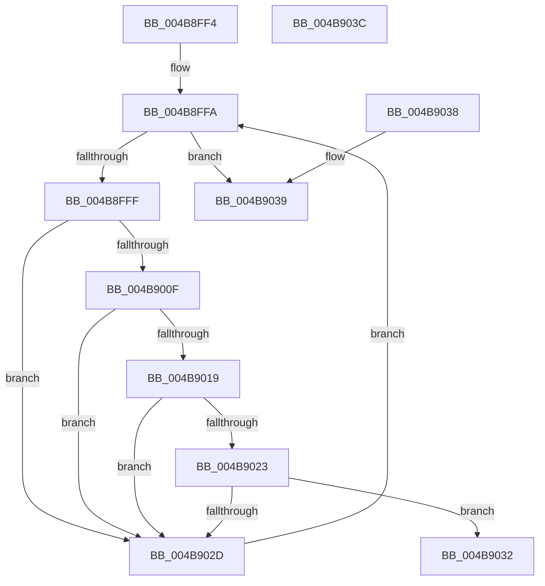

# AuthzBasepObjectInTypeList

- RVA: `0x004B8FF4`–`0x004B903D` (길이 `73` bytes)
- VA: `0x00000001404B8FF4`
- 실행 섹션: `.text`
- PDB 이름 있음: `예`; PDB Function 태그: `아니요`
- unwind 정보 RVA: `0x000DB714`
- 디코드: `27`개 명령, `73/73` bytes 표시
- 미해석 바이트: `0` (있으면 어셈블리에 `.byte`로 보존)

> 이 문서는 커널 이미지의 기계어와 PDB 기호를 분석해 생성했습니다. 4번과 5번은 함수 원형과 자료형을 바이너리 사용 방식에서 추정한 C 해석이며 원본 소스 복구 결과는 아닙니다.

## 1. Dependencies

- 직접 호출 지점: **0**; 고유 호출 대상: **0**
- 직접 호출자로 확인된 함수: **5**
- RIP 상대 이미지 참조: **0**

### Outgoing calls
- 직접 디코드된 call 명령이 없습니다.

### Direct callers
- [SepMaximumAccessCheckEx](../60/SepMaximumAccessCheckEx_function_00606D78.md) at `0x0060702E`
- [SepMaximumAccessCheckEx](../60/SepMaximumAccessCheckEx_function_00606D78.md) at `0x006071D1`
- [sub_006E0188](../6E/Unknown_function_006E0188.md) at `0x006E0253`
- [sub_006E0188](../6E/Unknown_function_006E0188.md) at `0x006E033A`
- [sub_006E8E06](../6E/Unknown_function_006E8E06.md) at `0x006E8F26`
- [sub_006E8E06](../6E/Unknown_function_006E8E06.md) at `0x006E8FCF`
- [sub_006E9020](../6E/Unknown_function_006E9020.md) at `0x006E90DD`
- [sub_006E9020](../6E/Unknown_function_006E9020.md) at `0x006E919D`
- [sub_00B397DE](../../page/B3/Unknown_function_00B397DE.md) at `0x00B3997D`

### Static image references
- 디코드된 RIP-relative 메모리 참조가 없습니다.

## 2. Other-region calls and transfers

- 다른 실행 섹션으로 향하는 call: **0**
- 별도 외부 분기/꼬리 이동을 확인하지 못했습니다.

## 3. Assembly (complete function range)

```asm
004B8FF4  4C 8B DA                        mov r11, rdx
004B8FF7  45 33 D2                        xor r10d, r10d
004B8FFA  45 3B D0                        cmp r10d, r8d
004B8FFD  73 3A                           jae 0x1404b9039
004B8FFF  4B 8D 14 52                     lea rdx, [r10 + r10*2]
004B9003  48 03 D2                        add rdx, rdx
004B9006  41 8B 44 D3 04                  mov eax, dword ptr [r11 + rdx*8 + 4]
004B900B  39 01                           cmp dword ptr [rcx], eax
004B900D  75 1E                           jne 0x1404b902d
004B900F  41 8B 44 D3 08                  mov eax, dword ptr [r11 + rdx*8 + 8]
004B9014  39 41 04                        cmp dword ptr [rcx + 4], eax
004B9017  75 14                           jne 0x1404b902d
004B9019  41 8B 44 D3 0C                  mov eax, dword ptr [r11 + rdx*8 + 0xc]
004B901E  39 41 08                        cmp dword ptr [rcx + 8], eax
004B9021  75 0A                           jne 0x1404b902d
004B9023  41 8B 44 D3 10                  mov eax, dword ptr [r11 + rdx*8 + 0x10]
004B9028  39 41 0C                        cmp dword ptr [rcx + 0xc], eax
004B902B  74 05                           je 0x1404b9032
004B902D  41 FF C2                        inc r10d
004B9030  EB C8                           jmp 0x1404b8ffa
004B9032  45 89 11                        mov dword ptr [r9], r10d
004B9035  B0 01                           mov al, 1
004B9037  C3                              ret
004B9038  CC                              int3
004B9039  32 C0                           xor al, al
004B903B  C3                              ret
004B903C  CC                              int3
```

## 4. C-style interpretation (structured pseudocode)

```c
__int64 __fastcall AuthzBasepObjectInTypeList(__int64 a1, __int64 a2, int a3, __int64 a4)
{
    __int64 result;
    __int64 v_r10;

    v_r10 = 0;
loc_004B8FFA:
    if (0 >= a3) goto loc_004B9039;
    a2 = (v_r10 + v_r10 * 2) + (v_r10 + v_r10 * 2);
    if ((*(unsigned int *)(a1)) != ((unsigned int)((unsigned int)(*(unsigned int *)(a2 + a2 * 8 + 4))))) goto loc_004B902D;
    if ((*(unsigned int *)(a1 + 4)) != ((unsigned int)((unsigned int)(*(unsigned int *)(a2 + a2 * 8 + 8))))) goto loc_004B902D;
    if ((*(unsigned int *)(a1 + 8)) != ((unsigned int)((unsigned int)(*(unsigned int *)(a2 + a2 * 8 + 12))))) goto loc_004B902D;
    if ((*(unsigned int *)(a1 + 12)) == ((unsigned int)((unsigned int)(*(unsigned int *)(a2 + a2 * 8 + 16))))) goto loc_004B9032;
loc_004B902D:
    v_r10 = (unsigned int)((v_r10) + 1);
    goto loc_004B8FFA;
loc_004B9032:
    *(unsigned int *)(a4) = (unsigned int)(v_r10);
    return 1;
loc_004B9039:
    result = 0;
    return result;
}
```

## 5. (Beta) C Style

```c
int64_t AuthzBasepObjectInTypeList(void *Arg1, void *Arg2, int32_t Arg3, void *Arg4)
{
    uint8_t *arg1 = (uint8_t *)Arg1;
    uint8_t *arg2 = (uint8_t *)Arg2;
    uint8_t *arg4 = (uint8_t *)Arg4;

    int64_t result;
    int64_t local_r10;

    local_r10 = 0;
loc_004B8FFA:
    if (0 >= Arg3) goto loc_004B9039;
    Arg2 = (local_r10 + local_r10 * 2) + (local_r10 + local_r10 * 2);
    if ((*(uint32_t *)(arg1)) != ((uint32_t)((uint32_t)(*(uint32_t *)(arg2 + arg2 * 8 + 0x4))))) goto loc_004B902D;
    if ((*(uint32_t *)(arg1 + 0x4)) != ((uint32_t)((uint32_t)(*(uint32_t *)(arg2 + arg2 * 8 + 0x8))))) goto loc_004B902D;
    if ((*(uint32_t *)(arg1 + 0x8)) != ((uint32_t)((uint32_t)(*(uint32_t *)(arg2 + arg2 * 8 + 0xC))))) goto loc_004B902D;
    if ((*(uint32_t *)(arg1 + 0xC)) == ((uint32_t)((uint32_t)(*(uint32_t *)(arg2 + arg2 * 8 + 0x10))))) goto loc_004B9032;
loc_004B902D:
    local_r10 = (uint32_t)((local_r10) + 1);
    goto loc_004B8FFA;
loc_004B9032:
    *(uint32_t *)(arg4) = (uint32_t)(local_r10);
    return 1;
loc_004B9039:
    result = 0;
    return result;
}
```

### 관측된 메모리 오프셋

구조체 형식이 확인되지 않은 접근은 인자 기준의 오프셋으로만 기록했습니다.

| 기준 인자 | 오프셋 표현 | 폭 (bit) | 접근 |
|---|---:|---:|---|
| `Arg1` | `+ 0x0` | `32` | `R` |
| `Arg1` | `+ 0x4` | `32` | `R` |
| `Arg1` | `+ 0x8` | `32` | `R` |
| `Arg1` | `+ 0xC` | `32` | `R` |
| `Arg2` | `+ 0x4 + rdx*8` | `32` | `R` |
| `Arg2` | `+ 0x8 + rdx*8` | `32` | `R` |
| `Arg2` | `+ 0xC + rdx*8` | `32` | `R` |
| `Arg2` | `+ 0x10 + rdx*8` | `32` | `R` |
| `Arg4` | `+ 0x0` | `32` | `W` |

## 6. Execution-region graph

[열기: 2D/3D 그래프와 함수 탐색 컨트롤 패널](../../../control-panel.html?section=text&rva=0x004B8FF4&view=graph)

- 2D 그래프는 위에서 아래로 흐르고, 3D 그래프는 빈 공간을 드래그해 회전합니다. Shift+드래그는 이동, 휠은 확대·축소, 함수 노드 선택은 대상 보고서 이동입니다.

### Static fallback


