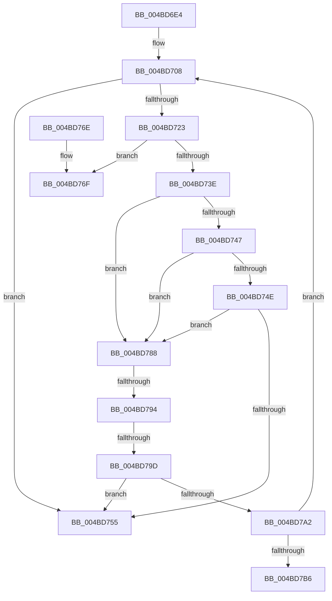

# AuthzBasepUpdateParentTypeList

- RVA: `0x004BD6E4`–`0x004BD7C0` (길이 `220` bytes)
- VA: `0x00000001404BD6E4`
- 실행 섹션: `.text`
- PDB 이름 있음: `예`; PDB Function 태그: `예`
- unwind 정보 RVA: `0x000BC064`
- 디코드: `63`개 명령, `220/220` bytes 표시
- 미해석 바이트: `0` (있으면 어셈블리에 `.byte`로 보존)

> 이 문서는 커널 이미지의 기계어와 PDB 기호를 분석해 생성했습니다. 4번과 5번은 함수 원형과 자료형을 바이너리 사용 방식에서 추정한 C 해석이며 원본 소스 복구 결과는 아닙니다.

## 1. Dependencies

- 직접 호출 지점: **0**; 고유 호출 대상: **0**
- 직접 호출자로 확인된 함수: **1**
- RIP 상대 이미지 참조: **0**

### Outgoing calls
- 직접 디코드된 call 명령이 없습니다.

### Direct callers
- [AuthzBasepAddAccessTypeList](../3D/AuthzBasepAddAccessTypeList_function_003D196C.md) at `0x003D1B05`

### Static image references
- 디코드된 RIP-relative 메모리 참조가 없습니다.

## 2. Other-region calls and transfers

- 다른 실행 섹션으로 향하는 call: **0**
- call이 아닌 외부 분기/꼬리 이동: **4**
  - `0x004BD783` → [sub_006FC922](../6F/Unknown_function_006FC922.md) (`tail-transfer`)
  - `0x004BD78E` → [sub_006FC922 + 0x3E](../6F/Unknown_function_006FC922.md) (`tail-transfer`)
  - `0x004BD797` → [sub_006FC922 + 0x2D](../6F/Unknown_function_006FC922.md) (`tail-transfer`)
  - `0x004BD7BB` → [sub_006FC922 + 0x54](../6F/Unknown_function_006FC922.md) (`tail-transfer`)

## 3. Assembly (complete function range)

```asm
004BD6E4  48 89 5C 24 08                  mov qword ptr [rsp + 8], rbx
004BD6E9  48 89 6C 24 10                  mov qword ptr [rsp + 0x10], rbp
004BD6EE  48 89 74 24 18                  mov qword ptr [rsp + 0x18], rsi
004BD6F3  57                              push rdi
004BD6F4  41 56                           push r14
004BD6F6  41 57                           push r15
004BD6F8  48 83 EC 30                     sub rsp, 0x30
004BD6FC  41 8B F1                        mov esi, r9d
004BD6FF  41 8B E8                        mov ebp, r8d
004BD702  44 8B FA                        mov r15d, edx
004BD705  4C 8B D9                        mov r11, rcx
004BD708  8B C5                           mov eax, ebp
004BD70A  33 FF                           xor edi, edi
004BD70C  41 83 CA FF                     or r10d, 0xffffffff
004BD710  33 DB                           xor ebx, ebx
004BD712  48 8D 0C 40                     lea rcx, [rax + rax*2]
004BD716  48 03 C9                        add rcx, rcx
004BD719  41 8B 6C CB 14                  mov ebp, dword ptr [r11 + rcx*8 + 0x14]
004BD71E  83 FD FF                        cmp ebp, -1
004BD721  74 32                           je 0x1404bd755
004BD723  45 0F B7 34 CB                  movzx r14d, word ptr [r11 + rcx*8]
004BD728  4C 8D 0C 6D 00 00 00 00         lea r9, [rbp*2]
004BD730  4C 03 CD                        add r9, rbp
004BD733  8D 55 01                        lea edx, [rbp + 1]
004BD736  4D 03 C9                        add r9, r9
004BD739  41 3B D7                        cmp edx, r15d
004BD73C  72 31                           jb 0x1404bd76f
004BD73E  43 8B 54 CB 18                  mov edx, dword ptr [r11 + r9*8 + 0x18]
004BD743  3B FA                           cmp edi, edx
004BD745  75 41                           jne 0x1404bd788
004BD747  47 3B 54 CB 1C                  cmp r10d, dword ptr [r11 + r9*8 + 0x1c]
004BD74C  75 3A                           jne 0x1404bd788
004BD74E  43 3B 5C CB 20                  cmp ebx, dword ptr [r11 + r9*8 + 0x20]
004BD753  75 33                           jne 0x1404bd788
004BD755  48 8B 5C 24 50                  mov rbx, qword ptr [rsp + 0x50]
004BD75A  48 8B 6C 24 58                  mov rbp, qword ptr [rsp + 0x58]
004BD75F  48 8B 74 24 60                  mov rsi, qword ptr [rsp + 0x60]
004BD764  48 83 C4 30                     add rsp, 0x30
004BD768  41 5F                           pop r15
004BD76A  41 5E                           pop r14
004BD76C  5F                              pop rdi
004BD76D  C3                              ret
004BD76E  CC                              int3
004BD76F  47 0F B7 04 CB                  movzx r8d, word ptr [r11 + r9*8]
004BD774  48 8D 04 52                     lea rax, [rdx + rdx*2]
004BD778  48 C1 E0 04                     shl rax, 4
004BD77C  48 83 C0 1C                     add rax, 0x1c
004BD780  49 03 C3                        add rax, r11
004BD783  E9 9A F1 23 00                  jmp 0x1406fc922
004BD788  8B 4C 24 70                     mov ecx, dword ptr [rsp + 0x70]
004BD78C  85 C9                           test ecx, ecx
004BD78E  0F 84 CC F1 23 00               je 0x1406fc960
004BD794  83 E9 01                        sub ecx, 1
004BD797  0F 84 B2 F1 23 00               je 0x1406fc94f
004BD79D  83 F9 01                        cmp ecx, 1
004BD7A0  75 B3                           jne 0x1404bd755
004BD7A2  43 8B 4C CB 20                  mov ecx, dword ptr [r11 + r9*8 + 0x20]
004BD7A7  F7 D1                           not ecx
004BD7A9  43 89 5C CB 20                  mov dword ptr [r11 + r9*8 + 0x20], ebx
004BD7AE  23 CB                           and ecx, ebx
004BD7B0  0F 84 52 FF FF FF               je 0x1404bd708
004BD7B6  BA 00 00 02 00                  mov edx, 0x20000
004BD7BB  E9 B6 F1 23 00                  jmp 0x1406fc976
```

## 4. C-style interpretation (structured pseudocode)

```c
__int64 __fastcall AuthzBasepUpdateParentTypeList(__int64 a1, int a2, int a3, int a4, unsigned int a5)
{
    __int64 result;
    __int64 v_r10;
    __int64 v_rbx;
    __int64 v_rdi;
    __int64 v_rsp;
    unsigned __int64 v_stack_p10;
    unsigned __int64 v_stack_p18;
    unsigned __int64 v_stack_p8;

    v_stack_p8 = v_rbx;
    v_stack_p10 = v_rbp;
    v_stack_p18 = v_rsi;
    v_rsp = (v_rsp) - (48);
loc_004BD708:
    v_rdi = 0;
    v_r10 = (unsigned int)((v_r10) | (0xFFFFFFFFULL));
    v_rbx = 0;
    a1 = ((unsigned int)((unsigned int)((unsigned int)(a3))) + (unsigned int)((unsigned int)((unsigned int)(a3))) * 2) + ((unsigned int)((unsigned int)((unsigned int)(a3))) + (unsigned int)((unsigned int)((unsigned int)(a3))) * 2);
    if (((unsigned int)((unsigned int)(*(unsigned int *)(a1 + a1 * 8 + 20)))) == -1) goto loc_004BD755;
    a4 = ((unsigned int)(*(unsigned int *)(a1 + a1 * 8 + 20)) * 2) + ((unsigned int)(*(unsigned int *)(a1 + a1 * 8 + 20)));
    a4 = (a4) + (a4);
    if (((unsigned int)((unsigned int)(*(unsigned int *)(a1 + a1 * 8 + 20)) + 1)) < ((unsigned int)((unsigned int)(a2)))) goto loc_004BD76F;
    if (0 != ((unsigned int)((unsigned int)(*(unsigned int *)(a1 + a4 * 8 + 24))))) goto loc_004BD788;
    if (((unsigned int)(v_r10)) != (*(unsigned int *)(a1 + a4 * 8 + 28))) goto loc_004BD788;
    if (0 != (*(unsigned int *)(a1 + a4 * 8 + 32))) goto loc_004BD788;
loc_004BD755:
    v_rsp = (v_rsp) + (48);
    return (unsigned int)((unsigned int)((unsigned int)(a3)));
loc_004BD76F:
    result = ((unsigned int)(*(unsigned int *)(a1 + a4 * 8 + 24)) + (unsigned int)(*(unsigned int *)(a1 + a4 * 8 + 24)) * 2) << (4);
    result = (result) + (28);
    result = (result) + (a1);
loc_004BD788:
    a1 = (unsigned int)(((unsigned int)(a5)) - (1));
    if (((unsigned int)(a1)) != 1) goto loc_004BD755;
    a1 = (unsigned int)(~((unsigned int)(*(unsigned int *)(a1 + a4 * 8 + 32))));
    *(unsigned int *)(a1 + a4 * 8 + 32) = (unsigned int)(v_stack_p8);
    a1 = (unsigned int)((a1) & ((unsigned int)(v_stack_p8)));
    if (condition_is_equal) goto loc_004BD708;
}
```

## 5. (Beta) C Style

```c
int64_t AuthzBasepUpdateParentTypeList(void *Arg1, int32_t Arg2, int32_t Arg3, int32_t Arg4, uint32_t Arg5)
{
    uint8_t *arg1 = (uint8_t *)Arg1;

    int64_t result;
    int64_t local_r10;
    int64_t local_rbx;
    int64_t local_rdi;
    int64_t local_rsp;
    uint64_t v_stack_p10;
    uint64_t v_stack_p18;
    uint64_t v_stack_p8;

    v_stack_p8 = local_rbx;
    v_stack_p10 = local_rbp;
    v_stack_p18 = local_rsi;
    local_rsp = (local_rsp) - (48);
loc_004BD708:
    local_rdi = 0;
    local_r10 = (uint32_t)((local_r10) | (0xFFFFFFFFULL));
    local_rbx = 0;
    Arg1 = ((uint32_t)((uint32_t)((uint32_t)(Arg3))) + (uint32_t)((uint32_t)((uint32_t)(Arg3))) * 2) + ((uint32_t)((uint32_t)((uint32_t)(Arg3))) + (uint32_t)((uint32_t)((uint32_t)(Arg3))) * 2);
    if (((uint32_t)((uint32_t)(*(uint32_t *)(arg1 + arg1 * 8 + 0x14)))) == -1) goto loc_004BD755;
    Arg4 = ((uint32_t)(*(uint32_t *)(arg1 + arg1 * 8 + 0x14)) * 2) + ((uint32_t)(*(uint32_t *)(arg1 + arg1 * 8 + 0x14)));
    Arg4 = (Arg4) + (Arg4);
    if (((uint32_t)((uint32_t)(*(uint32_t *)(arg1 + arg1 * 8 + 0x14)) + 1)) < ((uint32_t)((uint32_t)(Arg2)))) goto loc_004BD76F;
    if (0 != ((uint32_t)((uint32_t)(*(uint32_t *)(arg1 + Arg4 * 8 + 0x18))))) goto loc_004BD788;
    if (((uint32_t)(local_r10)) != (*(uint32_t *)(arg1 + Arg4 * 8 + 0x1C))) goto loc_004BD788;
    if (0 != (*(uint32_t *)(arg1 + Arg4 * 8 + 0x20))) goto loc_004BD788;
loc_004BD755:
    local_rsp = (local_rsp) + (48);
    return (uint32_t)((uint32_t)((uint32_t)(Arg3)));
loc_004BD76F:
    result = ((uint32_t)(*(uint32_t *)(arg1 + Arg4 * 8 + 0x18)) + (uint32_t)(*(uint32_t *)(arg1 + Arg4 * 8 + 0x18)) * 2) << (4);
    result = (result) + (28);
    result = (result) + (Arg1);
loc_004BD788:
    Arg1 = (uint32_t)(((uint32_t)(Arg5)) - (1));
    if (((uint32_t)(Arg1)) != 1) goto loc_004BD755;
    Arg1 = (uint32_t)(~((uint32_t)(*(uint32_t *)(arg1 + Arg4 * 8 + 0x20))));
    *(uint32_t *)(arg1 + Arg4 * 8 + 0x20) = (uint32_t)(v_stack_p8);
    Arg1 = (uint32_t)((Arg1) & ((uint32_t)(v_stack_p8)));
    if (condition_is_equal) goto loc_004BD708;
}
```

### 관측된 메모리 오프셋

구조체 형식이 확인되지 않은 접근은 인자 기준의 오프셋으로만 기록했습니다.

| 기준 인자 | 오프셋 표현 | 폭 (bit) | 접근 |
|---|---:|---:|---|
| `Arg1` | `+ 0x0 + r9*8` | `16` | `R` |
| `Arg1` | `+ 0x0 + rcx*8` | `16` | `R` |
| `Arg1` | `+ 0x14 + rcx*8` | `32` | `R` |
| `Arg1` | `+ 0x18 + r9*8` | `32` | `R` |
| `Arg1` | `+ 0x1C + r9*8` | `32` | `R` |
| `Arg1` | `+ 0x20 + r9*8` | `32` | `R` |
| `Arg1` | `+ 0x20 + r9*8` | `32` | `W` |

## 6. Execution-region graph

[열기: 2D/3D 그래프와 함수 탐색 컨트롤 패널](../../../control-panel.html?section=text&rva=0x004BD6E4&view=graph)

- 2D 그래프는 위에서 아래로 흐르고, 3D 그래프는 빈 공간을 드래그해 회전합니다. Shift+드래그는 이동, 휠은 확대·축소, 함수 노드 선택은 대상 보고서 이동입니다.

### Static fallback


