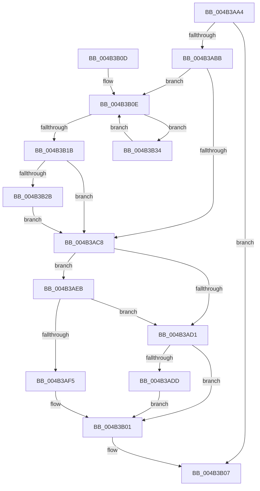

# BgpFwAcquireLock

- RVA: `0x004B3AA4`–`0x004B3B38` (길이 `148` bytes)
- VA: `0x00000001404B3AA4`
- 실행 섹션: `.text`
- PDB 이름 있음: `예`; PDB Function 태그: `아니요`
- unwind 정보 RVA: `0x000691A8`
- 디코드: `41`개 명령, `148/148` bytes 표시
- 미해석 바이트: `0` (있으면 어셈블리에 `.byte`로 보존)

> 이 문서는 커널 이미지의 기계어와 PDB 기호를 분석해 생성했습니다. 4번과 5번은 함수 원형과 자료형을 바이너리 사용 방식에서 추정한 C 해석이며 원본 소스 복구 결과는 아닙니다.

## 1. Dependencies

- 직접 호출 지점: **3**; 고유 호출 대상: **3**
- 직접 호출자로 확인된 함수: **35**
- RIP 상대 이미지 참조: **7**

### Outgoing calls
- `0x004B3AE4` → [KxWaitForSpinLockAndAcquire](../20/KxWaitForSpinLockAndAcquire_function_002085C0.md) (function, `0x002085C0`)
- `0x004B3AFC` → [KiAcquireSpinLockInstrumented](../20/KiAcquireSpinLockInstrumented_function_002084F0.md) (function, `0x002084F0`)
- `0x004B3B2D` → [KiRaiseIrqlProcessIrqlFlags](../4F/KiRaiseIrqlProcessIrqlFlags_function_004F56FC.md) (function, `0x004F56FC`)

### Direct callers
- [BgpFwQueryBootGraphicsInformation](../4C/BgpFwQueryBootGraphicsInformation_function_004CF524.md) at `0x004CF698`
- [BgpFwQueryBootGraphicsInformation](../4C/BgpFwQueryBootGraphicsInformation_function_004CF524.md) at `0x004CF6D1`
- [KiBugCheckProgress](../5B/KiBugCheckProgress_function_005B3E90.md) at `0x005B3EE2`
- [KiDisplayBlueScreen](../5B/KiDisplayBlueScreen_function_005B494C.md) at `0x005B4B6A`
- [BgDisplaySafeToPowerOffScreen](../69/BgDisplaySafeToPowerOffScreen_function_0069E994.md) at `0x0069E99A`
- [BgLibraryEnable](../69/BgLibraryEnable_function_0069E9CC.md) at `0x0069EA10`
- [BgQueryBootGraphicsInformation](../69/BgQueryBootGraphicsInformation_function_0069EA44.md) at `0x0069EA6C`
- [BgkDestroy](../../pagebgfx/BC/BgkDestroy_function_00BC0170.md) at `0x00BC01E3`
- [BgkDrawText](../../pagebgfx/BC/BgkDrawText_function_00BC02DC.md) at `0x00BC0306`
- [BgkSetBootGraphicsInformation](../../pagebgfx/BC/BgkSetBootGraphicsInformation_function_00BC0424.md) at `0x00BC0451`
- [BgAcquireSpinLock](../../pagebgfx/BC/BgAcquireSpinLock_function_00BC05B4.md) at `0x00BC05B8`
- [BgDisplayBackgroundUpdate](../../pagebgfx/BC/BgDisplayBackgroundUpdate_function_00BC05EC.md) at `0x00BC05F4`
- [BgDisplayProgressIndicator](../../pagebgfx/BC/BgDisplayProgressIndicator_function_00BC0628.md) at `0x00BC0630`
- [BgFreeContext](../../pagebgfx/BC/BgFreeContext_function_00BC0664.md) at `0x00BC067E`
- [BgGetContext](../../pagebgfx/BC/BgGetContext_function_00BC06A8.md) at `0x00BC06C1`
- [BgLibraryDisable](../../pagebgfx/BC/BgLibraryDisable_function_00BC0724.md) at `0x00BC0737`
- [BgMarkHiberPhase](../../pagebgfx/BC/BgMarkHiberPhase_function_00BC078C.md) at `0x00BC0796`
- [BgConsoleDestroyInterface](../../pagebgfx/BC/BgConsoleDestroyInterface_function_00BC0940.md) at `0x00BC0949`
- [BgConsoleGetInterface](../../pagebgfx/BC/BgConsoleGetInterface_function_00BC09A0.md) at `0x00BC09A8`
- [BgpConsoleClearScreen](../../pagebgfx/BC/BgpConsoleClearScreen_function_00BC09F0.md) at `0x00BC09F6`
- [BgpConsoleDisplayCharacter](../../pagebgfx/BC/BgpConsoleDisplayCharacter_function_00BC0AB0.md) at `0x00BC0ADA`
- [BgpConsoleDisplayString](../../pagebgfx/BC/BgpConsoleDisplayString_function_00BC0E60.md) at `0x00BC0E72`
- [BgpConsoleGetCursorState](../../pagebgfx/BC/BgpConsoleGetCursorState_function_00BC0FD0.md) at `0x00BC0FEE`
- [BgpConsoleGetState](../../pagebgfx/BC/BgpConsoleGetState_function_00BC1040.md) at `0x00BC104D`
- [BgpConsoleInitialize](../../pagebgfx/BC/BgpConsoleInitialize_function_00BC10B0.md) at `0x00BC10E6`
- [BgpConsoleSetCursor](../../pagebgfx/BC/BgpConsoleSetCursor_function_00BC1520.md) at `0x00BC153B`
- [BgpConsoleSetTextColor](../../pagebgfx/BC/BgpConsoleSetTextColor_function_00BC15D0.md) at `0x00BC15E5`
- [ResFwpDestroyBackground](../../pagebgfx/BC/ResFwpDestroyBackground_function_00BC1B3C.md) at `0x00BC1B94`
- [ResFwpPageInBackground](../../pagebgfx/BC/ResFwpPageInBackground_function_00BC1BB0.md) at `0x00BC1C07`
- [ResFwpPageOutBackground](../../pagebgfx/BC/ResFwpPageOutBackground_function_00BC1C34.md) at `0x00BC1CA8`
- [ResFwpPageOutBackground](../../pagebgfx/BC/ResFwpPageOutBackground_function_00BC1C34.md) at `0x00BC1CE0`
- [AnFwpBackgroundUpdateTimer](../../pagebgfx/BC/AnFwpBackgroundUpdateTimer_function_00BC21B0.md) at `0x00BC21FC`
- [AnFwpFadeAnimationTimer](../../pagebgfx/BC/AnFwpFadeAnimationTimer_function_00BC2F50.md) at `0x00BC2F72`
- [AnFwFadeCompletion](../../pagebgfx/BC/AnFwFadeCompletion_function_00BC358C.md) at `0x00BC35EE`
- [BgDisplayFade](../../pagebgfx/BC/BgDisplayFade_function_00BC36A4.md) at `0x00BC36B2`
- [AnFwpProgressIndicatorTimer](../../pagebgfx/BC/AnFwpProgressIndicatorTimer_function_00BC49D0.md) at `0x00BC49E0`
- [BgpFwLibraryInitialize](../../pagebgfx/BC/BgpFwLibraryInitialize_function_00BC5400.md) at `0x00BC5460`
- [BgpFwLibraryInitialize](../../pagebgfx/BC/BgpFwLibraryInitialize_function_00BC5400.md) at `0x00BC5647`

### Static image references
- `0x004B3AAA` → RVA `0x00EF0450` (`.data`; read)
- `0x004B3AC8` → RVA `0x00FC6B06` (`ALMOSTRO`; read)
- `0x004B3AD1` → RVA `0x00E64F68` (`.data`; read/write)
- `0x004B3ADD` → RVA `0x00E64F68` (`.data`; read)
- `0x004B3AEB` → RVA `0x00F0DE58` (`.data`; read)
- `0x004B3B01` → RVA `0x00E3EC3A` (`.data`; write)
- `0x004B3B23` → RVA `0x00FC6D20` (`ALMOSTRO`; read)

## 2. Other-region calls and transfers

- 다른 실행 섹션으로 향하는 call: **0**
- 별도 외부 분기/꼬리 이동을 확인하지 못했습니다.

## 3. Assembly (complete function range)

```asm
004B3AA4  40 53                           push rbx
004B3AA6  48 83 EC 20                     sub rsp, 0x20
004B3AAA  8B 05 A0 C9 A3 00               mov eax, dword ptr [rip + 0xa3c9a0]
004B3AB0  B9 00 0C 00 00                  mov ecx, 0xc00
004B3AB5  23 C1                           and eax, ecx
004B3AB7  3B C1                           cmp eax, ecx
004B3AB9  74 4C                           je 0x1404b3b07
004B3ABB  44 0F 20 C3                     mov rbx, cr8
004B3ABF  BA 02 00 00 00                  mov edx, 2
004B3AC4  3A DA                           cmp bl, dl
004B3AC6  76 46                           jbe 0x1404b3b0e
004B3AC8  F6 05 37 30 B1 00 21            test byte ptr [rip + 0xb13037], 0x21
004B3ACF  75 1A                           jne 0x1404b3aeb
004B3AD1  F0 48 0F BA 2D 8D 14 9B 00 00   lock bts qword ptr [rip + 0x9b148d], 0
004B3ADB  73 24                           jae 0x1404b3b01
004B3ADD  48 8D 0D 84 14 9B 00            lea rcx, [rip + 0x9b1484]
004B3AE4  E8 D7 4A D5 FF                  call 0x1402085c0
004B3AE9  EB 16                           jmp 0x1404b3b01
004B3AEB  8B 05 67 A3 A5 00               mov eax, dword ptr [rip + 0xa5a367]
004B3AF1  85 C0                           test eax, eax
004B3AF3  75 DC                           jne 0x1404b3ad1
004B3AF5  48 8D 0D 6C 14 9B 00            lea rcx, [rip + 0x9b146c]
004B3AFC  E8 EF 49 D5 FF                  call 0x1402084f0
004B3B01  88 1D 33 B1 98 00               mov byte ptr [rip + 0x98b133], bl
004B3B07  48 83 C4 20                     add rsp, 0x20
004B3B0B  5B                              pop rbx
004B3B0C  C3                              ret
004B3B0D  CC                              int3
004B3B0E  90                              nop
004B3B0F  48 8B 05 52 14 9B 00            mov rax, qword ptr [rip + 0x9b1452]
004B3B16  48 85 C0                        test rax, rax
004B3B19  75 19                           jne 0x1404b3b34
004B3B1B  44 0F 20 C3                     mov rbx, cr8
004B3B1F  44 0F 22 C2                     mov cr8, rdx
004B3B23  39 05 F7 31 B1 00               cmp dword ptr [rip + 0xb131f7], eax
004B3B29  74 9D                           je 0x1404b3ac8
004B3B2B  8A CB                           mov cl, bl
004B3B2D  E8 CA 1B 04 00                  call 0x1404f56fc
004B3B32  EB 94                           jmp 0x1404b3ac8
004B3B34  F3 90                           pause
004B3B36  EB D6                           jmp 0x1404b3b0e
```

## 4. C-style interpretation (structured pseudocode)

```c
__int64 __fastcall BgpFwAcquireLock(void)
{
    __int64 result;
    __int64 v_rsp;

    v_rsp = (v_rsp) - (32);
    result = (unsigned int)(((unsigned int)(*(unsigned int *)(v_rip + 10733984))) & ((unsigned int)((unsigned int)(0xC00ULL))));
    if (((unsigned int)(result)) == ((unsigned int)((unsigned int)(0xC00ULL)))) goto loc_004B3B07;
    if (((unsigned __int8)(v_cr8)) <= 2) goto loc_004B3B0E;
loc_004B3AC8:
    if (((*(unsigned __int8 *)(v_rip + 11612215)) & (33)) != 0) goto loc_004B3AEB;
loc_004B3AD1:
    if (condition_is_above_or_equal) goto loc_004B3B01;
    result = KxWaitForSpinLockAndAcquire(v_rip + 10163332, 2, a3, a4);
    goto loc_004B3B01;
loc_004B3AEB:
    if ((unsigned int)((unsigned int)(*(unsigned int *)(v_rip + 10855271))) != 0) goto loc_004B3AD1;
    result = KiAcquireSpinLockInstrumented(v_rip + 10163308, 2, a3, a4);
loc_004B3B01:
    *(unsigned __int8 *)(v_rip + 10006835) = (unsigned __int8)(v_cr8);
loc_004B3B07:
    v_rsp = (v_rsp) + (32);
    return result;
loc_004B3B0E:
    if (*(unsigned __int64 *)(v_rip + 10163282) != 0) goto loc_004B3B34;
    if ((*(unsigned int *)(v_rip + 11612663)) == ((unsigned int)(*(unsigned __int64 *)(v_rip + 10163282)))) goto loc_004B3AC8;
    result = KiRaiseIrqlProcessIrqlFlags((unsigned __int8)(v_cr8), 2, a3, a4);
    goto loc_004B3AC8;
loc_004B3B34:
    goto loc_004B3B0E;
}
```

## 5. (Beta) C Style

```c
void BgpFwAcquireLock(void)
{
    int64_t result;
    int64_t local_rsp;

    local_rsp = (local_rsp) - (32);
    result = (uint32_t)(((uint32_t)(*(uint32_t *)(v_rip + 0xA3C9A0))) & ((uint32_t)((uint32_t)(0xC00ULL))));
    if (((uint32_t)(result)) == ((uint32_t)((uint32_t)(0xC00ULL)))) goto loc_004B3B07;
    if (((uint8_t)(v_cr8)) <= 2) goto loc_004B3B0E;
loc_004B3AC8:
    if (((*(uint8_t *)(v_rip + 0xB13037)) & (33)) != 0) goto loc_004B3AEB;
loc_004B3AD1:
    if (condition_is_above_or_equal) goto loc_004B3B01;
    result = KxWaitForSpinLockAndAcquire(v_rip + 10163332, 2, a3, a4);
    goto loc_004B3B01;
loc_004B3AEB:
    if ((uint32_t)((uint32_t)(*(uint32_t *)(v_rip + 0xA5A367))) != 0) goto loc_004B3AD1;
    result = KiAcquireSpinLockInstrumented(v_rip + 10163308, 2, a3, a4);
loc_004B3B01:
    *(uint8_t *)(v_rip + 0x98B133) = (uint8_t)(v_cr8);
loc_004B3B07:
    local_rsp = (local_rsp) + (32);
    return result;
loc_004B3B0E:
    if (*(uint64_t *)(v_rip + 0x9B1452) != 0) goto loc_004B3B34;
    if ((*(uint32_t *)(v_rip + 0xB131F7)) == ((uint32_t)(*(uint64_t *)(v_rip + 0x9B1452)))) goto loc_004B3AC8;
    result = KiRaiseIrqlProcessIrqlFlags((uint8_t)(v_cr8), 2, a3, a4);
    goto loc_004B3AC8;
loc_004B3B34:
    goto loc_004B3B0E;
}
```

## 6. Execution-region graph

[열기: 2D/3D 그래프와 함수 탐색 컨트롤 패널](../../../control-panel.html?section=text&rva=0x004B3AA4&view=graph)

- 2D 그래프는 위에서 아래로 흐르고, 3D 그래프는 빈 공간을 드래그해 회전합니다. Shift+드래그는 이동, 휠은 확대·축소, 함수 노드 선택은 대상 보고서 이동입니다.

### Static fallback


