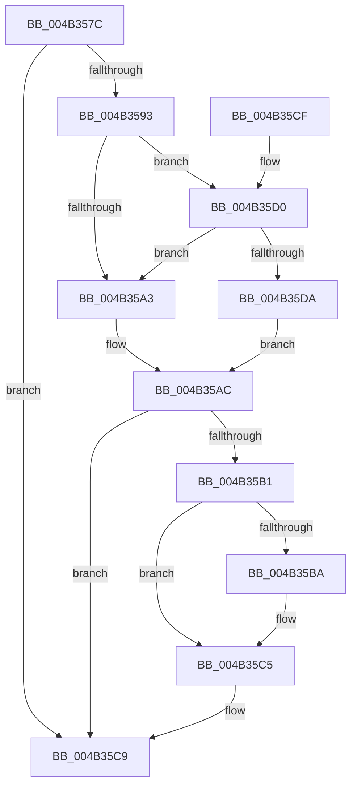

# BgpFwReleaseLock

- RVA: `0x004B357C`–`0x004B35ED` (길이 `113` bytes)
- VA: `0x00000001404B357C`
- 실행 섹션: `.text`
- PDB 이름 있음: `예`; PDB Function 태그: `아니요`
- unwind 정보 RVA: `0x0006084C`
- 디코드: `30`개 명령, `113/113` bytes 표시
- 미해석 바이트: `0` (있으면 어셈블리에 `.byte`로 보존)

> 이 문서는 커널 이미지의 기계어와 PDB 기호를 분석해 생성했습니다. 4번과 5번은 함수 원형과 자료형을 바이너리 사용 방식에서 추정한 C 해석이며 원본 소스 복구 결과는 아닙니다.

## 1. Dependencies

- 직접 호출 지점: **2**; 고유 호출 대상: **2**
- 직접 호출자로 확인된 함수: **35**
- RIP 상대 이미지 참조: **7**

### Outgoing calls
- `0x004B35C0` → [KiLowerIrqlProcessIrqlFlags](../4F/KiLowerIrqlProcessIrqlFlags_function_004F5698.md) (function, `0x004F5698`)
- `0x004B35E6` → [KiReleaseSpinLockInstrumented](../39/KiReleaseSpinLockInstrumented_function_00392EF0.md) (function, `0x00392EF0`)

### Direct callers
- [BgpFwQueryBootGraphicsInformation](../4C/BgpFwQueryBootGraphicsInformation_function_004CF524.md) at `0x004CF679`
- [KiBugCheckProgress](../5B/KiBugCheckProgress_function_005B3E90.md) at `0x005B3EFF`
- [KiDisplayBlueScreen](../5B/KiDisplayBlueScreen_function_005B494C.md) at `0x005B4BA0`
- [BgDisplaySafeToPowerOffScreen](../69/BgDisplaySafeToPowerOffScreen_function_0069E994.md) at `0x0069E9B7`
- [BgLibraryEnable](../69/BgLibraryEnable_function_0069E9CC.md) at `0x0069EA30`
- [BgQueryBootGraphicsInformation](../69/BgQueryBootGraphicsInformation_function_0069EA44.md) at `0x0069EA8E`
- [BgkDestroy](../../pagebgfx/BC/BgkDestroy_function_00BC0170.md) at `0x00BC021B`
- [BgkDrawText](../../pagebgfx/BC/BgkDrawText_function_00BC02DC.md) at `0x00BC0349`
- [BgkSetBootGraphicsInformation](../../pagebgfx/BC/BgkSetBootGraphicsInformation_function_00BC0424.md) at `0x00BC0471`
- [BgDisplayBackgroundUpdate](../../pagebgfx/BC/BgDisplayBackgroundUpdate_function_00BC05EC.md) at `0x00BC0613`
- [BgDisplayProgressIndicator](../../pagebgfx/BC/BgDisplayProgressIndicator_function_00BC0628.md) at `0x00BC064F`
- [BgFreeContext](../../pagebgfx/BC/BgFreeContext_function_00BC0664.md) at `0x00BC0695`
- [BgGetContext](../../pagebgfx/BC/BgGetContext_function_00BC06A8.md) at `0x00BC06DF`
- [BgLibraryDisable](../../pagebgfx/BC/BgLibraryDisable_function_00BC0724.md) at `0x00BC074B`
- [BgMarkHiberPhase](../../pagebgfx/BC/BgMarkHiberPhase_function_00BC078C.md) at `0x00BC07E2`
- [BgReleaseSpinLock](../../pagebgfx/BC/BgReleaseSpinLock_function_00BC07FC.md) at `0x00BC0800`
- [BgConsoleDestroyInterface](../../pagebgfx/BC/BgConsoleDestroyInterface_function_00BC0940.md) at `0x00BC098B`
- [BgConsoleGetInterface](../../pagebgfx/BC/BgConsoleGetInterface_function_00BC09A0.md) at `0x00BC09CD`
- [BgpConsoleClearScreen](../../pagebgfx/BC/BgpConsoleClearScreen_function_00BC09F0.md) at `0x00BC0A13`
- [BgpConsoleDisplayCharacter](../../pagebgfx/BC/BgpConsoleDisplayCharacter_function_00BC0AB0.md) at `0x00BC0B96`
- [BgpConsoleDisplayString](../../pagebgfx/BC/BgpConsoleDisplayString_function_00BC0E60.md) at `0x00BC0E8A`
- [BgpConsoleGetCursorState](../../pagebgfx/BC/BgpConsoleGetCursorState_function_00BC0FD0.md) at `0x00BC1018`
- [BgpConsoleGetState](../../pagebgfx/BC/BgpConsoleGetState_function_00BC1040.md) at `0x00BC1095`
- [BgpConsoleInitialize](../../pagebgfx/BC/BgpConsoleInitialize_function_00BC10B0.md) at `0x00BC12EB`
- [BgpConsoleSetCursor](../../pagebgfx/BC/BgpConsoleSetCursor_function_00BC1520.md) at `0x00BC15A0`
- [BgpConsoleSetTextColor](../../pagebgfx/BC/BgpConsoleSetTextColor_function_00BC15D0.md) at `0x00BC1613`
- [ResFwpDestroyBackground](../../pagebgfx/BC/ResFwpDestroyBackground_function_00BC1B3C.md) at `0x00BC1B82`
- [ResFwpPageInBackground](../../pagebgfx/BC/ResFwpPageInBackground_function_00BC1BB0.md) at `0x00BC1BEC`
- [ResFwpPageOutBackground](../../pagebgfx/BC/ResFwpPageOutBackground_function_00BC1C34.md) at `0x00BC1C6F`
- [ResFwpPageOutBackground](../../pagebgfx/BC/ResFwpPageOutBackground_function_00BC1C34.md) at `0x00BC1CCE`
- [AnFwpBackgroundUpdateTimer](../../pagebgfx/BC/AnFwpBackgroundUpdateTimer_function_00BC21B0.md) at `0x00BC2268`
- [AnFwpFadeAnimationTimer](../../pagebgfx/BC/AnFwpFadeAnimationTimer_function_00BC2F50.md) at `0x00BC321B`
- [AnFwFadeCompletion](../../pagebgfx/BC/AnFwFadeCompletion_function_00BC358C.md) at `0x00BC35CF`
- [BgDisplayFade](../../pagebgfx/BC/BgDisplayFade_function_00BC36A4.md) at `0x00BC36C8`
- [AnFwpProgressIndicatorTimer](../../pagebgfx/BC/AnFwpProgressIndicatorTimer_function_00BC49D0.md) at `0x00BC4A62`
- [BgpFwLibraryInitialize](../../pagebgfx/BC/BgpFwLibraryInitialize_function_00BC5400.md) at `0x00BC551F`
- [BgpFwLibraryInitialize](../../pagebgfx/BC/BgpFwLibraryInitialize_function_00BC5400.md) at `0x00BC565B`
- [BgpFwLibraryInitialize](../../pagebgfx/BC/BgpFwLibraryInitialize_function_00BC5400.md) at `0x00BC580C`
- [BgpFwLibraryInitialize](../../pagebgfx/BC/BgpFwLibraryInitialize_function_00BC5400.md) at `0x00BC5C2F`

### Static image references
- `0x004B3582` → RVA `0x00EF0450` (`.data`; read)
- `0x004B3593` → RVA `0x00FC6B06` (`ALMOSTRO`; read)
- `0x004B359A` → RVA `0x00E3EC3A` (`.data`; read)
- `0x004B35A3` → RVA `0x00E64F68` (`.data`; read/write)
- `0x004B35B1` → RVA `0x00FC6D20` (`ALMOSTRO`; read)
- `0x004B35D0` → RVA `0x00F0DE58` (`.data`; read)
- `0x004B35DF` → RVA `0x00E64F68` (`.data`; read)

## 2. Other-region calls and transfers

- 다른 실행 섹션으로 향하는 call: **0**
- 별도 외부 분기/꼬리 이동을 확인하지 못했습니다.

## 3. Assembly (complete function range)

```asm
004B357C  40 53                           push rbx
004B357E  48 83 EC 20                     sub rsp, 0x20
004B3582  8B 05 C8 CE A3 00               mov eax, dword ptr [rip + 0xa3cec8]
004B3588  B9 00 0C 00 00                  mov ecx, 0xc00
004B358D  23 C1                           and eax, ecx
004B358F  3B C1                           cmp eax, ecx
004B3591  74 36                           je 0x1404b35c9
004B3593  F6 05 6C 35 B1 00 01            test byte ptr [rip + 0xb1356c], 1
004B359A  0F B6 1D 99 B6 98 00            movzx ebx, byte ptr [rip + 0x98b699]
004B35A1  75 2D                           jne 0x1404b35d0
004B35A3  F0 48 83 25 BC 19 9B 00 00      lock and qword ptr [rip + 0x9b19bc], 0
004B35AC  80 FB 02                        cmp bl, 2
004B35AF  77 18                           ja 0x1404b35c9
004B35B1  83 3D 68 37 B1 00 00            cmp dword ptr [rip + 0xb13768], 0
004B35B8  74 0B                           je 0x1404b35c5
004B35BA  44 0F 20 C1                     mov rcx, cr8
004B35BE  8A D3                           mov dl, bl
004B35C0  E8 D3 20 04 00                  call 0x1404f5698
004B35C5  44 0F 22 C3                     mov cr8, rbx
004B35C9  48 83 C4 20                     add rsp, 0x20
004B35CD  5B                              pop rbx
004B35CE  C3                              ret
004B35CF  CC                              int3
004B35D0  8B 05 82 A8 A5 00               mov eax, dword ptr [rip + 0xa5a882]
004B35D6  85 C0                           test eax, eax
004B35D8  75 C9                           jne 0x1404b35a3
004B35DA  48 8B 54 24 28                  mov rdx, qword ptr [rsp + 0x28]
004B35DF  48 8D 0D 82 19 9B 00            lea rcx, [rip + 0x9b1982]
004B35E6  E8 05 F9 ED FF                  call 0x140392ef0
004B35EB  EB BF                           jmp 0x1404b35ac
```

## 4. C-style interpretation (structured pseudocode)

```c
__int64 __fastcall BgpFwReleaseLock(void)
{
    __int64 result;
    __int64 v_rsp;
    unsigned __int64 v_stack_p28;

    v_rsp = (v_rsp) - (32);
    result = (unsigned int)(((unsigned int)(*(unsigned int *)(v_rip + 10735304))) & ((unsigned int)((unsigned int)(0xC00ULL))));
    if (((unsigned int)(result)) == ((unsigned int)((unsigned int)(0xC00ULL)))) goto loc_004B35C9;
    if (((*(unsigned __int8 *)(v_rip + 11613548)) & (1)) != 0) goto loc_004B35D0;
loc_004B35A3:
loc_004B35AC:
    if (((unsigned __int8)(*(unsigned __int8 *)(v_rip + 10008217))) > 2) goto loc_004B35C9;
    if ((*(unsigned int *)(v_rip + 11614056)) != 0) {
        a1 = v_cr8;
        a2 = (unsigned __int8)(*(unsigned __int8 *)(v_rip + 10008217));
        result = KiLowerIrqlProcessIrqlFlags(a1, a2, a3, a4);
    }
loc_004B35C9:
    v_rsp = (v_rsp) + (32);
    return result;
loc_004B35D0:
    if ((unsigned int)((unsigned int)(*(unsigned int *)(v_rip + 10856578))) != 0) goto loc_004B35A3;
    result = KiReleaseSpinLockInstrumented(v_rip + 10164610, v_stack_p28, a3, a4);
    goto loc_004B35AC;
}
```

## 5. (Beta) C Style

```c
void BgpFwReleaseLock(void)
{
    int64_t result;
    int64_t local_rsp;
    uint64_t v_stack_p28;

    local_rsp = (local_rsp) - (32);
    result = (uint32_t)(((uint32_t)(*(uint32_t *)(v_rip + 0xA3CEC8))) & ((uint32_t)((uint32_t)(0xC00ULL))));
    if (((uint32_t)(result)) == ((uint32_t)((uint32_t)(0xC00ULL)))) goto loc_004B35C9;
    if (((*(uint8_t *)(v_rip + 0xB1356C)) & (1)) != 0) goto loc_004B35D0;
loc_004B35A3:
loc_004B35AC:
    if (((uint8_t)(*(uint8_t *)(v_rip + 0x98B699))) > 2) goto loc_004B35C9;
    if ((*(uint32_t *)(v_rip + 0xB13768)) != 0) {
        a1 = v_cr8;
        a2 = (uint8_t)(*(uint8_t *)(v_rip + 0x98B699));
        result = KiLowerIrqlProcessIrqlFlags(a1, a2, a3, a4);
    }
loc_004B35C9:
    local_rsp = (local_rsp) + (32);
    return result;
loc_004B35D0:
    if ((uint32_t)((uint32_t)(*(uint32_t *)(v_rip + 0xA5A882))) != 0) goto loc_004B35A3;
    result = KiReleaseSpinLockInstrumented(v_rip + 10164610, v_stack_p28, a3, a4);
    goto loc_004B35AC;
}
```

## 6. Execution-region graph

[열기: 2D/3D 그래프와 함수 탐색 컨트롤 패널](../../../control-panel.html?section=text&rva=0x004B357C&view=graph)

- 2D 그래프는 위에서 아래로 흐르고, 3D 그래프는 빈 공간을 드래그해 회전합니다. Shift+드래그는 이동, 휠은 확대·축소, 함수 노드 선택은 대상 보고서 이동입니다.

### Static fallback


