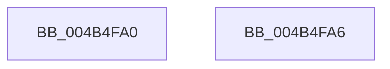

# BiIsOfflineHandle

- RVA: `0x004B4FA0`–`0x004B4FA7` (길이 `7` bytes)
- VA: `0x00000001404B4FA0`
- 실행 섹션: `.text`
- PDB 이름 있음: `예`; PDB Function 태그: `아니요`
- unwind 정보 RVA: `0x000DB714`
- 디코드: `4`개 명령, `7/7` bytes 표시
- 미해석 바이트: `0` (있으면 어셈블리에 `.byte`로 보존)

> 이 문서는 커널 이미지의 기계어와 PDB 기호를 분석해 생성했습니다. 4번과 5번은 함수 원형과 자료형을 바이너리 사용 방식에서 추정한 C 해석이며 원본 소스 복구 결과는 아닙니다.

## 1. Dependencies

- 직접 호출 지점: **0**; 고유 호출 대상: **0**
- 직접 호출자로 확인된 함수: **14**
- RIP 상대 이미지 참조: **0**

### Outgoing calls
- 직접 디코드된 call 명령이 없습니다.

### Direct callers
- [BcdFlushStore](../../page/82/BcdFlushStore_function_00823294.md) at `0x008232A1`
- [BcdForciblyUnloadStore](../../page/82/BcdForciblyUnloadStore_function_008232FC.md) at `0x0082330E`
- [BcdMarkAsSystemStore](../../page/82/BcdMarkAsSystemStore_function_008233B4.md) at `0x008233C1`
- [BcdEnumerateObjects](../../page/82/BcdEnumerateObjects_function_00823594.md) at `0x008235F1`
- [BcdQueryObject](../../page/82/BcdQueryObject_function_0082385C.md) at `0x00823888`
- [BcdOpenObject](../../page/91/BcdOpenObject_function_00916704.md) at `0x0091673C`
- [BcdDeleteObject](../../page/A3/BcdDeleteObject_function_00A3C578.md) at `0x00A3C585`
- [BcdCloseStore](../../page/A3/BcdCloseStore_function_00A3C68C.md) at `0x00A3C69E`
- [BcdCreateObject](../../page/A3/BcdCreateObject_function_00A3D890.md) at `0x00A3D8B5`
- [BiBindEfiBootManager](../../page/A3/BiBindEfiBootManager_function_00A3DCB0.md) at `0x00A3DD33`
- [BiDeleteElement](../../page/A3/BiDeleteElement_function_00A3E0F8.md) at `0x00A3E122`
- [BcdGetElementDataWithFlags](../../page/A3/BcdGetElementDataWithFlags_function_00A3EBE4.md) at `0x00A3EC44`
- [BcdSetElementDataWithFlags](../../page/A3/BcdSetElementDataWithFlags_function_00A3F080.md) at `0x00A3F0DD`
- [BcdCloseObject](../../page/A3/BcdCloseObject_function_00A3FB08.md) at `0x00A3FB15`

### Static image references
- 디코드된 RIP-relative 메모리 참조가 없습니다.

## 2. Other-region calls and transfers

- 다른 실행 섹션으로 향하는 call: **0**
- 별도 외부 분기/꼬리 이동을 확인하지 못했습니다.

## 3. Assembly (complete function range)

```asm
004B4FA0  80 E1 01                        and cl, 1
004B4FA3  8A C1                           mov al, cl
004B4FA5  C3                              ret
004B4FA6  CC                              int3
```

## 4. C-style interpretation (structured pseudocode)

```c
__int64 __fastcall BiIsOfflineHandle(unsigned __int8 a1)
{
    a1 = (unsigned __int8)((a1) & (1));
    return a1;
}
```

## 5. (Beta) C Style

```c
int64_t BiIsOfflineHandle(uint8_t Arg1)
{
    Arg1 = (uint8_t)((Arg1) & (1));
    return Arg1;
}
```

## 6. Execution-region graph

[열기: 2D/3D 그래프와 함수 탐색 컨트롤 패널](../../../control-panel.html?section=text&rva=0x004B4FA0&view=graph)

- 2D 그래프는 위에서 아래로 흐르고, 3D 그래프는 빈 공간을 드래그해 회전합니다. Shift+드래그는 이동, 휠은 확대·축소, 함수 노드 선택은 대상 보고서 이동입니다.

### Static fallback


