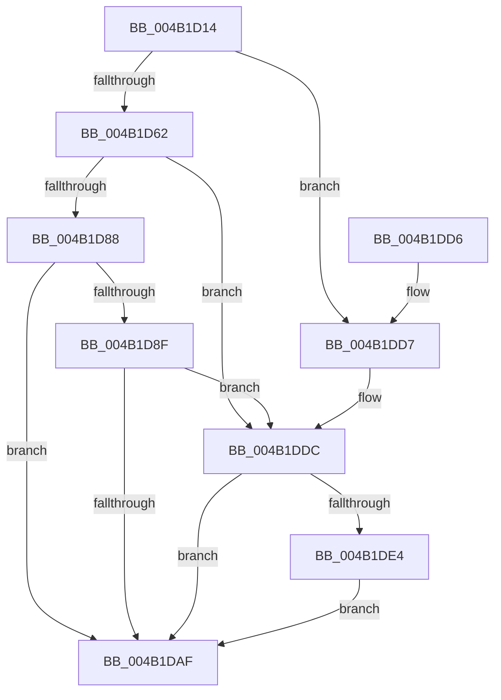

# BiOpenStoreKeyFromObject

- RVA: `0x004B1D14`–`0x004B1DEE` (길이 `218` bytes)
- VA: `0x00000001404B1D14`
- 실행 섹션: `.text`
- PDB 이름 있음: `예`; PDB Function 태그: `아니요`
- unwind 정보 RVA: `0x000B8FD4`
- 디코드: `57`개 명령, `218/218` bytes 표시
- 미해석 바이트: `0` (있으면 어셈블리에 `.byte`로 보존)

> 이 문서는 커널 이미지의 기계어와 PDB 기호를 분석해 생성했습니다. 4번과 5번은 함수 원형과 자료형을 바이너리 사용 방식에서 추정한 C 해석이며 원본 소스 복구 결과는 아닙니다.

## 1. Dependencies

- 직접 호출 지점: **5**; 고유 호출 대상: **5**
- 직접 호출자로 확인된 함수: **1**
- RIP 상대 이미지 참조: **1**

### Outgoing calls
- `0x004B1D4B` → [memset](../6C/memset_function_006C6C40.md) (function, `0x006C6C40`)
- `0x004B1D7D` → [ZwQueryKey](../6A/ZwQueryKey_function_006AD390.md) (function, `0x006AD390`)
- `0x004B1DA4` → [BiOpenKey](../../page/A3/BiOpenKey_function_00A3F60C.md) (function, `0x00A3F60C`)
- `0x004B1DBC` → [_security_check_cookie](../6A/_security_check_cookie_function_006AC640.md) (function, `0x006AC640`)
- `0x004B1DE4` → [BiCloseKey](../../page/91/BiCloseKey_function_00916A00.md) (function, `0x00916A00`)

### Direct callers
- [BiSetFirmwareModifiedFromObject](BiSetFirmwareModifiedFromObject_function_004B1CC8.md) at `0x004B1CD9`

### Static image references
- `0x004B1D26` → RVA `0x00E0A740` (`.data`; read)

## 2. Other-region calls and transfers

- 다른 실행 섹션으로 향하는 call: **2**
  - `0x004B1DA4` → [BiOpenKey](../../page/A3/BiOpenKey_function_00A3F60C.md) (`.text` → `PAGE`)
  - `0x004B1DE4` → [BiCloseKey](../../page/91/BiCloseKey_function_00916A00.md) (`.text` → `PAGE`)
- 별도 외부 분기/꼬리 이동을 확인하지 못했습니다.

## 3. Assembly (complete function range)

```asm
004B1D14  48 89 5C 24 18                  mov qword ptr [rsp + 0x18], rbx
004B1D19  48 89 74 24 20                  mov qword ptr [rsp + 0x20], rsi
004B1D1E  57                              push rdi
004B1D1F  48 81 EC F0 00 00 00            sub rsp, 0xf0
004B1D26  48 8B 05 13 8A 95 00            mov rax, qword ptr [rip + 0x958a13]
004B1D2D  48 33 C4                        xor rax, rsp
004B1D30  48 89 84 24 E0 00 00 00         mov qword ptr [rsp + 0xe0], rax
004B1D38  48 8B FA                        mov rdi, rdx
004B1D3B  48 8B D9                        mov rbx, rcx
004B1D3E  33 D2                           xor edx, edx
004B1D40  48 8D 4C 24 40                  lea rcx, [rsp + 0x40]
004B1D45  41 B8 A0 00 00 00               mov r8d, 0xa0
004B1D4B  E8 F0 4E 21 00                  call 0x1406c6c40
004B1D50  33 F6                           xor esi, esi
004B1D52  C7 44 24 30 A0 00 00 00         mov dword ptr [rsp + 0x30], 0xa0
004B1D5A  48 89 37                        mov qword ptr [rdi], rsi
004B1D5D  F6 C3 01                        test bl, 1
004B1D60  75 75                           jne 0x1404b1dd7
004B1D62  48 8D 44 24 30                  lea rax, [rsp + 0x30]
004B1D67  41 B9 A0 00 00 00               mov r9d, 0xa0
004B1D6D  4C 8D 44 24 40                  lea r8, [rsp + 0x40]
004B1D72  48 89 44 24 20                  mov qword ptr [rsp + 0x20], rax
004B1D77  8D 56 03                        lea edx, [rsi + 3]
004B1D7A  48 8B CB                        mov rcx, rbx
004B1D7D  E8 0E B6 1F 00                  call 0x1406ad390
004B1D82  8B D8                           mov ebx, eax
004B1D84  85 C0                           test eax, eax
004B1D86  78 54                           js 0x1404b1ddc
004B1D88  83 7C 24 40 4C                  cmp dword ptr [rsp + 0x40], 0x4c
004B1D8D  72 20                           jb 0x1404b1daf
004B1D8F  4C 8B CF                        mov r9, rdi
004B1D92  66 89 74 24 7E                  mov word ptr [rsp + 0x7e], si
004B1D97  41 B8 1F 00 02 00               mov r8d, 0x2001f
004B1D9D  48 8D 54 24 44                  lea rdx, [rsp + 0x44]
004B1DA2  33 C9                           xor ecx, ecx
004B1DA4  E8 63 D8 58 00                  call 0x140a3f60c
004B1DA9  8B D8                           mov ebx, eax
004B1DAB  85 C0                           test eax, eax
004B1DAD  78 2D                           js 0x1404b1ddc
004B1DAF  8B C3                           mov eax, ebx
004B1DB1  48 8B 8C 24 E0 00 00 00         mov rcx, qword ptr [rsp + 0xe0]
004B1DB9  48 33 CC                        xor rcx, rsp
004B1DBC  E8 7F A8 1F 00                  call 0x1406ac640
004B1DC1  4C 8D 9C 24 F0 00 00 00         lea r11, [rsp + 0xf0]
004B1DC9  49 8B 5B 20                     mov rbx, qword ptr [r11 + 0x20]
004B1DCD  49 8B 73 28                     mov rsi, qword ptr [r11 + 0x28]
004B1DD1  49 8B E3                        mov rsp, r11
004B1DD4  5F                              pop rdi
004B1DD5  C3                              ret
004B1DD6  CC                              int3
004B1DD7  BB 02 00 00 C0                  mov ebx, 0xc0000002
004B1DDC  48 8B 0F                        mov rcx, qword ptr [rdi]
004B1DDF  48 85 C9                        test rcx, rcx
004B1DE2  74 CB                           je 0x1404b1daf
004B1DE4  E8 17 4C 46 00                  call 0x140916a00
004B1DE9  48 89 37                        mov qword ptr [rdi], rsi
004B1DEC  EB C1                           jmp 0x1404b1daf
```

## 4. C-style interpretation (structured pseudocode)

```c
__int64 __fastcall BiOpenStoreKeyFromObject(__int64 a1, __int64 a2)
{
    __int64 result;
    __int64 v_rsi;
    __int64 v_rsp;
    unsigned __int64 v_stack_m18;
    unsigned __int16 v_stack_m7A;
    unsigned __int64 v_stack_m8;
    unsigned __int64 v_stack_mB4;
    unsigned __int64 v_stack_mB8;
    unsigned int v_stack_mC8;
    unsigned __int64 v_stack_mD8;
    unsigned __int64 v_stack_p18;
    unsigned __int64 v_stack_p20;

    v_stack_p18 = v_rbx;
    v_stack_p20 = v_rsi;
    v_rsp = (v_rsp) - (240);
    result = (*(unsigned __int64 *)(v_rip + 9800211)) ^ (v_rsp);
    v_stack_m18 = result;
    a2 = 0;
    result = memset(v_stack_mB8, a2, 160, a4);
    v_rsi = 0;
    v_stack_mC8 = 160;
    *(unsigned __int64 *)(a2) = 0;
    if ((((unsigned __int8)(a1)) & (1)) != 0) goto loc_004B1DD7;
    v_stack_mD8 = v_stack_mC8;
    result = ZwQueryKey(a1, v_rsi + 3, v_stack_mB8, 160);
    if (sign_flag) goto loc_004B1DDC;
    if (v_stack_mB8 < 76) goto loc_004B1DAF;
    v_stack_m7A = 0;
    a1 = 0;
    result = BiOpenKey(a1, v_stack_mB4, (unsigned int)(0x2001FULL), 0);
    if (sign_flag) goto loc_004B1DDC;
loc_004B1DAF:
    a1 = (v_stack_m18) ^ (v_rsp);
    result = _security_check_cookie(a1, v_stack_mB4, (unsigned int)(0x2001FULL), 0);
    return result;
loc_004B1DD7:
loc_004B1DDC:
    if (*(unsigned __int64 *)(a2) == 0) goto loc_004B1DAF;
    result = BiCloseKey(*(unsigned __int64 *)(a2), v_stack_mB4, (unsigned int)(0x2001FULL), 0);
    *(unsigned __int64 *)(a2) = *(unsigned __int64 *)(v_stack_m8 + 40);
    goto loc_004B1DAF;
}
```

## 5. (Beta) C Style

```c
int64_t BiOpenStoreKeyFromObject(int64_t Arg1, void *Arg2)
{
    uint8_t *arg2 = (uint8_t *)Arg2;

    int64_t result;
    int64_t local_rsi;
    int64_t local_rsp;
    uint64_t v_stack_m18;
    uint16_t v_stack_m7A;
    uint64_t v_stack_m8;
    uint64_t v_stack_mB4;
    uint64_t v_stack_mB8;
    uint32_t v_stack_mC8;
    uint64_t v_stack_mD8;
    uint64_t v_stack_p18;
    uint64_t v_stack_p20;

    v_stack_p18 = local_rbx;
    v_stack_p20 = local_rsi;
    local_rsp = (local_rsp) - (240);
    result = (*(uint64_t *)(v_rip + 0x958A13)) ^ (local_rsp);
    v_stack_m18 = result;
    Arg2 = 0;
    result = memset(v_stack_mB8, Arg2, 160, a4);
    local_rsi = 0;
    v_stack_mC8 = 160;
    *(uint64_t *)(arg2) = 0;
    if ((((uint8_t)(Arg1)) & (1)) != 0) goto loc_004B1DD7;
    v_stack_mD8 = v_stack_mC8;
    result = ZwQueryKey(Arg1, local_rsi + 3, v_stack_mB8, 160);
    if (sign_flag) goto loc_004B1DDC;
    if (v_stack_mB8 < 76) goto loc_004B1DAF;
    v_stack_m7A = 0;
    Arg1 = 0;
    result = BiOpenKey(Arg1, v_stack_mB4, (uint32_t)(0x2001FULL), 0);
    if (sign_flag) goto loc_004B1DDC;
loc_004B1DAF:
    Arg1 = (v_stack_m18) ^ (local_rsp);
    result = _security_check_cookie(Arg1, v_stack_mB4, (uint32_t)(0x2001FULL), 0);
    return result;
loc_004B1DD7:
loc_004B1DDC:
    if (*(uint64_t *)(arg2) == 0) goto loc_004B1DAF;
    result = BiCloseKey(*(uint64_t *)(arg2), v_stack_mB4, (uint32_t)(0x2001FULL), 0);
    *(uint64_t *)(arg2) = *(uint64_t *)(v_stack_m8 + 0x28);
    goto loc_004B1DAF;
}
```

### 관측된 메모리 오프셋

구조체 형식이 확인되지 않은 접근은 인자 기준의 오프셋으로만 기록했습니다.

| 기준 인자 | 오프셋 표현 | 폭 (bit) | 접근 |
|---|---:|---:|---|
| `Arg2` | `+ 0x0` | `64` | `R` |
| `Arg2` | `+ 0x0` | `64` | `W` |

## 6. Execution-region graph

[열기: 2D/3D 그래프와 함수 탐색 컨트롤 패널](../../../control-panel.html?section=text&rva=0x004B1D14&view=graph)

- 2D 그래프는 위에서 아래로 흐르고, 3D 그래프는 빈 공간을 드래그해 회전합니다. Shift+드래그는 이동, 휠은 확대·축소, 함수 노드 선택은 대상 보고서 이동입니다.

### Static fallback


