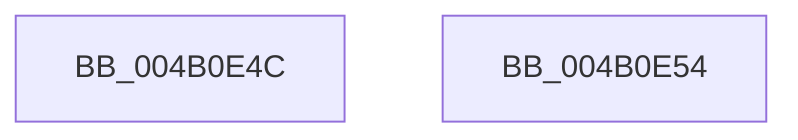

# BiSanitizeHandle

- RVA: `0x004B0E4C`–`0x004B0E55` (길이 `9` bytes)
- VA: `0x00000001404B0E4C`
- 실행 섹션: `.text`
- PDB 이름 있음: `예`; PDB Function 태그: `아니요`
- unwind 정보 RVA: `0x000DB714`
- 디코드: `4`개 명령, `9/9` bytes 표시
- 미해석 바이트: `0` (있으면 어셈블리에 `.byte`로 보존)

> 이 문서는 커널 이미지의 기계어와 PDB 기호를 분석해 생성했습니다. 4번과 5번은 함수 원형과 자료형을 바이너리 사용 방식에서 추정한 C 해석이며 원본 소스 복구 결과는 아닙니다.

## 1. Dependencies

- 직접 호출 지점: **0**; 고유 호출 대상: **0**
- 직접 호출자로 확인된 함수: **10**
- RIP 상대 이미지 참조: **0**

### Outgoing calls
- 직접 디코드된 call 명령이 없습니다.

### Direct callers
- [BcdFlushStore](../../page/82/BcdFlushStore_function_00823294.md) at `0x008232D0`
- [BiDeleteRegistryValue](../../page/82/BiDeleteRegistryValue_function_00826078.md) at `0x008260A1`
- [BiCloseStore](../../page/A3/BiCloseStore_function_00A3C5D8.md) at `0x00A3C5EB`
- [BiSetRegistryValue](../../page/A3/BiSetRegistryValue_function_00A3E3B0.md) at `0x00A3E3F1`
- [BiGetKeyName](../../page/A3/BiGetKeyName_function_00A3EF04.md) at `0x00A3EF26`
- [BiGetRegistryValue](../../page/A3/BiGetRegistryValue_function_00A3F3CC.md) at `0x00A3F438`
- [BiOpenKey](../../page/A3/BiOpenKey_function_00A3F60C.md) at `0x00A3F672`
- [BiDeleteKey](../../page/A3/BiDeleteKey_function_00A3FC58.md) at `0x00A3FC6B`
- [BiEnumerateSubKeys](../../page/A3/BiEnumerateSubKeys_function_00A3FD24.md) at `0x00A3FD98`
- [BiCreateKey](../../page/A4/BiCreateKey_function_00A404DC.md) at `0x00A4054A`

### Static image references
- 디코드된 RIP-relative 메모리 참조가 없습니다.

## 2. Other-region calls and transfers

- 다른 실행 섹션으로 향하는 call: **0**
- 별도 외부 분기/꼬리 이동을 확인하지 못했습니다.

## 3. Assembly (complete function range)

```asm
004B0E4C  48 83 E1 FD                     and rcx, 0xfffffffffffffffd
004B0E50  48 8B C1                        mov rax, rcx
004B0E53  C3                              ret
004B0E54  CC                              int3
```

## 4. C-style interpretation (structured pseudocode)

```c
__int64 __fastcall BiSanitizeHandle(__int64 a1)
{
    a1 = (a1) & (-3);
    return a1;
}
```

## 5. (Beta) C Style

```c
int64_t BiSanitizeHandle(int64_t Arg1)
{
    Arg1 = (Arg1) & (-3);
    return Arg1;
}
```

## 6. Execution-region graph

[열기: 2D/3D 그래프와 함수 탐색 컨트롤 패널](../../../control-panel.html?section=text&rva=0x004B0E4C&view=graph)

- 2D 그래프는 위에서 아래로 흐르고, 3D 그래프는 빈 공간을 드래그해 회전합니다. Shift+드래그는 이동, 휠은 확대·축소, 함수 노드 선택은 대상 보고서 이동입니다.

### Static fallback


