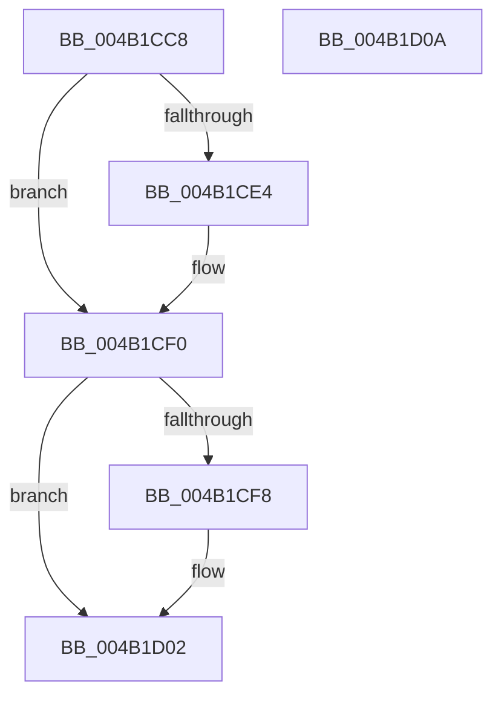

# BiSetFirmwareModifiedFromObject

- RVA: `0x004B1CC8`–`0x004B1D0B` (길이 `67` bytes)
- VA: `0x00000001404B1CC8`
- 실행 섹션: `.text`
- PDB 이름 있음: `예`; PDB Function 태그: `아니요`
- unwind 정보 RVA: `0x000AC81C`
- 디코드: `20`개 명령, `67/67` bytes 표시
- 미해석 바이트: `0` (있으면 어셈블리에 `.byte`로 보존)

> 이 문서는 커널 이미지의 기계어와 PDB 기호를 분석해 생성했습니다. 4번과 5번은 함수 원형과 자료형을 바이너리 사용 방식에서 추정한 C 해석이며 원본 소스 복구 결과는 아닙니다.

## 1. Dependencies

- 직접 호출 지점: **3**; 고유 호출 대상: **3**
- 직접 호출자로 확인된 함수: **3**
- RIP 상대 이미지 참조: **0**

### Outgoing calls
- `0x004B1CD9` → [BiOpenStoreKeyFromObject](BiOpenStoreKeyFromObject_function_004B1D14.md) (function, `0x004B1D14`)
- `0x004B1CEB` → [BiSetFirmwareModified](BiSetFirmwareModified_function_004B1DF4.md) (function, `0x004B1DF4`)
- `0x004B1CFD` → [BiCloseKey](../../page/91/BiCloseKey_function_00916A00.md) (function, `0x00916A00`)

### Direct callers
- [BcdDeleteObject](../../page/A3/BcdDeleteObject_function_00A3C578.md) at `0x00A3C5CB`
- [BiDeleteElement](../../page/A3/BiDeleteElement_function_00A3E0F8.md) at `0x00A3E22C`
- [BcdSetElementDataWithFlags](../../page/A3/BcdSetElementDataWithFlags_function_00A3F080.md) at `0x00A3F272`

### Static image references
- 디코드된 RIP-relative 메모리 참조가 없습니다.

## 2. Other-region calls and transfers

- 다른 실행 섹션으로 향하는 call: **1**
  - `0x004B1CFD` → [BiCloseKey](../../page/91/BiCloseKey_function_00916A00.md) (`.text` → `PAGE`)
- 별도 외부 분기/꼬리 이동을 확인하지 못했습니다.

## 3. Assembly (complete function range)

```asm
004B1CC8  40 57                           push rdi
004B1CCA  48 83 EC 20                     sub rsp, 0x20
004B1CCE  48 83 64 24 40 00               and qword ptr [rsp + 0x40], 0
004B1CD4  48 8D 54 24 40                  lea rdx, [rsp + 0x40]
004B1CD9  E8 36 00 00 00                  call 0x1404b1d14
004B1CDE  8B F8                           mov edi, eax
004B1CE0  85 C0                           test eax, eax
004B1CE2  78 0C                           js 0x1404b1cf0
004B1CE4  48 8B 4C 24 40                  mov rcx, qword ptr [rsp + 0x40]
004B1CE9  B2 01                           mov dl, 1
004B1CEB  E8 04 01 00 00                  call 0x1404b1df4
004B1CF0  48 83 7C 24 40 00               cmp qword ptr [rsp + 0x40], 0
004B1CF6  74 0A                           je 0x1404b1d02
004B1CF8  48 8B 4C 24 40                  mov rcx, qword ptr [rsp + 0x40]
004B1CFD  E8 FE 4C 46 00                  call 0x140916a00
004B1D02  8B C7                           mov eax, edi
004B1D04  48 83 C4 20                     add rsp, 0x20
004B1D08  5F                              pop rdi
004B1D09  C3                              ret
004B1D0A  CC                              int3
```

## 4. C-style interpretation (structured pseudocode)

```c
__int64 __fastcall BiSetFirmwareModifiedFromObject(void)
{
    __int64 result;
    __int64 v_rsp;
    unsigned __int64 v_stack_p18;

    v_rsp = (v_rsp) - (32);
    result = BiOpenStoreKeyFromObject(a1, v_stack_p18, a3, a4);
    if (!(sign_flag)) {
        a1 = v_stack_p18;
        a2 = 1;
        result = BiSetFirmwareModified(a1, a2, a3, a4);
    }
    if (v_stack_p18 != 0) {
        a1 = v_stack_p18;
        result = BiCloseKey(a1, a2, a3, a4);
    }
    v_rsp = (v_rsp) + (32);
    return (unsigned int)((unsigned int)((unsigned int)((unsigned int)(result))));
}
```

## 5. (Beta) C Style

```c
void BiSetFirmwareModifiedFromObject(void)
{
    int64_t result;
    int64_t local_rsp;
    uint64_t v_stack_p18;

    local_rsp = (local_rsp) - (32);
    result = BiOpenStoreKeyFromObject(a1, v_stack_p18, a3, a4);
    if (!(sign_flag)) {
        a1 = v_stack_p18;
        a2 = 1;
        result = BiSetFirmwareModified(a1, a2, a3, a4);
    }
    if (v_stack_p18 != 0) {
        a1 = v_stack_p18;
        result = BiCloseKey(a1, a2, a3, a4);
    }
    local_rsp = (local_rsp) + (32);
    return (uint32_t)((uint32_t)((uint32_t)((uint32_t)(result))));
}
```

## 6. Execution-region graph

[열기: 2D/3D 그래프와 함수 탐색 컨트롤 패널](../../../control-panel.html?section=text&rva=0x004B1CC8&view=graph)

- 2D 그래프는 위에서 아래로 흐르고, 3D 그래프는 빈 공간을 드래그해 회전합니다. Shift+드래그는 이동, 휠은 확대·축소, 함수 노드 선택은 대상 보고서 이동입니다.

### Static fallback


