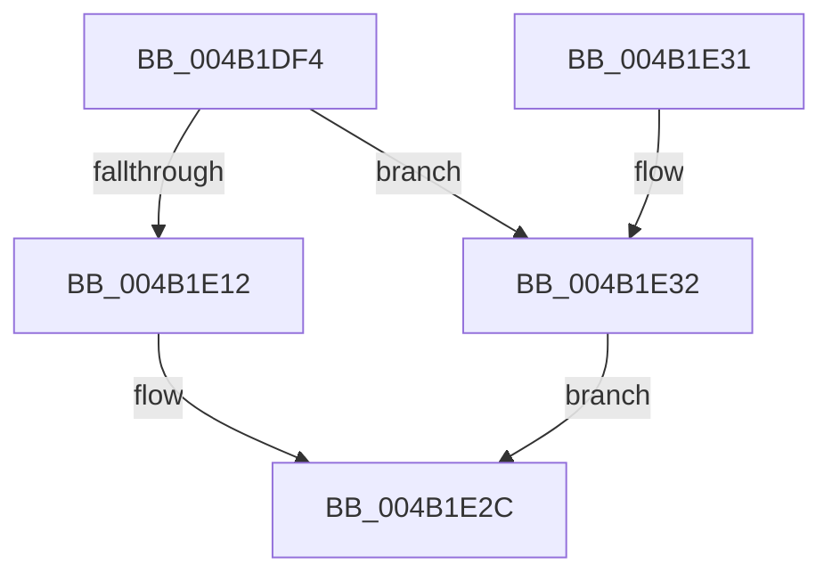

# BiSetFirmwareModified

- RVA: `0x004B1DF4`–`0x004B1E39` (길이 `69` bytes)
- VA: `0x00000001404B1DF4`
- 실행 섹션: `.text`
- PDB 이름 있음: `예`; PDB Function 태그: `아니요`
- unwind 정보 RVA: `0x000789BC`
- 디코드: `16`개 명령, `69/69` bytes 표시
- 미해석 바이트: `0` (있으면 어셈블리에 `.byte`로 보존)

> 이 문서는 커널 이미지의 기계어와 PDB 기호를 분석해 생성했습니다. 4번과 5번은 함수 원형과 자료형을 바이너리 사용 방식에서 추정한 C 해석이며 원본 소스 복구 결과는 아닙니다.

## 1. Dependencies

- 직접 호출 지점: **2**; 고유 호출 대상: **2**
- 직접 호출자로 확인된 함수: **5**
- RIP 상대 이미지 참조: **2**

### Outgoing calls
- `0x004B1E27` → [BiSetRegistryValue](../../page/A3/BiSetRegistryValue_function_00A3E3B0.md) (function, `0x00A3E3B0`)
- `0x004B1E32` → [BiDeleteRegistryValue](../../page/82/BiDeleteRegistryValue_function_00826078.md) (function, `0x00826078`)

### Direct callers
- [BiSetFirmwareModifiedFromObject](BiSetFirmwareModifiedFromObject_function_004B1CC8.md) at `0x004B1CEB`
- [BiCloseStore](../../page/A3/BiCloseStore_function_00A3C5D8.md) at `0x00A3C626`
- [BcdCreateObject](../../page/A3/BcdCreateObject_function_00A3D890.md) at `0x00A3D91D`
- [BiBindEfiBootManager](../../page/A3/BiBindEfiBootManager_function_00A3DCB0.md) at `0x00A3DEDE`
- [BiOpenSystemStore](../../page/A4/BiOpenSystemStore_function_00A40844.md) at `0x00A409B3`

### Static image references
- `0x004B1E02` → RVA `0x006D0A40` (` ?? ::FNODOBFM::`string'`; read)
- `0x004B1E09` → RVA `0x006D0A20` (` ?? ::FNODOBFM::`string'`; read)

## 2. Other-region calls and transfers

- 다른 실행 섹션으로 향하는 call: **2**
  - `0x004B1E27` → [BiSetRegistryValue](../../page/A3/BiSetRegistryValue_function_00A3E3B0.md) (`.text` → `PAGE`)
  - `0x004B1E32` → [BiDeleteRegistryValue](../../page/82/BiDeleteRegistryValue_function_00826078.md) (`.text` → `PAGE`)
- 별도 외부 분기/꼬리 이동을 확인하지 못했습니다.

## 3. Assembly (complete function range)

```asm
004B1DF4  48 83 EC 38                     sub rsp, 0x38
004B1DF8  84 D2                           test dl, dl
004B1DFA  C7 44 24 48 01 00 00 00         mov dword ptr [rsp + 0x48], 1
004B1E02  48 8D 15 37 EC 21 00            lea rdx, [rip + 0x21ec37]
004B1E09  4C 8D 05 10 EC 21 00            lea r8, [rip + 0x21ec10]
004B1E10  74 20                           je 0x1404b1e32
004B1E12  41 B9 04 00 00 00               mov r9d, 4
004B1E18  48 8D 44 24 48                  lea rax, [rsp + 0x48]
004B1E1D  44 89 4C 24 28                  mov dword ptr [rsp + 0x28], r9d
004B1E22  48 89 44 24 20                  mov qword ptr [rsp + 0x20], rax
004B1E27  E8 84 C5 58 00                  call 0x140a3e3b0
004B1E2C  48 83 C4 38                     add rsp, 0x38
004B1E30  C3                              ret
004B1E31  CC                              int3
004B1E32  E8 41 42 37 00                  call 0x140826078
004B1E37  EB F3                           jmp 0x1404b1e2c
```

## 4. C-style interpretation (structured pseudocode)

```c
__int64 __fastcall BiSetFirmwareModified(__int64 a1, unsigned __int8 a2)
{
    __int64 result;
    __int64 v_rsp;
    unsigned int v_stack_m10;
    unsigned __int64 v_stack_m18;
    unsigned int v_stack_p10;

    v_rsp = (v_rsp) - (56);
    v_stack_p10 = 1;
    if (a2 == 0) goto loc_004B1E32;
    v_stack_m10 = 4;
    v_stack_m18 = v_stack_p10;
    result = BiSetRegistryValue(a1, v_rip + 2223159, v_rip + 2223120, 4);
loc_004B1E2C:
    v_rsp = (v_rsp) + (56);
    return result;
loc_004B1E32:
    result = BiDeleteRegistryValue(a1, v_rip + 2223159, v_rip + 2223120, 4);
    goto loc_004B1E2C;
}
```

## 5. (Beta) C Style

```c
int64_t BiSetFirmwareModified(int64_t Arg1, uint8_t Arg2)
{
    int64_t result;
    int64_t local_rsp;
    uint32_t v_stack_m10;
    uint64_t v_stack_m18;
    uint32_t v_stack_p10;

    local_rsp = (local_rsp) - (56);
    v_stack_p10 = 1;
    if (Arg2 == 0) goto loc_004B1E32;
    v_stack_m10 = 4;
    v_stack_m18 = v_stack_p10;
    result = BiSetRegistryValue(Arg1, v_rip + 2223159, v_rip + 2223120, 4);
loc_004B1E2C:
    local_rsp = (local_rsp) + (56);
    return result;
loc_004B1E32:
    result = BiDeleteRegistryValue(Arg1, v_rip + 2223159, v_rip + 2223120, 4);
    goto loc_004B1E2C;
}
```

## 6. Execution-region graph

[열기: 2D/3D 그래프와 함수 탐색 컨트롤 패널](../../../control-panel.html?section=text&rva=0x004B1DF4&view=graph)

- 2D 그래프는 위에서 아래로 흐르고, 3D 그래프는 빈 공간을 드래그해 회전합니다. Shift+드래그는 이동, 휠은 확대·축소, 함수 노드 선택은 대상 보고서 이동입니다.

### Static fallback


