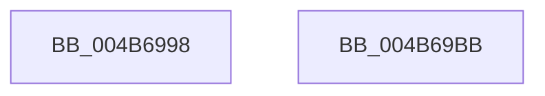

# BiZwEnumerateKey

- RVA: `0x004B6998`–`0x004B69BC` (길이 `36` bytes)
- VA: `0x00000001404B6998`
- 실행 섹션: `.text`
- PDB 이름 있음: `예`; PDB Function 태그: `아니요`
- unwind 정보 RVA: `0x0005D2F4`
- 디코드: `10`개 명령, `36/36` bytes 표시
- 미해석 바이트: `0` (있으면 어셈블리에 `.byte`로 보존)

> 이 문서는 커널 이미지의 기계어와 PDB 기호를 분석해 생성했습니다. 4번과 5번은 함수 원형과 자료형을 바이너리 사용 방식에서 추정한 C 해석이며 원본 소스 복구 결과는 아닙니다.

## 1. Dependencies

- 직접 호출 지점: **1**; 고유 호출 대상: **1**
- 직접 호출자로 확인된 함수: **1**
- RIP 상대 이미지 참조: **0**

### Outgoing calls
- `0x004B69B1` → [ZwEnumerateKey](../6A/ZwEnumerateKey_function_006AD710.md) (function, `0x006AD710`)

### Direct callers
- [BiEnumerateSubKeys](../../page/A3/BiEnumerateSubKeys_function_00A3FD24.md) at `0x00A3FF25`

### Static image references
- 디코드된 RIP-relative 메모리 참조가 없습니다.

## 2. Other-region calls and transfers

- 다른 실행 섹션으로 향하는 call: **0**
- 별도 외부 분기/꼬리 이동을 확인하지 못했습니다.

## 3. Assembly (complete function range)

```asm
004B6998  48 83 EC 38                     sub rsp, 0x38
004B699C  48 8B 44 24 68                  mov rax, qword ptr [rsp + 0x68]
004B69A1  45 33 C0                        xor r8d, r8d
004B69A4  48 89 44 24 28                  mov qword ptr [rsp + 0x28], rax
004B69A9  8B 44 24 60                     mov eax, dword ptr [rsp + 0x60]
004B69AD  89 44 24 20                     mov dword ptr [rsp + 0x20], eax
004B69B1  E8 5A 6D 1F 00                  call 0x1406ad710
004B69B6  48 83 C4 38                     add rsp, 0x38
004B69BA  C3                              ret
004B69BB  CC                              int3
```

## 4. C-style interpretation (structured pseudocode)

```c
__int64 __fastcall BiZwEnumerateKey(__int64 a1, __int64 a2, int a3, __int64 a4, unsigned int a5, __int64 a6)
{
    __int64 result;
    __int64 v_rsp;
    unsigned __int64 v_stack_m10;
    unsigned int v_stack_m18;

    v_rsp = (v_rsp) - (56);
    a3 = 0;
    v_stack_m10 = a6;
    v_stack_m18 = (unsigned int)((unsigned int)(a5));
    result = ZwEnumerateKey(a1, a2, a3, a4);
    v_rsp = (v_rsp) + (56);
    return result;
}
```

## 5. (Beta) C Style

```c
int64_t BiZwEnumerateKey(int64_t Arg1, int64_t Arg2, int32_t Arg3, int64_t Arg4, uint32_t Arg5, int64_t Arg6)
{
    int64_t result;
    int64_t local_rsp;
    uint64_t v_stack_m10;
    uint32_t v_stack_m18;

    local_rsp = (local_rsp) - (56);
    Arg3 = 0;
    v_stack_m10 = Arg6;
    v_stack_m18 = (uint32_t)((uint32_t)(Arg5));
    result = ZwEnumerateKey(Arg1, Arg2, Arg3, Arg4);
    local_rsp = (local_rsp) + (56);
    return result;
}
```

## 6. Execution-region graph

[열기: 2D/3D 그래프와 함수 탐색 컨트롤 패널](../../../control-panel.html?section=text&rva=0x004B6998&view=graph)

- 2D 그래프는 위에서 아래로 흐르고, 3D 그래프는 빈 공간을 드래그해 회전합니다. Shift+드래그는 이동, 휠은 확대·축소, 함수 노드 선택은 대상 보고서 이동입니다.

### Static fallback


