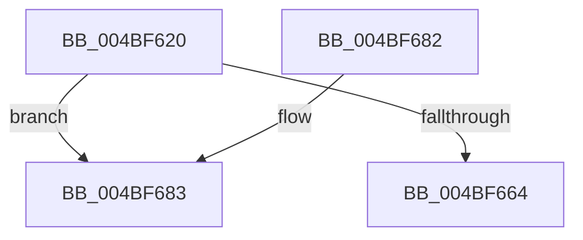

# CcAddDirtyPagesToExternalCache

- RVA: `0x004BF620`–`0x004BF68E` (길이 `110` bytes)
- VA: `0x00000001404BF620`
- 실행 섹션: `.text`
- PDB 이름 있음: `예`; PDB Function 태그: `예`
- unwind 정보 RVA: `0x000BC580`
- 디코드: `35`개 명령, `110/110` bytes 표시
- 미해석 바이트: `0` (있으면 어셈블리에 `.byte`로 보존)

> 이 문서는 커널 이미지의 기계어와 PDB 기호를 분석해 생성했습니다. 4번과 5번은 함수 원형과 자료형을 바이너리 사용 방식에서 추정한 C 해석이며 원본 소스 복구 결과는 아닙니다.

## 1. Dependencies

- 직접 호출 지점: **0**; 고유 호출 대상: **0**
- 직접 호출자로 확인된 함수: **0**
- RIP 상대 이미지 참조: **1**

### Outgoing calls
- 직접 디코드된 call 명령이 없습니다.

### Direct callers
- 이 함수 시작 RVA로 연결되는 직접 call은 확인되지 않았습니다. 간접 호출은 완전히 역산할 수 없습니다.

### Static image references
- `0x004BF654` → RVA `0x00FC6EA0` (`ALMOSTRO`; read)

## 2. Other-region calls and transfers

- 다른 실행 섹션으로 향하는 call: **0**
- call이 아닌 외부 분기/꼬리 이동: **1**
  - `0x004BF689` → [sub_006FCB7E](../6F/Unknown_function_006FCB7E.md) (`tail-transfer`)

## 3. Assembly (complete function range)

```asm
004BF620  4C 8B DC                        mov r11, rsp
004BF623  49 89 5B 08                     mov qword ptr [r11 + 8], rbx
004BF627  49 89 6B 10                     mov qword ptr [r11 + 0x10], rbp
004BF62B  49 89 73 18                     mov qword ptr [r11 + 0x18], rsi
004BF62F  57                              push rdi
004BF630  41 54                           push r12
004BF632  41 55                           push r13
004BF634  41 56                           push r14
004BF636  41 57                           push r15
004BF638  48 83 EC 50                     sub rsp, 0x50
004BF63C  4C 8B 71 38                     mov r14, qword ptr [rcx + 0x38]
004BF640  33 C0                           xor eax, eax
004BF642  0F 57 C0                        xorps xmm0, xmm0
004BF645  48 8B DA                        mov rbx, rdx
004BF648  48 8B F9                        mov rdi, rcx
004BF64B  0F 11 44 24 30                  movups xmmword ptr [rsp + 0x30], xmm0
004BF650  49 89 43 C8                     mov qword ptr [r11 - 0x38], rax
004BF654  48 8B 05 45 78 B0 00            mov rax, qword ptr [rip + 0xb07845]
004BF65B  48 8B 70 08                     mov rsi, qword ptr [rax + 8]
004BF65F  48 85 D2                        test rdx, rdx
004BF662  75 1F                           jne 0x1404bf683
004BF664  4C 8D 5C 24 50                  lea r11, [rsp + 0x50]
004BF669  49 8B 5B 30                     mov rbx, qword ptr [r11 + 0x30]
004BF66D  49 8B 6B 38                     mov rbp, qword ptr [r11 + 0x38]
004BF671  49 8B 73 40                     mov rsi, qword ptr [r11 + 0x40]
004BF675  49 8B E3                        mov rsp, r11
004BF678  41 5F                           pop r15
004BF67A  41 5E                           pop r14
004BF67C  41 5D                           pop r13
004BF67E  41 5C                           pop r12
004BF680  5F                              pop rdi
004BF681  C3                              ret
004BF682  CC                              int3
004BF683  41 BD FF FF FF FF               mov r13d, 0xffffffff
004BF689  E9 F0 D4 23 00                  jmp 0x1406fcb7e
```

## 4. C-style interpretation (structured pseudocode)

```c
__int64 __fastcall CcAddDirtyPagesToExternalCache(__int64 a1, __int64 a2)
{
    __int64 result;
    __int64 v_rsp;
    unsigned __int64 v_stack_m28;
    unsigned __int64 v_stack_m48;

    *(unsigned __int64 *)(v_rsp + 8) = v_rbx;
    *(unsigned __int64 *)(v_rsp + 16) = v_rbp;
    *(unsigned __int64 *)(v_rsp + 24) = v_rsi;
    v_rsp = (v_rsp) - (80);
    result = 0;
    v_stack_m48 = v_xmm0;
    *(unsigned __int64 *)(v_rsp - 56) = 0;
    if (a2 != 0) goto loc_004BF683;
    return *(unsigned __int64 *)(v_rip + 11565125);
loc_004BF683:
}
```

## 5. (Beta) C Style

```c
int64_t CcAddDirtyPagesToExternalCache(void *Arg1, int64_t Arg2)
{
    uint8_t *arg1 = (uint8_t *)Arg1;

    int64_t result;
    int64_t local_rsp;
    uint64_t v_stack_m28;
    uint64_t v_stack_m48;

    *(uint64_t *)(local_rsp + 0x8) = local_rbx;
    *(uint64_t *)(local_rsp + 0x10) = local_rbp;
    *(uint64_t *)(local_rsp + 0x18) = local_rsi;
    local_rsp = (local_rsp) - (80);
    result = 0;
    v_stack_m48 = v_xmm0;
    *(uint64_t *)(local_rsp - 0x38) = 0;
    if (Arg2 != 0) goto loc_004BF683;
    return *(uint64_t *)(v_rip + 0xB07845);
loc_004BF683:
}
```

### 관측된 메모리 오프셋

구조체 형식이 확인되지 않은 접근은 인자 기준의 오프셋으로만 기록했습니다.

| 기준 인자 | 오프셋 표현 | 폭 (bit) | 접근 |
|---|---:|---:|---|
| `Arg1` | `+ 0x38` | `64` | `R` |

## 6. Execution-region graph

[열기: 2D/3D 그래프와 함수 탐색 컨트롤 패널](../../../control-panel.html?section=text&rva=0x004BF620&view=graph)

- 2D 그래프는 위에서 아래로 흐르고, 3D 그래프는 빈 공간을 드래그해 회전합니다. Shift+드래그는 이동, 휠은 확대·축소, 함수 노드 선택은 대상 보고서 이동입니다.

### Static fallback


