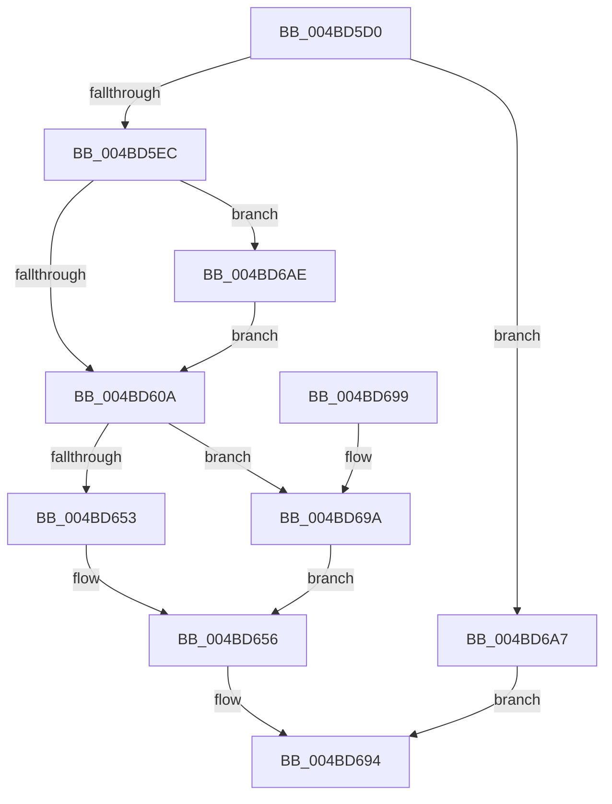

# CcAdjustThrottleForVolume

- RVA: `0x004BD5D0`–`0x004BD6BB` (길이 `235` bytes)
- VA: `0x00000001404BD5D0`
- 실행 섹션: `.text`
- PDB 이름 있음: `예`; PDB Function 태그: `아니요`
- unwind 정보 RVA: `0x00073864`
- 디코드: `54`개 명령, `235/235` bytes 표시
- 미해석 바이트: `0` (있으면 어셈블리에 `.byte`로 보존)

> 이 문서는 커널 이미지의 기계어와 PDB 기호를 분석해 생성했습니다. 4번과 5번은 함수 원형과 자료형을 바이너리 사용 방식에서 추정한 C 해석이며 원본 소스 복구 결과는 아닙니다.

## 1. Dependencies

- 직접 호출 지점: **1**; 고유 호출 대상: **1**
- 직접 호출자로 확인된 함수: **1**
- RIP 상대 이미지 참조: **2**

### Outgoing calls
- `0x004BD6A7` → [CcAdjustThrottleForExternalCache](../57/CcAdjustThrottleForExternalCache_function_0057DB1C.md) (function, `0x0057DB1C`)

### Direct callers
- [CcLazyWriteScanVolume](../38/CcLazyWriteScanVolume_function_00388DC0.md) at `0x00388F24`

### Static image references
- `0x004BD5DD` → RVA `0x00FC521C` (`ALMOSTRO`; read)
- `0x004BD69A` → RVA `0x00E0A878` (`.data`; read)

## 2. Other-region calls and transfers

- 다른 실행 섹션으로 향하는 call: **0**
- 별도 외부 분기/꼬리 이동을 확인하지 못했습니다.

## 3. Assembly (complete function range)

```asm
004BD5D0  48 83 EC 28                     sub rsp, 0x28
004BD5D4  8B 81 50 06 00 00               mov eax, dword ptr [rcx + 0x650]
004BD5DA  4C 8B C1                        mov r8, rcx
004BD5DD  44 8A 15 38 7C B0 00            mov r10b, byte ptr [rip + 0xb07c38]
004BD5E4  A8 10                           test al, 0x10
004BD5E6  0F 85 BB 00 00 00               jne 0x1404bd6a7
004BD5EC  8B 91 08 05 00 00               mov edx, dword ptr [rcx + 0x508]
004BD5F2  B8 00 02 00 00                  mov eax, 0x200
004BD5F7  3B D0                           cmp edx, eax
004BD5F9  0F 42 D0                        cmovb edx, eax
004BD5FC  48 83 B9 48 04 00 00 00         cmp qword ptr [rcx + 0x448], 0
004BD604  0F 85 A4 00 00 00               jne 0x1404bd6ae
004BD60A  4D 8B 88 F8 03 00 00            mov r9, qword ptr [r8 + 0x3f8]
004BD611  8B CA                           mov ecx, edx
004BD613  41 0F AF 88 10 06 00 00         imul ecx, dword ptr [r8 + 0x610]
004BD61B  49 8B C1                        mov rax, r9
004BD61E  41 0F AF 90 14 06 00 00         imul edx, dword ptr [r8 + 0x614]
004BD626  48 C1 E8 02                     shr rax, 2
004BD62A  4C 2B C8                        sub r9, rax
004BD62D  4D 8B D9                        mov r11, r9
004BD630  49 D1 EB                        shr r11, 1
004BD633  49 3B C9                        cmp rcx, r9
004BD636  8B C2                           mov eax, edx
004BD638  4C 0F 43 D8                     cmovae r11, rax
004BD63C  4C 0F 43 C9                     cmovae r9, rcx
004BD640  49 8B 80 40 04 00 00            mov rax, qword ptr [r8 + 0x440]
004BD647  49 03 80 38 04 00 00            add rax, qword ptr [r8 + 0x438]
004BD64E  45 84 D2                        test r10b, r10b
004BD651  74 47                           je 0x1404bd69a
004BD653  48 D1 E8                        shr rax, 1
004BD656  48 8D 0C 85 00 00 00 00         lea rcx, [rax*4]
004BD65E  48 B8 CD CC CC CC CC CC CC CC   movabs rax, 0xcccccccccccccccd
004BD668  48 F7 E1                        mul rcx
004BD66B  48 C1 EA 02                     shr rdx, 2
004BD66F  4C 3B CA                        cmp r9, rdx
004BD672  48 8B C2                        mov rax, rdx
004BD675  49 0F 42 C1                     cmovb rax, r9
004BD679  49 89 80 F8 03 00 00            mov qword ptr [r8 + 0x3f8], rax
004BD680  48 8B C2                        mov rax, rdx
004BD683  48 D1 E8                        shr rax, 1
004BD686  4C 3B CA                        cmp r9, rdx
004BD689  41 0F 42 C3                     cmovb eax, r11d
004BD68D  41 89 80 10 04 00 00            mov dword ptr [r8 + 0x410], eax
004BD694  48 83 C4 28                     add rsp, 0x28
004BD698  C3                              ret
004BD699  CC                              int3
004BD69A  8B 0D D8 D1 94 00               mov ecx, dword ptr [rip + 0x94d1d8]
004BD6A0  33 D2                           xor edx, edx
004BD6A2  48 F7 F1                        div rcx
004BD6A5  EB AF                           jmp 0x1404bd656
004BD6A7  E8 70 04 0C 00                  call 0x14057db1c
004BD6AC  EB E6                           jmp 0x1404bd694
004BD6AE  48 83 A1 48 04 00 00 00         and qword ptr [rcx + 0x448], 0
004BD6B6  E9 4F FF FF FF                  jmp 0x1404bd60a
```

## 4. C-style interpretation (structured pseudocode)

```c
__int64 __fastcall CcAdjustThrottleForVolume(__int64 a1)
{
    __int64 result;
    __int64 v_r11;
    __int64 v_rsp;

    v_rsp = (v_rsp) - (40);
    if ((((unsigned __int8)((unsigned int)(*(unsigned int *)(a1 + 1616)))) & (16)) != 0) goto loc_004BD6A7;
    a2 = (unsigned int)(*(unsigned int *)(a1 + 1288));
    if (((unsigned int)((unsigned int)(*(unsigned int *)(a1 + 1288)))) < 512) { a2 = 512; }
    if ((*(unsigned __int64 *)(a1 + 1096)) != 0) goto loc_004BD6AE;
loc_004BD60A:
    a1 = (unsigned int)(((unsigned int)((unsigned int)(a2))) * (*(unsigned int *)(a1 + 1552)));
    a2 = (unsigned int)((a2) * (*(unsigned int *)(a1 + 1556)));
    result = (*(unsigned __int64 *)(a1 + 1016)) >> (2);
    a4 = (*(unsigned __int64 *)(a1 + 1016)) - (result);
    v_r11 = (a4) >> (1);
    if (a1 >= a4) {
        v_r11 = (unsigned int)((unsigned int)(a2));
        a4 = a1;
    }
    result = (*(unsigned __int64 *)(a1 + 1088)) + (*(unsigned __int64 *)(a1 + 1080));
    if ((unsigned __int8)(*(unsigned __int8 *)(v_rip + 11566136)) == 0) goto loc_004BD69A;
    result = (result) >> (1);
loc_004BD656:
    a2 = (a2) >> (2);
    if (a4 < a2) { a2 = a4; }
    *(unsigned __int64 *)(a1 + 1016) = a2;
    result = (a2) >> (1);
    if (a4 < a2) { result = (unsigned int)(v_r11); }
    *(unsigned int *)(a1 + 1040) = (unsigned int)(result);
loc_004BD694:
    v_rsp = (v_rsp) + (40);
    return result;
loc_004BD69A:
    a2 = 0;
    goto loc_004BD656;
loc_004BD6A7:
    result = CcAdjustThrottleForExternalCache((unsigned int)(*(unsigned int *)(v_rip + 9753048)), a2, a1, a4);
    goto loc_004BD694;
loc_004BD6AE:
    goto loc_004BD60A;
}
```

## 5. (Beta) C Style

```c
int64_t CcAdjustThrottleForVolume(void *Arg1)
{
    uint8_t *arg1 = (uint8_t *)Arg1;

    int64_t result;
    int64_t local_r11;
    int64_t local_rsp;

    local_rsp = (local_rsp) - (40);
    if ((((uint8_t)((uint32_t)(*(uint32_t *)(arg1 + 0x650)))) & (16)) != 0) goto loc_004BD6A7;
    a2 = (uint32_t)(*(uint32_t *)(arg1 + 0x508));
    if (((uint32_t)((uint32_t)(*(uint32_t *)(arg1 + 0x508)))) < 512) { a2 = 512; }
    if ((*(uint64_t *)(arg1 + 0x448)) != 0) goto loc_004BD6AE;
loc_004BD60A:
    Arg1 = (uint32_t)(((uint32_t)((uint32_t)(a2))) * (*(uint32_t *)(arg1 + 0x610)));
    a2 = (uint32_t)((a2) * (*(uint32_t *)(arg1 + 0x614)));
    result = (*(uint64_t *)(arg1 + 0x3F8)) >> (2);
    a4 = (*(uint64_t *)(arg1 + 0x3F8)) - (result);
    local_r11 = (a4) >> (1);
    if (Arg1 >= a4) {
        local_r11 = (uint32_t)((uint32_t)(a2));
        a4 = Arg1;
    }
    result = (*(uint64_t *)(arg1 + 0x440)) + (*(uint64_t *)(arg1 + 0x438));
    if ((uint8_t)(*(uint8_t *)(v_rip + 0xB07C38)) == 0) goto loc_004BD69A;
    result = (result) >> (1);
loc_004BD656:
    a2 = (a2) >> (2);
    if (a4 < a2) { a2 = a4; }
    *(uint64_t *)(arg1 + 0x3F8) = a2;
    result = (a2) >> (1);
    if (a4 < a2) { result = (uint32_t)(local_r11); }
    *(uint32_t *)(arg1 + 0x410) = (uint32_t)(result);
loc_004BD694:
    local_rsp = (local_rsp) + (40);
    return result;
loc_004BD69A:
    a2 = 0;
    goto loc_004BD656;
loc_004BD6A7:
    result = CcAdjustThrottleForExternalCache((uint32_t)(*(uint32_t *)(v_rip + 0x94D1D8)), a2, Arg1, a4);
    goto loc_004BD694;
loc_004BD6AE:
    goto loc_004BD60A;
}
```

### 관측된 메모리 오프셋

구조체 형식이 확인되지 않은 접근은 인자 기준의 오프셋으로만 기록했습니다.

| 기준 인자 | 오프셋 표현 | 폭 (bit) | 접근 |
|---|---:|---:|---|
| `Arg1` | `+ 0x3F8` | `64` | `R` |
| `Arg1` | `+ 0x3F8` | `64` | `W` |
| `Arg1` | `+ 0x410` | `32` | `W` |
| `Arg1` | `+ 0x438` | `64` | `R` |
| `Arg1` | `+ 0x440` | `64` | `R` |
| `Arg1` | `+ 0x448` | `64` | `R` |
| `Arg1` | `+ 0x448` | `64` | `R/W` |
| `Arg1` | `+ 0x508` | `32` | `R` |
| `Arg1` | `+ 0x610` | `32` | `R` |
| `Arg1` | `+ 0x614` | `32` | `R` |
| `Arg1` | `+ 0x650` | `32` | `R` |

## 6. Execution-region graph

[열기: 2D/3D 그래프와 함수 탐색 컨트롤 패널](../../../control-panel.html?section=text&rva=0x004BD5D0&view=graph)

- 2D 그래프는 위에서 아래로 흐르고, 3D 그래프는 빈 공간을 드래그해 회전합니다. Shift+드래그는 이동, 휠은 확대·축소, 함수 노드 선택은 대상 보고서 이동입니다.

### Static fallback


