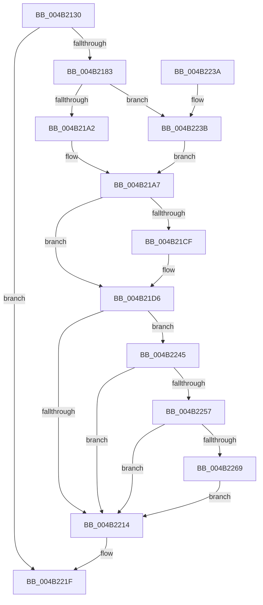

# CcAsyncLazywriteWorkerThread

- RVA: `0x004B2130`–`0x004B2293` (길이 `355` bytes)
- VA: `0x00000001404B2130`
- 실행 섹션: `.text`
- PDB 이름 있음: `예`; PDB Function 태그: `아니요`
- unwind 정보 RVA: `0x000B90B4`
- 디코드: `84`개 명령, `355/355` bytes 표시
- 미해석 바이트: `0` (있으면 어셈블리에 `.byte`로 보존)

> 이 문서는 커널 이미지의 기계어와 PDB 기호를 분석해 생성했습니다. 4번과 5번은 함수 원형과 자료형을 바이너리 사용 방식에서 추정한 C 해석이며 원본 소스 복구 결과는 아닙니다.

## 1. Dependencies

- 직접 호출 지점: **8**; 고유 호출 대상: **6**
- 직접 호출자로 확인된 함수: **0**
- RIP 상대 이미지 참조: **0**

### Outgoing calls
- `0x004B21A2` → [CcAsyncLazywriteWorker](../35/CcAsyncLazywriteWorker_function_00354C28.md) (function, `0x00354C28`)
- `0x004B21C1` → [KeAcquireInStackQueuedSpinLock](../27/KeAcquireInStackQueuedSpinLock_function_002757A0.md) (function, `0x002757A0`)
- `0x004B21F7` → [KeReleaseInStackQueuedSpinLock](../34/KeReleaseInStackQueuedSpinLock_function_00342CE0.md) (function, `0x00342CE0`)
- `0x004B221A` → [CcDereferencePartitionAndPrivateVolumeCacheMap](../38/CcDereferencePartitionAndPrivateVolumeCacheMap_function_0038B94C.md) (function, `0x0038B94C`)
- `0x004B223B` → [CcAsyncLazywriteWorkerMulti](../4D/CcAsyncLazywriteWorkerMulti_function_004D1574.md) (function, `0x004D1574`)
- `0x004B2275` → [KeAcquireInStackQueuedSpinLock](../27/KeAcquireInStackQueuedSpinLock_function_002757A0.md) (function, `0x002757A0`)
- `0x004B2282` → [CcNotifyWriteBehindVolume](../3C/CcNotifyWriteBehindVolume_function_003CC134.md) (function, `0x003CC134`)
- `0x004B228C` → [KeReleaseInStackQueuedSpinLock](../34/KeReleaseInStackQueuedSpinLock_function_00342CE0.md) (function, `0x00342CE0`)

### Direct callers
- 이 함수 시작 RVA로 연결되는 직접 call은 확인되지 않았습니다. 간접 호출은 완전히 역산할 수 없습니다.

### Static image references
- 디코드된 RIP-relative 메모리 참조가 없습니다.

## 2. Other-region calls and transfers

- 다른 실행 섹션으로 향하는 call: **0**
- 별도 외부 분기/꼬리 이동을 확인하지 못했습니다.

## 3. Assembly (complete function range)

```asm
004B2130  4C 8B DC                        mov r11, rsp
004B2133  49 89 5B 08                     mov qword ptr [r11 + 8], rbx
004B2137  49 89 6B 10                     mov qword ptr [r11 + 0x10], rbp
004B213B  49 89 73 18                     mov qword ptr [r11 + 0x18], rsi
004B213F  49 89 7B 20                     mov qword ptr [r11 + 0x20], rdi
004B2143  41 56                           push r14
004B2145  48 83 EC 50                     sub rsp, 0x50
004B2149  48 8B 71 48                     mov rsi, qword ptr [rcx + 0x48]
004B214D  33 C0                           xor eax, eax
004B214F  83 79 20 07                     cmp dword ptr [rcx + 0x20], 7
004B2153  0F 57 C0                        xorps xmm0, xmm0
004B2156  48 8B 69 38                     mov rbp, qword ptr [rcx + 0x38]
004B215A  0F 57 C9                        xorps xmm1, xmm1
004B215D  48 8B 79 40                     mov rdi, qword ptr [rcx + 0x40]
004B2161  48 8B D9                        mov rbx, rcx
004B2164  0F 11 44 24 20                  movups xmmword ptr [rsp + 0x20], xmm0
004B2169  4C 8D B6 20 01 00 00            lea r14, [rsi + 0x120]
004B2170  49 89 43 D8                     mov qword ptr [r11 - 0x28], rax
004B2174  0F 11 4C 24 38                  movups xmmword ptr [rsp + 0x38], xmm1
004B2179  49 89 43 F0                     mov qword ptr [r11 - 0x10], rax
004B217D  0F 85 9C 00 00 00               jne 0x1404b221f
004B2183  8B 49 28                        mov ecx, dword ptr [rcx + 0x28]
004B2186  48 8B 86 60 01 00 00            mov rax, qword ptr [rsi + 0x160]
004B218D  83 24 88 00                     and dword ptr [rax + rcx*4], 0
004B2191  48 8B CB                        mov rcx, rbx
004B2194  8B 87 50 06 00 00               mov eax, dword ptr [rdi + 0x650]
004B219A  A8 02                           test al, 2
004B219C  0F 85 99 00 00 00               jne 0x1404b223b
004B21A2  E8 81 2A EA FF                  call 0x140354c28
004B21A7  8B 4B 28                        mov ecx, dword ptr [rbx + 0x28]
004B21AA  48 8D 54 24 20                  lea rdx, [rsp + 0x20]
004B21AF  48 8B 86 60 01 00 00            mov rax, qword ptr [rsi + 0x160]
004B21B6  83 0C 88 FF                     or dword ptr [rax + rcx*4], 0xffffffff
004B21BA  48 8D 8D 40 03 00 00            lea rcx, [rbp + 0x340]
004B21C1  E8 DA 35 DC FF                  call 0x1402757a0
004B21C6  49 8B 46 08                     mov rax, qword ptr [r14 + 8]
004B21CA  4C 39 30                        cmp qword ptr [rax], r14
004B21CD  74 07                           je 0x1404b21d6
004B21CF  B9 03 00 00 00                  mov ecx, 3
004B21D4  CD 29                           int 0x29
004B21D6  48 89 43 08                     mov qword ptr [rbx + 8], rax
004B21DA  48 8D 4C 24 20                  lea rcx, [rsp + 0x20]
004B21DF  4C 89 33                        mov qword ptr [rbx], r14
004B21E2  48 89 18                        mov qword ptr [rax], rbx
004B21E5  49 89 5E 08                     mov qword ptr [r14 + 8], rbx
004B21E9  8B 86 30 01 00 00               mov eax, dword ptr [rsi + 0x130]
004B21EF  FF C8                           dec eax
004B21F1  89 86 30 01 00 00               mov dword ptr [rsi + 0x130], eax
004B21F7  E8 E4 0A E9 FF                  call 0x140342ce0
004B21FC  49 B8 14 00 00 00 80 F7 FF FF   movabs r8, 0xfffff78000000014
004B2206  4D 8B 00                        mov r8, qword ptr [r8]
004B2209  8B 86 30 01 00 00               mov eax, dword ptr [rsi + 0x130]
004B220F  83 F8 01                        cmp eax, 1
004B2212  76 31                           jbe 0x1404b2245
004B2214  48 8B D7                        mov rdx, rdi
004B2217  48 8B CD                        mov rcx, rbp
004B221A  E8 2D 97 ED FF                  call 0x14038b94c
004B221F  48 8B 5C 24 60                  mov rbx, qword ptr [rsp + 0x60]
004B2224  48 8B 6C 24 68                  mov rbp, qword ptr [rsp + 0x68]
004B2229  48 8B 74 24 70                  mov rsi, qword ptr [rsp + 0x70]
004B222E  48 8B 7C 24 78                  mov rdi, qword ptr [rsp + 0x78]
004B2233  48 83 C4 50                     add rsp, 0x50
004B2237  41 5E                           pop r14
004B2239  C3                              ret
004B223A  CC                              int3
004B223B  E8 34 F3 01 00                  call 0x1404d1574
004B2240  E9 62 FF FF FF                  jmp 0x1404b21a7
004B2245  48 8B 97 E0 03 00 00            mov rdx, qword ptr [rdi + 0x3e0]
004B224C  8B 87 10 04 00 00               mov eax, dword ptr [rdi + 0x410]
004B2252  48 3B D0                        cmp rdx, rax
004B2255  72 BD                           jb 0x1404b2214
004B2257  48 8B 87 40 06 00 00            mov rax, qword ptr [rdi + 0x640]
004B225E  48 05 40 4B 4C 00               add rax, 0x4c4b40
004B2264  4C 3B C0                        cmp r8, rax
004B2267  7C AB                           jl 0x1404b2214
004B2269  48 8D 8D 00 03 00 00            lea rcx, [rbp + 0x300]
004B2270  48 8D 54 24 38                  lea rdx, [rsp + 0x38]
004B2275  E8 26 35 DC FF                  call 0x1402757a0
004B227A  BA 20 00 00 00                  mov edx, 0x20
004B227F  48 8B CF                        mov rcx, rdi
004B2282  E8 AD 9E F1 FF                  call 0x1403cc134
004B2287  48 8D 4C 24 38                  lea rcx, [rsp + 0x38]
004B228C  E8 4F 0A E9 FF                  call 0x140342ce0
004B2291  EB 81                           jmp 0x1404b2214
```

## 4. C-style interpretation (structured pseudocode)

```c
__int64 __fastcall CcAsyncLazywriteWorkerThread(__int64 a1)
{
    __int64 result;
    __int64 v_rsp;
    unsigned __int64 v_stack_m20;
    unsigned __int64 v_stack_m38;
    unsigned __int64 v_stack_p10;
    unsigned __int64 v_stack_p18;
    unsigned __int64 v_stack_p20;
    unsigned __int64 v_stack_p38;
    unsigned __int64 v_stack_p8;

    *(unsigned __int64 *)(v_rsp + 8) = v_rbx;
    *(unsigned __int64 *)(v_rsp + 16) = v_rbp;
    *(unsigned __int64 *)(v_rsp + 24) = v_rsi;
    *(unsigned __int64 *)(v_rsp + 32) = v_rdi;
    v_rsp = (v_rsp) - (80);
    result = 0;
    v_stack_m38 = v_xmm0;
    *(unsigned __int64 *)(v_rsp - 40) = 0;
    v_stack_m20 = v_xmm1;
    *(unsigned __int64 *)(v_rsp - 16) = 0;
    if ((*(unsigned int *)(a1 + 32)) != 7) goto loc_004B221F;
    if ((((unsigned __int8)((unsigned int)(*(unsigned int *)(*(unsigned __int64 *)(a1 + 64) + 1616)))) & (2)) != 0) goto loc_004B223B;
    result = CcAsyncLazywriteWorker(a1, a2, a3, a4);
loc_004B21A7:
    result = KeAcquireInStackQueuedSpinLock(*(unsigned __int64 *)(a1 + 56) + 832, v_stack_m38, a3, a4);
    if ((*(unsigned __int64 *)(*(unsigned __int64 *)(*(unsigned __int64 *)(a1 + 72) + 288 + 8))) != (*(unsigned __int64 *)(a1 + 72) + 288)) {
        a1 = 3;
    }
    *(unsigned __int64 *)(a1 + 8) = *(unsigned __int64 *)(*(unsigned __int64 *)(a1 + 72) + 288 + 8);
    *(unsigned __int64 *)(a1) = *(unsigned __int64 *)(a1 + 72) + 288;
    *(unsigned __int64 *)(*(unsigned __int64 *)(*(unsigned __int64 *)(a1 + 72) + 288 + 8)) = a1;
    *(unsigned __int64 *)(*(unsigned __int64 *)(a1 + 72) + 288 + 8) = a1;
    result = (unsigned int)(((unsigned int)(*(unsigned int *)(*(unsigned __int64 *)(a1 + 72) + 304))) - 1);
    *(unsigned int *)(*(unsigned __int64 *)(a1 + 72) + 304) = (unsigned int)(result);
    result = KeReleaseInStackQueuedSpinLock(v_stack_m38, v_stack_m38, a3, a4);
    if (((unsigned int)((unsigned int)(*(unsigned int *)(*(unsigned __int64 *)(a1 + 72) + 304)))) <= 1) goto loc_004B2245;
loc_004B2214:
    result = CcDereferencePartitionAndPrivateVolumeCacheMap(*(unsigned __int64 *)(a1 + 56), *(unsigned __int64 *)(a1 + 64), *(unsigned __int64 *)(a3), a4);
loc_004B221F:
    v_rsp = (v_rsp) + (80);
    return result;
loc_004B223B:
    result = CcAsyncLazywriteWorkerMulti(*(unsigned __int64 *)(a1 + 56), *(unsigned __int64 *)(a1 + 64), *(unsigned __int64 *)(a3), a4);
    goto loc_004B21A7;
loc_004B2245:
    if ((*(unsigned __int64 *)(v_stack_p20 + 992)) < ((unsigned int)(*(unsigned int *)(v_stack_p20 + 1040)))) goto loc_004B2214;
    result = (*(unsigned __int64 *)(v_stack_p20 + 1600)) + (0x4C4B40ULL);
    if ((*(unsigned __int64 *)(a3)) < result) goto loc_004B2214;
    result = KeAcquireInStackQueuedSpinLock(v_stack_p10 + 768, v_stack_p38, *(unsigned __int64 *)(a3), a4);
    result = CcNotifyWriteBehindVolume(v_stack_p20, 32, *(unsigned __int64 *)(a3), a4);
    result = KeReleaseInStackQueuedSpinLock(v_stack_p38, 32, *(unsigned __int64 *)(a3), a4);
    goto loc_004B2214;
}
```

## 5. (Beta) C Style

```c
int64_t CcAsyncLazywriteWorkerThread(void *Arg1)
{
    uint8_t *arg1 = (uint8_t *)Arg1;

    int64_t result;
    int64_t local_rsp;
    uint64_t v_stack_m20;
    uint64_t v_stack_m38;
    uint64_t v_stack_p10;
    uint64_t v_stack_p18;
    uint64_t v_stack_p20;
    uint64_t v_stack_p38;
    uint64_t v_stack_p8;

    *(uint64_t *)(local_rsp + 0x8) = local_rbx;
    *(uint64_t *)(local_rsp + 0x10) = local_rbp;
    *(uint64_t *)(local_rsp + 0x18) = local_rsi;
    *(uint64_t *)(local_rsp + 0x20) = local_rdi;
    local_rsp = (local_rsp) - (80);
    result = 0;
    v_stack_m38 = v_xmm0;
    *(uint64_t *)(local_rsp - 0x28) = 0;
    v_stack_m20 = v_xmm1;
    *(uint64_t *)(local_rsp - 0x10) = 0;
    if ((*(uint32_t *)(arg1 + 0x20)) != 7) goto loc_004B221F;
    if ((((uint8_t)((uint32_t)(*(uint32_t *)(*(uint64_t *)(arg1 + 0x40) + 0x650)))) & (2)) != 0) goto loc_004B223B;
    result = CcAsyncLazywriteWorker(Arg1, a2, a3, a4);
loc_004B21A7:
    result = KeAcquireInStackQueuedSpinLock(*(uint64_t *)(arg1 + 0x38) + 832, v_stack_m38, a3, a4);
    if ((*(uint64_t *)(*(uint64_t *)(*(uint64_t *)(arg1 + 0x48) + 0x120 + 0x8))) != (*(uint64_t *)(arg1 + 0x48) + 288)) {
        Arg1 = 3;
    }
    *(uint64_t *)(arg1 + 0x8) = *(uint64_t *)(*(uint64_t *)(arg1 + 0x48) + 0x120 + 0x8);
    *(uint64_t *)(arg1) = *(uint64_t *)(arg1 + 0x48) + 288;
    *(void **)(*(uint64_t *)(*(uint64_t *)(arg1 + 0x48) + 0x120 + 0x8)) = Arg1;
    *(void **)(*(uint64_t *)(arg1 + 0x48) + 0x120 + 0x8) = Arg1;
    result = (uint32_t)(((uint32_t)(*(uint32_t *)(*(uint64_t *)(arg1 + 0x48) + 0x130))) - 1);
    *(uint32_t *)(*(uint64_t *)(arg1 + 0x48) + 0x130) = (uint32_t)(result);
    result = KeReleaseInStackQueuedSpinLock(v_stack_m38, v_stack_m38, a3, a4);
    if (((uint32_t)((uint32_t)(*(uint32_t *)(*(uint64_t *)(arg1 + 0x48) + 0x130)))) <= 1) goto loc_004B2245;
loc_004B2214:
    result = CcDereferencePartitionAndPrivateVolumeCacheMap(*(uint64_t *)(arg1 + 0x38), *(uint64_t *)(arg1 + 0x40), *(uint64_t *)(a3), a4);
loc_004B221F:
    local_rsp = (local_rsp) + (80);
    return result;
loc_004B223B:
    result = CcAsyncLazywriteWorkerMulti(*(uint64_t *)(arg1 + 0x38), *(uint64_t *)(arg1 + 0x40), *(uint64_t *)(a3), a4);
    goto loc_004B21A7;
loc_004B2245:
    if ((*(uint64_t *)(v_stack_p20 + 0x3E0)) < ((uint32_t)(*(uint32_t *)(v_stack_p20 + 0x410)))) goto loc_004B2214;
    result = (*(uint64_t *)(v_stack_p20 + 0x640)) + (0x4C4B40ULL);
    if ((*(uint64_t *)(a3)) < result) goto loc_004B2214;
    result = KeAcquireInStackQueuedSpinLock(v_stack_p10 + 768, v_stack_p38, *(uint64_t *)(a3), a4);
    result = CcNotifyWriteBehindVolume(v_stack_p20, 32, *(uint64_t *)(a3), a4);
    result = KeReleaseInStackQueuedSpinLock(v_stack_p38, 32, *(uint64_t *)(a3), a4);
    goto loc_004B2214;
}
```

### 관측된 메모리 오프셋

구조체 형식이 확인되지 않은 접근은 인자 기준의 오프셋으로만 기록했습니다.

| 기준 인자 | 오프셋 표현 | 폭 (bit) | 접근 |
|---|---:|---:|---|
| `Arg1` | `+ 0x0` | `64` | `W` |
| `Arg1` | `+ 0x8` | `64` | `W` |
| `Arg1` | `+ 0x20` | `32` | `R` |
| `Arg1` | `+ 0x28` | `32` | `R` |
| `Arg1` | `+ 0x38` | `64` | `R` |
| `Arg1` | `+ 0x40` | `64` | `R` |
| `Arg1` | `+ 0x48` | `64` | `R` |

## 6. Execution-region graph

[열기: 2D/3D 그래프와 함수 탐색 컨트롤 패널](../../../control-panel.html?section=text&rva=0x004B2130&view=graph)

- 2D 그래프는 위에서 아래로 흐르고, 3D 그래프는 빈 공간을 드래그해 회전합니다. Shift+드래그는 이동, 휠은 확대·축소, 함수 노드 선택은 대상 보고서 이동입니다.

### Static fallback


