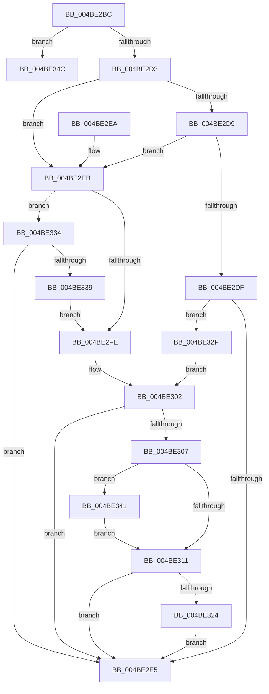

# CcChargeThreadForReadAhead

- RVA: `0x004BE2BC`–`0x004BE36B` (길이 `175` bytes)
- VA: `0x00000001404BE2BC`
- 실행 섹션: `.text`
- PDB 이름 있음: `예`; PDB Function 태그: `아니요`
- unwind 정보 RVA: `0x000BC3F8`
- 디코드: `51`개 명령, `175/175` bytes 표시
- 미해석 바이트: `0` (있으면 어셈블리에 `.byte`로 보존)

> 이 문서는 커널 이미지의 기계어와 PDB 기호를 분석해 생성했습니다. 4번과 5번은 함수 원형과 자료형을 바이너리 사용 방식에서 추정한 C 해석이며 원본 소스 복구 결과는 아닙니다.

## 1. Dependencies

- 직접 호출 지점: **1**; 고유 호출 대상: **1**
- 직접 호출자로 확인된 함수: **1**
- RIP 상대 이미지 참조: **0**

### Outgoing calls
- `0x004BE365` → [KeBugCheckEx](../4F/KeBugCheckEx_function_004FD660.md) (function, `0x004FD660`)

### Direct callers
- [CcScheduleReadAheadNuma](../38/CcScheduleReadAheadNuma_function_0038883C.md) at `0x00388B99`
- [CcScheduleReadAheadNuma](../38/CcScheduleReadAheadNuma_function_0038883C.md) at `0x00388CE8`

### Static image references
- 디코드된 RIP-relative 메모리 참조가 없습니다.

## 2. Other-region calls and transfers

- 다른 실행 섹션으로 향하는 call: **0**
- 별도 외부 분기/꼬리 이동을 확인하지 못했습니다.

## 3. Assembly (complete function range)

```asm
004BE2BC  48 83 EC 38                     sub rsp, 0x38
004BE2C0  48 8B 41 28                     mov rax, qword ptr [rcx + 0x28]
004BE2C4  48 8B 51 30                     mov rdx, qword ptr [rcx + 0x30]
004BE2C8  48 8B 40 08                     mov rax, qword ptr [rax + 8]
004BE2CC  8B 40 04                        mov eax, dword ptr [rax + 4]
004BE2CF  85 C0                           test eax, eax
004BE2D1  74 79                           je 0x1404be34c
004BE2D3  41 83 E9 01                     sub r9d, 1
004BE2D7  74 12                           je 0x1404be2eb
004BE2D9  41 83 E9 01                     sub r9d, 1
004BE2DD  74 0C                           je 0x1404be2eb
004BE2DF  41 83 F9 01                     cmp r9d, 1
004BE2E3  74 4A                           je 0x1404be32f
004BE2E5  48 83 C4 38                     add rsp, 0x38
004BE2E9  C3                              ret
004BE2EA  CC                              int3
004BE2EB  8B 4A 34                        mov ecx, dword ptr [rdx + 0x34]
004BE2EE  4C 8B 42 38                     mov r8, qword ptr [rdx + 0x38]
004BE2F2  48 8B 42 48                     mov rax, qword ptr [rdx + 0x48]
004BE2F6  4C 03 C1                        add r8, rcx
004BE2F9  48 85 C0                        test rax, rax
004BE2FC  75 36                           jne 0x1404be334
004BE2FE  4C 87 42 48                     xchg qword ptr [rdx + 0x48], r8
004BE302  48 85 C9                        test rcx, rcx
004BE305  74 DE                           je 0x1404be2e5
004BE307  48 8B 44 24 60                  mov rax, qword ptr [rsp + 0x60]
004BE30C  48 85 C0                        test rax, rax
004BE30F  74 30                           je 0x1404be341
004BE311  48 8B 80 20 02 00 00            mov rax, qword ptr [rax + 0x220]
004BE318  48 8B 90 38 06 00 00            mov rdx, qword ptr [rax + 0x638]
004BE31F  48 85 D2                        test rdx, rdx
004BE322  74 C1                           je 0x1404be2e5
004BE324  F0 48 01 0A                     lock add qword ptr [rdx], rcx
004BE328  F0 48 FF 42 10                  lock inc qword ptr [rdx + 0x10]
004BE32D  EB B6                           jmp 0x1404be2e5
004BE32F  8B 4A 34                        mov ecx, dword ptr [rdx + 0x34]
004BE332  EB CE                           jmp 0x1404be302
004BE334  4C 3B C0                        cmp r8, rax
004BE337  76 AC                           jbe 0x1404be2e5
004BE339  49 8B C8                        mov rcx, r8
004BE33C  48 2B C8                        sub rcx, rax
004BE33F  EB BD                           jmp 0x1404be2fe
004BE341  65 48 8B 04 25 88 01 00 00      mov rax, qword ptr gs:[0x188]
004BE34A  EB C5                           jmp 0x1404be311
004BE34C  48 83 64 24 20 00               and qword ptr [rsp + 0x20], 0
004BE352  45 33 C9                        xor r9d, r9d
004BE355  BA 13 06 00 00                  mov edx, 0x613
004BE35A  49 C7 C0 20 04 00 C0            mov r8, 0xffffffffc0000420
004BE361  41 8D 49 34                     lea ecx, [r9 + 0x34]
004BE365  E8 F6 F2 03 00                  call 0x1404fd660
004BE36A  CC                              int3
```

## 4. C-style interpretation (structured pseudocode)

```c
__int64 __fastcall CcChargeThreadForReadAhead(__int64 a1, __int64 a2, __int64 a3, int a4, __int64 a5)
{
    __int64 result;
    __int64 v_rsp;
    unsigned __int64 v_stack_p20;

    v_rsp = (v_rsp) - (56);
    if ((unsigned int)((unsigned int)(*(unsigned int *)(*(unsigned __int64 *)(*(unsigned __int64 *)(a1 + 40) + 8) + 4))) == 0) goto loc_004BE34C;
    a4 = (unsigned int)((a4) - (1));
    if (condition_is_equal) goto loc_004BE2EB;
    a4 = (unsigned int)((a4) - (1));
    if (condition_is_equal) goto loc_004BE2EB;
    if (a4 == 1) goto loc_004BE32F;
loc_004BE2E5:
    v_rsp = (v_rsp) + (56);
    return (unsigned int)(*(unsigned int *)(*(unsigned __int64 *)(*(unsigned __int64 *)(a1 + 40) + 8) + 4));
loc_004BE2EB:
    a3 = (*(unsigned __int64 *)(*(unsigned __int64 *)(a1 + 48) + 56)) + ((unsigned int)(*(unsigned int *)(*(unsigned __int64 *)(a1 + 48) + 52)));
    if (*(unsigned __int64 *)(*(unsigned __int64 *)(a1 + 48) + 72) != 0) goto loc_004BE334;
loc_004BE2FE:
loc_004BE302:
    if ((unsigned int)(*(unsigned int *)(*(unsigned __int64 *)(a1 + 48) + 52)) == 0) goto loc_004BE2E5;
    if (a5 == 0) goto loc_004BE341;
loc_004BE311:
    if (*(unsigned __int64 *)(*(unsigned __int64 *)(a5 + 544) + 1592) == 0) goto loc_004BE2E5;
    goto loc_004BE2E5;
loc_004BE32F:
    goto loc_004BE302;
loc_004BE334:
    if (a3 <= (*(unsigned __int64 *)(a5 + 544))) goto loc_004BE2E5;
    a1 = (a3) - (*(unsigned __int64 *)(a5 + 544));
    goto loc_004BE2FE;
loc_004BE341:
    goto loc_004BE311;
loc_004BE34C:
    a4 = 0;
    result = KeBugCheckEx(a4 + 52, (unsigned int)(0x613ULL), 0xFFFFFFFFC0000420ULL, a4);
    return result;
}
```

## 5. (Beta) C Style

```c
int64_t CcChargeThreadForReadAhead(void *Arg1, int64_t Arg2, int64_t Arg3, int32_t Arg4, int64_t Arg5)
{
    uint8_t *arg1 = (uint8_t *)Arg1;

    int64_t result;
    int64_t local_rsp;
    uint64_t v_stack_p20;

    local_rsp = (local_rsp) - (56);
    if ((uint32_t)((uint32_t)(*(uint32_t *)(*(uint64_t *)(*(uint64_t *)(arg1 + 0x28) + 0x8) + 0x4))) == 0) goto loc_004BE34C;
    Arg4 = (uint32_t)((Arg4) - (1));
    if (condition_is_equal) goto loc_004BE2EB;
    Arg4 = (uint32_t)((Arg4) - (1));
    if (condition_is_equal) goto loc_004BE2EB;
    if (Arg4 == 1) goto loc_004BE32F;
loc_004BE2E5:
    local_rsp = (local_rsp) + (56);
    return (uint32_t)(*(uint32_t *)(*(uint64_t *)(*(uint64_t *)(arg1 + 0x28) + 0x8) + 0x4));
loc_004BE2EB:
    Arg3 = (*(uint64_t *)(*(uint64_t *)(arg1 + 0x30) + 0x38)) + ((uint32_t)(*(uint32_t *)(*(uint64_t *)(arg1 + 0x30) + 0x34)));
    if (*(uint64_t *)(*(uint64_t *)(arg1 + 0x30) + 0x48) != 0) goto loc_004BE334;
loc_004BE2FE:
loc_004BE302:
    if ((uint32_t)(*(uint32_t *)(*(uint64_t *)(arg1 + 0x30) + 0x34)) == 0) goto loc_004BE2E5;
    if (Arg5 == 0) goto loc_004BE341;
loc_004BE311:
    if (*(uint64_t *)(*(uint64_t *)(Arg5 + 0x220) + 0x638) == 0) goto loc_004BE2E5;
    goto loc_004BE2E5;
loc_004BE32F:
    goto loc_004BE302;
loc_004BE334:
    if (Arg3 <= (*(uint64_t *)(Arg5 + 0x220))) goto loc_004BE2E5;
    Arg1 = (Arg3) - (*(uint64_t *)(Arg5 + 0x220));
    goto loc_004BE2FE;
loc_004BE341:
    goto loc_004BE311;
loc_004BE34C:
    Arg4 = 0;
    result = KeBugCheckEx(Arg4 + 52, (uint32_t)(0x613ULL), 0xFFFFFFFFC0000420ULL, Arg4);
    return result;
}
```

### 관측된 메모리 오프셋

구조체 형식이 확인되지 않은 접근은 인자 기준의 오프셋으로만 기록했습니다.

| 기준 인자 | 오프셋 표현 | 폭 (bit) | 접근 |
|---|---:|---:|---|
| `Arg1` | `+ 0x28` | `64` | `R` |
| `Arg1` | `+ 0x30` | `64` | `R` |

## 6. Execution-region graph

[열기: 2D/3D 그래프와 함수 탐색 컨트롤 패널](../../../control-panel.html?section=text&rva=0x004BE2BC&view=graph)

- 2D 그래프는 위에서 아래로 흐르고, 3D 그래프는 빈 공간을 드래그해 회전합니다. Shift+드래그는 이동, 휠은 확대·축소, 함수 노드 선택은 대상 보고서 이동입니다.

### Static fallback


