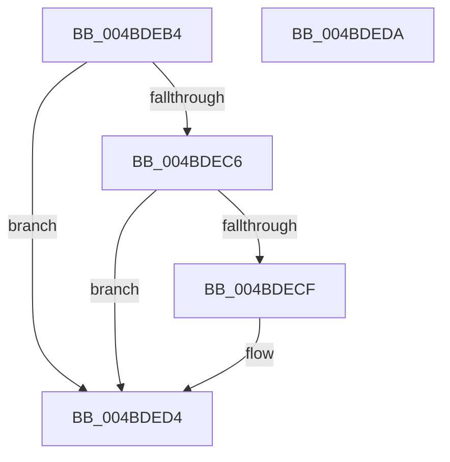

# CcCopyReadExceptionFilter

- RVA: `0x004BDEB4`–`0x004BDEDB` (길이 `39` bytes)
- VA: `0x00000001404BDEB4`
- 실행 섹션: `.text`
- PDB 이름 있음: `예`; PDB Function 태그: `아니요`
- unwind 정보 RVA: `0x000DB714`
- 디코드: `13`개 명령, `39/39` bytes 표시
- 미해석 바이트: `0` (있으면 어셈블리에 `.byte`로 보존)

> 이 문서는 커널 이미지의 기계어와 PDB 기호를 분석해 생성했습니다. 4번과 5번은 함수 원형과 자료형을 바이너리 사용 방식에서 추정한 C 해석이며 원본 소스 복구 결과는 아닙니다.

## 1. Dependencies

- 직접 호출 지점: **0**; 고유 호출 대상: **0**
- 직접 호출자로 확인된 함수: **3**
- RIP 상대 이미지 참조: **0**

### Outgoing calls
- 직접 디코드된 call 명령이 없습니다.

### Direct callers
- [CcMapAndCopyInToCache$filt$0](../6D/CcMapAndCopyInToCache_filt_0_function_006D2AD8.md) at `0x006D2AEC`
- [CcCopyBytesToUserBuffer$filt$0](../6D/CcCopyBytesToUserBuffer_filt_0_function_006D2CC0.md) at `0x006D2CCD`
- [CcCompleteAsyncRead$filt$0](../6D/CcCompleteAsyncRead_filt_0_function_006D3366.md) at `0x006D337A`

### Static image references
- 디코드된 RIP-relative 메모리 참조가 없습니다.

## 2. Other-region calls and transfers

- 다른 실행 섹션으로 향하는 call: **0**
- 별도 외부 분기/꼬리 이동을 확인하지 못했습니다.

## 3. Assembly (complete function range)

```asm
004BDEB4  48 8B 01                        mov rax, qword ptr [rcx]
004BDEB7  44 8B 00                        mov r8d, dword ptr [rax]
004BDEBA  44 89 02                        mov dword ptr [rdx], r8d
004BDEBD  41 81 F8 06 00 00 C0            cmp r8d, 0xc0000006
004BDEC4  75 0E                           jne 0x1404bded4
004BDEC6  48 8B 01                        mov rax, qword ptr [rcx]
004BDEC9  83 78 18 03                     cmp dword ptr [rax + 0x18], 3
004BDECD  72 05                           jb 0x1404bded4
004BDECF  8B 40 30                        mov eax, dword ptr [rax + 0x30]
004BDED2  89 02                           mov dword ptr [rdx], eax
004BDED4  B8 01 00 00 00                  mov eax, 1
004BDED9  C3                              ret
004BDEDA  CC                              int3
```

## 4. C-style interpretation (structured pseudocode)

```c
__int64 __fastcall CcCopyReadExceptionFilter(__int64 a1, __int64 a2)
{
    __int64 result;

    *(unsigned int *)(a2) = (unsigned int)((unsigned int)(*(unsigned int *)(*(unsigned __int64 *)(a1))));
    if (((unsigned int)((unsigned int)(*(unsigned int *)(*(unsigned __int64 *)(a1))))) != 0xC0000006ULL) goto loc_004BDED4;
    result = *(unsigned __int64 *)(a1);
    if ((*(unsigned int *)(*(unsigned __int64 *)(a1) + 24)) >= 3) {
        result = *(unsigned int *)(*(unsigned __int64 *)(a1) + 48);
        *(unsigned int *)(a2) = (unsigned int)(result);
    }
    return 1;
}
```

## 5. (Beta) C Style

```c
int64_t CcCopyReadExceptionFilter(void *Arg1, void *Arg2)
{
    uint8_t *arg1 = (uint8_t *)Arg1;
    uint8_t *arg2 = (uint8_t *)Arg2;

    int64_t result;

    *(uint32_t *)(arg2) = (uint32_t)((uint32_t)(*(uint32_t *)(*(uint64_t *)(arg1))));
    if (((uint32_t)((uint32_t)(*(uint32_t *)(*(uint64_t *)(arg1))))) != 0xC0000006ULL) goto loc_004BDED4;
    result = *(uint64_t *)(arg1);
    if ((*(uint32_t *)(*(uint64_t *)(arg1) + 0x18)) >= 3) {
        result = *(uint32_t *)(*(uint64_t *)(arg1) + 0x30);
        *(uint32_t *)(arg2) = (uint32_t)(result);
    }
    return 1;
}
```

### 관측된 메모리 오프셋

구조체 형식이 확인되지 않은 접근은 인자 기준의 오프셋으로만 기록했습니다.

| 기준 인자 | 오프셋 표현 | 폭 (bit) | 접근 |
|---|---:|---:|---|
| `Arg1` | `+ 0x0` | `64` | `R` |
| `Arg2` | `+ 0x0` | `32` | `W` |

## 6. Execution-region graph

[열기: 2D/3D 그래프와 함수 탐색 컨트롤 패널](../../../control-panel.html?section=text&rva=0x004BDEB4&view=graph)

- 2D 그래프는 위에서 아래로 흐르고, 3D 그래프는 빈 공간을 드래그해 회전합니다. Shift+드래그는 이동, 휠은 확대·축소, 함수 노드 선택은 대상 보고서 이동입니다.

### Static fallback


