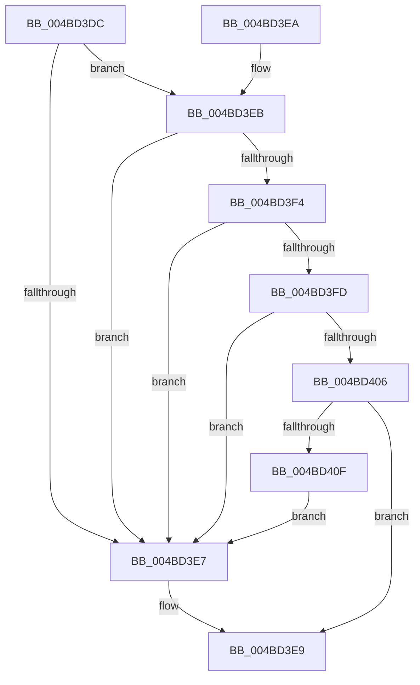

# CcHasGlobalTelemetryChanged

- RVA: `0x004BD3DC`–`0x004BD411` (길이 `53` bytes)
- VA: `0x00000001404BD3DC`
- 실행 섹션: `.text`
- PDB 이름 있음: `예`; PDB Function 태그: `아니요`
- unwind 정보 RVA: `0x000DB714`
- 디코드: `15`개 명령, `53/53` bytes 표시
- 미해석 바이트: `0` (있으면 어셈블리에 `.byte`로 보존)

> 이 문서는 커널 이미지의 기계어와 PDB 기호를 분석해 생성했습니다. 4번과 5번은 함수 원형과 자료형을 바이너리 사용 방식에서 추정한 C 해석이며 원본 소스 복구 결과는 아닙니다.

## 1. Dependencies

- 직접 호출 지점: **0**; 고유 호출 대상: **0**
- 직접 호출자로 확인된 함수: **1**
- RIP 상대 이미지 참조: **5**

### Outgoing calls
- 직접 디코드된 call 명령이 없습니다.

### Direct callers
- [CcTelemetryPeriodicTimerCallback](../../page/A8/CcTelemetryPeriodicTimerCallback_function_00A88370.md) at `0x00A883C8`

### Static image references
- `0x004BD3DE` → RVA `0x00F8F2C0` (`.data`; read)
- `0x004BD3EB` → RVA `0x00F8F2C8` (`.data`; read)
- `0x004BD3F4` → RVA `0x00F8F2D0` (`.data`; read)
- `0x004BD3FD` → RVA `0x00F8F2D8` (`.data`; read)
- `0x004BD406` → RVA `0x00F8F2E0` (`.data`; read)

## 2. Other-region calls and transfers

- 다른 실행 섹션으로 향하는 call: **0**
- 별도 외부 분기/꼬리 이동을 확인하지 못했습니다.

## 3. Assembly (complete function range)

```asm
004BD3DC  33 C0                           xor eax, eax
004BD3DE  48 39 05 DB 1E AD 00            cmp qword ptr [rip + 0xad1edb], rax
004BD3E5  76 04                           jbe 0x1404bd3eb
004BD3E7  B0 01                           mov al, 1
004BD3E9  C3                              ret
004BD3EA  CC                              int3
004BD3EB  48 39 05 D6 1E AD 00            cmp qword ptr [rip + 0xad1ed6], rax
004BD3F2  77 F3                           ja 0x1404bd3e7
004BD3F4  48 39 05 D5 1E AD 00            cmp qword ptr [rip + 0xad1ed5], rax
004BD3FB  77 EA                           ja 0x1404bd3e7
004BD3FD  48 39 05 D4 1E AD 00            cmp qword ptr [rip + 0xad1ed4], rax
004BD404  77 E1                           ja 0x1404bd3e7
004BD406  48 39 05 D3 1E AD 00            cmp qword ptr [rip + 0xad1ed3], rax
004BD40D  76 DA                           jbe 0x1404bd3e9
004BD40F  EB D6                           jmp 0x1404bd3e7
```

## 4. C-style interpretation (structured pseudocode)

```c
__int64 __fastcall CcHasGlobalTelemetryChanged(void)
{
    __int64 result;

    result = 0;
    if ((*(unsigned __int64 *)(v_rip + 11345627)) <= 0) goto loc_004BD3EB;
loc_004BD3E7:
loc_004BD3E9:
    return 1;
loc_004BD3EB:
    if ((*(unsigned __int64 *)(v_rip + 11345622)) > 1) goto loc_004BD3E7;
    if ((*(unsigned __int64 *)(v_rip + 11345621)) > 1) goto loc_004BD3E7;
    if ((*(unsigned __int64 *)(v_rip + 11345620)) > 1) goto loc_004BD3E7;
    if ((*(unsigned __int64 *)(v_rip + 11345619)) <= 1) goto loc_004BD3E9;
    goto loc_004BD3E7;
}
```

## 5. (Beta) C Style

```c
void CcHasGlobalTelemetryChanged(void)
{
    int64_t result;

    result = 0;
    if ((*(uint64_t *)(v_rip + 0xAD1EDB)) <= 0) goto loc_004BD3EB;
loc_004BD3E7:
loc_004BD3E9:
    return 1;
loc_004BD3EB:
    if ((*(uint64_t *)(v_rip + 0xAD1ED6)) > 1) goto loc_004BD3E7;
    if ((*(uint64_t *)(v_rip + 0xAD1ED5)) > 1) goto loc_004BD3E7;
    if ((*(uint64_t *)(v_rip + 0xAD1ED4)) > 1) goto loc_004BD3E7;
    if ((*(uint64_t *)(v_rip + 0xAD1ED3)) <= 1) goto loc_004BD3E9;
    goto loc_004BD3E7;
}
```

## 6. Execution-region graph

[열기: 2D/3D 그래프와 함수 탐색 컨트롤 패널](../../../control-panel.html?section=text&rva=0x004BD3DC&view=graph)

- 2D 그래프는 위에서 아래로 흐르고, 3D 그래프는 빈 공간을 드래그해 회전합니다. Shift+드래그는 이동, 휠은 확대·축소, 함수 노드 선택은 대상 보고서 이동입니다.

### Static fallback


