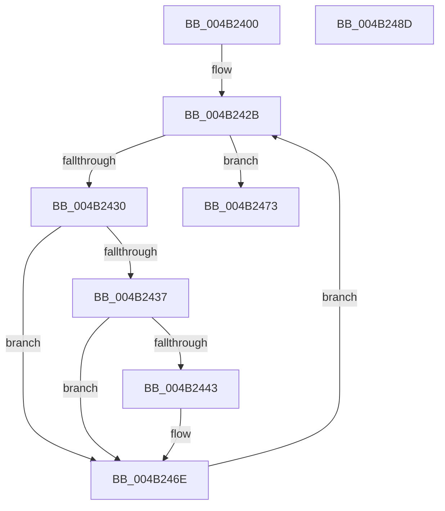

# CcPerfLogLoggedStreamsStats

- RVA: `0x004B2400`–`0x004B248E` (길이 `142` bytes)
- VA: `0x00000001404B2400`
- 실행 섹션: `.text`
- PDB 이름 있음: `예`; PDB Function 태그: `아니요`
- unwind 정보 RVA: `0x00066400`
- 디코드: `36`개 명령, `142/142` bytes 표시
- 미해석 바이트: `0` (있으면 어셈블리에 `.byte`로 보존)

> 이 문서는 커널 이미지의 기계어와 PDB 기호를 분석해 생성했습니다. 4번과 5번은 함수 원형과 자료형을 바이너리 사용 방식에서 추정한 C 해석이며 원본 소스 복구 결과는 아닙니다.

## 1. Dependencies

- 직접 호출 지점: **3**; 고유 호출 대상: **3**
- 직접 호출자로 확인된 함수: **2**
- RIP 상대 이미지 참조: **1**

### Outgoing calls
- `0x004B2418` → [KeRcuReadLock](../38/KeRcuReadLock_function_0038A1A0.md) (function, `0x0038A1A0`)
- `0x004B2461` → [CcPerfLogVolumeLogHandleInfo](CcPerfLogVolumeLogHandleInfo_function_004B2494.md) (function, `0x004B2494`)
- `0x004B2473` → [KeRcuReadUnlock](../38/KeRcuReadUnlock_function_0038A070.md) (function, `0x0038A070`)

### Direct callers
- [CcLazyWriteScanVolume](../38/CcLazyWriteScanVolume_function_00388DC0.md) at `0x0038957C`
- [CcLazyWriteScan](../3C/CcLazyWriteScan_function_003C9394.md) at `0x003C9AA7`

### Static image references
- `0x004B241D` → RVA `0x00F8F560` (`.data`; read)

## 2. Other-region calls and transfers

- 다른 실행 섹션으로 향하는 call: **0**
- 별도 외부 분기/꼬리 이동을 확인하지 못했습니다.

## 3. Assembly (complete function range)

```asm
004B2400  48 89 5C 24 08                  mov qword ptr [rsp + 8], rbx
004B2405  48 89 6C 24 10                  mov qword ptr [rsp + 0x10], rbp
004B240A  48 89 74 24 18                  mov qword ptr [rsp + 0x18], rsi
004B240F  57                              push rdi
004B2410  48 83 EC 30                     sub rsp, 0x30
004B2414  8B FA                           mov edi, edx
004B2416  8B F1                           mov esi, ecx
004B2418  E8 83 7D ED FF                  call 0x14038a1a0
004B241D  48 8B 1D 3C D1 AD 00            mov rbx, qword ptr [rip + 0xadd13c]
004B2424  48 8D 2D 35 D1 AD 00            lea rbp, [rip + 0xadd135]
004B242B  48 3B DD                        cmp rbx, rbp
004B242E  74 43                           je 0x1404b2473
004B2430  48 83 7B 18 00                  cmp qword ptr [rbx + 0x18], 0
004B2435  74 37                           je 0x1404b246e
004B2437  48 8B 8B 98 00 00 00            mov rcx, qword ptr [rbx + 0x98]
004B243E  48 85 C9                        test rcx, rcx
004B2441  74 2B                           je 0x1404b246e
004B2443  48 8B 43 48                     mov rax, qword ptr [rbx + 0x48]
004B2447  44 8B C7                        mov r8d, edi
004B244A  4C 8B 8B 88 00 00 00            mov r9, qword ptr [rbx + 0x88]
004B2451  8B D6                           mov edx, esi
004B2453  48 89 44 24 28                  mov qword ptr [rsp + 0x28], rax
004B2458  48 8B 43 30                     mov rax, qword ptr [rbx + 0x30]
004B245C  48 89 44 24 20                  mov qword ptr [rsp + 0x20], rax
004B2461  E8 2E 00 00 00                  call 0x1404b2494
004B2466  48 83 A3 98 00 00 00 00         and qword ptr [rbx + 0x98], 0
004B246E  48 8B 1B                        mov rbx, qword ptr [rbx]
004B2471  EB B8                           jmp 0x1404b242b
004B2473  E8 F8 7B ED FF                  call 0x14038a070
004B2478  48 8B 5C 24 40                  mov rbx, qword ptr [rsp + 0x40]
004B247D  48 8B 6C 24 48                  mov rbp, qword ptr [rsp + 0x48]
004B2482  48 8B 74 24 50                  mov rsi, qword ptr [rsp + 0x50]
004B2487  48 83 C4 30                     add rsp, 0x30
004B248B  5F                              pop rdi
004B248C  C3                              ret
004B248D  CC                              int3
```

## 4. C-style interpretation (structured pseudocode)

```c
__int64 __fastcall CcPerfLogLoggedStreamsStats(int a1, int a2)
{
    __int64 result;
    __int64 v_rsp;
    unsigned __int64 v_stack_m10;
    unsigned __int64 v_stack_m18;
    unsigned __int64 v_stack_p10;
    unsigned __int64 v_stack_p18;
    unsigned __int64 v_stack_p8;

    v_stack_p8 = v_rbx;
    v_stack_p10 = v_rbp;
    v_stack_p18 = v_rsi;
    v_rsp = (v_rsp) - (48);
    result = KeRcuReadLock(a1, a2, a3, a4);
loc_004B242B:
    if ((*(unsigned __int64 *)(v_rip + 11391292)) == (v_rip + 11391285)) goto loc_004B2473;
    if ((*(unsigned __int64 *)(*(unsigned __int64 *)(v_rip + 11391292) + 24)) == 0) goto loc_004B246E;
    if (*(unsigned __int64 *)(*(unsigned __int64 *)(v_rip + 11391292) + 152) != 0) {
        result = *(unsigned __int64 *)(*(unsigned __int64 *)(v_rip + 11391292) + 72);
        a3 = (unsigned int)((unsigned int)(a2));
        a4 = *(unsigned __int64 *)(*(unsigned __int64 *)(v_rip + 11391292) + 136);
        a2 = (unsigned int)((unsigned int)(a1));
        v_stack_m10 = result;
        result = *(unsigned __int64 *)(*(unsigned __int64 *)(v_rip + 11391292) + 48);
        v_stack_m18 = result;
        result = CcPerfLogVolumeLogHandleInfo(*(unsigned __int64 *)(*(unsigned __int64 *)(v_rip + 11391292) + 152), a2, a3, a4);
    }
    goto loc_004B242B;
loc_004B2473:
    result = KeRcuReadUnlock(*(unsigned __int64 *)(*(unsigned __int64 *)(v_rip + 11391292) + 152), a2, a3, a4);
    v_rsp = (v_rsp) + (48);
    return result;
}
```

## 5. (Beta) C Style

```c
int64_t CcPerfLogLoggedStreamsStats(int32_t Arg1, int32_t Arg2)
{
    int64_t result;
    int64_t local_rsp;
    uint64_t v_stack_m10;
    uint64_t v_stack_m18;
    uint64_t v_stack_p10;
    uint64_t v_stack_p18;
    uint64_t v_stack_p8;

    v_stack_p8 = local_rbx;
    v_stack_p10 = local_rbp;
    v_stack_p18 = local_rsi;
    local_rsp = (local_rsp) - (48);
    result = KeRcuReadLock(Arg1, Arg2, a3, a4);
loc_004B242B:
    if ((*(uint64_t *)(v_rip + 0xADD13C)) == (v_rip + 11391285)) goto loc_004B2473;
    if ((*(uint64_t *)(*(uint64_t *)(v_rip + 0xADD13C) + 0x18)) == 0) goto loc_004B246E;
    if (*(uint64_t *)(*(uint64_t *)(v_rip + 0xADD13C) + 0x98) != 0) {
        result = *(uint64_t *)(*(uint64_t *)(v_rip + 0xADD13C) + 0x48);
        a3 = (uint32_t)((uint32_t)(Arg2));
        a4 = *(uint64_t *)(*(uint64_t *)(v_rip + 0xADD13C) + 0x88);
        Arg2 = (uint32_t)((uint32_t)(Arg1));
        v_stack_m10 = result;
        result = *(uint64_t *)(*(uint64_t *)(v_rip + 0xADD13C) + 0x30);
        v_stack_m18 = result;
        result = CcPerfLogVolumeLogHandleInfo(*(uint64_t *)(*(uint64_t *)(v_rip + 0xADD13C) + 0x98), Arg2, a3, a4);
    }
    goto loc_004B242B;
loc_004B2473:
    result = KeRcuReadUnlock(*(uint64_t *)(*(uint64_t *)(v_rip + 0xADD13C) + 0x98), Arg2, a3, a4);
    local_rsp = (local_rsp) + (48);
    return result;
}
```

## 6. Execution-region graph

[열기: 2D/3D 그래프와 함수 탐색 컨트롤 패널](../../../control-panel.html?section=text&rva=0x004B2400&view=graph)

- 2D 그래프는 위에서 아래로 흐르고, 3D 그래프는 빈 공간을 드래그해 회전합니다. Shift+드래그는 이동, 휠은 확대·축소, 함수 노드 선택은 대상 보고서 이동입니다.

### Static fallback


