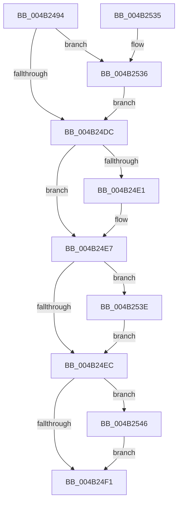

# CcPerfLogVolumeLogHandleInfo

- RVA: `0x004B2494`–`0x004B254E` (길이 `186` bytes)
- VA: `0x00000001404B2494`
- 실행 섹션: `.text`
- PDB 이름 있음: `예`; PDB Function 태그: `아니요`
- unwind 정보 RVA: `0x000B9338`
- 디코드: `54`개 명령, `186/186` bytes 표시
- 미해석 바이트: `0` (있으면 어셈블리에 `.byte`로 보존)

> 이 문서는 커널 이미지의 기계어와 PDB 기호를 분석해 생성했습니다. 4번과 5번은 함수 원형과 자료형을 바이너리 사용 방식에서 추정한 C 해석이며 원본 소스 복구 결과는 아닙니다.

## 1. Dependencies

- 직접 호출 지점: **2**; 고유 호출 대상: **2**
- 직접 호출자로 확인된 함수: **1**
- RIP 상대 이미지 참조: **1**

### Outgoing calls
- `0x004B251E` → [EtwTraceKernelEvent](../23/EtwTraceKernelEvent_function_00235350.md) (function, `0x00235350`)
- `0x004B252A` → [_security_check_cookie](../6A/_security_check_cookie_function_006AC640.md) (function, `0x006AC640`)

### Direct callers
- [CcPerfLogLoggedStreamsStats](CcPerfLogLoggedStreamsStats_function_004B2400.md) at `0x004B2461`

### Static image references
- `0x004B249D` → RVA `0x00E0A740` (`.data`; read)

## 2. Other-region calls and transfers

- 다른 실행 섹션으로 향하는 call: **0**
- 별도 외부 분기/꼬리 이동을 확인하지 못했습니다.

## 3. Assembly (complete function range)

```asm
004B2494  40 55                           push rbp
004B2496  48 8B EC                        mov rbp, rsp
004B2499  48 83 EC 70                     sub rsp, 0x70
004B249D  48 8B 05 9C 82 95 00            mov rax, qword ptr [rip + 0x95829c]
004B24A4  48 33 C4                        xor rax, rsp
004B24A7  48 89 45 F8                     mov qword ptr [rbp - 8], rax
004B24AB  48 8B 45 30                     mov rax, qword ptr [rbp + 0x30]
004B24AF  48 89 45 D0                     mov qword ptr [rbp - 0x30], rax
004B24B3  48 8B 45 38                     mov rax, qword ptr [rbp + 0x38]
004B24B7  48 89 45 D8                     mov qword ptr [rbp - 0x28], rax
004B24BB  48 89 4D C0                     mov qword ptr [rbp - 0x40], rcx
004B24BF  B9 01 00 00 00                  mov ecx, 1
004B24C4  84 D1                           test cl, dl
004B24C6  44 89 45 CC                     mov dword ptr [rbp - 0x34], r8d
004B24CA  4C 89 4D E0                     mov qword ptr [rbp - 0x20], r9
004B24CE  8D 41 FF                        lea eax, [rcx - 1]
004B24D1  0F 45 C1                        cmovne eax, ecx
004B24D4  89 45 C8                        mov dword ptr [rbp - 0x38], eax
004B24D7  F6 C2 02                        test dl, 2
004B24DA  75 5A                           jne 0x1404b2536
004B24DC  F6 C2 04                        test dl, 4
004B24DF  74 06                           je 0x1404b24e7
004B24E1  83 C8 04                        or eax, 4
004B24E4  89 45 C8                        mov dword ptr [rbp - 0x38], eax
004B24E7  F6 C2 10                        test dl, 0x10
004B24EA  75 52                           jne 0x1404b253e
004B24EC  F6 C2 08                        test dl, 8
004B24EF  75 55                           jne 0x1404b2546
004B24F1  83 65 F4 00                     and dword ptr [rbp - 0xc], 0
004B24F5  48 8D 45 C0                     lea rax, [rbp - 0x40]
004B24F9  8B D1                           mov edx, ecx
004B24FB  48 89 45 E8                     mov qword ptr [rbp - 0x18], rax
004B24FF  48 8D 4D E8                     lea rcx, [rbp - 0x18]
004B2503  C7 45 F0 28 00 00 00            mov dword ptr [rbp - 0x10], 0x28
004B250A  41 B9 0D 16 00 00               mov r9d, 0x160d
004B2510  C7 44 24 20 02 19 50 00         mov dword ptr [rsp + 0x20], 0x501902
004B2518  41 B8 00 00 02 80               mov r8d, 0x80020000
004B251E  E8 2D 2E D8 FF                  call 0x140235350
004B2523  48 8B 4D F8                     mov rcx, qword ptr [rbp - 8]
004B2527  48 33 CC                        xor rcx, rsp
004B252A  E8 11 A1 1F 00                  call 0x1406ac640
004B252F  48 83 C4 70                     add rsp, 0x70
004B2533  5D                              pop rbp
004B2534  C3                              ret
004B2535  CC                              int3
004B2536  83 C8 02                        or eax, 2
004B2539  89 45 C8                        mov dword ptr [rbp - 0x38], eax
004B253C  EB 9E                           jmp 0x1404b24dc
004B253E  83 C8 10                        or eax, 0x10
004B2541  89 45 C8                        mov dword ptr [rbp - 0x38], eax
004B2544  EB A6                           jmp 0x1404b24ec
004B2546  83 C8 08                        or eax, 8
004B2549  89 45 C8                        mov dword ptr [rbp - 0x38], eax
004B254C  EB A3                           jmp 0x1404b24f1
```

## 4. C-style interpretation (structured pseudocode)

```c
__int64 __fastcall CcPerfLogVolumeLogHandleInfo(__int64 a1, unsigned __int8 a2, int a3, __int64 a4, __int64 a5, __int64 a6)
{
    __int64 result;
    __int64 v_rsp;
    unsigned __int64 v_stack_m10;
    unsigned int v_stack_m14;
    unsigned int v_stack_m18;
    unsigned __int64 v_stack_m20;
    unsigned __int64 v_stack_m28;
    unsigned __int64 v_stack_m30;
    unsigned __int64 v_stack_m38;
    unsigned int v_stack_m3C;
    unsigned int v_stack_m40;
    unsigned __int64 v_stack_m48;
    unsigned int v_stack_m58;

    v_rsp = (v_rsp) - (112);
    result = (*(unsigned __int64 *)(v_rip + 9798300)) ^ (v_rsp);
    v_stack_m10 = result;
    v_stack_m38 = a5;
    v_stack_m30 = a6;
    v_stack_m48 = a1;
    v_stack_m3C = a3;
    v_stack_m28 = a4;
    result = 1 - 1;
    if (((1) & (a2)) != 0) { result = 1; }
    v_stack_m40 = (unsigned int)(result);
    if (((a2) & (2)) != 0) goto loc_004B2536;
loc_004B24DC:
    if (((a2) & (4)) != 0) {
        result = (unsigned int)((result) | (4));
        v_stack_m40 = (unsigned int)(result);
    }
    if (((a2) & (16)) != 0) goto loc_004B253E;
loc_004B24EC:
    if (((a2) & (8)) != 0) goto loc_004B2546;
loc_004B24F1:
    v_stack_m20 = v_stack_m48;
    v_stack_m18 = 40;
    v_stack_m58 = 0x501902ULL;
    result = EtwTraceKernelEvent(v_stack_m20, 1, (unsigned int)(0x80020000ULL), (unsigned int)(0x160DULL));
    a1 = (v_stack_m10) ^ (v_rsp);
    result = _security_check_cookie(a1, 1, (unsigned int)(0x80020000ULL), (unsigned int)(0x160DULL));
    v_rsp = (v_rsp) + (112);
    return result;
loc_004B2536:
    result = (unsigned int)((result) | (2));
    v_stack_m40 = (unsigned int)(result);
    goto loc_004B24DC;
loc_004B253E:
    result = (unsigned int)((result) | (16));
    v_stack_m40 = (unsigned int)(result);
    goto loc_004B24EC;
loc_004B2546:
    result = (unsigned int)((result) | (8));
    v_stack_m40 = (unsigned int)(result);
    goto loc_004B24F1;
}
```

## 5. (Beta) C Style

```c
int64_t CcPerfLogVolumeLogHandleInfo(int64_t Arg1, uint8_t Arg2, int32_t Arg3, int64_t Arg4, int64_t Arg5, int64_t Arg6)
{
    int64_t result;
    int64_t local_rsp;
    uint64_t v_stack_m10;
    uint32_t v_stack_m14;
    uint32_t v_stack_m18;
    uint64_t v_stack_m20;
    uint64_t v_stack_m28;
    uint64_t v_stack_m30;
    uint64_t v_stack_m38;
    uint32_t v_stack_m3C;
    uint32_t v_stack_m40;
    uint64_t v_stack_m48;
    uint32_t v_stack_m58;

    local_rsp = (local_rsp) - (112);
    result = (*(uint64_t *)(v_rip + 0x95829C)) ^ (local_rsp);
    v_stack_m10 = result;
    v_stack_m38 = Arg5;
    v_stack_m30 = Arg6;
    v_stack_m48 = Arg1;
    v_stack_m3C = Arg3;
    v_stack_m28 = Arg4;
    result = 1 - 1;
    if (((1) & (Arg2)) != 0) { result = 1; }
    v_stack_m40 = (uint32_t)(result);
    if (((Arg2) & (2)) != 0) goto loc_004B2536;
loc_004B24DC:
    if (((Arg2) & (4)) != 0) {
        result = (uint32_t)((result) | (4));
        v_stack_m40 = (uint32_t)(result);
    }
    if (((Arg2) & (16)) != 0) goto loc_004B253E;
loc_004B24EC:
    if (((Arg2) & (8)) != 0) goto loc_004B2546;
loc_004B24F1:
    v_stack_m20 = v_stack_m48;
    v_stack_m18 = 40;
    v_stack_m58 = 0x501902ULL;
    result = EtwTraceKernelEvent(v_stack_m20, 1, (uint32_t)(0x80020000ULL), (uint32_t)(0x160DULL));
    Arg1 = (v_stack_m10) ^ (local_rsp);
    result = _security_check_cookie(Arg1, 1, (uint32_t)(0x80020000ULL), (uint32_t)(0x160DULL));
    local_rsp = (local_rsp) + (112);
    return result;
loc_004B2536:
    result = (uint32_t)((result) | (2));
    v_stack_m40 = (uint32_t)(result);
    goto loc_004B24DC;
loc_004B253E:
    result = (uint32_t)((result) | (16));
    v_stack_m40 = (uint32_t)(result);
    goto loc_004B24EC;
loc_004B2546:
    result = (uint32_t)((result) | (8));
    v_stack_m40 = (uint32_t)(result);
    goto loc_004B24F1;
}
```

## 6. Execution-region graph

[열기: 2D/3D 그래프와 함수 탐색 컨트롤 패널](../../../control-panel.html?section=text&rva=0x004B2494&view=graph)

- 2D 그래프는 위에서 아래로 흐르고, 3D 그래프는 빈 공간을 드래그해 회전합니다. Shift+드래그는 이동, 휠은 확대·축소, 함수 노드 선택은 대상 보고서 이동입니다.

### Static fallback


