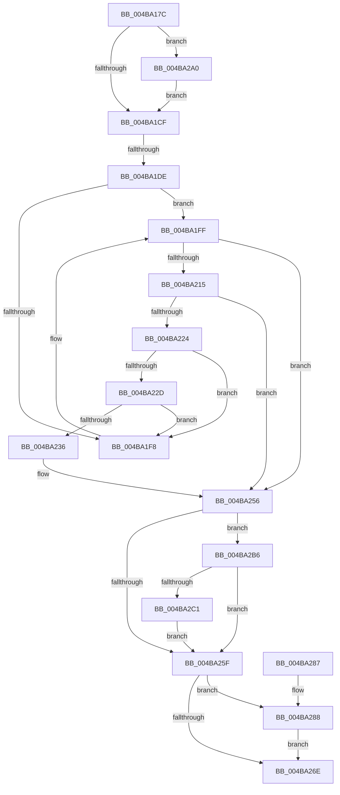

# CcPostWorkQueueAsyncLazywrite

- RVA: `0x004BA17C`–`0x004BA2D4` (길이 `344` bytes)
- VA: `0x00000001404BA17C`
- 실행 섹션: `.text`
- PDB 이름 있음: `예`; PDB Function 태그: `예`
- unwind 정보 RVA: `0x000BB354`
- 디코드: `91`개 명령, `344/344` bytes 표시
- 미해석 바이트: `0` (있으면 어셈블리에 `.byte`로 보존)

> 이 문서는 커널 이미지의 기계어와 PDB 기호를 분석해 생성했습니다. 4번과 5번은 함수 원형과 자료형을 바이너리 사용 방식에서 추정한 C 해석이며 원본 소스 복구 결과는 아닙니다.

## 1. Dependencies

- 직접 호출 지점: **6**; 고유 호출 대상: **6**
- 직접 호출자로 확인된 함수: **3**
- RIP 상대 이미지 참조: **1**

### Outgoing calls
- `0x004BA1EA` → [KeAcquireInStackQueuedSpinLock](../27/KeAcquireInStackQueuedSpinLock_function_002757A0.md) (function, `0x002757A0`)
- `0x004BA251` → [CcReferencePartitionAndPrivateVolumeCacheMap](../38/CcReferencePartitionAndPrivateVolumeCacheMap_function_0038B9E0.md) (function, `0x0038B9E0`)
- `0x004BA264` → [KeReleaseInStackQueuedSpinLock](../34/KeReleaseInStackQueuedSpinLock_function_00342CE0.md) (function, `0x00342CE0`)
- `0x004BA299` → [ExQueueWorkItemToPartition](../35/ExQueueWorkItemToPartition_function_00356E2C.md) (function, `0x00356E2C`)
- `0x004BA2AC` → [CcPerfLogWorkItemEnqueue](../35/CcPerfLogWorkItemEnqueue_function_00357340.md) (function, `0x00357340`)
- `0x004BA2CD` → [KeSetEvent](../33/KeSetEvent_function_0033F310.md) (function, `0x0033F310`)

### Direct callers
- [CcLazyWriteScanVolume](../38/CcLazyWriteScanVolume_function_00388DC0.md) at `0x00389176`
- [CcQueueAsyncLazywriteCompletion](../57/CcQueueAsyncLazywriteCompletion_function_0057FA60.md) at `0x0057FAC1`
- [sub_006E4FBA](../6E/Unknown_function_006E4FBA.md) at `0x006E5053`

### Static image references
- `0x004BA1A6` → RVA `0x00FC6B10` (`ALMOSTRO`; read)

## 2. Other-region calls and transfers

- 다른 실행 섹션으로 향하는 call: **0**
- call이 아닌 외부 분기/꼬리 이동: **1**
  - `0x004BA1D8` → [sub_006FC492](../6F/Unknown_function_006FC492.md) (`tail-transfer`)

## 3. Assembly (complete function range)

```asm
004BA17C  4C 8B DC                        mov r11, rsp
004BA17F  49 89 5B 08                     mov qword ptr [r11 + 8], rbx
004BA183  49 89 6B 10                     mov qword ptr [r11 + 0x10], rbp
004BA187  49 89 73 18                     mov qword ptr [r11 + 0x18], rsi
004BA18B  57                              push rdi
004BA18C  41 56                           push r14
004BA18E  41 57                           push r15
004BA190  48 83 EC 40                     sub rsp, 0x40
004BA194  4C 8B B1 88 00 00 00            mov r14, qword ptr [rcx + 0x88]
004BA19B  33 C0                           xor eax, eax
004BA19D  48 8B B1 98 00 00 00            mov rsi, qword ptr [rcx + 0x98]
004BA1A4  33 DB                           xor ebx, ebx
004BA1A6  F7 05 60 C9 B0 00 00 00 02 00   test dword ptr [rip + 0xb0c960], 0x20000
004BA1B0  0F 57 C0                        xorps xmm0, xmm0
004BA1B3  4C 8B B9 90 00 00 00            mov r15, qword ptr [rcx + 0x90]
004BA1BA  48 8B EA                        mov rbp, rdx
004BA1BD  0F 11 44 24 20                  movups xmmword ptr [rsp + 0x20], xmm0
004BA1C2  49 89 43 D8                     mov qword ptr [r11 - 0x28], rax
004BA1C6  48 8B F9                        mov rdi, rcx
004BA1C9  0F 85 D1 00 00 00               jne 0x1404ba2a0
004BA1CF  8B 87 80 00 00 00               mov eax, dword ptr [rdi + 0x80]
004BA1D5  83 F8 07                        cmp eax, 7
004BA1D8  0F 85 B4 22 24 00               jne 0x1406fc492
004BA1DE  49 8D 8E 40 03 00 00            lea rcx, [r14 + 0x340]
004BA1E5  48 8D 54 24 20                  lea rdx, [rsp + 0x20]
004BA1EA  E8 B1 B5 DB FF                  call 0x1402757a0
004BA1EF  48 8B 45 08                     mov rax, qword ptr [rbp + 8]
004BA1F3  48 39 28                        cmp qword ptr [rax], rbp
004BA1F6  74 07                           je 0x1404ba1ff
004BA1F8  B9 03 00 00 00                  mov ecx, 3
004BA1FD  CD 29                           int 0x29
004BA1FF  48 89 2F                        mov qword ptr [rdi], rbp
004BA202  48 89 47 08                     mov qword ptr [rdi + 8], rax
004BA206  48 89 38                        mov qword ptr [rax], rdi
004BA209  48 89 7D 08                     mov qword ptr [rbp + 8], rdi
004BA20D  38 9E C4 00 00 00               cmp byte ptr [rsi + 0xc4], bl
004BA213  75 41                           jne 0x1404ba256
004BA215  48 8D 86 20 01 00 00            lea rax, [rsi + 0x120]
004BA21C  48 8B 08                        mov rcx, qword ptr [rax]
004BA21F  48 3B C8                        cmp rcx, rax
004BA222  74 32                           je 0x1404ba256
004BA224  48 8B D9                        mov rbx, rcx
004BA227  48 39 41 08                     cmp qword ptr [rcx + 8], rax
004BA22B  75 CB                           jne 0x1404ba1f8
004BA22D  48 8B 09                        mov rcx, qword ptr [rcx]
004BA230  48 39 59 08                     cmp qword ptr [rcx + 8], rbx
004BA234  75 C2                           jne 0x1404ba1f8
004BA236  48 89 08                        mov qword ptr [rax], rcx
004BA239  49 8B D7                        mov rdx, r15
004BA23C  48 89 41 08                     mov qword ptr [rcx + 8], rax
004BA240  49 8B CE                        mov rcx, r14
004BA243  8B 86 30 01 00 00               mov eax, dword ptr [rsi + 0x130]
004BA249  FF C0                           inc eax
004BA24B  89 86 30 01 00 00               mov dword ptr [rsi + 0x130], eax
004BA251  E8 8A 17 ED FF                  call 0x14038b9e0
004BA256  80 BE C4 00 00 00 00            cmp byte ptr [rsi + 0xc4], 0
004BA25D  74 57                           je 0x1404ba2b6
004BA25F  48 8D 4C 24 20                  lea rcx, [rsp + 0x20]
004BA264  E8 77 8A E8 FF                  call 0x140342ce0
004BA269  48 85 DB                        test rbx, rbx
004BA26C  75 1A                           jne 0x1404ba288
004BA26E  48 8B 5C 24 60                  mov rbx, qword ptr [rsp + 0x60]
004BA273  48 8B 6C 24 68                  mov rbp, qword ptr [rsp + 0x68]
004BA278  48 8B 74 24 70                  mov rsi, qword ptr [rsp + 0x70]
004BA27D  48 83 C4 40                     add rsp, 0x40
004BA281  41 5F                           pop r15
004BA283  41 5E                           pop r14
004BA285  5F                              pop rdi
004BA286  C3                              ret
004BA287  CC                              int3
004BA288  48 83 23 00                     and qword ptr [rbx], 0
004BA28C  33 D2                           xor edx, edx
004BA28E  4D 8B 4E 08                     mov r9, qword ptr [r14 + 8]
004BA292  48 8B CB                        mov rcx, rbx
004BA295  44 8B 46 18                     mov r8d, dword ptr [rsi + 0x18]
004BA299  E8 8E CB E9 FF                  call 0x140356e2c
004BA29E  EB CE                           jmp 0x1404ba26e
004BA2A0  41 B1 01                        mov r9b, 1
004BA2A3  45 33 C0                        xor r8d, r8d
004BA2A6  48 8B D7                        mov rdx, rdi
004BA2A9  48 8B CD                        mov rcx, rbp
004BA2AC  E8 8F D0 E9 FF                  call 0x140357340
004BA2B1  E9 19 FF FF FF                  jmp 0x1404ba1cf
004BA2B6  41 8B 87 50 06 00 00            mov eax, dword ptr [r15 + 0x650]
004BA2BD  A8 02                           test al, 2
004BA2BF  74 9E                           je 0x1404ba25f
004BA2C1  48 8D 8E 48 01 00 00            lea rcx, [rsi + 0x148]
004BA2C8  45 33 C0                        xor r8d, r8d
004BA2CB  33 D2                           xor edx, edx
004BA2CD  E8 3E 50 E8 FF                  call 0x14033f310
004BA2D2  EB 8B                           jmp 0x1404ba25f
```

## 4. C-style interpretation (structured pseudocode)

```c
__int64 __fastcall CcPostWorkQueueAsyncLazywrite(__int64 a1, __int64 a2)
{
    __int64 result;
    __int64 v_rbx;
    __int64 v_rsp;
    unsigned __int64 v_stack_m38;
    unsigned __int64 v_stack_p10;
    unsigned __int64 v_stack_p18;
    unsigned __int64 v_stack_p8;

    *(unsigned __int64 *)(v_rsp + 8) = v_rbx;
    *(unsigned __int64 *)(v_rsp + 16) = v_rbp;
    *(unsigned __int64 *)(v_rsp + 24) = v_rsi;
    v_rsp = (v_rsp) - (64);
    result = 0;
    v_rbx = 0;
    v_stack_m38 = v_xmm0;
    *(unsigned __int64 *)(v_rsp - 40) = 0;
    if (((*(unsigned int *)(v_rip + 11585888)) & (0x20000ULL)) != 0) goto loc_004BA2A0;
loc_004BA1CF:
    result = KeAcquireInStackQueuedSpinLock(*(unsigned __int64 *)(a1 + 136) + 832, v_stack_m38, a3, a4);
    if ((*(unsigned __int64 *)(*(unsigned __int64 *)(a2 + 8))) != a2) {
        a1 = 3;
    }
    *(unsigned __int64 *)(a1) = a2;
    *(unsigned __int64 *)(a1 + 8) = *(unsigned __int64 *)(a2 + 8);
    *(unsigned __int64 *)(*(unsigned __int64 *)(a2 + 8)) = a1;
    *(unsigned __int64 *)(a2 + 8) = a1;
    if ((*(unsigned __int8 *)(*(unsigned __int64 *)(a1 + 152) + 196)) != 0) goto loc_004BA256;
    if ((*(unsigned __int64 *)(*(unsigned __int64 *)(a1 + 152) + 288)) == (*(unsigned __int64 *)(a1 + 152) + 288)) goto loc_004BA256;
    if ((*(unsigned __int64 *)(*(unsigned __int64 *)(*(unsigned __int64 *)(a1 + 152) + 288) + 8)) != (*(unsigned __int64 *)(a1 + 152) + 288)) goto loc_004BA1F8;
    if ((*(unsigned __int64 *)(*(unsigned __int64 *)(*(unsigned __int64 *)(*(unsigned __int64 *)(a1 + 152) + 288)) + 8)) != (*(unsigned __int64 *)(*(unsigned __int64 *)(a1 + 152) + 288))) goto loc_004BA1F8;
    *(unsigned __int64 *)(*(unsigned __int64 *)(a1 + 152) + 288) = *(unsigned __int64 *)(*(unsigned __int64 *)(*(unsigned __int64 *)(a1 + 152) + 288));
    *(unsigned __int64 *)(*(unsigned __int64 *)(*(unsigned __int64 *)(*(unsigned __int64 *)(a1 + 152) + 288)) + 8) = *(unsigned __int64 *)(a1 + 152) + 288;
    result = (unsigned int)(((unsigned int)(*(unsigned int *)(*(unsigned __int64 *)(a1 + 152) + 304))) + 1);
    *(unsigned int *)(*(unsigned __int64 *)(a1 + 152) + 304) = (unsigned int)(result);
    result = CcReferencePartitionAndPrivateVolumeCacheMap(*(unsigned __int64 *)(a1 + 136), *(unsigned __int64 *)(a1 + 144), a3, a4);
loc_004BA256:
    if ((*(unsigned __int8 *)(*(unsigned __int64 *)(a1 + 152) + 196)) == 0) goto loc_004BA2B6;
loc_004BA25F:
    result = KeReleaseInStackQueuedSpinLock(v_stack_m38, *(unsigned __int64 *)(a1 + 144), a3, a4);
    if (*(unsigned __int64 *)(*(unsigned __int64 *)(a1 + 152) + 288) != 0) goto loc_004BA288;
loc_004BA26E:
    v_rsp = (v_rsp) + (64);
    return result;
loc_004BA288:
    a2 = 0;
    result = ExQueueWorkItemToPartition(v_stack_p8, a2, (unsigned int)(*(unsigned int *)(v_stack_p18 + 24)), *(unsigned __int64 *)(*(unsigned __int64 *)(a1 + 136) + 8));
    goto loc_004BA26E;
loc_004BA2A0:
    a3 = 0;
    result = CcPerfLogWorkItemEnqueue(v_stack_p10, a1, a3, 1);
    goto loc_004BA1CF;
loc_004BA2B6:
    if ((((unsigned __int8)((unsigned int)(*(unsigned int *)(*(unsigned __int64 *)(a1 + 144) + 1616)))) & (2)) == 0) goto loc_004BA25F;
    a3 = 0;
    a2 = 0;
    result = KeSetEvent(v_stack_p18 + 328, a2, a3, 1);
    goto loc_004BA25F;
}
```

## 5. (Beta) C Style

```c
int64_t CcPostWorkQueueAsyncLazywrite(void *Arg1, void *Arg2)
{
    uint8_t *arg1 = (uint8_t *)Arg1;
    uint8_t *arg2 = (uint8_t *)Arg2;

    int64_t result;
    int64_t local_rbx;
    int64_t local_rsp;
    uint64_t v_stack_m38;
    uint64_t v_stack_p10;
    uint64_t v_stack_p18;
    uint64_t v_stack_p8;

    *(uint64_t *)(local_rsp + 0x8) = local_rbx;
    *(uint64_t *)(local_rsp + 0x10) = local_rbp;
    *(uint64_t *)(local_rsp + 0x18) = local_rsi;
    local_rsp = (local_rsp) - (64);
    result = 0;
    local_rbx = 0;
    v_stack_m38 = v_xmm0;
    *(uint64_t *)(local_rsp - 0x28) = 0;
    if (((*(uint32_t *)(v_rip + 0xB0C960)) & (0x20000ULL)) != 0) goto loc_004BA2A0;
loc_004BA1CF:
    result = KeAcquireInStackQueuedSpinLock(*(uint64_t *)(arg1 + 0x88) + 832, v_stack_m38, a3, a4);
    if ((*(uint64_t *)(*(uint64_t *)(arg2 + 0x8))) != Arg2) {
        Arg1 = 3;
    }
    *(void **)(arg1) = Arg2;
    *(uint64_t *)(arg1 + 0x8) = *(uint64_t *)(arg2 + 0x8);
    *(void **)(*(uint64_t *)(arg2 + 0x8)) = Arg1;
    *(void **)(arg2 + 0x8) = Arg1;
    if ((*(uint8_t *)(*(uint64_t *)(arg1 + 0x98) + 0xC4)) != 0) goto loc_004BA256;
    if ((*(uint64_t *)(*(uint64_t *)(arg1 + 0x98) + 0x120)) == (*(uint64_t *)(arg1 + 0x98) + 288)) goto loc_004BA256;
    if ((*(uint64_t *)(*(uint64_t *)(*(uint64_t *)(arg1 + 0x98) + 0x120) + 0x8)) != (*(uint64_t *)(arg1 + 0x98) + 288)) goto loc_004BA1F8;
    if ((*(uint64_t *)(*(uint64_t *)(*(uint64_t *)(*(uint64_t *)(arg1 + 0x98) + 0x120)) + 0x8)) != (*(uint64_t *)(*(uint64_t *)(arg1 + 0x98) + 0x120))) goto loc_004BA1F8;
    *(uint64_t *)(*(uint64_t *)(arg1 + 0x98) + 0x120) = *(uint64_t *)(*(uint64_t *)(*(uint64_t *)(arg1 + 0x98) + 0x120));
    *(uint64_t *)(*(uint64_t *)(*(uint64_t *)(*(uint64_t *)(arg1 + 0x98) + 0x120)) + 0x8) = *(uint64_t *)(arg1 + 0x98) + 288;
    result = (uint32_t)(((uint32_t)(*(uint32_t *)(*(uint64_t *)(arg1 + 0x98) + 0x130))) + 1);
    *(uint32_t *)(*(uint64_t *)(arg1 + 0x98) + 0x130) = (uint32_t)(result);
    result = CcReferencePartitionAndPrivateVolumeCacheMap(*(uint64_t *)(arg1 + 0x88), *(uint64_t *)(arg1 + 0x90), a3, a4);
loc_004BA256:
    if ((*(uint8_t *)(*(uint64_t *)(arg1 + 0x98) + 0xC4)) == 0) goto loc_004BA2B6;
loc_004BA25F:
    result = KeReleaseInStackQueuedSpinLock(v_stack_m38, *(uint64_t *)(arg1 + 0x90), a3, a4);
    if (*(uint64_t *)(*(uint64_t *)(arg1 + 0x98) + 0x120) != 0) goto loc_004BA288;
loc_004BA26E:
    local_rsp = (local_rsp) + (64);
    return result;
loc_004BA288:
    Arg2 = 0;
    result = ExQueueWorkItemToPartition(v_stack_p8, Arg2, (uint32_t)(*(uint32_t *)(v_stack_p18 + 0x18)), *(uint64_t *)(*(uint64_t *)(arg1 + 0x88) + 0x8));
    goto loc_004BA26E;
loc_004BA2A0:
    a3 = 0;
    result = CcPerfLogWorkItemEnqueue(v_stack_p10, Arg1, a3, 1);
    goto loc_004BA1CF;
loc_004BA2B6:
    if ((((uint8_t)((uint32_t)(*(uint32_t *)(*(uint64_t *)(arg1 + 0x90) + 0x650)))) & (2)) == 0) goto loc_004BA25F;
    a3 = 0;
    Arg2 = 0;
    result = KeSetEvent(v_stack_p18 + 328, Arg2, a3, 1);
    goto loc_004BA25F;
}
```

### 관측된 메모리 오프셋

구조체 형식이 확인되지 않은 접근은 인자 기준의 오프셋으로만 기록했습니다.

| 기준 인자 | 오프셋 표현 | 폭 (bit) | 접근 |
|---|---:|---:|---|
| `Arg1` | `+ 0x0` | `64` | `W` |
| `Arg1` | `+ 0x8` | `64` | `W` |
| `Arg1` | `+ 0x80` | `32` | `R` |
| `Arg1` | `+ 0x88` | `64` | `R` |
| `Arg1` | `+ 0x90` | `64` | `R` |
| `Arg1` | `+ 0x98` | `64` | `R` |
| `Arg2` | `+ 0x8` | `64` | `R` |
| `Arg2` | `+ 0x8` | `64` | `W` |

## 6. Execution-region graph

[열기: 2D/3D 그래프와 함수 탐색 컨트롤 패널](../../../control-panel.html?section=text&rva=0x004BA17C&view=graph)

- 2D 그래프는 위에서 아래로 흐르고, 3D 그래프는 빈 공간을 드래그해 회전합니다. Shift+드래그는 이동, 휠은 확대·축소, 함수 노드 선택은 대상 보고서 이동입니다.

### Static fallback


