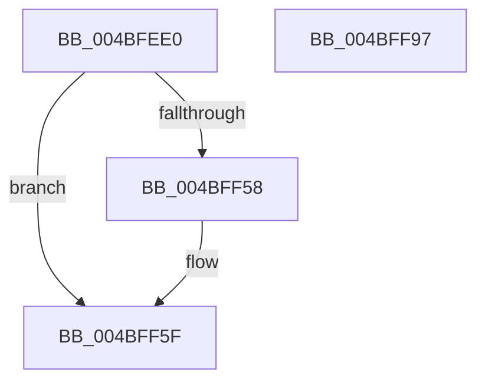

# CcQuickLazyWriteScanForVolume

- RVA: `0x004BFEE0`–`0x004BFF98` (길이 `184` bytes)
- VA: `0x00000001404BFEE0`
- 실행 섹션: `.text`
- PDB 이름 있음: `예`; PDB Function 태그: `아니요`
- unwind 정보 RVA: `0x0007D3C0`
- 디코드: `49`개 명령, `184/184` bytes 표시
- 미해석 바이트: `0` (있으면 어셈블리에 `.byte`로 보존)

> 이 문서는 커널 이미지의 기계어와 PDB 기호를 분석해 생성했습니다. 4번과 5번은 함수 원형과 자료형을 바이너리 사용 방식에서 추정한 C 해석이며 원본 소스 복구 결과는 아닙니다.

## 1. Dependencies

- 직접 호출 지점: **5**; 고유 호출 대상: **5**
- 직접 호출자로 확인된 함수: **0**
- RIP 상대 이미지 참조: **0**

### Outgoing calls
- `0x004BFF2A` → [CcLazyWriteScanVolume](../38/CcLazyWriteScanVolume_function_00388DC0.md) (function, `0x00388DC0`)
- `0x004BFF32` → [CcFreeWorkQueueEntry](../35/CcFreeWorkQueueEntry_function_0035723C.md) (function, `0x0035723C`)
- `0x004BFF43` → [KeAcquireInStackQueuedSpinLock](../27/KeAcquireInStackQueuedSpinLock_function_002757A0.md) (function, `0x002757A0`)
- `0x004BFF72` → [KeReleaseInStackQueuedSpinLock](../34/KeReleaseInStackQueuedSpinLock_function_00342CE0.md) (function, `0x00342CE0`)
- `0x004BFF7D` → [CcDereferencePartitionAndPrivateVolumeCacheMap](../38/CcDereferencePartitionAndPrivateVolumeCacheMap_function_0038B94C.md) (function, `0x0038B94C`)

### Direct callers
- 이 함수 시작 RVA로 연결되는 직접 call은 확인되지 않았습니다. 간접 호출은 완전히 역산할 수 없습니다.

### Static image references
- 디코드된 RIP-relative 메모리 참조가 없습니다.

## 2. Other-region calls and transfers

- 다른 실행 섹션으로 향하는 call: **0**
- 별도 외부 분기/꼬리 이동을 확인하지 못했습니다.

## 3. Assembly (complete function range)

```asm
004BFEE0  4C 8B DC                        mov r11, rsp
004BFEE3  49 89 5B 08                     mov qword ptr [r11 + 8], rbx
004BFEE7  49 89 6B 10                     mov qword ptr [r11 + 0x10], rbp
004BFEEB  49 89 73 18                     mov qword ptr [r11 + 0x18], rsi
004BFEEF  57                              push rdi
004BFEF0  48 83 EC 40                     sub rsp, 0x40
004BFEF4  48 8B 59 30                     mov rbx, qword ptr [rcx + 0x30]
004BFEF8  33 C0                           xor eax, eax
004BFEFA  48 8B 71 40                     mov rsi, qword ptr [rcx + 0x40]
004BFEFE  0F 57 C0                        xorps xmm0, xmm0
004BFF01  48 8B 69 38                     mov rbp, qword ptr [rcx + 0x38]
004BFF05  48 8B F9                        mov rdi, rcx
004BFF08  48 8B 51 48                     mov rdx, qword ptr [rcx + 0x48]
004BFF0C  4C 8B C3                        mov r8, rbx
004BFF0F  0F 11 44 24 20                  movups xmmword ptr [rsp + 0x20], xmm0
004BFF14  48 89 41 30                     mov qword ptr [rcx + 0x30], rax
004BFF18  48 8B CE                        mov rcx, rsi
004BFF1B  49 89 43 E8                     mov qword ptr [r11 - 0x18], rax
004BFF1F  44 8B 4B 10                     mov r9d, dword ptr [rbx + 0x10]
004BFF23  48 89 43 08                     mov qword ptr [rbx + 8], rax
004BFF27  48 89 03                        mov qword ptr [rbx], rax
004BFF2A  E8 91 8E EC FF                  call 0x140388dc0
004BFF2F  48 8B CB                        mov rcx, rbx
004BFF32  E8 05 73 E9 FF                  call 0x14035723c
004BFF37  48 8D 8D 40 03 00 00            lea rcx, [rbp + 0x340]
004BFF3E  48 8D 54 24 20                  lea rdx, [rsp + 0x20]
004BFF43  E8 58 58 DB FF                  call 0x1402757a0
004BFF48  48 8D 86 18 06 00 00            lea rax, [rsi + 0x618]
004BFF4F  48 8B 48 08                     mov rcx, qword ptr [rax + 8]
004BFF53  48 39 01                        cmp qword ptr [rcx], rax
004BFF56  74 07                           je 0x1404bff5f
004BFF58  B9 03 00 00 00                  mov ecx, 3
004BFF5D  CD 29                           int 0x29
004BFF5F  48 89 4F 08                     mov qword ptr [rdi + 8], rcx
004BFF63  48 89 07                        mov qword ptr [rdi], rax
004BFF66  48 89 39                        mov qword ptr [rcx], rdi
004BFF69  48 8D 4C 24 20                  lea rcx, [rsp + 0x20]
004BFF6E  48 89 78 08                     mov qword ptr [rax + 8], rdi
004BFF72  E8 69 2D E8 FF                  call 0x140342ce0
004BFF77  48 8B D6                        mov rdx, rsi
004BFF7A  48 8B CD                        mov rcx, rbp
004BFF7D  E8 CA B9 EC FF                  call 0x14038b94c
004BFF82  48 8B 5C 24 50                  mov rbx, qword ptr [rsp + 0x50]
004BFF87  48 8B 6C 24 58                  mov rbp, qword ptr [rsp + 0x58]
004BFF8C  48 8B 74 24 60                  mov rsi, qword ptr [rsp + 0x60]
004BFF91  48 83 C4 40                     add rsp, 0x40
004BFF95  5F                              pop rdi
004BFF96  C3                              ret
004BFF97  CC                              int3
```

## 4. C-style interpretation (structured pseudocode)

```c
__int64 __fastcall CcQuickLazyWriteScanForVolume(__int64 a1)
{
    __int64 result;
    __int64 v_rsp;
    unsigned __int64 v_stack_m28;
    unsigned __int64 v_stack_p10;
    unsigned __int64 v_stack_p18;
    unsigned __int64 v_stack_p8;

    *(unsigned __int64 *)(v_rsp + 8) = v_rbx;
    *(unsigned __int64 *)(v_rsp + 16) = v_rbp;
    *(unsigned __int64 *)(v_rsp + 24) = v_rsi;
    v_rsp = (v_rsp) - (64);
    result = 0;
    v_stack_m28 = v_xmm0;
    *(unsigned __int64 *)(a1 + 48) = 0;
    *(unsigned __int64 *)(v_rsp - 24) = 0;
    *(unsigned __int64 *)(*(unsigned __int64 *)(a1 + 48) + 8) = 0;
    *(unsigned __int64 *)(*(unsigned __int64 *)(a1 + 48)) = 0;
    result = CcLazyWriteScanVolume(*(unsigned __int64 *)(a1 + 64), *(unsigned __int64 *)(a1 + 72), *(unsigned __int64 *)(a1 + 48), (unsigned int)(*(unsigned int *)(*(unsigned __int64 *)(a1 + 48) + 16)));
    result = CcFreeWorkQueueEntry(*(unsigned __int64 *)(a1 + 48), *(unsigned __int64 *)(a1 + 72), *(unsigned __int64 *)(a1 + 48), (unsigned int)(*(unsigned int *)(*(unsigned __int64 *)(a1 + 48) + 16)));
    result = KeAcquireInStackQueuedSpinLock(*(unsigned __int64 *)(a1 + 56) + 832, v_stack_m28, *(unsigned __int64 *)(a1 + 48), (unsigned int)(*(unsigned int *)(*(unsigned __int64 *)(a1 + 48) + 16)));
    if ((*(unsigned __int64 *)(*(unsigned __int64 *)(*(unsigned __int64 *)(a1 + 64) + 1560 + 8))) != (*(unsigned __int64 *)(a1 + 64) + 1560)) {
        a1 = 3;
    }
    *(unsigned __int64 *)(a1 + 8) = a1;
    *(unsigned __int64 *)(a1) = *(unsigned __int64 *)(a1 + 64) + 1560;
    *(unsigned __int64 *)(a1) = a1;
    *(unsigned __int64 *)(*(unsigned __int64 *)(a1 + 64) + 1560 + 8) = a1;
    result = KeReleaseInStackQueuedSpinLock(v_stack_m28, v_stack_m28, *(unsigned __int64 *)(a1 + 48), (unsigned int)(*(unsigned int *)(*(unsigned __int64 *)(a1 + 48) + 16)));
    result = CcDereferencePartitionAndPrivateVolumeCacheMap(*(unsigned __int64 *)(a1 + 56), *(unsigned __int64 *)(a1 + 64), *(unsigned __int64 *)(a1 + 48), (unsigned int)(*(unsigned int *)(*(unsigned __int64 *)(a1 + 48) + 16)));
    v_rsp = (v_rsp) + (64);
    return result;
}
```

## 5. (Beta) C Style

```c
int64_t CcQuickLazyWriteScanForVolume(void *Arg1)
{
    uint8_t *arg1 = (uint8_t *)Arg1;

    int64_t result;
    int64_t local_rsp;
    uint64_t v_stack_m28;
    uint64_t v_stack_p10;
    uint64_t v_stack_p18;
    uint64_t v_stack_p8;

    *(uint64_t *)(local_rsp + 0x8) = local_rbx;
    *(uint64_t *)(local_rsp + 0x10) = local_rbp;
    *(uint64_t *)(local_rsp + 0x18) = local_rsi;
    local_rsp = (local_rsp) - (64);
    result = 0;
    v_stack_m28 = v_xmm0;
    *(uint64_t *)(arg1 + 0x30) = 0;
    *(uint64_t *)(local_rsp - 0x18) = 0;
    *(uint64_t *)(*(uint64_t *)(arg1 + 0x30) + 0x8) = 0;
    *(uint64_t *)(*(uint64_t *)(arg1 + 0x30)) = 0;
    result = CcLazyWriteScanVolume(*(uint64_t *)(arg1 + 0x40), *(uint64_t *)(arg1 + 0x48), *(uint64_t *)(arg1 + 0x30), (uint32_t)(*(uint32_t *)(*(uint64_t *)(arg1 + 0x30) + 0x10)));
    result = CcFreeWorkQueueEntry(*(uint64_t *)(arg1 + 0x30), *(uint64_t *)(arg1 + 0x48), *(uint64_t *)(arg1 + 0x30), (uint32_t)(*(uint32_t *)(*(uint64_t *)(arg1 + 0x30) + 0x10)));
    result = KeAcquireInStackQueuedSpinLock(*(uint64_t *)(arg1 + 0x38) + 832, v_stack_m28, *(uint64_t *)(arg1 + 0x30), (uint32_t)(*(uint32_t *)(*(uint64_t *)(arg1 + 0x30) + 0x10)));
    if ((*(uint64_t *)(*(uint64_t *)(*(uint64_t *)(arg1 + 0x40) + 0x618 + 0x8))) != (*(uint64_t *)(arg1 + 0x40) + 1560)) {
        Arg1 = 3;
    }
    *(void **)(arg1 + 0x8) = Arg1;
    *(uint64_t *)(arg1) = *(uint64_t *)(arg1 + 0x40) + 1560;
    *(void **)(arg1) = Arg1;
    *(void **)(*(uint64_t *)(arg1 + 0x40) + 0x618 + 0x8) = Arg1;
    result = KeReleaseInStackQueuedSpinLock(v_stack_m28, v_stack_m28, *(uint64_t *)(arg1 + 0x30), (uint32_t)(*(uint32_t *)(*(uint64_t *)(arg1 + 0x30) + 0x10)));
    result = CcDereferencePartitionAndPrivateVolumeCacheMap(*(uint64_t *)(arg1 + 0x38), *(uint64_t *)(arg1 + 0x40), *(uint64_t *)(arg1 + 0x30), (uint32_t)(*(uint32_t *)(*(uint64_t *)(arg1 + 0x30) + 0x10)));
    local_rsp = (local_rsp) + (64);
    return result;
}
```

### 관측된 메모리 오프셋

구조체 형식이 확인되지 않은 접근은 인자 기준의 오프셋으로만 기록했습니다.

| 기준 인자 | 오프셋 표현 | 폭 (bit) | 접근 |
|---|---:|---:|---|
| `Arg1` | `+ 0x0` | `64` | `W` |
| `Arg1` | `+ 0x8` | `64` | `W` |
| `Arg1` | `+ 0x30` | `64` | `R` |
| `Arg1` | `+ 0x30` | `64` | `W` |
| `Arg1` | `+ 0x38` | `64` | `R` |
| `Arg1` | `+ 0x40` | `64` | `R` |
| `Arg1` | `+ 0x48` | `64` | `R` |

## 6. Execution-region graph

[열기: 2D/3D 그래프와 함수 탐색 컨트롤 패널](../../../control-panel.html?section=text&rva=0x004BFEE0&view=graph)

- 2D 그래프는 위에서 아래로 흐르고, 3D 그래프는 빈 공간을 드래그해 회전합니다. Shift+드래그는 이동, 휠은 확대·축소, 함수 노드 선택은 대상 보고서 이동입니다.

### Static fallback


