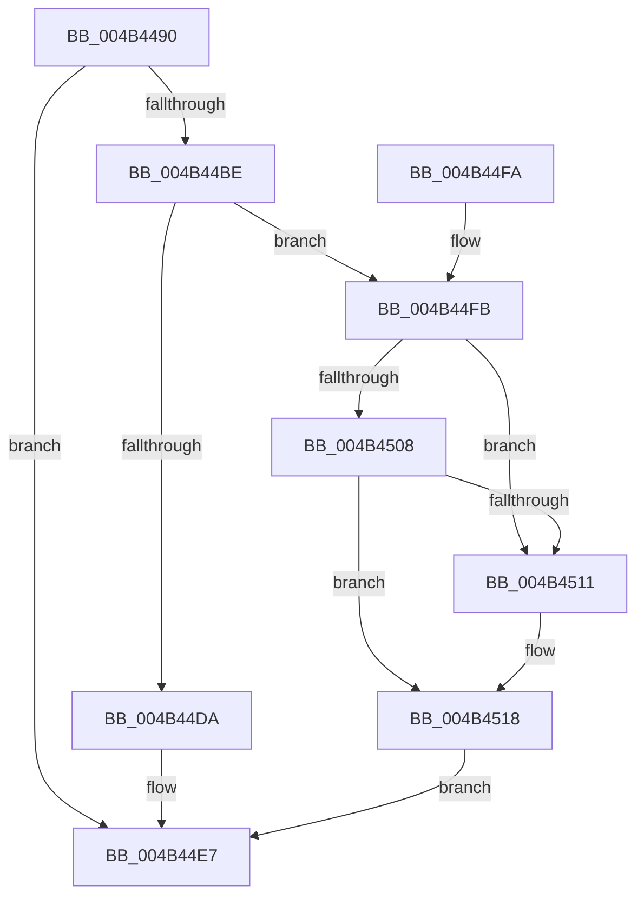

# CcSerializeWithLazyWriter

- RVA: `0x004B4490`–`0x004B454B` (길이 `187` bytes)
- VA: `0x00000001404B4490`
- 실행 섹션: `.text`
- PDB 이름 있음: `예`; PDB Function 태그: `아니요`
- unwind 정보 RVA: `0x000B9E60`
- 디코드: `50`개 명령, `187/187` bytes 표시
- 미해석 바이트: `0` (있으면 어셈블리에 `.byte`로 보존)

> 이 문서는 커널 이미지의 기계어와 PDB 기호를 분석해 생성했습니다. 4번과 5번은 함수 원형과 자료형을 바이너리 사용 방식에서 추정한 C 해석이며 원본 소스 복구 결과는 아닙니다.

## 1. Dependencies

- 직접 호출 지점: **4**; 고유 호출 대상: **3**
- 직접 호출자로 확인된 함수: **1**
- RIP 상대 이미지 참조: **0**

### Outgoing calls
- `0x004B44C9` → [KeAcquireInStackQueuedSpinLockAtDpcLevel](../27/KeAcquireInStackQueuedSpinLockAtDpcLevel_function_00275740.md) (function, `0x00275740`)
- `0x004B44DF` → [KeReleaseInStackQueuedSpinLockFromDpcLevel](../21/KeReleaseInStackQueuedSpinLockFromDpcLevel_function_002171B0.md) (function, `0x002171B0`)
- `0x004B453C` → [KeReleaseInStackQueuedSpinLockFromDpcLevel](../21/KeReleaseInStackQueuedSpinLockFromDpcLevel_function_002171B0.md) (function, `0x002171B0`)
- `0x004B4544` → [CcFreeWorkQueueEntry](../35/CcFreeWorkQueueEntry_function_0035723C.md) (function, `0x0035723C`)

### Direct callers
- [CcFlushCachePreProcess](../35/CcFlushCachePreProcess_function_0035A9B0.md) at `0x0035AF81`

### Static image references
- 디코드된 RIP-relative 메모리 참조가 없습니다.

## 2. Other-region calls and transfers

- 다른 실행 섹션으로 향하는 call: **0**
- 별도 외부 분기/꼬리 이동을 확인하지 못했습니다.

## 3. Assembly (complete function range)

```asm
004B4490  4C 8B DC                        mov r11, rsp
004B4493  49 89 5B 08                     mov qword ptr [r11 + 8], rbx
004B4497  49 89 73 10                     mov qword ptr [r11 + 0x10], rsi
004B449B  57                              push rdi
004B449C  48 83 EC 40                     sub rsp, 0x40
004B44A0  33 C0                           xor eax, eax
004B44A2  0F 57 C0                        xorps xmm0, xmm0
004B44A5  0F 11 44 24 20                  movups xmmword ptr [rsp + 0x20], xmm0
004B44AA  49 89 43 E8                     mov qword ptr [r11 - 0x18], rax
004B44AE  48 8B F2                        mov rsi, rdx
004B44B1  8B 82 98 00 00 00               mov eax, dword ptr [rdx + 0x98]
004B44B7  40 B7 01                        mov dil, 1
004B44BA  A8 20                           test al, 0x20
004B44BC  74 29                           je 0x1404b44e7
004B44BE  48 81 C1 40 03 00 00            add rcx, 0x340
004B44C5  49 8D 53 D8                     lea rdx, [r11 - 0x28]
004B44C9  E8 72 12 DC FF                  call 0x140275740
004B44CE  48 8B 9E F8 01 00 00            mov rbx, qword ptr [rsi + 0x1f8]
004B44D5  48 85 DB                        test rbx, rbx
004B44D8  75 21                           jne 0x1404b44fb
004B44DA  48 8D 4C 24 20                  lea rcx, [rsp + 0x20]
004B44DF  E8 CC 2C D6 FF                  call 0x1402171b0
004B44E4  40 32 FF                        xor dil, dil
004B44E7  48 8B 5C 24 50                  mov rbx, qword ptr [rsp + 0x50]
004B44EC  40 8A C7                        mov al, dil
004B44EF  48 8B 74 24 58                  mov rsi, qword ptr [rsp + 0x58]
004B44F4  48 83 C4 40                     add rsp, 0x40
004B44F8  5F                              pop rdi
004B44F9  C3                              ret
004B44FA  CC                              int3
004B44FB  48 83 E3 FE                     and rbx, 0xfffffffffffffffe
004B44FF  48 8B 0B                        mov rcx, qword ptr [rbx]
004B4502  48 39 59 08                     cmp qword ptr [rcx + 8], rbx
004B4506  75 09                           jne 0x1404b4511
004B4508  48 8B 43 08                     mov rax, qword ptr [rbx + 8]
004B450C  48 39 18                        cmp qword ptr [rax], rbx
004B450F  74 07                           je 0x1404b4518
004B4511  B9 03 00 00 00                  mov ecx, 3
004B4516  CD 29                           int 0x29
004B4518  48 89 08                        mov qword ptr [rax], rcx
004B451B  48 89 41 08                     mov qword ptr [rcx + 8], rax
004B451F  48 8D 4C 24 20                  lea rcx, [rsp + 0x20]
004B4524  48 83 63 08 00                  and qword ptr [rbx + 8], 0
004B4529  48 83 23 00                     and qword ptr [rbx], 0
004B452D  48 83 A6 F8 01 00 00 00         and qword ptr [rsi + 0x1f8], 0
004B4535  83 A6 98 00 00 00 DF            and dword ptr [rsi + 0x98], 0xffffffdf
004B453C  E8 6F 2C D6 FF                  call 0x1402171b0
004B4541  48 8B CB                        mov rcx, rbx
004B4544  E8 F3 2C EA FF                  call 0x14035723c
004B4549  EB 9C                           jmp 0x1404b44e7
```

## 4. C-style interpretation (structured pseudocode)

```c
__int64 __fastcall CcSerializeWithLazyWriter(__int64 a1, __int64 a2)
{
    __int64 result;
    __int64 v_rbx;
    __int64 v_rdi;
    __int64 v_rsp;
    unsigned __int64 v_stack_m28;
    unsigned __int64 v_stack_p10;
    unsigned __int64 v_stack_p20;
    unsigned __int64 v_stack_p8;

    *(unsigned __int64 *)(v_rsp + 8) = v_rbx;
    *(unsigned __int64 *)(v_rsp + 16) = v_rsi;
    v_rsp = (v_rsp) - (64);
    result = 0;
    v_stack_m28 = v_xmm0;
    *(unsigned __int64 *)(v_rsp - 24) = 0;
    if ((((unsigned __int8)((unsigned int)(*(unsigned int *)(a2 + 152)))) & (32)) == 0) goto loc_004B44E7;
    a1 = (a1) + (832);
    result = KeAcquireInStackQueuedSpinLockAtDpcLevel(a1, v_rsp - 40, a3, a4);
    if (*(unsigned __int64 *)(a2 + 504) != 0) goto loc_004B44FB;
    result = KeReleaseInStackQueuedSpinLockFromDpcLevel(v_stack_m28, v_rsp - 40, a3, a4);
    v_rdi = 0;
loc_004B44E7:
    v_rsp = (v_rsp) + (64);
    return 0;
loc_004B44FB:
    v_rbx = (v_stack_p8) & (-2);
    if ((*(unsigned __int64 *)(*(unsigned __int64 *)(v_rbx) + 8)) != v_rbx) goto loc_004B4511;
    if ((*(unsigned __int64 *)(*(unsigned __int64 *)(v_rbx + 8))) != v_rbx) {
        a1 = 3;
    }
    *(unsigned __int64 *)(*(unsigned __int64 *)(v_rbx + 8)) = a1;
    *(unsigned __int64 *)(a1 + 8) = *(unsigned __int64 *)(v_rbx + 8);
    result = KeReleaseInStackQueuedSpinLockFromDpcLevel(v_stack_p20, v_rsp - 40, a3, a4);
    result = CcFreeWorkQueueEntry(v_rbx, v_rsp - 40, a3, a4);
    goto loc_004B44E7;
}
```

## 5. (Beta) C Style

```c
int64_t CcSerializeWithLazyWriter(int64_t Arg1, void *Arg2)
{
    uint8_t *arg2 = (uint8_t *)Arg2;

    int64_t result;
    int64_t local_rbx;
    int64_t local_rdi;
    int64_t local_rsp;
    uint64_t v_stack_m28;
    uint64_t v_stack_p10;
    uint64_t v_stack_p20;
    uint64_t v_stack_p8;

    *(uint64_t *)(local_rsp + 0x8) = local_rbx;
    *(uint64_t *)(local_rsp + 0x10) = local_rsi;
    local_rsp = (local_rsp) - (64);
    result = 0;
    v_stack_m28 = v_xmm0;
    *(uint64_t *)(local_rsp - 0x18) = 0;
    if ((((uint8_t)((uint32_t)(*(uint32_t *)(arg2 + 0x98)))) & (32)) == 0) goto loc_004B44E7;
    Arg1 = (Arg1) + (832);
    result = KeAcquireInStackQueuedSpinLockAtDpcLevel(Arg1, local_rsp - 40, a3, a4);
    if (*(uint64_t *)(arg2 + 0x1F8) != 0) goto loc_004B44FB;
    result = KeReleaseInStackQueuedSpinLockFromDpcLevel(v_stack_m28, local_rsp - 40, a3, a4);
    local_rdi = 0;
loc_004B44E7:
    local_rsp = (local_rsp) + (64);
    return 0;
loc_004B44FB:
    local_rbx = (v_stack_p8) & (-2);
    if ((*(uint64_t *)(*(uint64_t *)(local_rbx) + 0x8)) != local_rbx) goto loc_004B4511;
    if ((*(uint64_t *)(*(uint64_t *)(local_rbx + 0x8))) != local_rbx) {
        Arg1 = 3;
    }
    *(uint64_t *)(*(uint64_t *)(local_rbx + 0x8)) = Arg1;
    *(uint64_t *)(Arg1 + 0x8) = *(uint64_t *)(local_rbx + 0x8);
    result = KeReleaseInStackQueuedSpinLockFromDpcLevel(v_stack_p20, local_rsp - 40, a3, a4);
    result = CcFreeWorkQueueEntry(local_rbx, local_rsp - 40, a3, a4);
    goto loc_004B44E7;
}
```

### 관측된 메모리 오프셋

구조체 형식이 확인되지 않은 접근은 인자 기준의 오프셋으로만 기록했습니다.

| 기준 인자 | 오프셋 표현 | 폭 (bit) | 접근 |
|---|---:|---:|---|
| `Arg2` | `+ 0x98` | `32` | `R` |
| `Arg2` | `+ 0x98` | `32` | `R/W` |
| `Arg2` | `+ 0x1F8` | `64` | `R` |
| `Arg2` | `+ 0x1F8` | `64` | `R/W` |

## 6. Execution-region graph

[열기: 2D/3D 그래프와 함수 탐색 컨트롤 패널](../../../control-panel.html?section=text&rva=0x004B4490&view=graph)

- 2D 그래프는 위에서 아래로 흐르고, 3D 그래프는 빈 공간을 드래그해 회전합니다. Shift+드래그는 이동, 휠은 확대·축소, 함수 노드 선택은 대상 보고서 이동입니다.

### Static fallback


