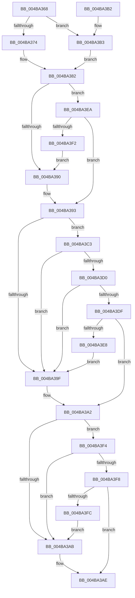

# CcShouldIssueVDLUpdate

- RVA: `0x004BA368`–`0x004BA3FE` (길이 `150` bytes)
- VA: `0x00000001404BA368`
- 실행 섹션: `.text`
- PDB 이름 있음: `예`; PDB Function 태그: `아니요`
- unwind 정보 RVA: `0x000DB714`
- 디코드: `42`개 명령, `150/150` bytes 표시
- 미해석 바이트: `0` (있으면 어셈블리에 `.byte`로 보존)

> 이 문서는 커널 이미지의 기계어와 PDB 기호를 분석해 생성했습니다. 4번과 5번은 함수 원형과 자료형을 바이너리 사용 방식에서 추정한 C 해석이며 원본 소스 복구 결과는 아닙니다.

## 1. Dependencies

- 직접 호출 지점: **0**; 고유 호출 대상: **0**
- 직접 호출자로 확인된 함수: **1**
- RIP 상대 이미지 참조: **1**

### Outgoing calls
- 직접 디코드된 call 명령이 없습니다.

### Direct callers
- [CcWriteBehindPostProcess](../35/CcWriteBehindPostProcess_function_00357BB4.md) at `0x00357C4B`

### Static image references
- `0x004BA36B` → RVA `0x00E65B88` (`.data`; read)

## 2. Other-region calls and transfers

- 다른 실행 섹션으로 향하는 call: **0**
- 별도 외부 분기/꼬리 이동을 확인하지 못했습니다.

## 3. Assembly (complete function range)

```asm
004BA368  45 33 D2                        xor r10d, r10d
004BA36B  44 38 15 16 B8 9A 00            cmp byte ptr [rip + 0x9ab816], r10b
004BA372  74 3F                           je 0x1404ba3b3
004BA374  48 8B 91 58 02 00 00            mov rdx, qword ptr [rcx + 0x258]
004BA37B  48 81 C2 50 04 00 00            add rdx, 0x450
004BA382  8B 41 04                        mov eax, dword ptr [rcx + 4]
004BA385  41 B8 01 00 00 00               mov r8d, 1
004BA38B  41 3B C0                        cmp eax, r8d
004BA38E  77 5A                           ja 0x1404ba3ea
004BA390  41 8A D2                        mov dl, r10b
004BA393  F7 81 98 00 00 00 00 04 00 00   test dword ptr [rcx + 0x98], 0x400
004BA39D  75 24                           jne 0x1404ba3c3
004BA39F  41 8A C2                        mov al, r10b
004BA3A2  44 39 91 0C 02 00 00            cmp dword ptr [rcx + 0x20c], r10d
004BA3A9  74 49                           je 0x1404ba3f4
004BA3AB  45 8A C2                        mov r8b, r10b
004BA3AE  41 8A C0                        mov al, r8b
004BA3B1  C3                              ret
004BA3B2  CC                              int3
004BA3B3  48 8B 91 18 02 00 00            mov rdx, qword ptr [rcx + 0x218]
004BA3BA  48 81 C2 90 04 00 00            add rdx, 0x490
004BA3C1  EB BF                           jmp 0x1404ba382
004BA3C3  48 8B 41 30                     mov rax, qword ptr [rcx + 0x30]
004BA3C7  4C 8B 49 28                     mov r9, qword ptr [rcx + 0x28]
004BA3CB  49 3B C1                        cmp rax, r9
004BA3CE  7C CF                           jl 0x1404ba39f
004BA3D0  48 B8 FF FF FF FF FF FF FF 7F   movabs rax, 0x7fffffffffffffff
004BA3DA  4C 3B C8                        cmp r9, rax
004BA3DD  74 C0                           je 0x1404ba39f
004BA3DF  41 8A C0                        mov al, r8b
004BA3E2  4C 39 51 08                     cmp qword ptr [rcx + 8], r10
004BA3E6  75 BA                           jne 0x1404ba3a2
004BA3E8  EB B5                           jmp 0x1404ba39f
004BA3EA  48 39 12                        cmp qword ptr [rdx], rdx
004BA3ED  41 8A D0                        mov dl, r8b
004BA3F0  75 A1                           jne 0x1404ba393
004BA3F2  EB 9C                           jmp 0x1404ba390
004BA3F4  84 C0                           test al, al
004BA3F6  74 B3                           je 0x1404ba3ab
004BA3F8  84 D2                           test dl, dl
004BA3FA  74 B2                           je 0x1404ba3ae
004BA3FC  EB AD                           jmp 0x1404ba3ab
```

## 4. C-style interpretation (structured pseudocode)

```c
__int64 __fastcall CcShouldIssueVDLUpdate(__int64 a1)
{
    __int64 v_r10;

    v_r10 = 0;
    if ((*(unsigned __int8 *)(v_rip + 10139670)) == 0) goto loc_004BA3B3;
    a2 = (*(unsigned __int64 *)(a1 + 600)) + (0x450ULL);
loc_004BA382:
    if (((unsigned int)((unsigned int)(*(unsigned int *)(a1 + 4)))) > 1) goto loc_004BA3EA;
loc_004BA390:
loc_004BA393:
    if (((*(unsigned int *)(a1 + 152)) & (0x400ULL)) != 0) goto loc_004BA3C3;
loc_004BA39F:
loc_004BA3A2:
    if ((*(unsigned int *)(a1 + 524)) == 0) goto loc_004BA3F4;
loc_004BA3AB:
loc_004BA3AE:
    return 0;
loc_004BA3B3:
    a2 = (*(unsigned __int64 *)(a1 + 536)) + (0x490ULL);
    goto loc_004BA382;
loc_004BA3C3:
    if ((*(unsigned __int64 *)(a1 + 48)) < (*(unsigned __int64 *)(a1 + 40))) goto loc_004BA39F;
    if ((*(unsigned __int64 *)(a1 + 40)) == (*(unsigned __int64 *)(a1 + 48))) goto loc_004BA39F;
    if ((*(unsigned __int64 *)(a1 + 8)) != 0) goto loc_004BA3A2;
    goto loc_004BA39F;
loc_004BA3EA:
    if ((*(unsigned __int64 *)(a2)) != a2) goto loc_004BA393;
    goto loc_004BA390;
loc_004BA3F4:
    if (0 == 0) goto loc_004BA3AB;
    if (0 == 0) goto loc_004BA3AE;
    goto loc_004BA3AB;
}
```

## 5. (Beta) C Style

```c
int64_t CcShouldIssueVDLUpdate(void *Arg1)
{
    uint8_t *arg1 = (uint8_t *)Arg1;

    int64_t local_r10;

    local_r10 = 0;
    if ((*(uint8_t *)(v_rip + 0x9AB816)) == 0) goto loc_004BA3B3;
    a2 = (*(uint64_t *)(arg1 + 0x258)) + (0x450ULL);
loc_004BA382:
    if (((uint32_t)((uint32_t)(*(uint32_t *)(arg1 + 0x4)))) > 1) goto loc_004BA3EA;
loc_004BA390:
loc_004BA393:
    if (((*(uint32_t *)(arg1 + 0x98)) & (0x400ULL)) != 0) goto loc_004BA3C3;
loc_004BA39F:
loc_004BA3A2:
    if ((*(uint32_t *)(arg1 + 0x20C)) == 0) goto loc_004BA3F4;
loc_004BA3AB:
loc_004BA3AE:
    return 0;
loc_004BA3B3:
    a2 = (*(uint64_t *)(arg1 + 0x218)) + (0x490ULL);
    goto loc_004BA382;
loc_004BA3C3:
    if ((*(uint64_t *)(arg1 + 0x30)) < (*(uint64_t *)(arg1 + 0x28))) goto loc_004BA39F;
    if ((*(uint64_t *)(arg1 + 0x28)) == (*(uint64_t *)(arg1 + 0x30))) goto loc_004BA39F;
    if ((*(uint64_t *)(arg1 + 0x8)) != 0) goto loc_004BA3A2;
    goto loc_004BA39F;
loc_004BA3EA:
    if ((*(uint64_t *)(a2)) != a2) goto loc_004BA393;
    goto loc_004BA390;
loc_004BA3F4:
    if (0 == 0) goto loc_004BA3AB;
    if (0 == 0) goto loc_004BA3AE;
    goto loc_004BA3AB;
}
```

### 관측된 메모리 오프셋

구조체 형식이 확인되지 않은 접근은 인자 기준의 오프셋으로만 기록했습니다.

| 기준 인자 | 오프셋 표현 | 폭 (bit) | 접근 |
|---|---:|---:|---|
| `Arg1` | `+ 0x4` | `32` | `R` |
| `Arg1` | `+ 0x8` | `64` | `R` |
| `Arg1` | `+ 0x28` | `64` | `R` |
| `Arg1` | `+ 0x30` | `64` | `R` |
| `Arg1` | `+ 0x98` | `32` | `R` |
| `Arg1` | `+ 0x20C` | `32` | `R` |
| `Arg1` | `+ 0x218` | `64` | `R` |
| `Arg1` | `+ 0x258` | `64` | `R` |

## 6. Execution-region graph

[열기: 2D/3D 그래프와 함수 탐색 컨트롤 패널](../../../control-panel.html?section=text&rva=0x004BA368&view=graph)

- 2D 그래프는 위에서 아래로 흐르고, 3D 그래프는 빈 공간을 드래그해 회전합니다. Shift+드래그는 이동, 휠은 확대·축소, 함수 노드 선택은 대상 보고서 이동입니다.

### Static fallback


