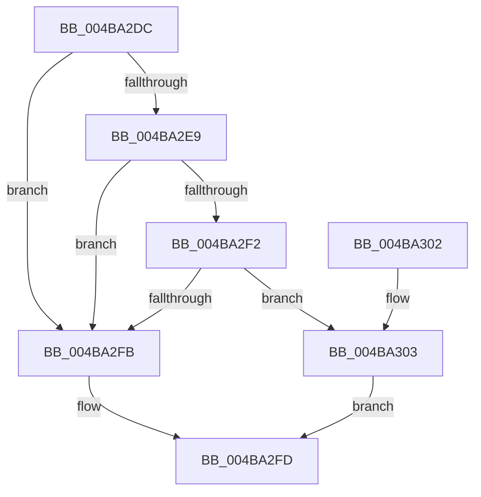

# CcUnmapInactiveViews

- RVA: `0x004BA2DC`–`0x004BA30A` (길이 `46` bytes)
- VA: `0x00000001404BA2DC`
- 실행 섹션: `.text`
- PDB 이름 있음: `예`; PDB Function 태그: `아니요`
- unwind 정보 RVA: `0x0005CEE8`
- 디코드: `14`개 명령, `46/46` bytes 표시
- 미해석 바이트: `0` (있으면 어셈블리에 `.byte`로 보존)

> 이 문서는 커널 이미지의 기계어와 PDB 기호를 분석해 생성했습니다. 4번과 5번은 함수 원형과 자료형을 바이너리 사용 방식에서 추정한 C 해석이며 원본 소스 복구 결과는 아닙니다.

## 1. Dependencies

- 직접 호출 지점: **1**; 고유 호출 대상: **1**
- 직접 호출자로 확인된 함수: **3**
- RIP 상대 이미지 참조: **2**

### Outgoing calls
- `0x004BA303` → [CcUnmapInactiveViewsInternal](../27/CcUnmapInactiveViewsInternal_function_0027174C.md) (function, `0x0027174C`)

### Direct callers
- [sub_00238DB5](../23/Unknown_function_00238DB5.md) at `0x00238DCF`
- [MiSegmentDereferenceWorker](../46/MiSegmentDereferenceWorker_function_00464D40.md) at `0x00464DC0`
- [MiReduceSystemCache](../67/MiReduceSystemCache_function_006784F4.md) at `0x0067852F`

### Static image references
- `0x004BA2E0` → RVA `0x00E65B50` (`.data`; read)
- `0x004BA2E9` → RVA `0x00E65B8C` (`.data`; read)

## 2. Other-region calls and transfers

- 다른 실행 섹션으로 향하는 call: **0**
- 별도 외부 분기/꼬리 이동을 확인하지 못했습니다.

## 3. Assembly (complete function range)

```asm
004BA2DC  48 83 EC 28                     sub rsp, 0x28
004BA2E0  83 3D 69 B8 9A 00 00            cmp dword ptr [rip + 0x9ab869], 0
004BA2E7  74 12                           je 0x1404ba2fb
004BA2E9  83 3D 9C B8 9A 00 00            cmp dword ptr [rip + 0x9ab89c], 0
004BA2F0  74 09                           je 0x1404ba2fb
004BA2F2  48 8B 49 08                     mov rcx, qword ptr [rcx + 8]
004BA2F6  48 85 C9                        test rcx, rcx
004BA2F9  75 08                           jne 0x1404ba303
004BA2FB  33 C0                           xor eax, eax
004BA2FD  48 83 C4 28                     add rsp, 0x28
004BA301  C3                              ret
004BA302  CC                              int3
004BA303  E8 44 74 DB FF                  call 0x14027174c
004BA308  EB F3                           jmp 0x1404ba2fd
```

## 4. C-style interpretation (structured pseudocode)

```c
__int64 __fastcall CcUnmapInactiveViews(__int64 a1)
{
    __int64 result;
    __int64 v_rsp;

    v_rsp = (v_rsp) - (40);
    if ((*(unsigned int *)(v_rip + 10139753)) == 0) goto loc_004BA2FB;
    if ((*(unsigned int *)(v_rip + 10139804)) == 0) goto loc_004BA2FB;
    if (*(unsigned __int64 *)(a1 + 8) != 0) goto loc_004BA303;
loc_004BA2FB:
    result = 0;
loc_004BA2FD:
    v_rsp = (v_rsp) + (40);
    return result;
loc_004BA303:
    result = CcUnmapInactiveViewsInternal(*(unsigned __int64 *)(a1 + 8), a2, a3, a4);
    goto loc_004BA2FD;
}
```

## 5. (Beta) C Style

```c
int64_t CcUnmapInactiveViews(void *Arg1)
{
    uint8_t *arg1 = (uint8_t *)Arg1;

    int64_t result;
    int64_t local_rsp;

    local_rsp = (local_rsp) - (40);
    if ((*(uint32_t *)(v_rip + 0x9AB869)) == 0) goto loc_004BA2FB;
    if ((*(uint32_t *)(v_rip + 0x9AB89C)) == 0) goto loc_004BA2FB;
    if (*(uint64_t *)(arg1 + 0x8) != 0) goto loc_004BA303;
loc_004BA2FB:
    result = 0;
loc_004BA2FD:
    local_rsp = (local_rsp) + (40);
    return result;
loc_004BA303:
    result = CcUnmapInactiveViewsInternal(*(uint64_t *)(arg1 + 0x8), a2, a3, a4);
    goto loc_004BA2FD;
}
```

### 관측된 메모리 오프셋

구조체 형식이 확인되지 않은 접근은 인자 기준의 오프셋으로만 기록했습니다.

| 기준 인자 | 오프셋 표현 | 폭 (bit) | 접근 |
|---|---:|---:|---|
| `Arg1` | `+ 0x8` | `64` | `R` |

## 6. Execution-region graph

[열기: 2D/3D 그래프와 함수 탐색 컨트롤 패널](../../../control-panel.html?section=text&rva=0x004BA2DC&view=graph)

- 2D 그래프는 위에서 아래로 흐르고, 3D 그래프는 빈 공간을 드래그해 회전합니다. Shift+드래그는 이동, 휠은 확대·축소, 함수 노드 선택은 대상 보고서 이동입니다.

### Static fallback


